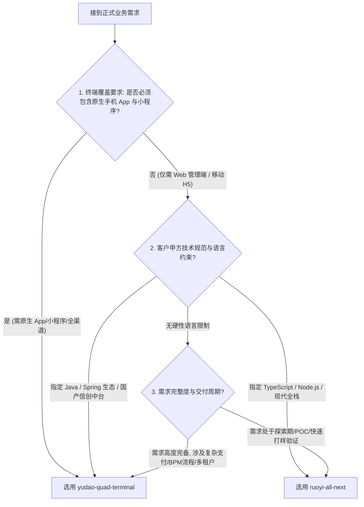

# Coolie 工坊两大商业交付底座自动选型法典 (Foundry Blueprint Selection Rules)

> **最高工程契约**：工坊全体 AI 数字员工（Hermes、墨斗/FDA、铁匠/SWE、门神/FDSE、百晓生/DS、兜底渊/SRE）在接到正式业务需求时，**严禁盲目手搓全新代码，必须依据本法典执行标准化底座选型与极速派生 (Hatching)**。

---

## 一、 两大核心开发底座全景对照

| 维度指标 | 芋道四位一体多端基座 (`yudao-quad-terminal`) | 现代轻量全栈基座 (`ruoyi-all-next`) |
| :--- | :--- | :--- |
| **主要编程语言** | **Java (JDK 17/21 LTS) + TypeScript** | **TypeScript (Node 24 / Next.js) + SQL** |
| **后端架构栈** | Spring Boot 3.5 + Spring Cloud Alibaba 微服务/单体 | Next.js 16 (16.3.6) App Router + Prisma / SQLite / PostgreSQL |
| **前端中台栈** | Vue 3 + Vite + Pinia + Element Plus (管理后台) | React 19 + Tailwind CSS + Radix UI / shadcn |
| **移动与终端形态** | **四位一体原生覆盖**： 1. PC Web 管理中台 2. 微信小程序 (Uni-App Vue3) 3. 原生手机 App (Expo SDK 52 / React Native) 4. 微服务 API 网关 | **轻终端与现代 Web 全栈**： 1. 响应式 PC Web 端 2. 移动端 H5 极简单手卡片流 3. 原生支持 3200 端口沙箱实时预览 |
| **内置业务域资产** | **19 大垂直行业域** (ERP, MES, CRM, BPM 流程引擎, 商城, 会员, 微信/支付宝支付, 多租户行级隔离) | **极简核心底座** (组织权限, 动态数据模型, 工作台, 敏捷 API 契约, 轻量多企业隔离) |
| **Token 与研发开销** | 适合结合 `pnpm ctx:query` 切片与生成工具进行工业级裁剪 | 极低 Token 消耗，全栈同构，代码量凝练，极速改动与热更 |
| **极速派生指令** | `bash scripts/hatch-client-project.sh <path> --profile quad-terminal` | `bash scripts/hatch-client-project.sh <path> --profile minimal` (或 `degit xaicd/ruoyi-all-next#main`) |

---

## 二、 AI Agent 自动选型决策树 (Selection Decision Matrix)

当数字员工接到正式业务需求（无论是客户标书、工坊会话立项还是需求规格说明书 SRS）时，必须按以下 4 级漏斗确定选型：

### 1. 终端覆盖维度（一票命中）
- **必须覆盖原生 App (iOS/Android) 与微信小程序**：直接选定 **`yudao-quad-terminal`**。其内置的 Expo SDK 52 原生 App 与 Uni-App 小程序已通过 6 寸屏防御、刘海防遮挡与自建 OTA 热更新考验，开箱即用；
- **纯 Web 管理端或轻量 H5 场景**：优先选用 **`ruoyi-all-next`**，避免引入 Java 微服务重型中间件。

### 2. 客户技术栈规范维度（甲方约束）
- **政企、金融、电信、大制造甲方**：通常硬性要求 Java 体系、Spring Cloud 微服务规范、MyBatis 兼容与私有化信创部署，严格执行 **`yudao-quad-terminal`**；
- **新零售、出海SaaS、AI 原生应用、轻量企业工具**：拥抱 TypeScript 全栈极速迭代，优先执行 **`ruoyi-all-next`**。

### 3. 需求完整度维度（按需借力）
- **完备商业需求 (Mature SRS)**：需求涵盖完整会员积分体系、微信/支付宝支付清算、多级审批工作流、复杂租户隔离，选 **`yudao-quad-terminal`**（借力 19 域成熟资产，节省 80% 代码手搓量）；
- **敏捷验证与 POC (Exploratory / Prototyping)**：需求模糊或快速迭代，选 **`ruoyi-all-next`**（改动链路短、无微服务网络开销、3200 端口沙箱秒级预览）。

---

## 三、 数字员工选型与交付行为守则

1. **先出 DAR 决策，再行立项 (DAR Before Coding)**：
   - 墨斗 (FDA) 与 百晓生 (DS) 收到需求后，必须在《架构概要设计说明书 (HLD)》或《方案研判报告》中明确输出两大底座对比得分表；
2. **遵守开源基座原生目录结构（公理五）**：
   - 选定底座后，**100% 保持开源基座原生目录结构**，严禁私自将工程打乱；
   - 依赖与资产管理通过 `pnpm-workspace.yaml` 或 Workspaces 无侵入映射；
3. **结合专属 Skills 精准装配**：
   - 命中 `yudao-quad-terminal` ➜ 装配 `yudao-cloud-bootstrap`、`yudao-backend-dev`、`yudao-admin-vue3`、`yudao-miniapp-dev`、`yudao-expo-app`；
   - 命中 `ruoyi-all-next` ➜ 装配 `cmmi-req-spec`、`cmmi-detailed-contracts`、`speckit-workflow`、`mutation-tester`。
