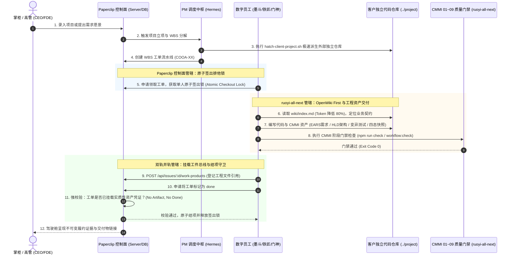

# RUOYI-PAPERCLIP-ORTHOGONAL-INTEGRATION.md
# Paperclip 控制面与 ruoyi-all-next 商业交付工程法典正交并轨与冲突防御手册

> **生效对象**：Hermes (PM)、墨斗 (FDA)、铁匠 (Core SWE)、门神 (FDSE)、兜底渊 (PRE-SRE)、百晓生 (DS) 全体数字员工与流水线  
> **制定宗旨**：彻底澄清 Paperclip 控制面平台与 ruoyi-all-next 商业交付工程法典的职责边界，明确正交并轨、互不冲突、双向赋能的架构准则与仲裁矩阵，建立全生命周期无缝协同防线。

---

## 一、 核心论断：正交并轨与双引擎定位 (Executive Summary)

**Paperclip 规范与 ruoyi-all-next 规范不仅毫无冲突，而且在物理拓扑与业务逻辑上是高度正交、各司其职的双引擎关系**：

```
┌──────────────────────────────────────────────────────────────────────────┐
│                   Coolie AI 原生商业软件交付工厂 (Coolie Foundry)        │
└──────────────────────────────────────────────────────────────────────────┘
                                     │
         ┌───────────────────────────┴───────────────────────────┐
         ▼                                                       ▼
【第一引擎：控制面与调度中枢】                   【第二引擎：交付工程法典与质量基线】
  (Paperclip Control-Plane Backbone)              (ruoyi-all-next CMMI 01~09 Foundry)
 ┌─────────────────────────────────────┐         ┌─────────────────────────────────────┐
 │ • 企业边界物理隔离 (company_id)     │         │ • CMMI 01~09 全生命周期工程真资产   │
 │ • 单一人原子签出排他锁 (Single-Lock)│ ◀──────▶│ • EARS 5 态需求收敛与 RTM 跟踪矩阵  │
 │ • 真实预算硬熔断机制 (Hard-Stop)    │ (双轨并轨)│ • OpenWiki 动态知识大脑 (RFC 8615)  │
 │ • 原生工件总线 (Work Product Bus)   │         │ • 四态真机快照与变异测试打假 (G4)   │
 │ • 标准 ACP 智能体调度协议栈         │         │ • 不可变 Checksum 制品与秒级回滚 (G5)│
 └─────────────────────────────────────┘         └─────────────────────────────────────┘
         │                                                       │
         └───────────────────────────┬───────────────────────────┘
                                     ▼
                  【客户独立商业代码仓库 (Client Project)】
                  (如: /host-workspace/xaicd/sys-points)
```

1. **Paperclip 定位为「控制面操作系统 (Control-Plane OS)」**：
   - 解决的是**“谁在什么组织下、花多少预算、拿什么锁、派给哪个 Agent 执行、任务怎么签出和记录审计”**的管理中枢问题；
   - 维护控制面核心实体不变量（单人原子签出、单组织数据物理隔离、硬停熔断、心跳租约、工单不可变日志）。
2. **ruoyi-all-next 定位为「商业软件交付工程法典与质量标准 (Foundry Delivery Standard)」**：
   - 解决的是**“软件如何从 0 到 1 高质量建造、需求怎么用 EARS 收敛、架构怎么做 DAR 选型、怎么打假假 Mock、四态真机快照怎么存证、工程资产怎么标准化沉淀、生产怎么做到秒级回滚”**的工程真资产问题；
   - 维护交付工程资产不变量（No Artifact No Done、OpenWiki First 80% Token 减负、SpaceX 级变异测试打假、实事求是 0 假 Demo）。
3. **二者的物理并轨桥梁**：
   - 客户商业项目在独立工作区（`../<client-project>`）落盘代码与 CMMI 01~09 资产；
   - 通过 Paperclip 控制面原生工件总线（`POST /api/issues/:id/work-products`），以 `resourceRef.kind: "workspace_file"` 进行资产登记与双向血缘挂载；
   - 后端在工单完工时强校验实质性资产凭证，实现严丝合缝的闭环交付。

---

## 二、 权威冲突防御与仲裁矩阵 (Conflict Defense Matrix)

当数字员工或开发人员在处理具体问题产生疑惑时，严格按以下仲裁矩阵判定管辖权：

| 维度 / 场景 | 管辖权归属 | 遵循标准 | 冲突防御与仲裁判定铁律 |
| :--- | :--- | :--- | :--- |
| **平台根目录骨架** | **Paperclip** | 原生 6 大目录标准 (`server/`, `ui/`, `packages/`, `cli/`, `skills/`, `doc/`) | **绝对白名单拦截**：平台仓库根目录归 Paperclip 主线管辖，严禁在根目录嵌套 `projects/` 或散落任何未授权目录与临时文件。由 `pre-commit-check.mjs` 秒级阻断。 |
| **客户交付项目工作区** | **ruoyi-all-next** | 独立平级仓库 (`../<slug>`)，原生基座或 PNPM Monorepo | **绝对物理隔离**：每个商业交付项目是独立的代码仓库与 Git 历史。内部严格落盘 `docs/01_management` ~ `docs/09_operations`、`wiki/` 与 `docs/specs/`，严禁污染平台代码。 |
| **任务签出与执行锁** | **Paperclip** | 单一人原子签出排他锁 (`issue_checkout_runs`) | **单写者唯一性**：任务派发与状态流转 100% 服从 Paperclip 签出锁与租约心跳，严禁绕过控制面搞多 Agent 无锁并发写入代码。 |
| **需求收敛与分析** | **ruoyi-all-next** | EARS 语法 (IEEE 29148) + 双向 RTM 矩阵 | **消灭自然语言二义性**：需求统一收敛为 5 态语法 (`WHEN...THEN...SHALL`)，形成结构化 `docs/02_requirements/software-requirements.md`，直接映射代码单测。 |
| **架构选型与边界设计** | **ruoyi-all-next** | HLD 拓扑 + DAR 加权决策矩阵 + MADR | **科学选型与隔离保障**：架构决策必须输出加权决策分析（至少 2 正选 + 1 阴性对照），多租户数据隔离必须在 AST 或网关层硬拦截。 |
| **工件沉淀与完工判定** | **双轨正交并轨** | Paperclip 原生工件总线 + ruoyi-all-next CMMI 资产 | **No Artifact, No Done**：物理文件在客户仓库生成，通过控制面 API 登记为 `work_products`。工单结项时平台强校验工件存在性，无工程真资产严禁标记 Done。 |
| **AI 知识检索与 Token 优化** | **ruoyi-all-next** | OpenWiki 知识大脑 (`wiki/index.md`) | **OpenWiki First**：交付项目统一建立 RFC 8615 知识大脑，数字员工进场先读机器可读索引，Token 消耗直降 80%，杜绝全盘盲搜代码与文档漂移。 |
| **代码规范与防假打假** | **ruoyi-all-next** | SpaceX 变异测试 + 反假 Mock + 0 编译报错 | **求真务实**：严禁空洞断言与假测试；变异测试突变体杀灭率必须达标；CI 静态类型检查 100% 退出码 0。 |
| **生产投产与回滚演练** | **ruoyi-all-next** | 不可变 Checksum 制品 + 秒级回滚 SOP | **不可逆防御**：生产发版前必须进行 7 处版本一致性核对；提供秒级原子回滚脚本，杜绝就地修改热补丁。 |

---

## 三、 双轨并轨数据流动与物理时序 (Execution Sequence)



---

## 四、 平台数字员工四大执行守则 (Digital Employee Rules of Engagement)

全体数字员工在接到任何研发、重构或运维任务时，必须严格遵守以下四条守则：

### 守则 1：仓库边界不混淆 (Never Mix Repositories)
- **平台仓库 (`coolie`)**：专门用于承载 Coolie 平台本体自身的控制面（Server）、管理端（UI）、移动端（Expo App）、数据库 Schema（packages/db）和 CLI 工具。
- **业务项目仓库 (`../<project-slug>`)**：专门用于承载客户商业交付代码（如微服务、小程序、业务 H5、业务规范文档等）。
- **红线**：严禁在平台仓库根目录创建 `projects/` 或在此提交客户业务代码；脚本输出必须使用独立平级目录。

### 守则 2：签出锁与预算硬熔断不可逾越 (Respect Control-Plane Invariants)
- 数字员工执行任务时，必须通过 Paperclip 控制面提供的原子签出机制持锁施工；
- 严禁绕过控制面机制在后台启动多个 CLI 进程修改同一份代码；
- 遇到预算超限硬停（Auto-Pause）时，必须停下等待审批提额，严禁私自绕过预算限制。

### 3. OpenWiki 动态大脑优先读取 (OpenWiki First Before Code Exploration)
- 进入客户项目工作区时，**第一动作必须是读取 `wiki/index.md`**；
- 基于 OpenWiki 自动生成的领域实体词条、架构规范与常见陷阱开展工作；
- 严禁进场后盲目使用全盘 grep 或全局大模型搜索，确保 Token 利用效率最大化与思考专注度。

### 4. 结项必有实质性工程资产 (No Artifact, No Done)
- 任何任务在更新为 `done` 之前，必须在独立项目仓库落地真实的工程文件，并通过工件总线完成关联；
- 交付物必须具备实质内容：通过编译检查的代码、真机四态快照、EARS 规范需求文档、或机器证据库 JSON 指纹；
- 严禁空口汇报“已完成”、“已修复”而无任何可审查的物理资产。

---

## 五、 机器校验与持续守卫 (Automated Machine Enforcement)

本规范已固化至底层编译器与自动化门禁中，任何偏离行为将触发自动阻断：
1. `scripts/pre-commit-check.mjs`：提交前拦截任何违规目录、违规 `projects/` 提交与未编译代码；
2. `scripts/check-governance-audit.mjs`：全局审计项目拓扑、CMMI 01~09 资产合规度与双轨并轨守卫；
3. `scripts/workflow-engine.cjs`：Kiro 原生工作流引擎验证配方 DAG 完整性与各阶段资产交付物。
