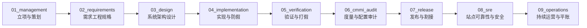

# CMMI 01~09 全生命周期过程资产标准作业规程 (CMMI Asset Authoring SOP)

> **适用标准**: CMMI V2.0 / V3.0 (DEV + SVC 融合模型) × IEEE 29148 需求规范 × Google SRE 最佳实践  
> **核心哲学**: **过程资产工程化 (Process-as-Code)、交付证据物理化 (Evidence-First)、全链路双向可追溯 (End-to-End Traceability)、零造假实事求是 (Zero Fake Demos)**  
> **最高铁律**: 严格遵循 Rule 0 底线法则与高阶反向思维，严禁大模型人肉写样板 Markdown，统一由 `npm run cmmi:asset` 脚手架生成并由专属 Skill 驱动作业。

---

## 一、 高阶反向思维与设计底座铁律 (Core Invariants)

在进行 CMMI 01~09 任意阶段过程资产作业时，任何工程师或 AI 数字员工必须恪守以下 5 条底线法则：

1. **声明式 DSL 驱动与消灭 Token 浪费 (Zero Token Waste)**：
   - 严禁人肉或大模型手写成百上千行的 Markdown 格式样板；
   - 资产的创建一律经由 `npm run cmmi:asset new --phase <XX> --type <type> [--project <projectCode>]` 引擎展开标准骨架，输入声明参数压缩至极简 (<500 Tokens)。
2. **实事求是与反虚假 Demo 铁律 (Zero Fake Demos & Real Data Gate)**：
   - 严禁在基座仓库或商业交付项目中凭空捏造未发生的生产故障（如“超发优惠券”、“资金损失”）或虚假财务流水账单；
   - 事故复盘（`postmortem`）、对账流水（`reconciliation`）等事实态资产，在未实际发生线上事件时，相关目录必须保留规范拓扑并使用 `.gitkeep` **严格留空**；
   - 工具层强制内置 `--real` 鉴权门禁，无真实事实证明严禁生成运行期业务资产。
3. **单一真源与全生命周期 01~09 物理落归 (Single Source of Truth & Unbroken Chain)**：
   - 严禁在 `docs/` 根目录随意散落孤儿 markdown 文件；
   - 过程资产必须精确落位至 `docs/01_management` 至 `docs/09_operations` 9 大标准子目录；敏捷特性规格独立内聚于 `docs/specs/<domain>/<feature-slug>/`。
4. **控制面与工件总线双轨血缘绑定 (Dual-Track Control-Plane Provenance)**：
   - 控制面（Paperclip Backbone）原生实体（`issue_documents`、`issue_work_products`、`attachments`）为第一法定真理源，支持富文本划线在线批注；
   - 本地代码工作区物理工程资产通过 `POST /api/issues/:id/work-products` 登记绑定：
     `metadata: { resourceRef: { kind: "workspace_file", relativePath: "docs/02_requirements/software-requirements.md" } }`。
5. **极简主义人机工程与高管审批闭环 (Minimalist Ergonomics & In-Place Approval)**：
   - 交付物状态更新为 `done` 时，后端服务刚性校验实质性工程资产凭证（No Artifact, No Done）；
   - 高危动作与门禁放行统一上提至移动端 6 寸屏顶栏 🔔 铃铛收件箱，以因果卡片呈现，支持两字【通过】/【驳回】就地审批。
6. **经验沉淀严谨性与精准增量更新铁律 (Rigorous Distillation & Surgical Incremental Update Law)**：
   - 经验总结与规则演进必须具备真实物理实证，严禁无事实主观臆造；
   - 文本表达必须符合 RFC 2119 规范语法，坚决剔除任何业务特性词汇，100% 抽象为通用软件工程标准；
   - 规则更新严格执行靶向单点归宿与加法原则（Minimal Diff），严禁推倒重写既有战略资产，确保原子闭环与 0 漂移。

---

## 二、 CMMI 01~09 全生命周期工序与顶级 Skill 固化矩阵

全生命周期 9 大阶段均有确定性专属 Skill 驱动专业作业，并由统一的脚手架引擎生成基线：



| 阶段 | 阶段目录 | CMMI 实践域 | 核心工作内容 | 资产类型 (type) | 承载专属 Skill | 准入门禁与防假规则 |
|---|---|---|---|---|---|---|
| **01** | `docs/01_management/` | PLAN / MC / RSKM / DAR | 项目立项书、综合研发计划、风险台账、DAR 加权决策分析、阶段配置管理计划 | `charter`, `plan`, `risk`, `dar`, `pcm` | **`dar-decision-matrix`**<br/>**`cmmi-wbs-milestone`**<br/>`solution-scouting-and-dar` | **G0 门禁**: 明确 In/Out 范围；DAR 必须含 >=2 候选 + 1 阴性对照 |
| **02** | `docs/02_requirements/` | RDM (需求开发与管理) | EARS 5 态需求规格、需求双向跟踪矩阵 (RTM)、NFR 非功能指标、用户需求说明 | `srs`, `rtm`, `nfr`, `urs` | **`ears-spec-writer`**<br/>**`cmmi-req-spec`**<br/>`spec-driven-dev` | **G1 门禁**: EARS 句式消除二义性；RTM 需双向绑定设计与测试 |
| **03** | `docs/03_design/` | TS (技术解决方案) | MADR 架构决策、8 大审计底座列、Archify 拓扑建模、HLD 概要设计、OpenAPI 契约 | `adr`, `erd`, `archify`, `hld`, `api-spec` | **`adr-architect`**<br/>**`archify`**<br/>**`cmmi-tech-solution`**<br/>`cmmi-detailed-contracts` | **G2/G3 门禁**: 继承 8 大审计列；MADR 格式；交互式 Mermaid/Archify 拓扑 |
| **04** | `docs/04_implementation/` | TS (构造与编码) | 研发编码规范清单、变异测试指南、插件隔离蓝图、软件物料清单 (SBOM) | `code-review`, `mutation-guide`, `plugin-blueprint`, `sbom` | **`core-swe`**<br/>`swe-delivery-flow`<br/>`mutation-tester` | **G3 门禁**: 跨域经由 Facade/Broker；0 编译报错；WBS 任务 100% 勾选 |
| **05** | `docs/05_verification/` | VV (验证与确认) | 测试计划、真实测试套件执行大盘、变异测试打假、客户终验核销单 | `test-plan`, `test-summary`, `mutation-report`, `uat` | **`cmmi-ver-val`**<br/>**`mutation-tester`**<br/>`qa-humanlike-e2e` | **G4 门禁**: 真实数据库测试 100% 通过；变异测试需真实运行带 `--real` |
| **06** | `docs/06_cmmi_audit/` | QPM / CAR / PQA / CM | 统计过程控制 (SPC)、CAR 5-Whys 根因分析、不可变配置审计台账、门禁追踪记录 | `spc`, `car`, `audit`, `gate-trace` | **`cmmi-car-spc-metrics`** | **G4_QA 门禁**: `npm run check:governance` 18 道门禁全绿 |
| **07** | `docs/07_release/` | TRANS (转型与发布) | 生产部署割接 SOP、秒级自动回滚 Runbook、版本发布说明、发版核对清单 | `deployment-sop`, `rollback-runbook`, `release-notes`, `checklist` | **`cmmi-immutable-release`**<br/>**`app-release-pipeline`**<br/>`sre-release-and-deploy` | **G5 门禁**: 割接 SOP 闭环验证；秒级回滚 Runbook 可执行；7处版本一致 |
| **08** | `docs/08_sre/` | SCON / CAM / SRE | 服务等级目标 (SLO/SLI)、容灾应急方案、5-Whys 免责复盘、Strix 红队渗透报告 | `slo-matrix`, `dr-plan`, `postmortem`, `strix-report` | **`sre-slo-manager`**<br/>**`postmortem-analyzer`**<br/>`strix-penetration-testing` | **G6_SRE 门禁**: 单机吞吐 >=5,000 RPS；事故复盘与渗透必须带 `--real` |
| **09** | `docs/09_operations/` | CMMI-SVC / BizOps / DataOps | 多租户持续运营 SOP、数字员工运营台账、常态巡检报告、资金轧差对账平账 | `tenant-governance`, `agent-ops-ledger`, `inspection-report`, `reconciliation` | **`ceo-company-ops`**<br/>**`financial-reconciliation-agent`** | **G7_OPS 门禁**: 复式记账借贷恒等平衡；真实对账单必须带 `--real` |

---

## 三、 九大阶段标准化作业 SOP (Standard Operating Procedures)

### Phase 01: 项目策划与决策分析 (PLAN / MC / RSKM / DAR)
- **触发时机**: 项目立项、重大架构重构、引入重型外部依赖、技术路线选型。
- **驱动 Skill**: `dar-decision-matrix`, `cmmi-wbs-milestone`, `solution-scouting-and-dar`。
- **作业步骤**:
  1. 运行 `npm run cmmi:asset new -- --phase 01 --type charter --title "<项目全称>" [--project <代码>]`，完善边界范围与权责；
  2. 运行 `npm run cmmi:asset new -- --phase 01 --type plan --title "<研发计划>" [--project <代码>]`，制定研发里程碑；
  3. 运行 `npm run cmmi:asset new -- --phase 01 --type risk [--project <代码>]`，识别技术架构风险与防御预案；
  4. 遇多方案选型时，运行 `npm run cmmi:asset new -- --phase 01 --type dar --title "<选型决策>" --slug "<SLUG>" [--project <代码>]`，启动 `dar-decision-matrix` 技能开展加权打分（必须设置阴性对照）；
  5. 运行 `npm run cmmi:asset new -- --phase 01 --type pcm --version "<版本>" [--project <代码>]`，确立阶段配置管理基线。
- **交付产物**: `docs/01_management/project-charter.md`, `project-plan.md`, `rskm-risk-ledger.md`, `DAR-*.md`, `phase-configuration-management.md`。

### Phase 02: 需求工程与规格定义 (RDM / EARS / SRS / RTM)
- **触发时机**: 新功能迭代、业务变更、客户定制需求导入。
- **驱动 Skill**: `ears-spec-writer`, `cmmi-req-spec`, `spec-driven-dev`。
- **作业步骤**:
  1. 调用 `ears-spec-writer`，以 Rolls-Royce EARS 5 态句式消除需求二义性；
  2. 运行 `npm run cmmi:asset new -- --phase 02 --type srs --version "<版本>" [--project <代码>]`，固化软件需求规格；
  3. 运行 `npm run cmmi:asset new -- --phase 02 --type rtm [--project <代码>]`，建立需求到设计与测试用例的双向追溯矩阵；
  4. 运行 `npm run cmmi:asset new -- --phase 02 --type nfr [--project <代码>]` 与 `urs`，收敛非功能指标与用户原始故事。
- **交付产物**: `docs/02_requirements/software-requirements.md`, `requirements-traceability-matrix.md`, `non-functional-reqs.md`, `user-requirements.md`。

### Phase 03: 技术解决方案与架构设计 (TS / MADR / Archify)
- **触发时机**: 数据模型变更、跨域通信、插件拆分、API 契约制定。
- **驱动 Skill**: `adr-architect`, `archify`, `cmmi-tech-solution`, `cmmi-detailed-contracts`。
- **作业步骤**:
  1. 运行 `npm run cmmi:asset new -- --phase 03 --type adr --id <编号> --title "<决策标题>" --slug "<SLUG>" [--project <代码>]`，调用 `adr-architect` 撰写 MADR 架构决策记录；
  2. 运行 `npm run cmmi:asset new -- --phase 03 --type hld --version "<版本>" [--project <代码>]`，输出概要架构方案；
  3. 检查表结构设计，运行 `npm run cmmi:asset new -- --phase 03 --type erd [--project <代码>]`，确保持久化实体严格继承 8 大审计底座字段；
  4. 运行 `npm run cmmi:asset new -- --phase 03 --type archify --title "<架构全景>" --slug "<SLUG>" [--project <代码>]`，生成可交互架构图谱（`archify`）；
  5. 运行 `npm run cmmi:asset new -- --phase 03 --type api-spec [--project <代码>]`，确立统一契约。
- **交付产物**: `docs/03_design/adr/ADR-*.md`, `architecture-design-hld.md`, `database-design-erd.md`, `architecture-topology-*.md`, `api-specifications.md`。

### Phase 04: 实现构造与编码防假 (TS / Coding / Zero Fake Mock)
- **触发时机**: 业务编码、领域服务开发、API 实现、模块重构。
- **驱动 Skill**: `core-swe`, `swe-delivery-flow`, `mutation-tester`。
- **作业步骤**:
  1. 运行 `npm run cmmi:asset new -- --phase 04 --type code-review [--project <代码>]`，对照 8 大工程红线进行同行代码审查；
  2. 运行 `npm run cmmi:asset new -- --phase 04 --type mutation-guide [--project <代码>]`，固化变异测试指导规范；
  3. 运行 `npm run cmmi:asset new -- --phase 04 --type plugin-blueprint [--project <代码>]`，确立第一方插件物理隔离蓝图；
  4. 运行 `npm run cmmi:asset new -- --phase 04 --type sbom --version "<版本>" [--project <代码>]`，导出不可变依赖清单与哈希。
- **交付产物**: `docs/04_implementation/coding-standards.md`, `mutation-testing-guide.md`, `plugin-blueprint.md`, `software-bill-of-materials.md`。

### Phase 05: 验证确认与变异打假 (VV / Testing / Mutation)
- **触发时机**: 代码合并主干前、版本发布前验证。
- **驱动 Skill**: `cmmi-ver-val`, `mutation-tester`, `qa-humanlike-e2e`。
- **作业步骤**:
  1. 运行 `npm run cmmi:asset new -- --phase 05 --type test-plan --version "<版本>" [--project <代码>]`，确立验证覆盖计划；
  2. 运行测试套件，执行全矩阵真实数据库驱动测试（100% 退出码 0）；
  3. 运行 `npm run cmmi:asset new -- --phase 05 --type test-summary --version "<版本>" [--project <代码>]`，记录测试大盘；
  4. 针对核心交易链路，调用 `mutation-tester` 启动真实变异引擎，杀灭存活突变体与假 Mock，生成实测报告：
     `npm run cmmi:asset new -- --phase 05 --type mutation-report --version "<版本>" --real --score "91.5%" [--project <代码>]`；
  5. 固化客户终验单：`npm run cmmi:asset new -- --phase 05 --type uat [--project <代码>]`。
- **交付产物**: `docs/05_verification/test-plan.md`, `test-summary-report.md`, `mutation-report.md`, `uat-acceptance-certificate.md`。

### Phase 06: 质量保证与度量审计 (QPM / CAR / PQA)
- **触发时机**: 交付里程碑节点、正式发版封版前夕。
- **驱动 Skill**: `cmmi-car-spc-metrics`。
- **作业步骤**:
  1. 运行 `node scripts/check-governance-audit.mjs`，总检全仓自动化门禁（退出码必须为 0）；
  2. 运行 `npm run cmmi:asset new -- --phase 06 --type spc [--project <代码>]`，分析吞吐量与缺陷控制线；
  3. 针对线上或测试发现的缺陷，运行 `npm run cmmi:asset new -- --phase 06 --type car --title "<缺陷>" [--project <代码>]`，执行 5-Whys 根因分析并固化防退化测试用例；
  4. 运行 `npm run cmmi:asset new -- --phase 06 --type audit --version "<版本>" [--project <代码>]` 与 `gate-trace`，完成配置审计与全流程门禁追溯。
- **交付产物**: `docs/06_cmmi_audit/spc-control-chart.md`, `car-5whys-rca.md`, `audit-trail.md`, `gate-trace-record.md`。

### Phase 07: 转型交付与割接回滚 (TRANS / Release / SOP)
- **触发时机**: 生产环境发布、版本割接、客户现场交付。
- **驱动 Skill**: `cmmi-immutable-release`, `app-release-pipeline`, `sre-release-and-deploy`。
- **作业步骤**:
  1. 运行 `npm run cmmi:asset new -- --phase 07 --type deployment-sop [--project <代码>]`，明确割接流程；
  2. 运行 `npm run cmmi:asset new -- --phase 07 --type rollback-runbook [--project <代码>]`，制定 60 秒故障回滚预案；
  3. 运行 `npm run cmmi:asset new -- --phase 07 --type release-notes --version "<版本>" [--project <代码>]` 与 `checklist`；
  4. 运行 `bash scripts/VERSION-CONSISTENCY-CHECK.sh` 确保 7 处版本一致。
- **交付产物**: `docs/07_release/system-deployment-sop.md`, `rollback-emergency-plan.md`, `RELEASE_NOTES_*.md`, `release-verification-checklist.md`。

### Phase 08: 站点可靠性与安全 (SCON / CAM / SRE / Postmortem)
- **触发时机**: 系统上线后稳定性监控、容量压测、线上故障复盘。
- **驱动 Skill**: `sre-slo-manager`, `postmortem-analyzer`, `strix-penetration-testing`。
- **作业步骤**:
  1. 运行 `npm run cmmi:asset new -- --phase 08 --type slo-matrix [--project <代码>]`，固化 SLO 指标与容量护栏；
  2. 运行 `npm run cmmi:asset new -- --phase 08 --type dr-plan [--project <代码>]`，制定多活容灾演练方案；
  3. 若生产发生真实事故，调用 `postmortem-analyzer` 执行 1-5-10 应急并输出 5-Whys 免责复盘：
     `npm run cmmi:asset new -- --phase 08 --type postmortem --title "<真实事故>" --slug "<SLUG>" --real [--project <代码>]`；
  4. 运行 Strix 容器执行真实红队渗透演练，记录渗透测试报告（需带 `--real`）：
     `npm run cmmi:asset new -- --phase 08 --type strix-report --version "<版本>" --real [--project <代码>]`。
- **交付产物**: `docs/08_sre/01_slo_sli_metrics/SLO-SLI-ERROR-BUDGET-MATRIX.md`, `disaster-recovery-plan.md`, `02_postmortem/POSTMORTEM-*.md`, `strix-penetration-report.md`。

### Phase 09: 持续运营与对账平账 (BizOps / DataOps / CMMI-SVC)
- **触发时机**: 日终清算、渠道对账、日常系统巡检、AI 数字员工管理。
- **驱动 Skill**: `ceo-company-ops`, `financial-reconciliation-agent`。
- **作业步骤**:
  1. 运行 `npm run cmmi:asset new -- --phase 09 --type tenant-governance [--project <代码>]`，制定企业开户与配额 SOP；
  2. 运行 `npm run cmmi:asset new -- --phase 09 --type agent-ops-ledger [--project <代码>]`，沉淀数字员工运行时审计；
  3. 运行 `npm run cmmi:asset new -- --phase 09 --type inspection-report [--project <代码>]`，记录常态巡检；
  4. 针对具备资金交易的商业工程，调用 `financial-reconciliation-agent` 进行三方对账与资金轧差：
     `npm run cmmi:asset new -- --phase 09 --type reconciliation --title "<对账批次>" --slug "<SLUG>" --real [--project <代码>]`。
- **交付产物**: `docs/09_operations/tenant-governance.md`, `agent-operations-ledger.md`, `system-inspection-report.md`, `02_financial_reconciliation/RECONCILIATION-*.md`。

---

## 四、 过程资产“五存五不存”生命周期防污染法则

| 准则 | 详细要求 | 负面反例 (严惩) |
|---|---|---|
| **存代码化过程资产** | 规格、ADR、ERD、SOP 一律使用标准 Markdown / JSON 纳入 Git 版本控制 | ❌ 严禁把需求与评审写在外部孤立 Word/Excel 里与代码割裂 |
| **存机器可读契约与指纹** | 跨端契约、统一 OpenAPI、自动化门禁数字指纹记录必须与代码同生同灭 | ❌ 严禁脱离代码的人工手写离线契约 |
| **存真实测试与验收证据** | 100% 真实数据库测试结果、四态真机快照、真实压测护栏记录 | ❌ 严禁伪造测试报告与假变异得分 |
| **不存未经发生的假数据** | 未发生线上事故或流水时，`08_sre/02_postmortem` 与 `09_operations/02_financial_reconciliation` 保持 `.gitkeep` 留空 | ❌ 严禁在模板底座中伪造虚假故障（如“超发优惠券 5,000 元”） |
| **不存形式主义手工假评审** | 评审必须基于真实代码变更与质量门禁退出码，严禁纸面签字应付评估 | ❌ 严禁上线前补录虚假评审签字 |
| **不存二进制大包与临时产物** | 构建产物、临时日志、视频动图严禁提交至 Git 仓库，静态切图收敛至 `assets/` | ❌ 严禁将 node_modules、zip 压缩包或几十兆构建临时文件推至仓库 |

---

## 五、 标准 CLI 脚手架命令手册 (全量 26 类资产速查)

```bash
# ==========================================
# 1. Phase 01: 立项与策划 (5 类)
# ==========================================
npm run cmmi:asset new -- --phase 01 --type charter --title "<项目全称>" [--project <代码>]
npm run cmmi:asset new -- --phase 01 --type plan --title "<研发计划>" [--project <代码>]
npm run cmmi:asset new -- --phase 01 --type risk [--project <代码>]
npm run cmmi:asset new -- --phase 01 --type dar --title "<选型决策>" --slug "<SLUG>" [--project <代码>]
npm run cmmi:asset new -- --phase 01 --type pcm --version "<版本>" [--project <代码>]

# ==========================================
# 2. Phase 02: 需求工程 (4 类)
# ==========================================
npm run cmmi:asset new -- --phase 02 --type srs --version "<版本>" [--project <代码>]
npm run cmmi:asset new -- --phase 02 --type rtm [--project <代码>]
npm run cmmi:asset new -- --phase 02 --type nfr [--project <代码>]
npm run cmmi:asset new -- --phase 02 --type urs [--project <代码>]

# ==========================================
# 3. Phase 03: 系统设计 (5 类)
# ==========================================
npm run cmmi:asset new -- --phase 03 --type adr --id <编号> --title "<决策标题>" --slug "<SLUG>" [--project <代码>]
npm run cmmi:asset new -- --phase 03 --type erd [--project <代码>]
npm run cmmi:asset new -- --phase 03 --type archify --title "<架构拓扑>" --slug "<SLUG>" [--project <代码>]
npm run cmmi:asset new -- --phase 03 --type hld --version "<版本>" [--project <代码>]
npm run cmmi:asset new -- --phase 03 --type api-spec [--project <代码>]

# ==========================================
# 4. Phase 04: 实现与构造 (4 类)
# ==========================================
npm run cmmi:asset new -- --phase 04 --type code-review [--project <代码>]
npm run cmmi:asset new -- --phase 04 --type mutation-guide [--project <代码>]
npm run cmmi:asset new -- --phase 04 --type plugin-blueprint [--project <代码>]
npm run cmmi:asset new -- --phase 04 --type sbom --version "<版本>" [--project <代码>]

# ==========================================
# 5. Phase 05: 验证与打假 (4 类)
# ==========================================
npm run cmmi:asset new -- --phase 05 --type test-plan --version "<版本>" [--project <代码>]
npm run cmmi:asset new -- --phase 05 --type test-summary --version "<版本>" [--project <代码>]
npm run cmmi:asset new -- --phase 05 --type mutation-report --version "<版本>" --real --score "91.5%" [--project <代码>]
npm run cmmi:asset new -- --phase 05 --type uat [--project <代码>]

# ==========================================
# 6. Phase 06: 质量保证 (4 类)
# ==========================================
npm run cmmi:asset new -- --phase 06 --type spc [--project <代码>]
npm run cmmi:asset new -- --phase 06 --type car --title "<缺陷根因>" [--project <代码>]
npm run cmmi:asset new -- --phase 06 --type audit --version "<版本>" [--project <代码>]
npm run cmmi:asset new -- --phase 06 --type gate-trace [--project <代码>]

# ==========================================
# 7. Phase 07: 发布交付 (4 类)
# ==========================================
npm run cmmi:asset new -- --phase 07 --type deployment-sop [--project <代码>]
npm run cmmi:asset new -- --phase 07 --type rollback-runbook [--project <代码>]
npm run cmmi:asset new -- --phase 07 --type release-notes --version "<版本>" [--project <代码>]
npm run cmmi:asset new -- --phase 07 --type checklist [--project <代码>]

# ==========================================
# 8. Phase 08: SRE 稳定性 (4 类)
# ==========================================
npm run cmmi:asset new -- --phase 08 --type slo-matrix [--project <代码>]
npm run cmmi:asset new -- --phase 08 --type dr-plan [--project <代码>]
npm run cmmi:asset new -- --phase 08 --type postmortem --title "<事故复盘>" --slug "<SLUG>" --real [--project <代码>]
npm run cmmi:asset new -- --phase 08 --type strix-report --version "<版本>" --real [--project <代码>]

# ==========================================
# 9. Phase 09: 持续运营 (4 类)
# ==========================================
npm run cmmi:asset new -- --phase 09 --type tenant-governance [--project <代码>]
npm run cmmi:asset new -- --phase 09 --type agent-ops-ledger [--project <代码>]
npm run cmmi:asset new -- --phase 09 --type inspection-report [--project <代码>]
npm run cmmi:asset new -- --phase 09 --type reconciliation --title "<对账批次>" --slug "<SLUG>" --real [--project <代码>]

# ==========================================
# 盘点与健康扫描
# ==========================================
npm run cmmi:asset list [--project <代码>]       # 盘点 01~09 全部交付资产台账
npm run cmmi:asset check [--project <代码>]      # 扫描目录拓扑合规性与反造假健康
```

---

## 六、 交付物质量门禁与自检闭环 (Verification Checklist)

在任何过程资产变更提交至 Git 之前，必须执行以下自检：

- [ ] **全 9 阶段拓扑合规**：新创建文档是否严格落入 `docs/01_management` 至 `docs/09_operations` 对应标准目录？
- [ ] **根目录 0 孤儿**：`docs/` 根目录下除特定架构总述外是否绝对无散落 `.md` 文件？
- [ ] **反造假实事求是**：未发生的线上事故与财务账目是否严格保留 `.gitkeep` 留空？
- [ ] **脚手架扫描通过**：运行 `npm run cmmi:asset check`，退出码是否为 0？
- [ ] **全生命周期门禁闭环**：全仓与项目质量门禁是否保持 100% 绿色通过？
