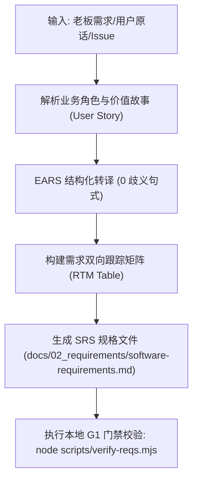

# CMMI 需求工程与双向跟踪矩阵规范 (RD / REQM)

> **CMMI 过程域**: Requirements Development (RD) & Requirements Management (REQM)  
> **门禁对应**: G1 需求与业务旅程门禁 (`gate_g1_spec`)  
> **主责工匠角色**: DS 业务方案专家 (`emp_ds`)  
> **核心产出**: 0-1 软件工程资产包 —— 《用户需求说明书 (URD)》、《软件需求规格说明书 (SRS)》、《需求双向跟踪矩阵 (RTM)》

---

## 1. 技能定位与核心原则

传统 CMMI 需求文档最大的痛点是“需求脱节、文字模糊、验收无据、把运行时业务数据错当工程产物”。本技能确立以下原则：
1. **0-1 软件工程资产本质**：G1 的唯一使命是定义**该软件系统本身的功能规格与业务边界**。**绝对禁止**将系统上线后产生的运行时业务数据（如板材利用率、客户订单、制造图纸等）当成工程产物充数！
2. **EARS 无歧义断言**：通过 **EARS (Easy Approach to Requirements Syntax)** 句式，将自然语言需求固化为 0 歧义的逻辑断言。
3. **全链路双向追踪 (RTM)**：强制建立**从业务需求 -> 系统功能 -> 架构设计 -> 测试用例 -> 交付物**的全链路双向追踪矩阵 (RTM)。
4. **No Artifact, No Done 铁律**：产出的 SRS/RTM 必须作为物理 Work Product 挂载到工单，无实体文件严禁点 Done。

### EARS 核心语法模式
所有功能需求必须归纳为以下 5 类 EARS 模式之一：
1. **普遍需求 (Ubiquitous)**: `The <system> shall <system response>.`
2. **事件驱动需求 (Event-driven)**: `WHEN <trigger>, the <system> shall <system response>.`
3. **状态驱动需求 (State-driven)**: `WHILE <in state>, the <system> shall <system response>.`
4. **异常情况需求 (Unwanted behavior)**: `IF <condition/error>, THEN the <system> shall <system response>.`
5. **可选特性需求 (Optional feature)**: `WHERE <feature is included>, the <system> shall <system response>.`

### 真实业务现场三态口语 EARS 映射 (来自 real-world 实证)
商业交付中老板与用户的指令往往不是标准的开发祈使句，必须建立三态语法转译映射：
- **祈使动作句**（“实现xxx / 修复扫码核销并发锁 / 优化慢查询”） ➜ 映射为 **Event-driven**: `WHEN <trigger>, the system SHALL <action>.`
- **陈述约束句**（“C 端 APP 首页 的 库存尾货 得 放着 / 顶部导航要固定”） ➜ 映射为 **State-driven / Constraint**: `WHILE <in state>, the system SHALL PRESERVE <component/behavior>.`
- **否定纠错句**（“底部 已是最新版本Xxx，不要再提示了，设置 版本检查 才显示”） ➜ 映射为 **Unwanted behavior / Conditional**: `The system SHALL NOT <display alert>; IF <user clicks settings version check>, THEN the system SHALL <display dialog>.`

> **进厂入库铁律**：任何符合上述三态之一的业务诉求，第一步必须通过 MCP 原生工具 `mcp__coolie__paperclipCreateIssue` 正式立项进排期池，严禁口头承诺无痕流失，严禁跳过控制面私自在本地偷跑代码！

---

## 2. 自动化执行步骤 (Workflow)



1. **资产双轨映射**: 优先通过 Paperclip 原生 API 挂载至工单富文本文档（`POST /api/issues/:id/documents`，key: `requirements`），在控制面实现富文本预览与在线批注；本地代码工作区采用 CMMI 标准工程目录 `docs/02_requirements/software-requirements.md`（敏捷特性全息包位于 `docs/specs/<domain>/<feature-slug>/`），并通过 `issue_work_products` 登记索引。开源基座（如 RuoYi 等）100% 保持基座原生目录结构。
2. **需求捕获**: 提取原始诉求，不擅自修改用户意图，保留原话。
3. **拆解用户故事**: 遵循 `作为 <角色>, 我想要 <功能>, 以便 <达成商业价值>`。
4. **EARS 格式化**: 将每个验收条目转换为 EARS 语法，分配全局唯一标识符（例如 `REQ-SYS-001`）。
5. **生成双向追踪矩阵 (RTM)**:
   - 需求编号 (`REQ-ID`)
   - 需求描述
   - 对应架构模块 (`HLD-Module`)
   - 对应验证用例 (`TEST-Case`)
   - 满足门禁 (`Gate`)
6. **本地门禁校验**: 运行项目本地 `scripts/verify-reqs.mjs`，确保所有需求均有双向映射且 0 悬空。

---

## 3. 产物模板基线 (`docs/02_requirements/software-requirements.md`)

```markdown
# [系统名称] 软件需求规格说明书 (SRS & RTM)

- **系统代码**: {{SYSTEM_CODE}}
- **责任工匠**: {{AUTHOR_ROLE}}
- **修订版本**: v{{VERSION}}
- **生效门禁**: G1 需求门禁 (PASSED)

## 1. 业务目标与背景
...

## 2. EARS 结构化需求清单
- [REQ-001] WHEN 用户点击导出按钮, AND 处于离线状态, THEN 系统 SHALL 提示“网络已断开”并缓存本地任务。
- [REQ-002] ...

## 3. 需求双向跟踪矩阵 (RTM)
| 需求编号 (REQ-ID) | 需求描述 | 架构模块 (HLD) | 验收用例 (TEST-ID) | 责任人 | 状态 |
| :--- | :--- | :--- | :--- | :--- | :--- |
| REQ-001 | 离线任务导出与本地缓存 | Mod_CacheManager | TC-OFFLINE-01 | DS / FDSE | ACTIVE |
```

---

## 4. G1 门禁通过准则 (Definition of Done)
- [ ] 所有需求项均符合 EARS 语法规则，无“尽量”、“大致”等歧义副词。
- [ ] 需求双向跟踪矩阵覆盖率 100%（每个需求必有对应测试项和模块负责人）。
- [ ] 严禁以运行时业务数据充数，必须为软件系统本身的 0-1 需求说明与矩阵。
- [ ] 必须将 SRS/RTM 作为物理 Work Product (kind: artifact/document) 挂载至工单 (No Artifact, No Done)。
- [ ] `node scripts/verify-reqs.mjs` 退出码为 0。

---

## 5. 权威开源标准与参考文献
- **ISO/IEC/IEEE 29148:2018** (取代 IEEE 830) 需求工程标准、EARS 句式正反例与 G1 评审清单：
  - 请参阅 [`references/ieee-29148-srs-standard.md`](references/ieee-29148-srs-standard.md)

