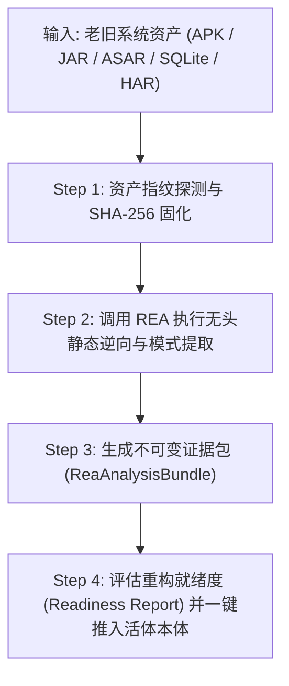

# REA 存量系统逆向工程与重构评估技能指南 (REA Reverse Engineering Skill)

> **最高工程契约**：工坊全体 AI 数字员工（墨斗/FDA、铁匠/SWE、百晓生/DS、门神/FDSE）在面临存量老旧项目接入、客户无源码但有二进制包（APK/JAR/WAR/ASAR/SQLite/HAR抓包）的场景时，必须严格执行本指南。通过标准逆向管网快速提取业务实体与动词契约，严禁凭空盲猜老系统结构。

---

## 一、 核心定位与 4 大逆向能力通道

| 逆向资产类型 | 触发通道 | 底层分析引擎 | 产出物与本体映射 |
| :--- | :--- | :--- | :--- |
| **Android APK / DEX** | `apk` | JADX 反编译 + AST 扫描 | 提取 Java/Kotlin 类、Spring/Retrofit 注解、路由 ➜ `Object Types` & `Action Types` |
| **Java 字节码 JAR / WAR** | `jar` | JADX / CFR / Procyon | 提取 JPA/MyBatis 实体与 Controller 路由 ➜ `Object Types` & `Action Types` |
| **离线数据库 SQLite DB** | `sqlite` | SQLite Inspector | 提取物理表结构、主外键约束与数据分布 ➜ `Object Types` (layer: table) & `Link Types` |
| **前端打包 dist / ASAR** | `bundle` | Wakaru 反混淆 + ASAR 解包 | 还原前端组件拓扑、Pinia/Vuex 状态树、IPC 接口 ➜ `Action Types` & `seedActions` |
| **网络流量 HAR / PCAP** | `network`| HAR / JSON-RPC 分析器 | 提取运行时真实 REST API 契约与 Payload 格式 ➜ 契约 LLD 与本体动作 |

---

## 二、 标准作业工作流 (Workflow 4 步走)



### Step 1: 资产上传与哈希校验
- 将老旧二进制放置于受控目录；
- 计算并记录 SHA-256 指纹（不可变凭据，防篡改）。

### Step 2: 逆向抽取与证据包组织
- 运行 REA 对应引擎对文件进行解包与反编译；
- 按照 `@paperclipai/ontology-core` 的 `ReaAnalysisBundle` 契约归一化输出 JSON。

### Step 3: 一键推入 Living Ontology 认知流水线
- 执行统一抽取工具：
  ```bash
  node scripts/rea-ingest.mjs --job <jobId> --bundle <bundle.json>
  ```
- 自动完成：
  1. 实体表与类折叠为 `seedNodeTypes`；
  2. 外键关联与调用拓扑折叠为 `seedRelationTypes`；
  3. API 路由折叠为 `seedActions`；
  4. 动态打分并生成《系统重构就绪度评估报告 (Readiness Report)》；
  5. 给出新基线架构推荐（`ruoyi-all-next` 或 `yudao-quad-terminal`）。

### Step 4: 掌柜看板两字确认发布
- 掌柜在工坊控制面检视逆向证据图谱；
- 点击【确认】，原子发布至目标 Project 绑定的 Living Ontology 活体资产库中，正式开启现代化重构工程！
