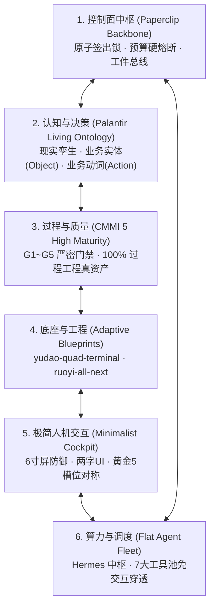
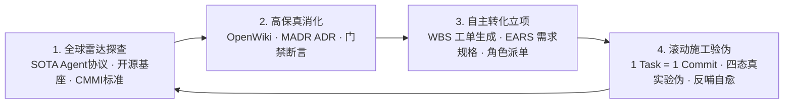
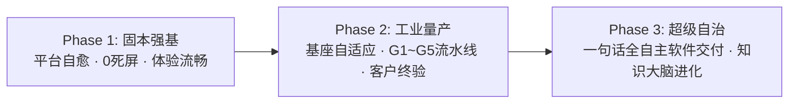

# GOALS — Coolie 平台北极星愿景、战略使命与工程目标大纲

> **核心定义**: Coolie 是全流程 AI 原生数字员工自主驱动的**「端到端商业软件交付工厂 (AI-Native Software Delivery Foundry)」**。  
> 本文件为全平台最高目标纲领，确立工坊建设、商业交付、技术底座与工程治理的根本衡准与战略里程碑。

---

## 一、北极星愿景 (The North Star Vision)

1. **最高生态位**：  
   让每一个企业以极低门槛拥有一家永不停歇、高成熟度（对标 CMMI 5 级质量保障）、100% 交付工程真资产的 AI 软件交付公司。全体数字员工统一站在**软件交付公司总架构师与合伙人**的顶层视角，审视并执行全生命周期的需求、架构、编码、验证与投产。
2. **唯一商业交付准绳**：  
   商业软件交付的成败，不以“代码已提交”、“Demo 可运行”或“PPT 汇报完”为衡量，**唯一法定成败标准是甲方客户在真实生产环境中、依据《软件需求规格说明书 (SRS)》签署的《客户终验核销单 (UAT Acceptance Certificate)》**，实现商务回款与商业闭环。

---

## 二、两大物理世界与生命周期彻底解耦铁律 (Dual-World Physical Isolation)

必须在物理、逻辑与认知上严格区分并隔离以下两大世界：

| 维度 | 世界一：Coolie 工坊平台自身建设 (`coolie-dev`) | 世界二：商业客户项目交付工厂 (`coolie-prod`) |
| :--- | :--- | :--- |
| **物理节点** | **Mac 宿主机**（前线指挥舱、Android 模拟器、Metro 8081、Node 24、brew） | **云端生产服务器集群**（`tc-coolie-claw` 生产控制面 + `aja-pc` 业务中台 + `cwall` 算力节点） |
| **主体属性** | **工坊工具与平台本体**（本地施工团队，生产工具自身） | **商业交付客体**（客户现场业务系统，交付成果） |
| **核心职责** | 建设与迭代工坊控制面系统、移动端原生 APP、数字员工协作机制、工具链与调度器 | 承载各行业交付项目（如云南移动企微、九夏智居中台、residential-plan-service 等） |
| **数据边界** | 仅承载工坊内部研发工单、心跳日志、代码仓库与内部协同文档 | 真实生产数据（订单、图纸、板材率、企微画像等）由交付系统自身独立承载，与工坊严格隔离 |
| **核心关切** | **研发体验流畅迅捷**，根除墨迹、繁杂、断流与假死，保障高频自主 Loop 稳定保活 | **契约守恒与客户终验**，100% 落实 CMMI 01~09 过程真资产，确保现场 0 故障 |

---

## 三、六位一体超级集成体架构目标 (Super-Foundry 6-in-1 Architecture)

Coolie 平台必须长期维系并深化以下六位一体超级集成体架构：

1. **控制面中枢 (Paperclip Backbone)**：  
   单一人负责人原子签出锁、实时 Token 与花费硬熔断、原生协同文档 (`documents`)、不可变工件总线 (`issue_work_products`) 与全链路活动审计账本。
2. **认知与决策 (Palantir Living Ontology)**：  
   以业务实体 (Object Types) 与业务动词 (Action Types) 为双核，项目进厂即建本体域，任务施工挂载动词因果血缘，代码与真机快照作为不可篡改证据沉淀。
3. **过程与质量 (CMMI 5 High Maturity Engineering)**：  
   全面落实从 0 到 1 商业软件工程资产化：
   - `G1` 需求规格 (SRS + EARS + RTM 追溯矩阵)；
   - `G2` 架构与技术解决方案 (HLD + DAR 选型矩阵 + 租户物理隔离)；
   - `G3` 详细设计与静态契约 (LLD + OpenAPI 契约 + TS 强类型 SDK + 0 编译报错)；
   - `G4` 测试与真实验证 (测试总结报告 + 四态真机无死穴截屏 + 变异测试打假)；
   - `G5` 生产投产与运维 (不可变制品指纹 + 7 步无缓存部署 + 秒级回滚 SOP)；
   - `G6-G7` 稳定性与合规 (SLO/SLI 度量 + 5-Whys CAR 缺陷根本原因复盘)。
4. **底座与工程自适应规范 (Adaptive Blueprints)**：  
   确立两大核心开源底座生态位的战略选型法典：
   - **`yudao-quad-terminal` (芋道四位一体多端基座)**：Java 17/21 + Spring Boot 3 + Vue 3 + Uni-App + Expo 原生 App。覆盖 PC + 小程序 + 原生 App + 微服务中台全渠道闭环，拥有 19 大垂直行业域成熟资产，专攻政企信创、多端覆盖与完备商用中台。
   - **`ruoyi-all-next` (现代化全栈轻量级基座)**：TypeScript + Next.js 16 + React 19 + Tailwind CSS + Prisma。全栈同构、极度敏捷，开箱即用支持 3200 端口沙箱实时极速预览，专攻快速打样、POC 原型与轻量级云原生交付。
5. **极简人机驾驶舱 (Minimalist Cockpit)**：  
   - **移动端 6 寸屏极限物理视口防御**：严格适配 320px~332px 视口宽度防撑爆，单手操作可达；
   - **高信噪比极简文案**：核心操作统一收敛为凝练的两字按钮（如“同意”、“驳回”、“立项”、“派单”）；
   - **经典绝对对称底栏**：保持黄金 5 槽位绝对对称（`Overview` / `Tasks` / `[+]` / `Studio` / `Assets`）；
   - **无感就地导航**：严格保持 LIFO 调用栈，就地浮层覆盖，杜绝跨 Tab 乱跳。
6. **算力与调度中枢 (Flat Digital Employee Fleet)**：  
   以 Hermes 为交付工厂调度决策中枢，统领底层 7 大工具池（`agy`, `claude-glm`, `claude-mm`, `cmd`, `copilot`, `kiro-cli`, `hermes`），后台免交互授权（`--dangerously-skip-permissions` / `--yolo`），依托 Tailscale Mesh 网络在多机矩阵（Mac、cwall、aja-pc、tc-coolie-claw）之间实现透明穿透调度。

---

## 四、工坊产品体验与抗熵治理目标 (UX & Anti-Entropy Objectives)

彻底解决工坊在日常建设与运行中的“墨迹、繁杂、异常、断流”痛点，达到与前沿 IDE 一致的流畅交付体验：

1. **根除任务假死与断流**：  
   - 心跳重试耗尽自动阶梯退避复活（5m / 15m / 60m 唤醒队列，封顶 3 次），阻断工单自动救活；
   - 交付主线常驻例行任务 (Routine) 自动保活与超时自动收口（如 `setup-long-term-routine.mjs`）；
   - 耗时超 60 秒的重型任务（Docker build / 全量测试）强制后台异步化并在 1 秒内给出预估耗时心跳，杜绝会话冻结。
2. **根除虚假完工与代码悬空**：  
   - **1 Task = 1 Commit & Clean Working Tree**：工单标为 `done` 时必须物理绑定已推送到远端的有效 Commit SHA；工作树必须保证 `0 dirty, 0 untracked`；
   - **严禁 `git stash` 掩埋**：严禁把未完工或同伴代码推入 stash 堆栈换取构建假通过，根除隐蔽退化。
3. **消除无效复杂与繁杂交互**：  
   - 全盘收敛孤儿死屏、死导入与废弃按钮（如 COOA-234 清理无用 Pipelines/Plans/TasksScreen）；
   - 一站式审批流打通：收件箱外露审批 Tab 与动态角标，实现一跳查验、两字决策；
   - 流式同帧交互稳固：支持长文本平滑流式推送，手势解锚与底部吸附分帧恒定。

---

## 五、外部前沿知识持续动态吸收与滚动演进闭环 (External Knowledge Dynamic Absorption & Continuous Rolling Loop)

工坊产品不是固化的代码静态切片，而是具备高频新陈代谢能力的有机生命体。AI Agent 技术与开源基座生态日新月异，闭门造车必将迅速落后。工坊必须建立像呼吸与新陈代谢一样自然流转的**「外部知识动态吸收消化引擎 (Knowledge Ingestion & Rolling Loop Engine)」**：

### 1. 四阶段动态知识代谢流水线 (4-Stage Knowledge Metabolism Pipeline)
1. **阶段一：全球雷达探查与前沿摄取 (Global Scouting & SOTA Ingestion)**：
   - 持续对标全球前沿数字员工范式（Google DeepMind Antigravity, Palantir Foundry, Paperclip, Devin, Anthropic ACP/Computer Use）；
   - 持续吸纳主流工业级开源基座体系（芋道 Yudao-Cloud 19 域微服务/单体、若依 RuoYi-All-Next Next.js 16/React 19 轻量基座、MedusaJS v2 可逆 Saga 工作流、Supabase 极速开发）；
   - 持续追踪 CMMI 5 级高成熟度度量体系、Google SRE 稳定性标准与 Strix 红队渗透安全规范。
2. **阶段二：高保真消化与活体本体化 (Digestion & Living Ontologization)**：
   - 外部前沿知识进入工坊后，第一时间进行语义对齐与最小侵入性转译，沉淀为三类工程资产：
     - **OpenWiki 词条 (`wiki/`)**：为 LLM 知识大脑提供高内聚双向链接的索引词条，消除全盘盲搜；
     - **MADR 架构决策记录 (`docs/03_design/adr/`)**：记录方案选型理由、替代方案、契约变动与潜在影响；
     - **数字员工行动军规 (`.agents/rules/`)**：转化为可被编译器、测试套件与预提交脚本机检的硬约束。
3. **阶段三：自主转化工程工单与立项排期 (Autonomous Issue Generation & WBS Plan)**：
   - 将消化后的外部最佳实践，自动转译为平台自身演进或商业交付的具体 WBS 工单 (`COOA-xxx`)；
   - 严格遵循 EARS 严谨规格，明确负责数字员工角色（Hermes / 墨斗 / 铁匠 / 门神 / 兜底渊），杜绝口头悬空。
4. **阶段四：持续滚动施工、验伪反哺与抗退化固化 (Rolling Execution, Verification & Feedback Loop)**：
   - 数字员工依托后台守护中枢 (`coolie-dev-loop-supervisor`) 保持 24x7 持续滚动 loop；
   - 严格恪守 1 Task = 1 Commit、Clean Working Tree，每一阶段以实质性物理工程资产结项；
   - 施工中的踩坑与经验自动反哺至 OpenWiki 踩坑指南 (`wiki/gotchas/`) 与预提交门禁中，形成永不衰退的正向自进化飞轮。

### 2. 知识吸收与演进三大铁律 (Three Iron Laws of Knowledge Ingestion)
1. **实事求是，实证为王 (RFC 2119 & Ground-Truth)**：严禁未经真实代码、测试用例或真机走查验证的虚浮概念入库；
2. **零特性污染与向后兼容 (Zero Feature Pollution & Backwards Compatibility)**：外部技术引入必须保持现有 263 张物理表、Paperclip 控制面主线与客户端 6 寸屏界面的 100% 契约稳定；
3. **单向演进与抗退化门禁 (One-Way Evolution & Automated Regression Guard)**：每一次演进必须固化至少一道自动化测试或预提交守卫，杜绝历史缺陷卷土重来。

---

## 六、战略里程碑规划 (Strategic Milestones)

### Phase 1: 固本强基 (Platform Stability & Fluid UX) — 当前阶段
- [x] **任务断流与假死治理**：完成 `COOA-42` 阶梯复活机制与 dev-server 热重载；
- [x] **自主巡检 Loop 机制**：建立分钟级守护进程与保活 Keeper，实现 100% 自动解卡与超时 Routine 收口；
- [x] **移动端边缘屏与结构性死屏清理**：完成 `COOA-234` 与 `COOA-237`，审批流闭环，Inbox Zero 达成；
- [x] **知识吸收与自主演进滚动 Loop 闭环**：通过 Antigravity 持续调度与守护进程，实现外部知识从摄取 ➔ 消化 ➔ 立项 ➔ 施工 ➔ 验伪的全流程自动化自愈；
- [ ] **全端体验一致性**：Web 控制台、移动原生 App 与 72 工具池状态全面对齐。

### Phase 2: 工业量产 (Standardized Foundry & Customer Delivery)
- [ ] **两大底座秒级派生**：`yudao-quad-terminal` 与 `ruoyi-all-next` 脚手架派生流水线秒级初始化；
- [ ] **CMMI G1~G5 自动化门禁流水线**：需求进厂 ➜ 架构定界 ➜ 契约编码 ➜ 真实验证 ➜ 生产割接全链路卡片化串联；
- [ ] **标杆商业项目落地签署终验单**：完成云南移动、九夏智居等客户项目的正式投产与甲方纸质签署核销。

### Phase 3: 超级自治 (Autonomous Software Factory)
- [ ] **掌柜一句话全自主交付**：掌柜口语化输入一句话，数字员工协同完成需求挖掘、架构设计、工程编码、测试集生成与发布回滚预案；
- [ ] **OpenWiki 动态知识大脑自进化**：从每次事故复盘 (5-Whys) 与实际交付中自动提炼守卫断言与技术资产，系统持续抗退化。

---

## 七、不可逾越的工程底线 (Non-Negotiable Axiomatic Guardrails)

全体数字员工、协作者与掌柜在执行任何任务时，必须严格遵守五大铁律：

1. **No Artifact, No Done（无工件不完工）**：  
   任务标为 `done` 时必须挂载实质性物理工程资产（Commit PR、在线预览、真机快照、规格文档或机器证据）。
2. **1 Task = 1 Commit & Clean Working Tree（一任务一提交，保持工作区绝对纯净）**：  
   提交必须通过全部预提交守卫（编译 0 报错、单测通过、无未跟踪散落文件）。
3. **单一人原子签出锁（Single Assignee Checkout Lock）**：  
   接单执行必须原子签出，杜绝多 Agent 冲突踩踏。
4. **真实真机四态验伪（Real Multi-Modal Ground Truth）**：  
   严禁使用空洞假 Mock 伪造测试结果，移动端交互必须基于真实模拟器/真机快照与几何防遮挡断言。
5. **公司与项目物理隔离边界（Strict Isolation）**：  
   严禁跨公司、跨项目篡改数据或随意拷贝代码，尊重每台机器与每个项目的独立基线。
