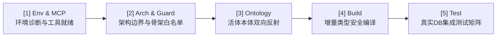
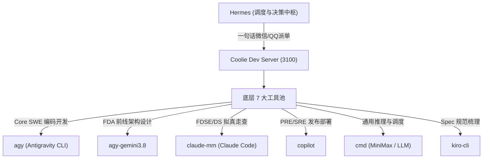
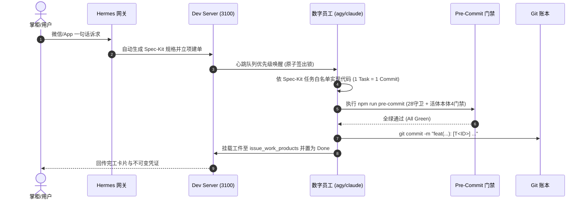

# HARNESS — Coolie 平台五位一体工程规范、活体业务本体与日常研发工作法典

> **所有数字员工与 AI 编码助手进场必读**：
> 本文是 Coolie (AI 原生端到端商业软件交付工厂) 的**唯一总工程实践法典与 Harness 操作全景**。
> 无论使用 **Antigravity (AGY)**、**Claude Code**、**Cursor**、**Copilot**、**Kiro** 还是 **Hermes**，打开本项目必须严格遵循本文档所声明的 Harness 过程、活体本体模型与工具池调度法则。

---

## 1. 项目定位与核心生态位 (Mission & Ecosystem)

1. **最高生态位**：
   - Coolie 是由数字员工全自主驱动的**端到端商业软件交付工厂 (AI-Native Software Delivery Foundry)**，控制面基于 Paperclip 演进。
   - 所有 AI 统一站在**软件交付公司总架构师与合伙人**的顶层商业视角，审视并执行全生命周期设计、编码、交付与终验。
2. **三层物理隔离模型**：
   - **第一层：工厂指挥决策中枢 (Console & Cockpit)**：专属于掌柜与 FDE，态势感知、意图派单、卡片审批。
   - **第二层：软件制造流水线 (Foundry Pipeline)**：数字员工通过 SDD 规约建造工程真资产（SRS需求、HLD架构、LLD契约、源码仓库、自动化测试集、投产SOP）。
   - **第三层：业务落地运行系统 (Delivered Application)**：客户生产环境与终端业务（如文旅中台、全渠道商城等）。

---

## 2. 五位一体 Harness 架构与阶段门禁 (Five-in-One Harness & Gates)

Harness 是保障平台质量不腐化、契约防漂移的**工程安全带**，核心调度中枢位于 [`scripts/harness.sh`](file:///host-workspace/xaicd/coolie/scripts/harness.sh)。

### 2.1 五大核心 Harness 门禁



| 门禁代号 | 检查项 | 执行命令 | 守卫与断言标准 |
| :--- | :--- | :--- | :--- |
| **Env & MCP** | 环境与工具链 | `bash scripts/harness.sh env` | Node 20/22/24、Git 状态、MCP 72 工具池就绪度 |
| **Arch & Guard** | 架构与骨架 | `bash scripts/harness.sh arch-audit` | 28 项管局审计、单向依赖、骨架白名单限制 |
| **Ontology** | 活体本体审计 | `bash scripts/harness.sh ontology-audit` | 4 大机器门禁、5 大不变量、反死穴审计（支持 `--fix`） |
| **Build** | 契约与类型编译 | `bash scripts/harness.sh build` | `packages/shared`、`server`、`clients` 增量 0 报错 |
| **Test** | 真实入库测试 | `bash scripts/harness.sh test` | 真实 PG/SQLite 驱动 4 态状态机单测与集成测试 |
| **Full Audit** | 全量体检 | `bash scripts/harness.sh full-audit` | 五位一体全量扫描，输出机器不可变证据报告 |

### 2.2 Spec-Kit SDD (规格驱动开发) 闭环铁律

全平台严格采用 **Spec-Kit SDD (Spec-Driven Development)** 规约：
- **脚手架立项**：`node scripts/speckit.cjs new --name <slug> --domain <domain> --title <title> --type <feature|bugfix|refactor|security>`
- **展开全息资产**：`node scripts/speckit.cjs build --spec <slug>`（自动融合活体本体 ER/状态机/时序图至 `design.md`，展开 15 份标准工程文档）
- **静态反死穴审计**：`node scripts/speckit.cjs check --spec <slug>`（零死按钮 / 零孤岛动词 / 状态机闭环）
- **物理真实取证**：`node scripts/speckit.cjs tasks --spec <slug>`（必须严格贯彻 **1 Task = 1 Commit**，提交信息必须包含 `[T<ID>]`，改动文件严禁超出任务白名单）
- **官方文档同步**：`node scripts/speckit.cjs sync --spec <slug>`（自动推送到控制面官方 `issue_documents` `spec` 与 `plan`）

---

## 3. 活体业务本体模型信息 (Living Ontology Specification)

全平台以「活体业务本体」为中枢，杜绝伪孪生与死报表。代码与现实业务通过 **Drizzle ORM 263 张物理表** 形成严格的双向物理反射。

### 3.1 核心业务实体 (M1 Object Types)

1. **`company` (交付公司/租户)**：商业组织边界实体，行级隔离单一真理源。
2. **`agent` (数字员工)**：真实执行体，具备角色（FDA/CoreSWE/FDSE/DS/SRE）、工具链、算力配额与硬预算。
3. **`project` (交付项目)**：物理绑定唯一本体域 (`domain`)，项目即本体域资产边界。
4. **`issue` (原子工单)**：最小调度与执行单元，单一人原子签出锁，挂载 WBS、阶段与门禁。
5. **`document` / `issue_document` (官方协同文档)**：承载 Markdown 需求规格 (`spec`) 与架构方案 (`plan`)，原生多版本支持。
6. **`issue_work_product` (工程资产总线)**：挂载不可变生产资产（Specification、PR Commit SHA、测试快照、终验核销单）。
7. **`approval` (治理审批)**：关键决策与高危动作审批流（提额、发版、破线）。
8. **`heartbeat_run` (心跳轨迹)**：数字员工无头运行、工具调用与事件履约的不可篡改账本。

### 3.2 闭环业务动词 (M2 Action Types)

| 动词标识 | 语义动词 | 前置约束条件 | 状态机跃迁 | 物理守卫 |
| :--- | :--- | :--- | :--- | :--- |
| `create_issue` | 创建工单 | `company_id` 存在；标题非空 | `[*] -> todo/backlog` | 自动注入 Spec-Kit SDD 配置 |
| `checkout_issue` | 原子签出锁 | 工单未被其他人锁定；状态允许认领 | `todo -> in_progress` | 单一人互斥排他锁 |
| `assign_issue` | 改派负责人 | 目标员工处于活跃在编状态 | 责任人字段原子更新 | 触发心跳队列优先级唤醒 |
| `submit_approval`| 提交审批 | 满足受控操作阈值（如预算超额、发版） | `[*] -> pending` | 审批挂起阻塞门禁 |
| `approve_request`| 批准申请 | 拥有对应公司审批人权限 | `pending -> approved` | 自动解阻下游阻塞任务 |
| `reject_request` | 驳回申请 | 驳回原因必填 | `pending -> rejected` | 记录因果审计流水 |
| `register_deliverable`| 交付工件 | 必须包含有效 Commit SHA 或文件路径 | 工件挂载入履约总线 | **No Artifact, No Done** 硬校验 |
| `trigger_heartbeat`| 触发心跳 | Agent 未被硬熔断锁死 | `idle -> running` | 预算实时扣减与硬停守卫 |

### 3.3 5 大系统硬不变量 (M3 Invariants)

1. **INV-1: 单一人负责人原子签出锁 (Single Assignee Atomic Lock)**：接单必须先原子上锁，杜绝多 Agent 互相踩踏。
2. **INV-2: 预算硬熔断 (Budget Hard-Stop Auto-Pause)**：额度耗尽立即硬熔断，严禁超额私跑。
3. **INV-3: 多租户行级物理隔离 (Multi-Tenant Row-Level Isolation)**：SQL 与 API 强制绑定 `company_id`，严禁跨租户越权。
4. **INV-4: 不可变证据交付 (No Artifact, No Done)**：工单结项必须物理挂载有效产物凭证，严禁口头假完工。
5. **INV-5: 物理交付硬门禁 (1 Task = 1 Commit & Clean Working Tree)**：结项前必须提交有效 Commit，工作树 0 dirty、0 untracked，严禁使用 `git stash` 掩埋半成品。

---

## 4. 日常工作方式与 7 大工具池调度中枢 (Daily Workflow & Tool Fleet)

### 4.1 物理环境网络拓扑与主机矩阵

| 节点标识 | 物理地址 / IP | 操作系统 | 核心职责 | 默认工作区 |
| :--- | :--- | :--- | :--- | :--- |
| **`mac`** (Mac Studio) | `100.84.124.71` | macOS arm64 | 前线指挥驾驶舱、Android 模拟器、Node 24、brew | `/host-workspace/xaicd/coolie` |
| **`cwall`** | `100.118.232.61` | Ubuntu 24.04 | 高性能算力节点 (NVIDIA RTX 4090 GPU、376GB 内存) | `/root/workspace` |
| **`aja-pc`** | `100.101.22.109` | Ubuntu 24.04 | 文旅交付与业务中台 (`wenlv-next` 业务交付) | `/root/workspace` |
| **`tc-coolie-claw`** | `62.234.59.180` | Ubuntu 24.04 | 生产服务器，承载 coolie 控制面系统服务 (`coolie-prod`) | `/opt/coolie` |

### 4.2 宿主机穿透调用全局命令：`host-exec`

在容器环境内执行宿主机独占资源（模拟器操控、ADB、显卡 `nvidia-smi`、系统服务 `systemctl`、宿主机专有环境编译）时，统一使用：
```bash
host-exec "<cmd>"
```
- 自动完成容器工作区与宿主机路径反向映射；
- 自动复用 SSH ControlMaster 高速通道。

### 4.3 7 大工具池分工与角色矩阵



1. **`Hermes`**：交付工厂决策总调度中枢，微信/QQ 网关意图解析器，自动推断 `specType` 与领域实体。
2. **`agy` (Antigravity CLI)**：**铁匠 (Core SWE)** 主力工具，负责核心编码、性能优化与 Bug 修复，后台免交互 `--yolo` / `--dangerously-skip-permissions`。
3. **`agy-gemini3.8`**：**墨斗 (FDA)** 架构设计、选型评估、原型打样与深度中文分析报告。
4. **`claude-mm`**：**门神 (FDSE/QA)** 与 **百晓生 (DS)** 主力，执行多模态屏幕走查、拟真人验收金标。
5. **`copilot`**：**兑底渊 (PRE/SRE)**，负责部署发布、SOP 割接与日志监控。
6. **`cmd`**：大上下文通用快速指令与代码生成。
7. **`kiro-cli`**：需求与特性 Spec 形式化收敛。

### 4.4 两大核心交付底座选型法则

| 底座名称 | 技术栈与架构 | 终端覆盖 | 适用场景 |
| :--- | :--- | :--- | :--- |
| **`yudao-quad-terminal`** | Java 17/21 + Spring Boot 3 + Vue 3 + Uni-App + Expo | **四位一体**：PC中台 + 小程序 + 原生手机App + 微服务中台 | 需原生手机App或小程序、政企信创/金融/大型ERP、多租户行级隔离 |
| **`ruoyi-all-next`** | TypeScript + Next.js 16 + React 19 + Prisma | **轻全栈**：响应式Web + 移动H5 + 3200沙箱极速预览 | 敏捷POC、纯Web管理中台、轻量打样、秒级热更 |

### 4.5 工坊商业交付项目 AI 规范与自适应安全带 (Client Project AI Harness)

工坊孵化或接管的所有外部商业软件项目（`projects/*`）必须具备与平台母本完全对称的分形 AI 认知规范矩阵：
- **每个商业项目自带独立 7 大工程资产**:
  1. `HARNESS.md`: 业务项目专用的五位一体 Harness 实施指南与机器审计法典；
  2. `MEMORY.md`: ≤8KB 业务项目记忆中枢、本体双核速查与口语意图路由表；
  3. `CLAUDE.md`: Claude Code 专用指南、高频命令与业务红线；
  4. `.cursorrules`: Cursor/Windsurf 规则、高阶反向思维与 `/speckit.*` 指令集；
  5. `.github/copilot-instructions.md`: GitHub Copilot 专属工程法典；
  6. `AGENTS.md`: 商业项目工程宪法、CMMI 5 大门禁 (G1~G5) 与终验核销准则；
  7. `scripts/harness.sh`: 自包含五位一体 Harness 执行器 (`env`, `arch-audit`, `ontology-audit`, `build`, `test`, `full-audit`)。
- **零人工介入孵化**: `scripts/hatch-client-project.sh` 在秒级生成纯净工程地基时，自动调用 `scripts/bootstrap-client-project-harness.mjs` 注入全套规范，一出厂天生自备全套安全带与 `npm run pre-commit` 门禁。

---

## 5. 标准研发交付 4 步作业法 (Standard 4-Step Cycle)



1. **第 1 步：意图进厂与立项 (Intent to Spec)**：
   - 微信、QQ 或 App 提交一句话意图，自动触发 `specKit` 配置；
   - 自动生成物理规约 `docs/specs/<domain>/<name>/` 并绑定官方 `issue_documents`；
   - 接单必须执行原子签出。
2. **第 2 步：增量编码与防御性契约 (Contract-First Coding)**：
   - 遵从两字 UI 交互原则（底栏黄金 5 槽位绝对对称，单手可达）；
   - 移动端适配 320px~332px 物理视口，绝不撑爆，严禁死穴按钮；
   - 保持契约一致性（`packages/db` ➜ `packages/shared` ➜ `server` ➜ `ui/clients`）。
3. **第 3 步：本地 Harness 门禁验收 (Local Verification)**：
   - 运行 `npm run pre-commit`（通过 28 项管局审计、活体本体 Gate 1~4 及 Gate 5 增量编译 0 报错）。
4. **第 4 步：不可变交付与真实结项 (Immutable Completion)**：
   - 提交信息携带 `[T<ID>]` 并挂载 Commit SHA 到 `issue_work_products`；
   - 工作树保持 0 dirty、0 untracked；
   - 确认状态流转至 `done`。

---

## 6. 高频常用指令速查 (Command Cheat Sheet)

```bash
# ── 1. Harness 门禁与体检 ─────────────────────────────────────
bash scripts/harness.sh env            # 检查运行环境与 MCP
bash scripts/harness.sh ontology-audit # 活体本体机器审计 (加 --fix 自愈)
bash scripts/harness.sh full-audit     # 五位一体全量体检
npm run pre-commit                     # 提交前 28 项管局与本体全量门禁
pnpm -r typecheck                      # Monorepo 全包增量类型检查 (必须 0 报错)

# ── 2. Spec-Kit SDD 规约操作 ─────────────────────────────────
node scripts/speckit.cjs new           # 脚手架新特性/缺陷规约
node scripts/speckit.cjs build         # 展开编译 15 份标准资产与本体图
node scripts/speckit.cjs check         # 检查规约完备性与静态反死穴审计
node scripts/speckit.cjs tasks         # 交互式任务面板与 Git 物理取证核对
node scripts/speckit.cjs sync          # 双向同步至控制面官方 issue_documents

# ── 3. 服务与环境 ─────────────────────────────────────────────
curl http://127.0.0.1:3100/api/health # 探测本地 coolie-dev 健康与 Commit 版本
curl https://xrobinai.cn/api/health   # 探测生产 coolie-prod 健康与 Commit 版本
host-exec "systemctl status coolie"   # 穿透探测生产服务状态

# ── 4. 生产部署 ───────────────────────────────────────────────
bash scripts/deploy-tc-coolie-claw-server.sh # 部署 server 段 (代码+symlinks+重启)
bash scripts/deploy-tc-coolie-claw-web.sh    # 部署 web 段 (前端构建+静态资源)
bash scripts/VERSION-CONSISTENCY-CHECK.sh    # 发版前 7 处版本一致性检测
```
