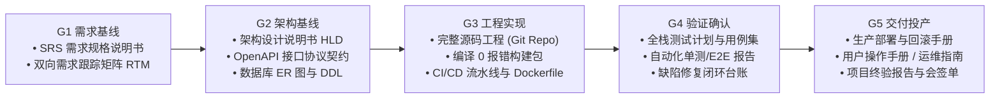

# CMMI 项目工程交付物与上线运行时业务数据的本质边界重构

> **作者**：Coolie 平台特派 FDE 审计组  
> **审视基准**：老板 2026-10-08 关键纠偏——「CMMI 过程交付物的定义不是我想要的，CMMI 是项目交付过程管理，是这个项目从 0-1 的建设交付过程产物，文档、代码这些；不是项目上线运行后系统内容产物」。  
> **核心使命**：彻底划清“0-1 软件项目工程交付产物”与“系统上线后运行业务数据”的物理界限，废除概念错位，重塑高质量软件交付物矩阵。

---

## 一、 根本性概念纠偏：彻底切开两大生命周期产物

老板的一席话直切本质。过去一段时间，平台在交付物定义上犯了最严重的**张冠李戴与层级错位**：把系统上线运行后产生的业务数据，错误地当成了 CMMI 软件项目交付的过程产物！

```
【致命错位举例】：
你去给银行做一套「核心信贷审批系统」：
- 正确的 CMMI 工程交付物：SRS需求规格、技术架构设计、API接口契约、系统完整源码、性能测试报告、部署手册、客户验收单。
- 荒谬的把业务数据当交付物：系统里张三借了5000块钱的借款单、放款审批记录、利息计算结果。
```

平台过去在“九夏智居”或“云南移动”项目中，恰恰犯了这个错误——把“文彬家玄关柜算料利用率 76.42%”、“30件板件打孔数控代码 G-code”、“企微营销触达话术 JSON”当作交付物。**这些根本不是建设九夏智居或企微平台的工程交付物，而是这两个软件系统上线运行后产生的业务内容数据 (Runtime Business Outputs)！**

### 两大产物物理隔离定义表

| 维度 | **CMMI 项目工程交付物 (Build-Time Engineering Assets)** | **系统上线后运行业务数据 (Runtime Business Outputs)** |
| :--- | :--- | :--- |
| **本质属性** | **把软件系统从 0 到 1 建设出来、验收、交付的工程资产** | **软件系统上线后，最终用户日常使用产生的数据与业务记录** |
| **面向对象** | 甲方项目采购方、技术负责人、运维人员、质量审计员 | 最终业务用户（业主文彬、商场导购、消费者、运营人员） |
| **典型代表** | 1. 软件需求规格说明书 (SRS/EARS)<br>2. 架构设计说明书 (HLD) 与 API Swagger 契约<br>3. 数据库 ER 图与 DDL Migration 脚本<br>4. 完整工程源码仓库与 CI/CD 构建脚本<br>5. 系统测试用例集、压力测试与真机 E2E 报告<br>6. 生产部署手册、秒级回滚预案与用户操作手册<br>7. 项目终验报告与双方会签单 | 1. 某业主的玄关柜 3D 设计方案<br>2. 某次开料排版的利用率 76.42%<br>3. 导出给工厂雕刻机用的数控 G 代码<br>4. 企微某次促销活动的触达客户名单<br>5. 导购发送给客户的话术草稿 |
| **所属中枢** | **CMMI 过程管理 & Spec-First 工程流水线** | **活体业务本体 (Ontology Object & Action Data)** |
| **质量衡量** | 编译 0 报错、契约完备、测试覆盖率、部署自动化率、客户验收签字 | 算法利用率高低、业务转化率、客户满意度、订单利润率 |

---

## 二、 为什么老板说“还不如 Spec 驱动的结果”？

老板对 Spec 驱动的肯定，揭示了工程落地的真理：
1. **Spec 驱动做的是最纯粹的 0-1 软件工程过程管理**：
   - **Requirement**：精准定义要交付的软件功能规格；
   - **Design**：精确定义架构影响面、文件修改清单与接口变更；
   - **Task / Code**：输出实实在在通过编译的生产代码与自动化测试脚本。
   - 它每走一步，产出的都是**实打实的软件工程资产**，绝不假造业务数据，所以它扎实、可信、高效！
2. **反观变形的 CMMI 过程**：
   - 本该产出高质量的“0-1 软件工程资产”，却被大模型搞成了“写假大空套话长文”；
   - 发现套话没人看，又病急乱投医，把上线运行后的业务数据（算料利用率、G 代码）塞进来充当交付物；
   - 结果**两头落空**：真正的软件工程产物（高质量源码、严密契约、部署包）没有沉淀出来，反而让大家对 CMMI 产生了严重的不信任感！

---

## 三、 CMMI 0-1 项目工程交付物唯一定义与规范矩阵

彻底拨乱反正，CMMI 在平台的唯一职责就是：**管理客户项目从立项到终验上线（0 到 1）的软件工程交付全生命周期！**

### G1 到 G5 的唯一合法工程交付物清单



### 1. G1 需求基线 (Requirements Baseline)
- **交付物 1：《软件需求规格说明书 (SRS)》**：采用 EARS 句式严密表达每个功能特性，消灭模糊副词；
- **交付物 2：《双向需求跟踪矩阵 (RTM)》**：每一条业务需求，必须 100% 对应到后续的架构模块与测试用例编号。

### 2. G2 架构与设计基线 (Architecture Baseline)
- **交付物 1：《系统架构与概要设计说明书 (HLD)》**：微服务拓扑图、技术选型理由 (DAR)、高并发与数据隔离设计；
- **交付物 2：《OpenAPI / Swagger 接口契约定义》**：前后端解耦的标准化接口定义文件；
- **交付物 3：《数据库设计说明书与物理 DDL》**：数据库表结构 ER 图、索引设计、Migration 脚本。

### 3. G3 构造与实现基线 (Build & Construction)
- **交付物 1：完整工程源码仓库 (Source Code Repository)**：
  - 遵循单一职责与分层架构，具备完整的 `package.json`、编译配置与环境配置文件；
- **交付物 2：一键编译打包产物与容器化配置**：
  - 执行 `pnpm build` 或 `mvn clean package` 退出码必须为 0；
  - 提供生产级 `Dockerfile` 与 `docker-compose.yml`。

### 4. G4 验证与确认基线 (Verification & Validation)
- **交付物 1：《系统全栈测试用例集 (Test Suite)》**：覆盖正常流、边界值、异常流；
- **交付物 2：《自动化测试执行与回归报告》**：包含单元测试覆盖率、端到端 UI 拟真人测试报告与缺陷闭环清单。

### 5. G5 交付与投产基线 (Release & Handover)
- **交付物 1：《生产环境部署手册与回滚预案 (Deployment & Rollback SOP)》**：运维一键拉起与秒级回滚步骤；
- **交付物 2：《用户操作使用手册 / 运维白皮书》**：给甲方业务用户与管理员的使用手册；
- **交付物 3：《项目竣工验收报告与终验会签单》**：双方签字盖章的验收证明。

---

## 四、 落地行动路线（给老板明日审查的明确抓手）

1. **界面与数据模型物理拆分**：
   - **工程交付物中心**：只展示该软件项目 0-1 建设过程中的 7 类工程资产（SRS、HLD、API 契约、源码仓库、测试用例、部署手册、验收单）；
   - **业务数据大盘**：若该项目上线后有运行数据（如算料记录、企微群名单），属于业务本体域 (Domain) 的运行数据，绝不混入工程交付物中！
2. **吸收 Spec 驱动优势改造 CMMI**：
   - G1-G3 严禁用模板堆砌废话长文，直接以 Spec-driven 的三步走格式作为每个模块的工程骨架；
   - 让 CMMI 成为多个 Spec 模块的集成大盘，既有 Spec 的扎实高效，又有 CMMI 的全流程可控。
