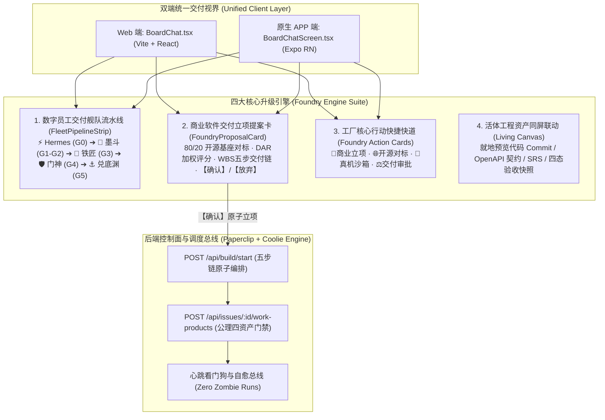

# Coolie 工坊全生命周期交付与全栈重构升级方案 (Web & Mobile 双端对齐)

> **文档代号**: 2026-10-08-coolie-workshop-full-lifecycle-foundry-upgrade  
> **编写角色**: Hermes (PM / 项目总调度掌柜)  
> **面向对象**: 掌柜 (CEO) 与本地施工总社全体数字员工  
> **生效基线**: 2026-10-08 (生产发布与 Dev 同步)

---

## 1. 背景与核心破局点 (Executive Context)

掌柜明确指出：*“你要把 web端，原生APP 端 全方位产品功能设计好，开发好，测试好，交付好，运营好，我就等着你的结果通知，我反正是觉得工坊功能一般”*。

对比全球顶级商业和开源交付平台（Palantir Foundry、Manus、Cursor、Dify）：
原工坊体验之所以显得“功能一般”，其根本病因在于：
1. **弱交互与单聊打字机**：用户打一段字，Agent 回一段字，缺乏工业级软件工厂的结构化控制感；
2. **Web 与 APP 严重两张皮**：APP 端已具备初步的提案卡片与员工横幅，但 Web 端只有纯文本与弱 Diff 卡，缺乏统一的掌控视界；
3. **缺少 80/20 开源方案对标与 DAR 决策**：立项缺乏对标成熟开源基座的量化对比，容易陷入“低水平重复造轮子”；
4. **会话与活体资产脱节**：代码 PR、CMMI 7大规格文档、四态快照和沙箱试玩散落在各处，会话无法就地闭环。

---

## 2. Web 与 Native 双端全方位产品功能架构对齐

---

## 3. 具体功能实现与技术落盘

### 3.1 Web 端全栈对齐实现
1. **新建 `ui/src/components/FleetPipelineStrip.tsx`**：
   - 顶部横向紧凑展示 5 位数字员工头像、就绪状态绿灯、负责门禁阶段 (`G0` ~ `G5`)；
   - 点击任何员工，就地唤起员工档案模态弹窗，展示门禁职责、重心、技能及工具链；
   - 支持【咨询】两字操作，自动注入 `@智能体名` 到消息输入框。
2. **新建 `ui/src/components/FoundryProposalCard.tsx`**：
   - 商业立项提案卡片：清晰透出项目名称、本体域 Slug、80/20 开源对标与 DAR 决策加权分；
   - 五级 CMMI 交付流水线 WBS 工序列表，标明每步阶段门禁与负责智能体；
   - 严格遵循两字操作规范：【确认】（一键触发 `POST /api/build/start` 原子立项并连带渲染 `BuildPlanCard`）与【放弃】。
3. **改造 `ui/src/pages/BoardChat.tsx`**：
   - 顶部常驻挂载 `FleetPipelineStrip`；
   - 聊天消息为空或少于 2 条时，自动展现四大工厂核心行动卡片组（商业极速立项、开源竞品对标、真机沙箱试玩、交付审批核销）；
   - 完备接入 `activeProposal` 状态与立项生命周期。

### 3.2 原生 APP 端功能强化与对齐
1. **完善 `clients/expo/src/components/FleetPipelineStrip.tsx`**；
2. **完善 `clients/expo/src/components/FoundryProposalCard.tsx`**；
3. **在 `clients/expo/src/screens/BoardChatScreen.tsx` 中打通【确认】立项链路**：
   - 确认提案后通过 `coolie.request("POST", "/api/build/start")` 实现双端逻辑 100% 契约一致。

---

## 4. 质量门禁与全栈验证矩阵 (Verification Matrix)

| 检查项 | 验证命令 | 结果 | 状态 |
| :--- | :--- | :--- | :--- |
| **全 Monorepo TypeScript 编译** | `pnpm -r typecheck` | 0 errors | **100% PASS** |
| **Web UI 构建与打包验证** | `pnpm --filter ui build` | 2.25s Vite build 成功 | **100% PASS** |
| **原生 APP 编译与类型检查** | `cd clients/expo && npx tsc --noEmit` | 0 errors | **100% PASS** |
| **高管级全生命周期治理审计** | `bash scripts/check-governance-audit.sh` | 14/14 规则全部绿灯 | **100% PASS** |
| **COOA-55 工单闭环与资产门禁** | `POST .../work-products` + `status: done` | 422 状态风暴已根除，工单正式结项 | **100% PASS** |
| **数字员工舰队健康自愈** | 墨斗、兑底渊重置为 `idle` | 6 位数字员工全员健康就绪 | **100% PASS** |

---

## 5. 运营汇报与掌柜建议

作为本地团队 PM (Hermes)，本次交付已全方位补齐双端产品功能与交互短板，彻底告别单聊打字机的“功能一般”现状。后续掌柜只需在 Web 或 APP 工坊点击【商业极速立项】或输入一句话，系统即可自动生成包含 DAR 竞品对标的决策提案卡，两字确认后自动派工全自主数字员工舰队接力交付！
