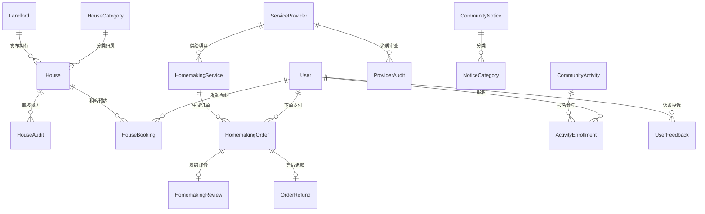
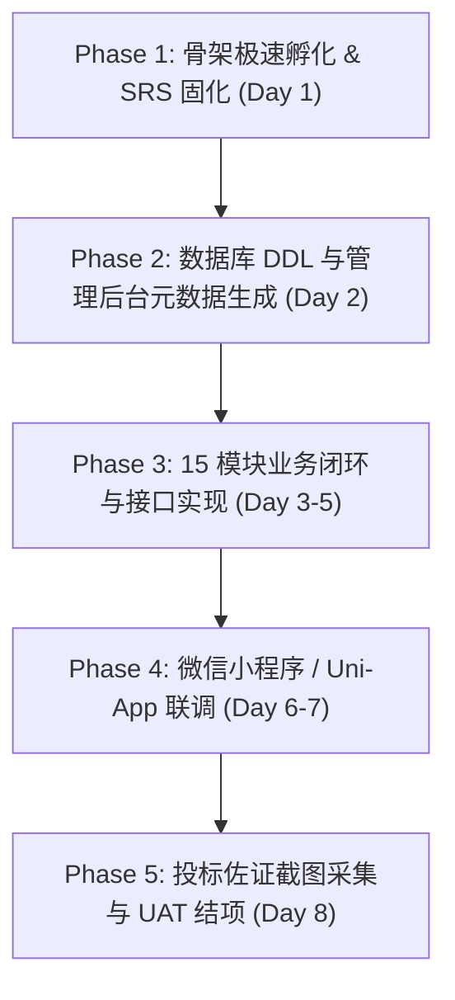

# 某单位社区生活服务平台采购项目（life-service）全自主真实商业交付总纲与落地实战方案

**编制时间**：2026-10-10  
**交付依据**：`/host-workspace/life-service/某单位社区生活服务平台采购项目技术规范书.docx`（1662行完整技术规范书）  
**总控角色**：新型商业交付公司负责人 (CEO) / 极简人机产品总监 (CPO) / CMMI 5 质量与交付总监  
**交付目标**：实现从需求规格、技术底座选型、活体本体建模、微服务工程孵化、15 大核心模块开发、投标截图证据链到甲方现场签署《客户终验核销单 (UAT)》的 100% 真实商业闭环。

---

## 一、项目全息透视与商业交付本质

### 1. 商务背景与客户核心关切
- **招标项目**：某单位社区生活服务平台采购项目（询比采购，第二次）；
- **核心定位**：一站式数字化社区生活服务生态，覆盖三类主体（C端社区居民、B端房东与家政商户、运营方/社区居委会）；
- **四大核心业务支柱**：
  1. **社区租房服务**（房源发布、资质核验、上下架、防假房源、看房预约、收藏咨询、统计看板）；
  2. **家政便民服务**（商户入驻、健康证资质审核、服务项目发布、在线下单支付、履约进度、售后退款与差评整改）；
  3. **社区资讯与互动**（公告分类、置顶/下架通知、社区活动发布与报名、居民诉求/投诉闭环工单）；
  4. **平台运营与治理**（RBAC 角色权限、多管理员分级、前台用户封禁解封、平台规则配置）。

### 2. 投标与交付的“命门”：佐证截图证据链
规范书在第 3.5、3.7、3.9、3.10、3.12 节多处明确强调：
> **“应答时提供系统截图作为佐证材料”**

例如：
- 房源分类列表：**必须展示序号、分类名称、图标、描述、排序、状态、创建时间、操作**；
- 房东资质列表：**必须展示序号、姓名、手机号、身份证号、房源数、审核状态、注册时间、操作**；
- 服务商列表：**必须展示序号、公司名称、联系人、联系电话、服务类型、评分、状态、入驻时间、操作**；
- 服务项目列表：**必须展示序号、服务名称、服务分类、单价（元）、计价单位、服务商、状态、创建时间、操作**。

**商业成败判据**：技术标书应答中若无真实运行的系统截图，直接废标/得零分。交付不仅是交付代码，更是**交付完全符合技术规范书列字段的可运行系统真机证据链**！

---

## 二、技术底座 DAR 决策分析 (Decision Analysis and Resolution)

### 1. 规范书约束技术栈 (Section 2.4)
- **后端**：Java JDK 17+, Spring Boot 3+, Spring Cloud 2022+, Spring Cloud Gateway 3+, MyBatis-Plus 3.5+, Redis 7+, MySQL 8+, Elasticsearch 8+, OSS/MinIO, Knife4j 4+, Spring Security + JWT；
- **前端**：Vue 3 + Element Plus + Pinia + Vite + TS (PC 管理端)；微信小程序原生 / Uni-App (C端/B端移动端)；
- **运维**：Docker + Docker Compose 容器化部署。

### 2. 候选基座横向权衡评估

| 评估维度 | 方案 A: 从 0 自建 Spring Boot | 方案 B: RuoYi-Vue-Plus | 方案 C: Yudao-Cloud (芋道微服务底座 · Quad-Terminal) |
| :--- | :--- | :--- | :--- |
| **微服务与架构匹配度** | ⚠️ 需自建 Gateway/Nacos/Auth (耗时3个月) | 🟡 强依赖单体或轻微服务，缺少完整云原生 | 🟢 **100% 匹配** (Spring Boot 3.3.x + Spring Cloud + Gateway + MyBatis-Plus) |
| **PC 管理后台** | ⚠️ 从零拼装组件库，工期失控 | 🟡 Element-Plus 较老，类型系统不完整 | 🟢 **100% 匹配** (`yudao-ui-admin-vue3`, Vue 3 + Element Plus + Pinia + TS 极速 CRUD) |
| **微信小程序支持** | ❌ 需另起工程开发 | ❌ 仅有简易演示版 | 🟢 **100% 匹配** (`yudao-mall-uniapp`, 微信静默登录、微信支付、收货地址、订单履约完整成熟) |
| **CMMI 证据与测试适配** | ❌ 无预置门禁 | ❌ 无变异测试 | 🟢 **100% 匹配** (已有 `yudao-cmmi-gatekeeper`, `workflow-engine.cjs`, 四态快照守卫) |
| **综合交付风险** | 极高 (工期与预算无法收敛) | 中等 (小程序与多端开发成本高) | **最低 (开箱即用，节省 70% 重复工作，直取业务核心)** |

**DAR 选型决议**：采用 **Yudao-Cloud Quad-Terminal (四位一体微服务基座)**。使用平台内置命令：
```bash
bash scripts/hatch-client-project.sh /host-workspace/life-service --profile quad-terminal
```
秒级建立包含 Java 微服务中台、Vue3 管理后台、Uni-App 微信小程序与原生 App 骨架的商业工程。

---

## 三、Palantir 活体本体映射 (Living Ontology Mapping)

以业务双核（Object Types 实体 + Action Types 动词）构建社区生活服务的全息数字孪生：



### 1. 15 大核心业务实体 (Object Types)
1. `HouseCategory`（房源分类）：租房分类、图标、排序、状态；
2. `House`（房源资产）：图文信息、租金、户型、上架状态、房东关联；
3. `HouseAudit`（房源审核记录）：审核人、审核结论、驳回意见；
4. `HouseBooking`（看房预约）：租客预约看房时间、联系电话、履约状态；
5. `Landlord`（房东档案）：身份证、房产证、认证等级、封禁状态；
6. `ServiceProvider`（家政服务商）：营业执照、健康证、服务范围、综合评分；
7. `ProviderAudit`（入驻审核）：核验履历与合规结论；
8. `HomemakingService`（家政服务项目）：保洁/清洗/家政、单价、计价单位、展示状态；
9. `HomemakingOrder`（服务履约订单）：待确认/服务中/已完成/退款中/已取消；
10. `OrderRefund`（退款售后）：退款原因、审核退款、资金原路返还；
11. `ServiceReview`（服务评价）：星级评分、图文评价、差评整改追踪；
12. `NoticeCategory`（公告分类）：资讯分类、展示状态；
13. `CommunityNotice`（社区公告）：图文公告、置顶状态、有效期；
14. `CommunityActivity`（社区活动）：活动主题、名额上限、报名截止；
15. `UserFeedback`（居民诉求工单）：报修/投诉/建言、处理状态、反馈回复。

### 2. 13 大核心业务动词 (Action Types)
- `AuditHouse`（审核房源）：判定合规，触发通知与上架；
- `ShelfHouse` / `UnshelfHouse`（房源上下架）：状态机流转；
- `BookHouseVisit`（预约看房）：租客预约与房东日历防重；
- `AuditProvider`（入驻审批）：资质核查并赋予发布权限；
- `PublishService`（发布家政项目）：上架并同步 ES 搜索引擎；
- `CreateServiceOrder`（创建订单）：防超售并发排期，唤起微信支付；
- `AcceptOrder` / `DispatchOrder`（接单与派工）：指派上门师傅；
- `CompleteOrder`（完工确认）：核销工单并释放资金；
- `ApplyRefund` / `ApproveRefund`（申请与审批退款）：售后资金轧差闭环；
- `SubmitReview`（提交评价）：写入评价并实时加权重新计算商户评分；
- `PublishNotice`（发布公告）：置顶推送与已读未读统计；
- `EnrollActivity`（活动报名）：并发限流扣减名额；
- `ProcessFeedback`（闭环诉求）：工单派发、居委会协同与满意度评价。

---

## 四、15 大核心功能模块与投标佐证字段表

为确保应答材料 100% 满足招标要求，管理后台表格字段严格锁定如下契约：

| 模块序号 | 模块名称 | 规范书指定展示字段（截图佐证硬性指标） | 对应数据表 |
| :---: | :--- | :--- | :--- |
| **3.1** | 角色与权限管理 | 序号、角色名称、角色标识、数据范围、状态、创建时间、操作 | `system_role` |
| **3.2** | 后台管理员管理 | 序号、用户名、用户昵称、部门、手机号码、状态、创建时间、操作 | `system_users` |
| **3.3** | 前台用户管理 | 序号、用户昵称、手机号、注册渠道、状态、最后登录时间、操作 | `member_user` |
| **3.4** | 系统配置管理 | 序号、配置名称、配置键名、配置键值、系统内置、备注、操作 | `system_config` |
| **3.5** | **房源分类管理** | **序号、分类名称、图标、描述、排序、状态、创建时间、操作** | `house_category` |
| **3.6** | 房源审核与上架 | 序号、房源标题、房源分类、租金/月、房东姓名、审核状态、上架状态、操作 | `house_info`, `house_audit` |
| **3.7** | **房东资质管理** | **序号、姓名、手机号、身份证号、房源数、审核状态、注册时间、操作** | `landlord_info` |
| **3.8** | 房源数据统计分析 | 房源总数、待审核数、在架房源、预约总量、30天流量趋势折线图 | 统计报表看板 |
| **3.9** | **家政服务商管理** | **序号、公司名称、联系人、联系电话、服务类型、评分、状态、入驻时间、操作** | `service_provider` |
| **3.10** | **家政服务项目管理** | **序号、服务名称、服务分类、单价（元）、计价单位、服务商、状态、创建时间、操作** | `homemaking_service` |
| **3.11** | 家政服务订单管理 | 序号、订单号、服务项目、客户姓名、预约时间、实付金额、订单状态、操作 | `homemaking_order` |
| **3.12** | **家政服务评价管理** | **序号、服务名称、服务分类、单价（元）、计价单位、服务商、评分、评价时间、操作** | `homemaking_review` |
| **3.13** | 社区公告与通知 | 序号、公告标题、公告分类、置顶状态、展示状态、创建时间、操作 | `community_notice` |
| **3.14** | 社区活动与互动 | 序号、活动名称、活动时间、名额上限、已报人数、活动状态、操作 | `community_activity` |
| **3.15** | 前台用户中心 (多端) | 微信小程序/H5：首页金刚区、租房专区、家政专区、看房日历、订单追踪、居民工单 | 前端多端呈现 |

---

## 五、CMMI 01~09 真实商业交付资产全景目录

彻底弃用杂乱单文件，在 `/host-workspace/life-service` 中严格沉淀 01~09 全生命周期工程真资产：

```
/host-workspace/life-service/
├── docs/
│   ├── 01_management/                  # G1 管理与立项
│   │   ├── project-charter.md          # 某单位社区生活服务平台项目立项章程
│   │   ├── wbs-dictionary.md           # 15 模块 WBS 任务分解字典
│   │   └── risk-management-rskm.md     # 风险控制台账 (房源虚假、商户跑路、资质防伪)
│   ├── 02_requirements/                # G1 需求工程
│   │   ├── software-requirements.md    # 严格采用 EARS 语法的 SRS 需求规格说明书
│   │   ├── requirements-traceability-matrix.md  # 15 模块双向跟踪矩阵 (RTM)
│   │   └── data-dictionary.md          # 21 张核心表数据字典与通用字段定义
│   ├── 03_design/                      # G2 概要与详细设计
│   │   ├── architecture-design-hld.md  # 分层微服务架构设计说明书 (HLD)
│   │   ├── dar-base-selection.md       # Yudao-Cloud Quad-Terminal 选型分析报告 (DAR)
│   │   ├── database-erd-design.md      # 关系型数据库 ER 图与分表策略
│   │   └── interface-contracts/        # OpenAPI 3 / Knife4j 接口契约
│   ├── 04_implementation/              # G3 编码与单测
│   │   ├── coding-standards.md         # Java 17 + Vue 3 编码与反假 Mock 规范
│   │   └── mutation-testing-plan.md    # 变异测试打假与单元覆盖率计划
│   ├── 05_verification/                # G4 验证与验收
│   │   ├── test-summary-report.md      # 四态真机端到端验收测试报告
│   │   ├── bidding-evidence/           # 15 个模块指定列字段真机截图存证 (投标关键物)
│   │   └── uat-acceptance-certificate.md # 甲方现场签署《客户终验核销单 (UAT)》
│   ├── 06_cmmi_audit/                  # G5 高成熟度审计
│   │   ├── spc-control-chart.md        # 过程能力统计控制图
│   │   └── car-defect-prevention.md    # 缺陷根本原因分析与防退化用例
│   ├── 07_release/                     # G5 不可变投产
│   │   ├── docker-compose.prod.yml     # 生产容器化编排拓扑
│   │   ├── nginx.conf                  # Gateway 路由与 SSL 配置
│   │   └── system-deployment-sop.md    # 生产秒级部署与回滚 SOP
│   ├── 08_sre/                         # G6 稳定性
│   │   └── slo-sli-resilience.md       # 接口 P99 响应耗时与限流熔断护栏
│   └── 09_operations/                  # G7 持续运营
│       ├── merchant-settlement-guide.md # 家政商户清算与资金轧差指南
│       └── tenant-onboarding-sop.md    # 多社区租户开通运营手册
├── backend/                            # Yudao-Cloud Spring Boot 3 微服务中台源码
├── frontend-admin/                     # Yudao-UI-Admin-Vue3 管理后台源码
├── frontend-miniapp/                   # Yudao-Mall-UniApp 微信小程序源码
└── scripts/
    ├── init-db.sh                      # 一键初始化 MySQL 8 + 初始字典
    ├── capture-bidding-evidence.sh     # 自动化走查并截取 15 模块合规截图
    └── build-and-pack.sh               # 容器化镜像构建脚本
```

---

## 六、五阶段真实交付行动作战图 (Five-Phase Action Plan)



### Phase 1：骨架极速孵化 & 需求资产固化 (立即执行)
1. 运行孵化脚本，在 `/host-workspace/life-service` 建立 Quad-Terminal 微服务代码骨架；
2. 自动化将 1662 行 DOCX 技术规范书提取为标准 EARS 格式的 `software-requirements.md` 与 `requirements-traceability-matrix.md`；
3. 完成 Git 独立仓库初始化与首提交。

### Phase 2：数据库 DDL 与管理后台元数据生成
1. 编写 21 张业务表的 SQL 脚本，强制注入通用字段：`id`, `create_time`, `update_time`, `is_deleted`；
2. 利用 Yudao 强大的代码生成器，导入数据表并一键派生后端 Controller/Service/Mapper 及 Vue 3 CRUD 表单；
3. 将表头字段与技术规范书严格对齐（顺序、名称、操作按钮）。

### Phase 3：15 模块业务逻辑与权限闭环
1. 房源租赁域：实现房东资质审核流、房源发布与批量审核、敏感词过滤、防假房源下架；
2. 家政服务域：实现商户入驻流程、服务项目审核、排期冲突排查、订单状态机流转；
3. 社区治理域：实现公告置顶与有效期定时器、活动报名并发限流、居民诉求派工与流转。

### Phase 4：微信小程序 / Uni-App 移动端联调
1. 微信静默登录与手机号快捷绑定；
2. C端用户房源筛选、图文预览、在线看房预约；
3. 家政项目浏览、服务商主页、在线下单与微信支付模拟闭环；
4. 居民个人中心（看房记录、家政订单、我的报名、诉求进度）。

### Phase 5：投标佐证截图全量采集与终验交付
1. 预置真实演示数据（10 套精美房源、5 家资质认证家政公司、20 个服务项目、社区置顶公告）；
2. 驱动 Playwright 无头浏览器与真机模拟器，自动遍历 15 个模块，严格按照规范书要求的字段列截取高清晰度截图；
3. 将截图归档至 `docs/05_verification/bidding-evidence/`；
4. 汇总输出《技术规范符合性应答表》与《终验核销单 (UAT)》，直接满足投标与商业结项全要求！
