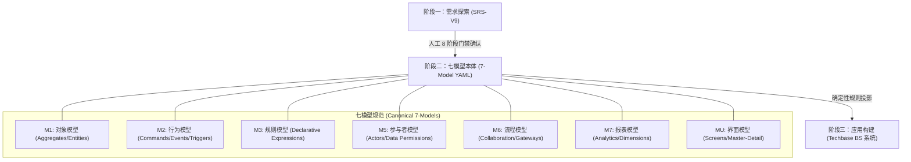
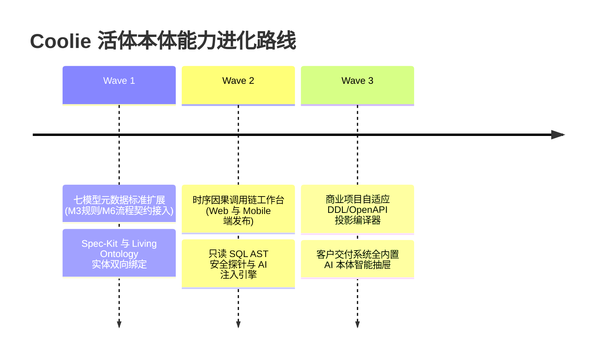

# 深度研报：从 `ontology-driven-dev` 反思 Coolie 活体本体插件能力的演进之路

> **战略基线**：对标 `sharptoolbox/ontology-driven-dev` 项目（含 `reference-example`、七模型 YAML 规范及技术底座），立足 Coolie 最高工程法典（五大公理体系），运用**全局反向高阶思维 (High-Order Inverse Thinking)**，穿透其核心本质、识别关键局限，并提炼 Coolie 活体本体插件（`plugin-ontology`）与全栈商业交付工厂的五大进化突破口。

---

## 一、标杆项目架构全貌透析 (`ontology-driven-dev`)

`ontology-driven-dev` 是目前开源社区中少有的将**领域驱动设计 (DDD)**、**本体工程 (Ontology Engineering)** 与 **AI 辅助代码生成**进行深度结合的优秀范式。其核心骨架由三层构成：

### 1. 核心精髓 (What it does extraordinarily well)
1. **七模型完备正交性**：
   - 彻底解决了传统开发中“需求文档是自然语言，代码是实现细节，两者没有数学级精确映射”的顽疾；
   - 将业务精确切分为 7 个互不重叠的维度，尤其是将 **M2 (行为)** 与 **M3 (规则)** 剥离（行为关注状态跃迁前置/后置，规则关注无副作用纯函数断言），设计极度凝练；
2. **确定性投影机制**：
   - DDL 物理表、数据字典、前后端 API 契约、页面布局全部从七模型确定性推导，从根本上消灭了“模型一套、实现一套”的双轨漂移；
3. **AI 对话框的本体注册表注入**：
   - 生成的系统右侧常驻 AI Copilot，利用 AST 语法树守卫实现强制“只读 SQL 安全边界”，并将七模型元数据作为上下文灌给大模型，实现零幻觉的业务查询与解释。

---

## 二、反向高阶审视：五大视角穿透其局限与盲区

站在 Coolie 端到端商业交付工厂与 Palantir 活体本体的宏观维度，该开源项目存在以下**本质局限 (Missing Links)**：

| 审视视角 | `ontology-driven-dev` 的局限与死穴 | Coolie 工厂与活体本体的高阶超越 |
| :--- | :--- | :--- |
| **1. 交付总控 (CEO 视角)** | **小作坊代码生成器**：只能产出极简 Flask/SQLite 单体管理页，无法应对复杂商业企业级交付（如银行资金对账、电信级 BOSS 容灾、全屋定制运筹优化）。 | **端到端商业交付总控**：以《客户终验核销单》与商业回款为法定终局，全生命周期成本管控、单人原子签出与真实预算硬停。 |
| **2. 控制面架构师视角** | **无控制面调度中枢**：没有多智能体协作总线、工单状态流转、原子锁与权限隔离，所有操作依赖本地手动命令行。 | **Paperclip 控制面底座**：拥有不可变证据总线 (`work_products`)、双向血缘指针、7 大工具池后台免交互施工与多版本工件交付。 |
| **3. 活体本体架构师视角** | **静态冷死文件 (Dead YAML)**：七模型被写死在本地磁盘 YAML 文件中，代码生成后本体生命周期即终结，运行期无法热插拔、无分支、无合并。 | **Palantir 活体业务本体 (Living Twin)**：基于 263 张物理表数据库管网，现实世界活体孪生，会话即提议、项目即域、支持在线动态演进与跨企业物理隔离。 |
| **4. 极简人机产品视角** | **传统臃肿后台交互**：经典 PC 树状多级菜单 + 复杂大表单，不具备现代移动端态势感知能力。 | **6 寸屏极简对称驾驶舱**：局部一跳因果卡片流、两字按钮、黄金 5 槽位绝对对称、就地浮层防遮挡。 |
| **5. CMMI 5 质量总监视角** | **无过程工程资产与防造假**：没有 CMMI 01~09 过程资产，没有真机自动化打假测试，没有变异测试与不可变生产秒级回滚预案。 | **CMMI 5 机器证据库**：G1 需求 SRS 到 G5 投产 SOP 资产全在位，真机快照打假，严守 *No Artifact, No Done* 铁律。 |

---

## 三、Coolie 本体插件（`plugin-ontology`）进化借鉴的 5 大杀手级方向

吸收其七模型的形式化之美，扬其所长，补其所短，推动 Coolie 从“双核本体”迈向“企业级全息活体工业本体”：

### 🌟 进化一：从「业务双核」升维为「全息七维活体本体模型」
- **现状**：Coolie 现行以 `Object Types` + `Action Types`（业务实体与动词）为核心，规则、报表与流程多分散在工单与代码中；
- **进化落地**：
  1. 在 `packages/db/src/schema/ontology_*` 与 `packages/plugins/plugin-ontology` 中，正式扩展原生支持：
     - **M3 (Rules)**：声明式业务规则引擎，支持输入参数校验与判定表达式，在 Action 触发时前置守卫；
     - **M6 (Flows)**：端到端协同与条件网关时序流，贯通审批与自动化触发任务；
     - **M7 (Reports)**：业务多维聚合指标模型，让大屏与报表直接挂靠本体指标；
     - **MU (UI Layouts)**：将界面的交互元素与 Action 进行精准契约绑定。

### 🌟 进化二：可视化「全时序因果调用链工作台 (Call-Chain Workbench)」
- **借鉴标杆**：`reference-example/contract-management-ui-callchain_v9.html`
- **进化落地**：
  - 目前 Coolie 的本体视图以力导向拓扑图（Force Graph）为主，适合宏观浏览实体关联，但缺乏**业务发生的因果时序感**；
  - 在 Web 控制台和移动端增加**【时序因果流转工作台】**：
    $$\text{界面操作 (MU)} \xrightarrow{\text{触发}} \text{业务动作 (M2)} \xrightarrow{\text{校验}} \text{业务规则 (M3)} \xrightarrow{\text{变更}} \text{聚合对象 (M1)} \xrightarrow{\text{驱动}} \text{流程网关 (M6)}$$
  - 掌柜或工程师点击任意一个功能，可一键高亮全链路的因果流转脉络，消灭系统暗黑逻辑！

### 🌟 进化三：本体驱动的「多基座 DDL / OpenAPI / 代码投影编译器」
- **借鉴标杆**：模型直接投影生成数据库与代码；
- **进化落地**：
  - 打造 `scripts/ontology-projector.cjs`（或作为 `speckit` 的子模块）：
    - 输入：项目绑定的 Living Ontology 元数据；
    - 输出：自动投影生成 RuoYi 微服务、Yudao 四位一体或 Node Monorepo 的多租户 DDL、Java/TS 实体类、Knife4j OpenAPI 注解和前端 `useCrudSchemas`；
    - **彻底消除 80% 的机械重构与契约漂移风险**。

### 🌟 进化四：交付项目开箱自带「本体语义注入 + 只读 SQL 探针 AI 总助」
- **借鉴标杆**：`techbase` 右侧内置 AI 对话框与只读 SQL 语义查询；
- **进化落地**：
  - 在 `scripts/hatch-client-project.sh` 极速孵化的交付项目中，默认植入轻量级 AI 交互组件（如 `apps/backend/ai` 模块与前端右侧抽屉）；
  - 将该项目绑定的七模型元数据自动化灌入 AI 上下文，并挂载带 AST 校验的只读 SQL 查询探针；
  - 交付给甲方客户时，系统不仅是一个业务软件，还是一个“懂业务、能查数、知流程”的智能数字孪生中枢！

### 🌟 进化五：Spec-Kit SDD 与七模型活体本体的「无缝编织」
- **联动落地**：
  - 将刚刚引入的 `speckit` 规范（`brief.json`、`spec.json`）与七模型语法标准化对齐；
  - 在工坊对话中，Hermes 提议的每个新特性（Feature），自动关联到对应的 Aggregate（M1）与 Action（M2），并在执行 `speckit sync` 时，将这些模型原子同步进服务端的 `ontology_*` 活体数据库中，实现真正意义上的**“进厂即本体、编码即契约、验收即孪生”**！

---

## 四、演进实施路线图 (Evolution Roadmap)

