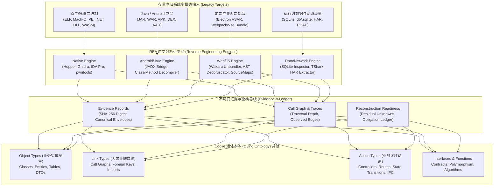

# Coolie 活体本体引擎与 morluto/rea 深度集成设计方案：存量老旧项目全栈反向工程接入法典

> **创建日期**: `2026-10-13`  
> **状态**: 📐 规划与落地阶段 (Approved Design & Initial Core Implementation)  
> **核心归宿**: `doc/plans/2026-10-13-legacy-project-reverse-engineering-rea-integration.md`  
> **对齐标准**: Paperclip 原生架构规范、Palantir Foundry 活体本体双核规范 (Object Types + Action Types)、CMMI 5 高成熟度工程过程资产标准、`morluto/rea` (v6.4.0) 逆向工程协议与证据链规范。

---

## 一、背景与问题：为什么老旧系统的反向工程能力是生死线？

在商业软件交付工厂（Commercial Software Delivery Foundry）的真实商业交付场景中，**甲方客户很少有从零开始的纯绿地项目（Greenfield Projects）**。相反，90% 以上的企业级客户交付需求均为**存量遗留系统（Brownfield Legacy Systems）的重构、升级、打通或替换**：

1. **核心痛点**：
   - **源码残缺或脱节**：许多老旧系统历经多次外包转手，源码早已丢失，仅剩线上正在跑的编译后制品（`.jar`/`.war`、`.apk`、Electron `.asar`、`.dll`/`.so` 动态库、压缩混淆的 Webpack/Vite 前端 bundle）；
   - **文档严重漂移**：架构设计说明书（HLD）、接口契约（LLD）、数据字典早已无人维护，实际运行逻辑以“线上二进制代码”为唯一真理；
   - **运行时黑盒**：只有正在运行的 SQLite/MySQL 数据库物理文件，或者前端与后端之间交互的网络流量抓包（HAR/PCAP），内部业务实体与状态机迁移对外部完全不可见；
   - **传统静态扫描失效**：现有的代码抽取器（如简单的正则表达式、基础 AST 解析）只能识别规范整洁的 `.java` 或 `.proto` 源文件，面对混淆、编译、打包、二进制及运行态数据完全束手无策，陷入“没有源文件就无法构建活体本体”的死穴。

2. **战略破局：引入 `morluto/rea` (Reverse Engineer Anything)**：
   - GitHub 顶级开源逆向工程中枢 **`morluto/rea`**（v6.4.0，`rea-agents`）提供了工业级的多模态反向工程与证据链体系；
   - REA 将强大的逆向引擎（Hopper/Ghidra/IDA、JADX、Wakaru 前端反混淆解包器、SQLite 模式探测器、HAR/PCAP 网络抓包分析器）通过统一的 MCP（Model Context Protocol）与 CLI 暴露给 AI 智能体；
   - **Coolie 结合点**：将 REA 深度集成至 Coolie 活体本体插件（`@paperclipai/plugin-ontology`）与底层认知引擎（`@paperclipai/ontology-core`），赋予 Coolie 工厂**“存量项目进厂即反向提取活体本体、老旧系统秒级孪生并轨”**的杀手级能力。

---

## 二、`morluto/rea` 核心架构与逆向能力矩阵解构

`morluto/rea` 并非简单的反编译包装脚本，而是一套严格遵循**“不可变证据、因果图谱、重构就绪度”**的工程化逆向系统：



### 1. REA 的 4 大逆向分析能力域

| 能力域 | 底层驱动引擎 | 输入格式 | 输出的核心逆向要素 |
| :--- | :--- | :--- | :--- |
| **Java & Android** | JADX Bridge, JVM Bytecode Reader | `.apk`, `.dex`, `.jar`, `.war`, `.class` | 类继承结构、字段注解、方法伪代码、API 注解、AndroidManifest 权限与组件 |
| **JavaScript & Electron** | Wakaru, Source Map Recovery, AST Parser | `.asar`, minified `.js` bundles, Webpack chunks | 还原后的原始模块树、Vue/React 组件状态、Pinia/Redux 数据流、IPC 通信信道、Electron 边界 |
| **Data Tier (数据层)** | SQLite Database Inspector, Native SQLite Driver | `.sqlite`, `.db`, WAL snapshots | 物理表结构、字段类型、主外键关系、索引约束、数据字典与样本分布 |
| **Network & Protocols** | HTTP Archive Parser, TShark / PCAP Reader | `.har`, `.saz`, `.pcap`, mitmproxy logs | REST API 路径、HTTP 动词、请求参数 Schema、响应 Payload 结构、状态变更因果 |
| **Native & Managed** | Ghidra, Hopper, IDA, .NET CIL Inspector | ELF, Mach-O, Windows PE, .NET assembly | 导出符号、CIL 指令集、函数调用图（Call Graph）、系统调用边界 |

### 2. REA 的“证据链与重构就绪度 (Reconstruction Readiness)”思想
REA 杜绝无凭据的幻觉猜测，所有结论均以不可变 Evidence 记录留痕：
- **`Evidence Record`**：携带唯一的 `evidence_id`、输入目标指纹 `source_digest`、规范化解析结果 `normalized_result`、原始输出 `raw_result`；
- **`Call Graph & Limitations`**：在遍历函数调用时，显式标记覆盖边界（`relationship_coverage`）与局限性（`limitations`）；
- **`Reconstruction Readiness Report`**：在进入重构阶段前，严格校验未解决未知项（`residual_unknowns`），未达标则 Fail-Closed 阻断。这与 Coolie 平台的 **“No Artifact, No Done（无工件不完工）”** 工程公理产生极致的哲学共鸣。

---

## 三、Coolie 活体本体映射契约（REA ➜ Palantir Foundry 双核并轨）

Coolie 活体本体以 **Object Types（业务实体）** 与 **Action Types（业务动词）** 为基石。REA 的逆向产物将实现 100% 确定性的物理并轨：

### 1. Object Types（现实世界实体活体孪生）映射
- **Java / JADX 反编译类**：
  - 携带 `@Entity`、`@Table`、`@TableName`（MyBatis-Plus）、POJO 属性的类，自动转化为 `Object Type`；
  - 属性字段、类型（`String`、`Long`、`BigDecimal`、`LocalDateTime`）及其注释（Javadoc 或 Swagger `@Schema`）自动提取为 `properties_schema`；
  - 标注入库原产地：`origin: { kind: "rea_apk" | "rea_jar", namespace: package, table: tableName, evidenceId: "..." }`。
- **SQLite 物理表**：
  - 提取的每个 Table 自动映射为 `Object Type`（layer: `aggregate_root` 或 `child_entity`）；
  - 字段列名、主键标识、默认值与类型转换为规范 JSON Schema；
  - 标注入库原产地：`origin: { kind: "rea_sqlite", table: tableName, evidenceId: "..." }`。
- **前端解包模型 (Wakaru)**：
  - Vue/React 前端解包出的 TypeScript Interfaces、Pinia Store、Redux Reducer State 映射为 `Object Type`（layer: `state`）。

### 2. Link Types（因果拓扑与关系血缘）映射
- **外键因果**：SQLite 外键约束或 JPA `@ManyToOne` / `@OneToMany` 自动生成 `ontology_relation_types`（`one_to_many`、`many_to_one`）；
- **调用因果 (Call Graph)**：REA 的 `get_call_graph` 提取的方法调用边，自动转化为服务层与数据实体之间的引用血缘；
- **前端引用因果**：前端 Store 对后台 API 的依赖边自动挂载至 Link Types。

### 3. Action Types（闭环业务动词与履约契约）映射
- **Controller 路由映射**：
  - JADX/AST 扫描到的 `@PostMapping`、`@PutMapping`、`@DeleteMapping`、`@RequestMapping` 转换为 `Action Type`；
  - 路由路径、HTTP 动词自动填入 `api_contract`；
  - 方法参数映射为 Action 的输入参数（`input_schema`）；
  - 方法操作的实体映射为 Action 的目标实体（`target_entity`）；
- **网络抓包 API 映射**：
  - 从 `.har` 或抓包文件中嗅探出的高频 API，结合其实际 Request/Response Payload 逆向生成强类型 Action Type；
- **状态机流转 (State Transitions)**：
  - 分析方法内部对实体状态字段（如 `status`、`state`、`approval_status`）的赋值逻辑，自动提取状态迁移图（`state_transitions`，例如 `pending ➜ approved ➜ executed`）。

### 4. Interfaces & Functions（多态接口与业务算法）映射
- **接口多态**：Java Interface、抽象类自动转为 `ontology_interfaces`，实现类挂载 `implements_interfaces`；
- **计算逻辑**：无副作用的纯计算方法（如出材率算法、利息计算、校验规则）映射为 `ontology_functions`。

---

## 四、分层物理工程架构设计

```
packages/
├── ontology-core/                          # 活体本体无宿主核心包
│   └── src/
│       └── cognition/
│           ├── AstExtractor.ts             # 原生静态 AST 抽取器
│           ├── extractionTypes.ts          # 抽取模型类型 (扩展 REA 来源)
│           └── rea/                        # 【新增】REA 逆向工程适配核心
│               ├── reaTypes.ts             # REA 证据、解析结果与契约接口
│               ├── ReaOntologyExtractor.ts # 核心桥接器：REA 逆向产物 ➜ RepoDraft
│               ├── ReaBundleScanner.ts     # 前端/Electron 逆向解析器
│               ├── ReaJadxScanner.ts       # Java/Android 逆向解析器
│               └── ReaSqliteScanner.ts     # 物理数据库模式逆向解析器
│
└── plugins/
    └── plugin-ontology/                    # 控制面本体插件
        ├── src/
        │   ├── manifest.ts                 # 注册 REA 逆向能力路由与数据项
        │   ├── worker.ts                   # 调度 REA 认知作业 (cognition-jobs)
        │   └── ui/                         # 前端向导与可视化逆向视图
        │       ├── BrownfieldOnboardingModal.tsx # 存量项目进厂向导
        │       └── ReverseEngineeringInspector.tsx # 逆向证据与 Call Graph 走查台
```

### 1. `ontology-core/src/cognition/extractionTypes.ts` 扩展
将 `ExtractionKind` 与 `SourceStereotype` 扩展为支持 REA 逆向通道：
```typescript
export type ExtractionKind = 
  | "ddl" 
  | "java" 
  | "proto" 
  | "mybatis" 
  | "openapi" 
  | "source"
  // 新增 REA 逆向通道
  | "rea_binary"
  | "rea_bundle"
  | "rea_apk"
  | "rea_sqlite"
  | "rea_network";

export interface ExtractedOrigin {
  kind: ExtractionKind;
  namespace?: string;
  module?: string;
  service?: string;
  table?: string;
  stereotype?: SourceStereotype;
  // 新增不可变证据链溯源
  evidenceId?: string;
  sourceDigest?: string;
  confidence?: number;
}
```

### 2. `packages/ontology-core/src/cognition/rea/ReaOntologyExtractor.ts`
负责将 REA 的 JSON 输出（不管是 JADX、Wakaru 还是 SQLite Inspector 产生的 Evidence Bundle）规范化转译为 Coolie 平台现有的 `RepoDraft`（含 `seedNodeTypes`、`seedRelationTypes`、`seedActions`、`coverage`），与现有 O3 流水线无缝兼容。

### 3. `plugin-ontology` 认知流水线升级（9 状态机增强）
在现有的 `ontology_cognition_jobs` 状态机中注入 REA 阶段：
```
pending 
  ➜ indexing (文件指纹与资产类型嗅探)
  ➜ rea_analyzing (调用 REA 执行反编译/解包/模式探测)
  ➜ synthesizing (将 REA Evidence 转换为 Object/Action Types 草案)
  ➜ awaiting_confirm (掌柜在前端检视逆向证据图谱并确认)
  ➜ publishing (原子写入 targetDomain，形成活体本体资产)
  ➜ completed
```

---

## 五、实施落地路线图 (Implementation Roadmap)

| 阶段 | 周期 | 核心交付物 | 验收断言 (No Artifact, No Done) |
| :--- | :--- | :--- | :--- |
| **Stage 1: 核心契约与抽取引擎落地** | 即刻 | `packages/ontology-core/src/cognition/rea/` | `pnpm typecheck` 0 报错；单测验证 REA 逆向包转译为 `RepoDraft` 100% 通过 |
| **Stage 2: 存量系统认知流水线升级** | 本周 | `packages/plugins/plugin-ontology/src/worker.ts` | `cognition-jobs` 支持上传 `.zip`/`.jar`/`.sqlite`/`.asar`，生成带 Evidence 证据链的本体草案 |
| **Stage 3: 前端交互走查台与证据检视** | 下周 | `packages/plugins/plugin-ontology/src/ui/` | 移动端 & Web 端展示老系统逆向反编译预览、Call Graph 调用图与重构准备度评分卡 |
| **Stage 4: 7 工具池数字员工联动** | 持续 | `coolie-mcp-orchestration` 挂载 `rea-agents` | 墨斗 (FDA) 与 铁匠 (SWE) 可在工单中自主调用 REA 工具对老系统进行切片探针 |

---

## 六、安全沙箱与风险防范

1. **不可信二进制执行边界**：
   - 逆向分析老旧二进制文件时，**严格采用静态解析与反编译**（Ghidra headless / JADX headless / Wakaru），严禁在未经沙箱隔离的宿主机上直接执行未知可执行程序；
2. **资源与内存熔断护栏**：
   - 大规模解包（如上百兆 ASAR 或大型 APK）限制最大解包内存与超时时间（默认 3 分钟超时），规避 Zip Bomb 或内存溢出崩溃；
3. **高熵凭据自动过滤**：
   - 老代码中常有硬编码数据库密码、API Token 等脏数据，逆向引擎提取 Action/Object Types 时统一执行敏感信息脱敏过滤器（Regex + High Entropy Guard），防止凭据外泄至本体资产库。
