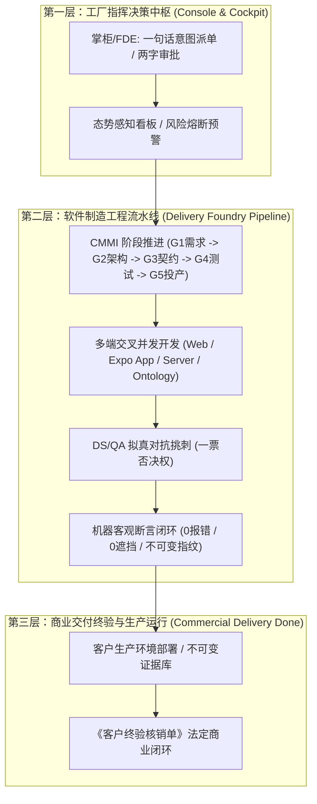
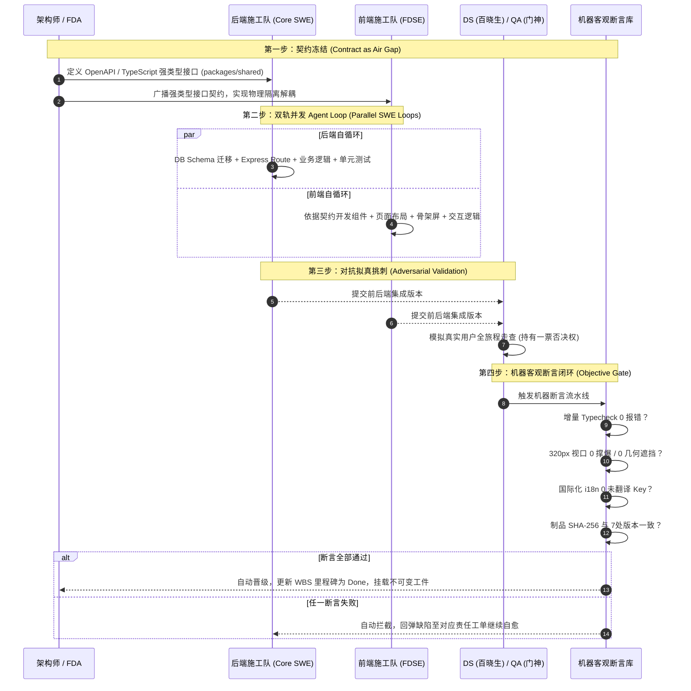

# 全盘多端交叉自循环交付工厂架构法典与落地执行图谱
> **Foundry Omni-View Cross-Functional Self-Looping Matrix & Execution Codex**
>
> 制定日期：2026-10-13  
> 责任团队：Coolie 交付工厂总架构师与合伙人编审组  
> 适用范围：全平台数字员工团队（Hermes / 铁匠 / 墨斗 / 门神 / 兜底渊 / 百晓生）与终端工程矩阵

---

## 一、 顶层建设目标与现实差距（直面现状，对标顶级）

### 1.1 工厂最高生态位定位
Coolie 的本质定位绝非简单的“任务看板”或“代码辅助小工具”，而是**全流程 AI 原生数字员工全自主驱动的「端到端商业软件交付工厂 (AI-Native Software Delivery Foundry)」**。
全体数字员工与交付团队统一站在**软件交付公司总架构师与合伙人**的顶层商业视角：
- **交付目标**：实现从客户一句话意图进厂、需求严谨规格收敛（SRS）、架构方案设计（HLD）、接口强类型契约（LLD）、源码并发交付、四态拟真走查、生产不可变发布，直至最终甲方签署《客户终验核销单》的法定商业闭环。
- **演进哲学**：直面当前系统能力“特弱”的现实，不自欺欺人，不自我感动。向全球顶级标杆（Linear 的极速丝滑、Palantir Foundry 的活体本体物理孪生、Devin 的全自主编码排错、SpaceX 的航天级变异打假测试）看齐，以 CMMI 5 高成熟度工程纪律为骨架，通过**高阶反向思维**与持续迭代，让系统在每次运转中实现不可逆的质量跃迁。



---

## 二、 全盘多端地毯式现状与痛点剖析（直面硬伤清单）

要向顶级产品看齐，必须首先将全平台三大终端与底层管网的硬伤彻底暴露在手术刀下：

### 2.1 移动端原生 App（Expo SDK 52 / React Native，30 个核心屏）
1. **小屏撑爆与文字排版折行 (Screen Overflow)**：
   - 在 320px~375px 小视口设备（如 iPhone SE、小屏 Android）上，部分三级详情页与卡片内部存在硬编码宽度或固定 padding，导致文字折行重叠、数字截断。
2. **软键盘弹起物理遮挡 (Keyboard Collision)**：
   - 审批意见输入、工单流转备注等表单场景下，系统原生输入法弹起时，底部确认按钮偶发被完全遮挡，缺乏绝对几何高度自适应避让。
3. **深层路由栈 LIFO 错位 (Route Stack Drift)**：
   - 用户在二级/三级抽屉或浮层跳入“工单详情”或“审批流”后，点击原生物理返回键或顶栏返回箭头时，偶发跳回首页 Tab，破坏了局部无感前进后退的调用栈原则。
4. **OTA 增量热更新感知滞后 (OTA Latency & Silent Loading)**：
   - 自建 OTA 增量更新已具备基础分发能力，但缺乏客户端后台静默预载、SHA-256 完整性校验、以及重启即生效的无缝提示与兜底降级方案。

### 2.2 Web 控制台（React 19 + Vite，80+ 页面）
1. **国际化 (i18n) 盲区与死角**：
   - 尽管系统已有 8 大命名空间基础，但在上游原生模块（如 Connectors、Settings 高级流、审批策略树）中依然残留大量硬编码英文字符串；部分报错信息仍直接透传英文异常栈。
2. **非两字极简交互膨胀**：
   - 部分次级页面出现“提交并继续”、“Confirm and Save”、“取消并返回”等冗长文案，违背了平台宪法“核心操作统一收敛为两字按钮”的极简人机铁律。
3. **复杂交互重绘与滚动性能**：
   - 活体本体拓扑图（Ontology Graph）与实时执行日志瀑布流在加载长列表时，存在多余重绘，缺少虚拟化滚动（Virtual List）与防抖节流保护。
4. **异步操作防抖与假死防御**：
   - 部分表单在触发耗时请求（如代码拉取、Docker 镜像构建）时，未全局锁定按钮并展示就地骨架屏，容易导致用户重复点击或误判为系统假死。

### 2.3 服务端底座与数据管网（Express REST API + PostgreSQL 263 表）
1. **任务单一人原子签出锁自愈缺失**：
   - 当执行节点发生极端网络中断或容器强杀时，工单原子锁缺乏心跳超时自动探测与优雅解挂机制，导致工单短暂陷入假死。
2. **长任务非阻塞心跳断链**：
   - 耗时超过 60 秒的重型工程任务（如全量单测、端到端评测）缺乏轻量化内部状态打点（心跳广播），未能在 1 秒内将进度同步给前端，导致控制台感知脱节。
3. **多租户行级物理隔离防穿透**：
   - 全盘 263 张物理表在面对跨公司、跨项目复杂联查时，必须由静态契约与查询中间件严格保证 `company_id` 与 `project_id` 双重隔离，杜绝数据越权穿透风险。

### 2.4 活体本体与逆向工程中枢（Palantir Living Ontology + REA）
1. **本体动词与物理资产挂载脱节**：
   - 任务施工时绑定的 ActionType 与代码 Commit、四态快照未能在所有场景下实现 100% 物理因果并轨，偶发出现“工单标注完成但证据库为空”的假完工。
2. **存量老系统逆向工程自动化**：
   - 对老旧系统（APK、JAR、ASAR、SQLite）的逆向探测缺乏一键提取本体草案并自动生成 CMMI 规格树的流水线能力。

---

## 三、 八大多维高阶反向审视视角具象化法典

向顶级产品看齐，绝不能依赖单兵自检，必须将全平台审视升维为八大专业角色的严苛对抗：

| 审视角色 | 核心关注点与审查靶心 | 核心审查指标 | 法定一票否决项 (Veto Items) | 强制交付证据要求 |
| :--- | :--- | :--- | :--- | :--- |
| **1. CEO / 商业交付总控** | 商业成败、ROI、现场真用、客户终验核销单 | 客户现场 0 培训上手度、商务回款核销闭环 | 无法打通业务真实使用场景、无甲方可验收的工程实物 | 《客户终验核销单 (UAT)》、商业交付总结报告 |
| **2. CPO / 竞品穿透与全面产品思路** | 竞品对标、借力成熟开源、极简交互与两字按钮 | 交互路径最小跳数、核心操作两字收敛率 (100%) | 界面出现三字以上啰嗦动词、重复造低效轮子、交互路径反人类 | 竞品横评分析表 (DAR)、两字交互合规审查清单 |
| **3. UX / 移动端与人因工程** | 6寸屏自适应、单手触达、黄金5槽位对称、防遮挡 | 320px 视口撑爆率为 0、弹窗/输入法遮挡率为 0 | 软键盘遮挡输入框/提交按钮、底栏不对称、页面白屏假死 | 320px/375px/430px 多视口几何无遮挡断言报告 |
| **4. Core SWE / 平台研发与架构** | TypeScript 严格类型、模块解耦、契约防漂移 | `pnpm -r typecheck` 0 报错、OpenAPI 强类型同源 | 存在 `any` 泛滥、直接跨包引用私有实现、打破原子事务 | 增量 Typecheck 0 报错日志、OpenAPI 强类型契约文件 |
| **5. DS / 部署战略与业务方案 (主审官)** | 用户视角拟真走查、业务语义隔离、拒绝死交互 | 真实业务旅程走通率 (100%)、空态/错误态友好度 | 发现死交互/假按钮、业务流程中途卡死、错误提示报技术栈代码 | DS 拟真走查全旅程录像/测试台账 (持有投产一票否决权) |
| **6. QA / 拟真人走查与测试验证** | 双模拟器装机、Playwright 自动化、真机四态快照 | 核心业务路径自动化覆盖率、变异测试杀假率 (100%) | 未提供真实设备四态截图证据、测试用例全部依赖假 Mock | Normal/Loading/Empty/Error 真机四态快照、变异测试报告 |
| **7. PRE-SRE / 可靠性与发布割接** | 不可变制品、7处版本一致、秒级回滚 SOP、SLO/SLI | 制品 SHA-256 校验率 (100%)、部署回滚耗时 < 30s | 版本号源冲突漂移、生产环境健康探针异常、无回滚预案 | `scripts/VERSION-CONSISTENCY-CHECK.sh` 绿标、秒级回滚 SOP |
| **8. Ops / 运营排班与调度治理** | 单写者纪律、防踩踏、防死循环、冷寂自动兜底 | 任务阻塞时长 < 1h、无无限循环递归工单 | 多个 Agent 并发篡改同一文件、定时器疯狂刷屏克隆工单 | 调度心跳流水账、单写者锁持有证据、依赖树状态矩阵 |

---

## 四、 Routine 与 Agent Loop 的本质解构与治本方案

针对掌柜此前指出的“开启长任务后产生很多新问题（高频克隆工单、死循环、骚扰弹窗）”，必须从理论与工程两端彻底澄清概念：

### 4.1 概念本质对比与边界划分
```
+-----------------------------------------------------------------------------------+
| 控制面调度器 (Routine / Keeper)                                                    |
| - 物理层级：系统控制面全局服务 (Control-Plane Level)                                |
| - 角色定位：外层“发牌员”与“例行体检医生”                                            |
| - 触发周期：低频（小时级或按里程碑事件触发）                                        |
| - 行为特征：扫描全局状态，检查主线长任务进展；当且仅当主线停滞时唤醒派单            |
| - 严禁行为：严禁高频 (如每15分钟) INSERT INTO issues 克隆相同工单！                  |
+-----------------------------------------------------------------------------------+
                                      │ 唤醒派单 (单任务状态推进)
                                      ▼
+-----------------------------------------------------------------------------------+
| 单任务自循环引擎 (Agent Inner Loop / /loop)                                        |
| - 物理层级：单工单执行引擎内部 (Runtime Execution Level)                           |
| - 角色定位：内层“施工匠人”，在单一工单内进行闭环打磨                                |
| - 执行循环：Observe (观察环境/读取代码) ➜ Think (决策/对比规格) ➜                   |
|             Act (编码/修改) ➜ Verify (跑单测/查几何遮挡)                          |
| - 终止条件：达成工单定义的退出门禁 (如 0报错、断言全绿) 或遇到真外部依赖            |
| - 严禁行为：严禁在单兵自旋中自嗨自审（必须引入外部 DS/QA 对抗检验）！              |
+-----------------------------------------------------------------------------------+
```

### 4.2 单兵裸 /loop 的致命死穴与破局之策
- **死穴**：单一 Agent 裸跑 `/loop` 会陷入认知盲区——自己在 0.4s 内报错就盲目重试 20 次耗尽额度，或者修改完代码后由于自己审查自己，产生“我已经做完了”的虚假繁荣。
- **破局（对抗制衡机制）**：
  1. **铁匠 (Core SWE) 编码**：只对静态契约、代码实现与单测负责；
  2. **百晓生 (DS) 审核**：完全不看代码，以最刁钻的用户身份启动真机走查，不通直接打回；
  3. **机器断言裁判**：由客观脚本（编译、静态扫描、DOM 几何检测）作为硬门禁，不受任何 Agent 主观意识干扰。

---

## 五、 多端交叉自循环任务推进流水线（四步法）

为了让复杂的跨端任务能够 7x24 小时高质量、无阻塞地自循环推进，建立标准化的“四步解耦流水线”：



### 5.1 第一步：契约冻结 (OpenAPI / TS Contract as Air Gap)
- 任何跨端功能开工前，第一步必须在 `packages/shared` 或 OpenAPI 契约中完成强类型数据结构的定义与落盘；
- 契约一旦合入主分支，前后端立刻在物理上实现彻底解耦，互不等待依赖。

### 5.2 第二步：双轨并发 Agent Loop (Parallel SWE Loops)
- **后端执行线程**：在 `server/` 内基于契约编写路由、服务、数据访问层与自动化单测；
- **前端执行线程**：在 `ui/` 或 `clients/expo/` 内基于 Mock 数据和契约强类型并发开发界面与交互；
- 各自执行内部的 `Observe ➜ Think ➜ Act ➜ Verify` 循环，杜绝跨端互相阻塞。

### 5.3 第三步：DS / QA 对抗拟真挑刺 (Adversarial Validation)
- 前后端集成后，自动交由百晓生 (DS) 与门神 (QA)；
- DS 不读任何后端实现代码，直接以真实企业掌柜/客户的身份体验端到端操作；
- 只要出现卡顿、白屏、假按钮、未友好报错，DS 直接行使**一票否决权**打回重修。

### 5.4 第四步：机器客观断言闭环 (Objective Machine Assertions)
- 机器断言作为最终裁判，必须满足以下硬指标方可自动核销：
  1. `pnpm -r typecheck` **0 报错**；
  2. 移动端 320px/375px/430px 视口 **DOM 几何 0 遮挡、0 水平溢出**；
  3. Web 与 App **0 遗留未翻译硬编码英文**；
  4. 发版制品 **7 处版本号严格一致，SHA-256 不可篡改**；
  5. 自动挂载代码 Commit SHA 与四态真机截图至控制面工件总线。

---

## 六、 全盘主线长任务与阶段性 WBS 执行图谱

为落实掌柜“全面丰富”的指示，我们将工坊的持续升级收拢为 **1 个总控制主线长任务 (`COOA-114`)**，下设 **4 条核心子主线** 与详尽的 WBS 阶梯：

```
COOA-114: [主线长任务] Coolie 工坊全生命周期持续研发与能力升级 (Continuous Evolution)
 ├── COOA-116: [主线 A·国际化] Paperclip 上游功能全量国际化与本地化治理
 │    ├── COOA-116.1: Web 端 8 大命名空间硬编码英文全面清剿 (Settings / Connectors / Approvals)
 │    ├── COOA-116.2: 移动端 Expo 原生 App 30 屏多语言字典全覆盖与动态切换
 │    └── COOA-116.3: 服务端 API 异常与运行时错误码多语言中文化映射
 ├── COOA-129: [主线 B·移动端] 原生 App 6 寸屏极简体验、防撑爆防遮挡与 LIFO 路由守卫
 │    ├── COOA-129.1: 30 屏 320px~430px 视口防撑爆与折行几何对齐走查
 │    ├── COOA-129.2: 软键盘弹起绝对几何避让与底部提交按钮保活
 │    ├── COOA-129.3: 全局抽屉与深层跳转的 LIFO 严格调用栈防乱跳修复
 │    └── COOA-129.4: 自建 OTA 增量热更新客户端后台静默预载与平滑重启机制
 ├── COOA-130: [主线 C·底座] 263 表高内聚复用、原子并发锁自愈与长任务心跳管网
 │    ├── COOA-130.1: 任务单一人原子签出锁断网/强杀心跳自愈与过期解挂
 │    ├── COOA-130.2: 长任务 (>60s) 非阻塞心跳打点与前端控制台实时进度广播
 │    └── COOA-130.3: 多租户与跨公司查询中间件严格行级隔离防穿透硬核加固
 └── COOA-131: [主线 D·全流程] 商业交付全流程拟真对抗走查与 CMMI 终验核销闭环
      ├── COOA-131.1: DS 角色从“一句话意图”到“终验单”端到端真实旅程拟真走查
      ├── COOA-131.2: 变异测试打假与反空洞 Mock 专项治理
      └── COOA-131.3: CMMI G1~G5 全阶段物理资产挂载守卫与终验核销自动化
```

### 6.1 子主线详细任务规格说明书

#### 【主线 A】`COOA-116`: Paperclip 上游功能全量国际化与本地化治理
- **责任角色**：墨斗 (FDA) + 铁匠 (Core SWE)
- **输入来源**：Web 80+ 页面走查、上游原生 English 字符串探测脚本。
- **具体工作包**：
  1. 扫描 `ui/src/` 下未接入 `useTranslation()` 的硬编码英文字符串，集中补齐至 `locales/zh-CN/` 各命名空间（`common`, `issues`, `agents`, `settings`, `connectors`, `approvals`, `ontology`, `system`）；
  2. 针对移动端 `clients/expo/` 梳理 30 个核心页面的文案字典，实现系统跟随与中英文一键切换；
  3. 服务端 `server/src/errors/` 下统一错误信息的多语言国际化封装，禁止将原始英文 SQL 错误或微服务堆栈裸露到界面。
- **完成门禁 (DoD)**：
  - 静态扫描脚本检测 Web 与 App 界面未翻译 key 为 0；
  - 语言切换即时生效，无白屏、无闪烁；
  - 挂载包含多语言对比的真机快照。

#### 【主线 B】`COOA-129`: 原生 App 6 寸屏极简体验、防撑爆防遮挡与 LIFO 路由守卫
- **责任角色**：门神 (FDSE) + 极简人机产品总监 (CPO)
- **输入来源**：Android 模拟器与真实真机多视口走查数据。
- **具体工作包**：
  1. 使用 `agent-device` 驱动模拟器在 320px (SE)、375px (标准)、430px (Pro Max) 三大分辨率下走查 30 个核心屏，彻底消除水平滚动条与文本重叠；
  2. 重构输入弹窗与审批卡片的容器布局，引入 `KeyboardAvoidingView` 与安全区动态计算，确保软键盘弹出后焦点组件与“确定/取消”按钮 100% 露在键盘上方；
  3. 审查全部跨 Tab 跳转与详情下钻路由，确保通过 `navigation.goBack()` 精准返回上一跳，杜绝误跳回首页；
  4. 升级自建 OTA 客户端，实现后台静默下载、SHA-256 校验通过后弹窗提示“更新就绪，点击重启生效”。
- **完成门禁 (DoD)**：
  - 30 屏三视口截图无一撑爆、无一文本错位；
  - 软键盘弹起测试 0 遮挡；
  - 路由回退测试通过率 100%；
  - 提交四态真机快照。

#### 【主线 C】`COOA-130`: 263 表高内聚复用、原子并发锁自愈与长任务心跳管网
- **责任角色**：兜底渊 (PRE-SRE) + 铁匠 (Core SWE)
- **输入来源**：服务端真实生产日志、压测异常崩溃场景模拟。
- **具体工作包**：
  1. 在 `server/src/services/heartbeat.ts` 中增强原子锁续租逻辑，当任务容器猝死且超过 300 秒无有效续租时，安全将锁状态重置为 `released`，并生成恢复审计日志；
  2. 针对 Docker build、全量测试、复杂编译等重型任务，统一接入非阻塞子进程包装器，每 10 秒向控制面广播标准心跳事件，防止控制台呈现无响应假死；
  3. 针对 `company_id` 与 `project_id` 多租户边界，在 Drizzle ORM 层建立安全中间件防越权扫描，严防跨租户读取或写入。
- **完成门禁 (DoD)**：
  - 模拟容器强杀场景下，原子锁能在 5 分钟内自动解挂自愈；
  - 长时间任务执行过程中前端每 10 秒收到一次进度心跳；
  - 多租户穿透安全测试用例 100% 通过。

#### 【主线 D】`COOA-131`: 商业交付全流程拟真对抗走查与 CMMI 终验核销闭环
- **责任角色**：百晓生 (DS) + 门神 (QA) + CEO
- **输入来源**：全生命周期 CMMI 5 交付资产规范。
- **具体工作包**：
  1. 百晓生 (DS) 模拟企业客户真实场景，从掌柜手机端语音/文字派单一句话开始，经历规格自动生成、代码拉取、测试验证，直至查看不可变成果物；
  2. 针对整个流水线中的假 Mock、假测试开展变异测试攻防，故意注入破坏性代码，验证测试套件是否能 100% 发现并熔断；
  3. 规范化 G1~G5 阶段物理资产的自动落盘与校验（OpenAPI TS 契约、Git Commit SHA、真机四态快照、Docker 镜像不可变指纹、秒级回滚预案），最终生成经由掌柜两字确认的《客户终验核销单》。
- **完成门禁 (DoD)**：
  - DS 拟真走查全流程顺利闭环，无任何死交互或流程中断；
  - 变异测试杀假率达到 100%；
  - 物理资产挂载守卫在缺失资产时 100% 拒绝将任务标记为 `done`；
  - 成功生成一份完整的数字资产交付终验单。

---

## 七、 持续演进巡检机制（Anti-Flood & Anti-Freeze 守卫纪律）

为了彻底杜绝此前长任务暴露出的“高频生成垃圾工单”和“弹窗打扰掌柜”等缺陷，制定以下常驻巡检纪律：

1. **单任务单线程演进纪律 (One Active Thread)**：
   - 任何时刻，处于 `in_progress` 的主线子任务严格保持在 1~2 个；前序子任务未达成机器客观断言闭环前，后续子任务保持在 `todo` 队列，严禁无序并发造成代码踩踏。
2. **零骚扰静默治理铁律 (Zero-Disturbance Policy)**：
   - 全体数字员工在自循环排错与测试过程中，**严禁无端触发 `ask_user_questions` 或弹窗向掌柜提问琐碎技术细节**；
   - 所有的架构抉择依据 `dar-decision-matrix` 自主加权推演，并将推演过程写入工单文档；仅在涉及法定商务终验或真实商业决策时，才向掌柜呈现极简的“两字审批”。
3. **低频例行体检与停滞报警 (Hourly Health-Check Keeper)**：
   - 控制面巡检守护以 1 小时为周期进行低频体检：
     - 若当前子任务正常活跃（最近 15 分钟内有心跳打点），巡检器保持静默，绝不插入新工单；
     - 若当前子任务已完成，巡检器自动唤醒并激活下一个 `todo` 任务；
     - 若当前子任务无心跳且超过 1 小时无进展，巡检器判定为“停滞 (Stalled)”，自动执行接力唤醒并记录恢复审计事件。

---

## 八、 实施推进排期与交接基线

| 阶段里程碑 | 攻坚重点与交付成果 | 验收标准 | 预计耗时 |
| :--- | :--- | :--- | :--- |
| **M1: 架构基线与主线建制** | 编制发布本法典，落盘 `COOA-114` 核心子工单矩阵与 WBS 代码 | 法典合入主干，数据库工单清晰有序，0 垃圾工单 | 即刻完成 |
| **M2: 国际化与移动端攻坚** | 推进 `COOA-116` (全量国际化) 与 `COOA-129` (移动端 6寸屏防撑爆防遮挡) | Web 8命名空间 0 英文，App 30屏三视口 0 撑爆 | 2-3 工作日 |
| **M3: 底座并发与自愈加固** | 推进 `COOA-130` (原子锁自愈、长任务非阻塞心跳、多租户防穿透) | 模拟强杀 5 分钟自愈，长任务心跳稳定广播 | 2 工作日 |
| **M4: 商业全流程拟真对抗** | 推进 `COOA-131` (DS 拟真走查、变异测试打假、CMMI 终验核销闭环) | 全业务旅程走通，变异测试杀假率 100%，终验单生成 | 2-3 工作日 |

本法典自发布之日起即刻生效，作为 Coolie 工坊长期研发自循环与全视角审视的最高执行蓝本。
