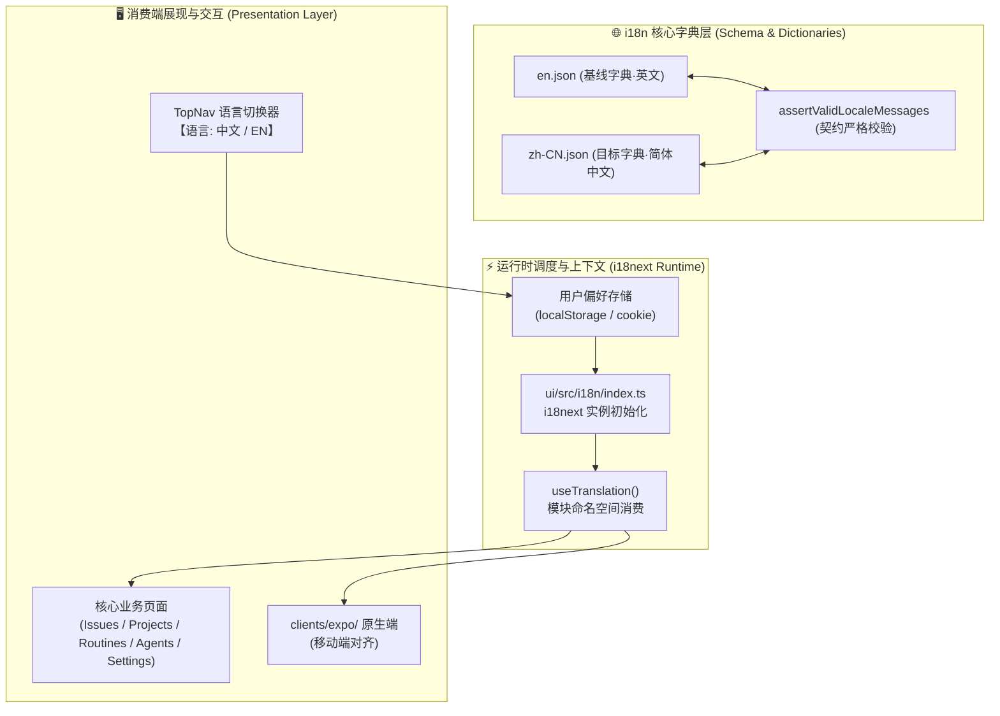

# Paperclip 上游功能全量国际化与本地化架构方案 (Full i18n & Localization Architecture)

> **制定时间**: 2026-10-13  
> **指导思想**: 掌柜明确指示 —— *“长任务 还得有 细节的 比如1. paperclip上游 功能的 全量国际化”*  
> **关联主线**: `COOA-114` (Coolie 工坊持续研发与能力升级长任务)  
> **子工单**: `COOA-116` (`182df248-498c-4f47-b921-d694a94dbe8d`)  

---

## 1. 现状剖析与痛点诊断

当前 Paperclip 控制面虽内建了 `i18next` 框架，但整体国际化成熟度极低，存在三大痛点：

1. **词库严重残缺 (覆盖率 < 5%)**:
   - `ui/src/i18n/locales/en.json` 与 `zh-CN.json` 仅有 171 行，仅覆盖导航栏和空状态提示；
   - 核心生产力模块（工单列表、工单详情、项目治理、例行调度 Routines、数字员工 Agents、工作区 Workspaces、系统设置 Settings）均未纳入国际化。
2. **页面组件充斥硬编码英文**:
   - 绝大多数业务组件直接将英文文本硬编码在 JSX 中（例如 `"Create Issue"`, `"In Progress"`, `"Assignee"`, `"Budget Limit"`, `"Execution Policy"` 等）；
   - 中文使用者（掌柜、交付总监、客户）在操作时体验生硬割裂，违背“零培训、傻瓜式极简使用”原则。
3. **缺乏运行时语言切换控件**:
   - 用户无法在界面上一键切换界面语言，当前语言环境主要依赖浏览器探测或写死配置。
4. **强校验契约限制 (`assertValidLocaleMessages`)**:
   - `ui/src/i18n/locale-validation.ts` 强制要求所有非英文语言包必须与 `en.json` 的键集合 100% 严格一致（不可缺键，也不可有 extraKeys）；
   - 必须通过规范的增量演进方式同步维护 `en.json` 与 `zh-CN.json`。

---

## 2. 总体架构设计

---

## 3. 词库全量扩展设计 (8 大核心命名空间)

为实现全量国际化，将按以下 8 大业务域系统性扩充词条：

### 3.1 `common` & `actions` (公共通用与两字动词)
- 遵循极简两字 UI 铁律：
  - `save`: "保存" / `cancel`: "取消" / `confirm`: "确认" / `delete`: "删除"
  - `create`: "创建" / `search`: "搜索" / `refresh`: "刷新" / `export`: "导出"
  - `edit`: "编辑" / `filter`: "筛选" / `reset`: "重置" / `copy`: "复制"
- 通用加载与空状态、弹窗确认提示。

### 3.2 `issues` (任务与工单管理)
- **状态机**:
  - `todo`: "待办" / `in_progress`: "进行中" / `done`: "已完成" / `blocked`: "已受阻" / `cancelled`: "已取消"
- **优先级**:
  - `urgent`: "紧急" / `high`: "高" / `medium`: "中" / `low`: "低"
- **字段与操作**:
  - 任务详情、负责人指派、执行模式、工作区环境选择、超时看门狗、工单评论、工件关联、历史变更流水。

### 3.3 `projects` (项目与里程碑)
- 项目立项、目标设定、本体域绑定、CMMI 阶段划分 (G1~G5)、工程目录与代码库关联。

### 3.4 `routines` (常驻调度与例行巡检)
- 调度器标题/描述、触发方式（定时 Schedule、Webhook、API）、并发策略、补偿机制、历史运行批次。

### 3.5 `agents` (数字员工与组织治理)
- 员工花名册、5 大核心角色 (FDA/SWE/FDSE/DS/SRE)、技能配置、适配器参数、模型选择、预算硬熔断、考勤与心跳。

### 3.6 `workspaces` (沙箱与开发工作区)
- 独立工作区、本地容器、端口映射、实时运行状态、服务重置与数据克隆。

### 3.7 `settings` & `billing` (实例配置与财务预算)
- 公司资料、成员权限 RBAC、API Key 授权、Token 消耗账单、数据备份与一键恢复。

### 3.8 `errors` & `feedback` (统一异常与反馈提示)
- 网络超时、403 无权访问、404 未找到、409 冲突锁、500 服务异常等友好中文反馈。

---

## 4. 实施阶段与任务拆解 (WBS)

| 阶段编号 | 阶段名称 | 交付产物与关键动作 | 负责人 | 验收门禁 |
| :--- | :--- | :--- | :--- | :--- |
| **Stage 1** | **字典扩展与契约守卫** | 扩充 `en.json` 与 `zh-CN.json`（首期覆盖通用 + 工单 + 项目）；跑通 `assertValidLocaleMessages` | 铁匠 (Core SWE) | 0 漏译、0 extraKey、单测通过 |
| **Stage 2** | **全站语言切换器落地** | 在 `TopNav.tsx` 增加语言切换下拉/胶囊，接入持久化切换 | 门神 (FDSE) | 免刷新即时切换，刷新记忆保留 |
| **Stage 3** | **核心页面去硬编码转译** | 改造 `Issues.tsx`, `IssueDetail.tsx`, `Projects.tsx`, `Routines.tsx`，接入 `useTranslation()` | 铁匠 (Core SWE) | 页面 0 散落英文，文案精准对齐 |
| **Stage 4** | **治理与系统设置页面转译** | 改造 `Agents.tsx`, `Settings.tsx`, `Workspaces.tsx` | 门神 (FDSE) | 深度页面中文化 100% 覆盖 |
| **Stage 5** | **原生移动端 (Expo) 对齐** | 将 Web 端词典契约同步映射至移动端原生交互 | 门神 (FDSE) | 6 寸屏 320px 视口无截断、无撑爆 |

---

## 5. 防退化保障铁律

1. **唯一真理基线**: 任何新增文案必须先入 `en.json`，再配对进入 `zh-CN.json`；
2. **预提交门禁集成**: `pnpm -r typecheck` 和 `pnpm test` 自动运行 `locale-validation`，缺键漏键直接阻断 Commit；
3. **两字规范约束**: 按钮、Tab 标签在中文下严格保持 2 汉字，规避移动端与紧凑界面排版崩溃。
