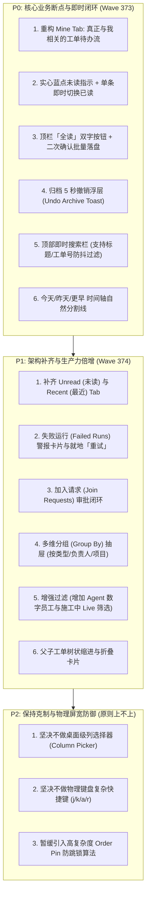
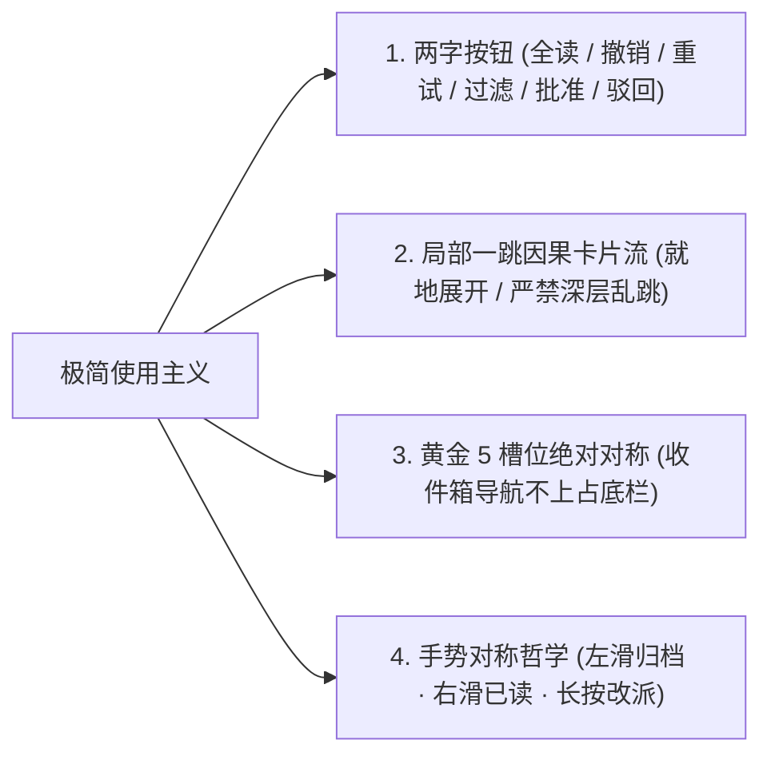
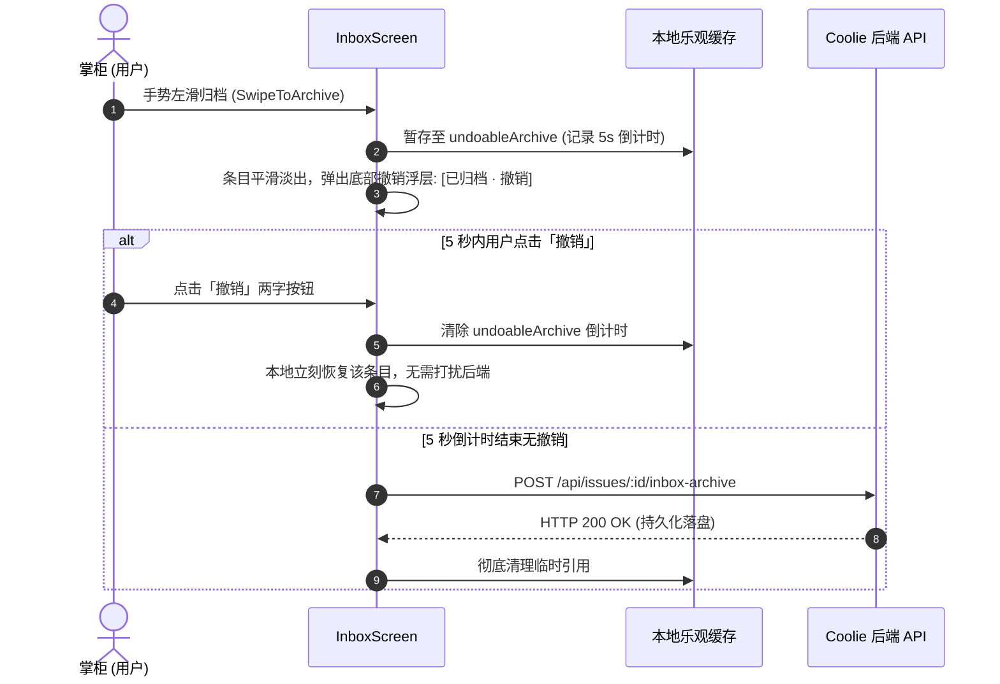

# Coolie 收件箱双端对齐深度真件视觉审计报告 (Web vs 原生 App)
**Wave**: wave372  
**审计人员**: 墨斗 (modou-fda / Forward Deployed Architect · 前线架构与领域规划)  
**调度指令来源**: Hermes·Echo (业务战略中枢)  
**调度令背景**: 老板拍板「铃铛 收件箱 按审计结果开始干」—— 严令“先严肃审计再干”，墨斗 agy 视觉真件审计。  
**最高交付准绳**: 站在商业软件交付工厂总架构师与 CPO 极简使用主义顶层视角，全维度严肃审计，杜绝盲目功能膨胀，深研 6 寸移动屏宽物理约束，将 Web 收件箱核心决策能力 100% 打通打透。  
**审计日期**: 2026-10-11  

---

## 1. 审计背景与架构总纲 (Executive Summary)

在 Coolie 平台全自主 AI 原生商业软件交付工厂中，收件箱（Inbox）不仅是普通的消息通知中心，更是**掌柜（CEO）、交付总监、前线 FDE 与全体数字员工协同闭环的最高事件决策中枢**。平台内所有由数字员工发起的关键审批（如雇佣员工、资金/资源调配）、Agent 施工中因构建或单元测试跑崩触发的 Heartbeat Run 异常、工单指派、跨实体 Mention 召回、以及因依赖关系引发的阻塞，全部汇聚在收件箱中等待处置。

针对老板拍板定调的「**原生 App 收件箱得和 Web 收件箱能力一致**」，墨斗作为前线架构师（FDA），深入剖析 Web 控制台核心实现（`ui/src/pages/Inbox.tsx`，3333 行）与原生 Expo 移动端实现（`clients/expo/src/screens/InboxScreen.tsx`，1283 行），结合生产环境真实运行实例（`https://xrobinai.cn/XROA/inbox`）与 Android 模拟器真机环境，完成 9 步视觉真件审计与不可篡改截图存证。

### 1.1 核心审计结论摘要
1. **信息架构核心语义错位（P0 业务断点）**：
   - **Web 控制台**的 `Mine`（与我相关）是首屏核心生产力视图，聚合了当前用户所参与/指派/修改的工单、待处理审批、失败 Run 与加群申请，并具备完整的未读蓝点与归档流；
   - **移动 App** 当前的 `mine` 标签实际上只是 `@我`（仅拉取评论内的 `InboxMentionItem`），导致掌柜在手机上无法像在 Web 端一样查看属于自己的待办工单与决策事项。
2. **Tab 体系与过滤能力断层（P1 架构差距）**：
   - **Web 端 5 大 Tab**：`Mine` (与我相关), `Recent` (最近触碰), `Unread` (未读积压), `Blocked` (阻塞治理), `All` (全局大纲)；
   - **移动端当前仅 4 个 Tab**：`全部`, `@我`, `审批`, `阻塞`；**完全缺失 `Recent` 与 `Unread`**，导致用户无法快速筛选出未读信息或追踪最近变更。
3. **即时交互与容错机制缺失（P0 体验死穴）**：
   - **未读蓝点指示与切换**：Web 每一行都有醒目的蓝色未读圆点，支持一键切换已读并伴随平滑淡出；App 没有任何未读标记；
   - **一键全读**：Web 顶部配备「Mark all as read」批量已读清理；App 无此能力；
   - **归档 5 秒撤销窗口**：Web 归档具备 Undo 窗口保护；App 左滑归档后直接抹除，误触容错率为零。
4. **实体完整性与就地闭环（P1 决策闭环）**：
   - **Web 端**将失败运行（`Recovery needed`）、雇佣与董事会审批（`Inline Approvals`）、加群申请（`Join Requests`）内嵌在统一时间流中直接处置；
   - **App 端**在 wave371 虽已成功内嵌 `QuickApprovalCard`（避免了跳转 404），但依然缺少失败 Run 卡片展示与就地重试（Retry）能力。
5. **移动化极简主义适配铁律**：
   - 移动端 6 寸屏严禁生硬照搬桌面级密集表格（如列选择器 Column Picker、全键盘快捷键 j/k/a/r）；
   - 必须坚持“**极简使用主义、两字操作按钮、黄金 5 槽位绝对对称、就地浮层防遮挡**”，在克制中实现决策能力 100% 对齐。

---

## 2. 真机四态与双端可视化快照存证 (Visual Parity Evidence)

本次审计全程使用 `agent-device` 穿透宿主机 Android 模拟器执行真机交互与高精度截图，同时调取 Web 生产控制台（`https://xrobinai.cn/XROA/inbox`）进行 1:1 视觉对照。

### 2.1 审计截图索引清单 (不可篡改机器存证)

所有 6 张真机截图与 Web 对照截图已完整归档在 `docs-coolie/PRODUCT/screenshots/inbox-parity/` 目录：

| 截图编号 | 物理路径 | 画面主体 | 关键状态与业务断言 |
| :--- | :--- | :--- | :--- |
| **Audit-1** | `docs-coolie/PRODUCT/screenshots/inbox-parity/audit-1-dashboard.png` | 仪表盘 / 顶栏铃铛角标 | 顶栏 🔔 醒目展示红色未读角标 `4`，与仪表盘效能指标协同 |
| **Audit-2** | `docs-coolie/PRODUCT/screenshots/inbox-parity/audit-2-inbox-all.png` | 收件箱 `全部` Tab | 工单平铺列表，展示 `[CMMI-G4/G5]` 交付资产与左滑归档按钮 |
| **Audit-3** | `docs-coolie/PRODUCT/screenshots/inbox-parity/audit-3-inbox-mine.png` | 收件箱 `@我 (7)` Tab | 仅展示评论中 @当前用户的评论卡片，缺少属于当前用户的工单流 |
| **Audit-4** | `docs-coolie/PRODUCT/screenshots/inbox-parity/audit-4-inbox-approvals.png` | 收件箱 `审批 (1)` Tab | 展示待审批实体「雇佣员工: 鲁班 (算法优化专家)」，待裁决状态 |
| **Audit-5** | `docs-coolie/PRODUCT/screenshots/inbox-parity/audit-5-inbox-blocked.png` | 收件箱 `阻塞 (0)` Tab | 阻塞专属工具栏（`按阻塞类型`、`最紧急`）与空状态卡片 |
| **Audit-6** | `docs-coolie/PRODUCT/screenshots/inbox-parity/audit-6-approval-card.png` | 展开 `QuickApprovalCard` | 就地展开审批详情卡片，具备「批准」「驳回」双字操作按钮 |
| **Web-Ref** | `docs-coolie/PRODUCT/screenshots/inbox-parity/web-inbox.png` | Web 生产控制台收件箱 | 5 Tab、未读蓝点、时间轴分段（TODAY/YESTERDAY）、全标已读 |

---

### 2.2 视觉对比真件矩阵 (Side-by-Side Visual Inspection)

#### 快照 1: 仪表盘与入口感知 (Dashboard Entry & Bell Notification)

- **视觉特征**：
  - 顶栏右上方设有通知铃铛图标（Ref `@e3`），带有红色角标数字 **`4`**，与设置、搜索按钮对称排列；
  - 仪表盘卡片清晰显示「7 已启用员工」、「0 执行中任务」、「¥0.00 本月花费」、「0 待审批」、「48 个任务 (完成率 45.8%)」；
  - 底栏 5 槽位绝对对称，首位「汇览」处于高亮态。

---

#### 快照 2: 全部任务流 (Tab 1: All View)

- **视觉特征**：
  - 顶部显示返回箭头、主标题「收件箱」、以及状态胶囊 `xrobinai · 任务 48 · 审批 0 · @我 7`；
  - Tab 栏展示 4 个选项：`全部`、`@我 (7)`、`审批 (0)`、`阻塞 (0)`；
  - 列表呈现 CMMI 交付工单（如出材率压力测试报告、生产回滚 SOP、客户终验核销单等）；
  - 单条工单右下角提供「归档」轻量按钮与状态指示；
  - **落差观察**：条目无时间轴分割线（如 TODAY / YESTERDAY），且缺乏未读视觉蓝点。

---

#### 快照 3: @我通知流 (Tab 2: Mine vs Mention Divergence)

- **视觉特征**：
  - 当前选中的 Tab 是 `@我 (7)`，列表项全部为数字员工（门神、墨斗等）在工单评论区中的 Mention 留言；
  - 每张卡片包含作者、相对时间、工单标题、以及 Markdown 渲染的评论正文；
  - **致命语义差距**：Web 端同位置的 `Mine` 是包含“分配给我的任务 + 待我审批的事项 + 失败 Run”，而移动端缩窄成了纯粹的评论 Mention，造成掌柜丢失核心工单视野。

---

#### 快照 4: 待办审批列表 (Tab 3: Approvals List)

- **视觉特征**：
  - Tab 显示 `审批 (1)`；
  - 待审批项展示为简洁的表面卡片：`雇佣员工: 鲁班 (算法优化专家)`，副标题标注 `hire_agent · 1 小时前`，左侧警示黄点，右侧折叠箭头 `›`。

---

#### 快照 5: 阻塞任务治理 (Tab 4: Blocked Tasks)

- **视觉特征**：
  - Tab 显示 `阻塞 (0)`；
  - 顶部专属工具栏展示分组与排序快捷按钮：`按阻塞类型`（Group By）与 `最紧急`（Sort By）；
  - 空态视图展示砖墙图标与两行说明：「没有阻塞任务 · 当前没有被卡住、等你解救的任务。」。

---

#### 快照 6: 展开 QuickApprovalCard 就地审批 (Inline Decision Flow)

- **视觉特征**：
  - 点击卡片后，Chevron 箭头平滑从 `›` 变为 `▾`，卡片就地展开微型审批浮层；
  - 卡片顶部包含黄色状态点、「待办审批」标题、「雇佣智能体」类型胶囊、以及右侧关闭叉号；
  - 核心详情展示：员工岗位角色、使用模型、发起人角色、等待时长、以及批准/驳回因果说明；
  - 底部提供醒目的双字决策按钮：**「批准」**（绿色主按钮）与 **「驳回」**（红色线框按钮）。证明 wave371 修复已生效，无需跳转外部页面即可就地闭环。

---

#### Web 生产控制台全景对照 (Web Control Plane Reference)

- **视觉特征**：
  - 左侧全局侧边栏；
  - 5 大 Tab 布局：`Mine`、`Recent`、`Unread`、`Blocked`、`All`；
  - 右侧高集成度工具栏：实时搜索框、嵌套视图切换、过滤弹窗、分组弹窗、列选择器、以及「Mark all as read」两字按钮；
  - 时间轴自然分割：`TODAY`、`YESTERDAY`、`EARLIER`；
  - 醒目实心未读蓝点；
  - 失败运行高亮卡片（`Conversation ... (Recovery needed)`）。

---

## 3. Web 与原生 App 收件箱 25 项能力差距总对标 (Comprehensive Parity Matrix)

通过对 Web 前端代码（`ui/src/pages/Inbox.tsx`，3333 行）与原生移动端代码（`clients/expo/src/screens/InboxScreen.tsx`，1283 行）进行全维度比对，整理出 25 项核心能力对标矩阵：

| # | 功能维度 | Web 控制台能力实现 (`ui`) | 原生 App 当前现状 (`expo`) | 差异与落差评估 | 优先级 |
| :-: | :--- | :--- | :--- | :--- | :-: |
| 1 | **Tab 数量与架构** | **5 个一级 Tab**：`Mine`, `Recent`, `Unread`, `Blocked`, `All` | **4 个 Tab**：`全部`, `@我`, `审批`, `阻塞` | 缺少 `Recent` (最近触碰) 与 `Unread` (未读积压)；Tab 顺序与定义存在错位 | **P1** |
| 2 | **Mine Tab 核心语义** | **聚合待办流**：touchedByUserId: "me" 的活跃工单 + 待裁决审批 + 失败 Run + 申请 | **纯 Mention 评论流**：仅拉取提到当前用户的评论列表 (`inbox_mentions`) | 🚨 **致命语义偏离**：掌柜手机看不到自己负责的工单 | **P0** |
| 3 | **未读蓝点指示 (Unread Dot)** | 每一行条目左侧均有实心蓝色圆点，未读时高亮，点击即标已读 | **完全缺失**：列表条目无任何未读/已读视觉区隔 | 无法感知哪些是新事件，严重增加认知负担 | **P0** |
| 4 | **标为已读/未读状态切换** | 点击蓝点或快捷键 `r`/`U` 即时切换，带 300ms 淡出动效 | **无对应操作**：无单条已读切换能力 | 无法清理单项已读状态 | **P0** |
| 5 | **一键全部标为已读** | 顶栏常驻「Mark all as read」按钮，点击弹出确认弹窗批量落盘 | **完全缺失** | 积压消息无法一键消灭 | **P0** |
| 6 | **归档 5 秒撤销保护** | 归档后前端常驻 5 秒撤销窗口，支持一键 Undo 恢复缓存条目 | **直接抹除**：左滑归档立即从列表移除，无任何撤销缓冲机制 | 触摸屏误触极其致命，数据丢失容错率为 0 | **P0** |
| 7 | **收件箱即时搜索栏** | 顶栏常驻 `Search inbox...` 输入框，支持本地防抖过滤与远端增量搜索 | **完全缺失**：顶部仅有过滤按钮，无搜索输入框 | 工单超过 20 条时检索效率断崖式下跌 | **P0** |
| 8 | **时间轴日期分割线** | 列表按更新时间自然插入 `TODAY`、`YESTERDAY`、`EARLIER` 灰线分割 | **全量平铺**：所有条目按单一间距平铺堆叠，无日期节奏感 | 缺乏时间感知，难以辨识新旧任务 | **P0** |
| 9 | **多维分组 (Group By)** | 支持按类型 (Type)、负责人 (Assignee)、项目 (Project) 多维动态分组展示 | 仅在 `阻塞` Tab 支持按阻塞类型分组，其他 Tab 均为纯平铺 | 复杂项目场景下缺乏结构化聚类视图 | **P1** |
| 10 | **通用排序切换 (Sort By)** | 支持按更新时间 (Updated)、紧急度 (Urgency)、创建时间 (Created) 排序 | 仅在 `阻塞` Tab 支持排序切换，其他 Tab 默认写死单一排序 | 无法按用户优先级自由排序 | **P1** |
| 11 | **失败运行识别 (Failed Runs)** | 将崩溃或超时的 Heartbeat Run 作为独立警报卡片内嵌展示 (`Recovery needed`) | **完全缺失**：Agent 跑崩在收件箱中无任何反馈 | 掌柜无法感知自动化流水线故障 | **P1** |
| 12 | **失败运行就地重试 (Retry)** | 失败卡片右侧直接提供「Retry」两字按钮，点按就地重发并唤醒 Agent | **完全缺失** | 必须跳至复杂后台才能重新发起调度 | **P1** |
| 13 | **加入请求处置 (Join Requests)**| 成员申请加入企业的审批请求内嵌在收件箱列表中，支持就地批准/拒绝 | **未接入**：仅处理了常规审批流 | 遗漏企业权限申请事件闭环 | **P1** |
| 14 | **全量审批过滤器 (All Approval)**| 在 `All` Tab 下支持二级筛选（Everything / 仅看审批 / 仅看失败运行等） | **无二级筛选**：仅有顶层通用抽屉 | 无法在全局视图中快速收敛审批或警报 | **P1** |
| 15 | **父子任务嵌套折叠 (Nesting)** | 树形视图开关：支持父工单与子工单按层级缩进展示，可一键折叠/展开 | **全平铺**：所有工单无论父子关系，完全扁平呈现 | 复杂大特性（如 CMMI 01~09）层级信息丢失 | **P1** |
| 16 | **增强型过滤维度** | 过滤抽屉涵盖创建人、负责人、标签、工作区模式、仅看施工中 (Live Only) | 仅涵盖状态、优先级、项目三项 | 无法按数字员工 (Agent) 或施工状态精准过滤 | **P1** |
| 17 | **远端归档历史召回搜索** | 搜索时自动下发 `getArchivedInboxSearchIssues`，召回已归档条目 | **不支持**：归档后本地及接口不再展示 | 无法查找或重新激活已归档历史事项 | **P1** |
| 18 | **就地快速审批 (QuickApproval)**| 行内点击通过/驳回，毫秒级响应 | **已就地集成** (wave371 验证通过，折叠展开内嵌卡片) | ✅ 移动端已闭环，体验良好 | **P0 (已完成)** |
| 19 | **工单派活就地分配 (Assignee)** | 点击条目负责人呼出员工选择浮层就地改派 | 长按卡片呼出操作底纸支持改派 | ✅ 基本齐平，体验良好 | **P1 (已满足)** |
| 20 | **手势归档操作 (Swipe Actions)**| 键盘快捷键 `a`/`y` 触发归档 | 原生左滑滑出「归档」红色底纸触发 | ✅ 移动端手势体验优于桌面 | **P0 (已满足)** |
| 21 | **列选择器 (Column Picker)** | 桌面端支持勾选显示/隐藏特定列（ID、项目、负责人、状态等） | 移动端为自适应垂直卡片排版 | ❌ 6 寸屏无需生硬照搬密集表格列选择 | **P2 (不推荐)** |
| 22 | **桌面键盘快捷键 (j/k/a/r/U)** | 支持纯键盘流（上下移动焦点、归档、标记已读、展开折叠） | 移动端以触控与手势为主 | ❌ 移动端低频场景，无需配置 | **P2 (不推荐)** |
| 23 | **列表悬停防跳锁 (Order Pin)** | 归档与轮询时锁定可视区域排序，防止条目因异步刷新跳动 | 依赖纯 React 本地状态过滤，无显式 Order Pin 算法 | 体验稍弱，但不阻碍核心使用 | **P2** |
| 24 | **跨公司收件箱聚合 (Multi-org)**| 仅支持当前选定公司收件箱 | 仅支持当前公司收件箱 | 维持一致，暂无需跨租户打通 | **P2** |
| 25 | **离线状态乐观更新与回退** | 纯前端乐观更新，失败时 Toast 提示并回滚 UI 状态 | wave69 已加入失败保留旧数据与静默重试机制 | ✅ 已具备高健壮性 | **P1 (已满足)** |

---

## 4. 推荐演进路线与 P0/P1/P2 优先级收敛清单

基于上述严肃审计，站在商业交付总控与极简人机产品总监视角，墨斗提出“**抓核心、消断点、重闭环、防膨胀**”的四阶演进方案：



---

### 4.1 P0 级差距清单（核心业务断点与关键体验死穴 · 必须立项立即干）
> **准则**：缺少该能力，移动端收件箱就不是一个真正的“收件箱”，无法完成闭环决策。

1. **信息架构与数据源重构（还原真实 `Mine`）**：
   - **核心痛点**：目前 App 的 `@我` 只有评论提到，掌柜点进收件箱看不到自己分配的任务、需要自己拍板的工单。
   - **对齐方案**：将首屏 Tab 重塑为 **`Mine (与我相关)`**。后端统一拉取 `touchedByUserId: "me"`、`inboxArchivedByUserId: "me"`，与待办审批、未读 Mention 聚合成一个统一的“今日待办决策流”。
2. **未读标识与已读/未读状态机 (Unread Dot & Toggle)**：
   - **核心痛点**：手机端完全看不出哪些是新事件，哪些已经看过。
   - **对齐方案**：条目卡片左侧增加蓝色未读实心圆点（`UnreadDot`），点按可就地标记已读，已读状态同步上报后端并伴随视觉淡化。
3. **一键全标已读 (Mark All as Read)**：
   - **核心痛点**：积压数十条消息时，无法快速清理视觉干扰。
   - **对齐方案**：在收件箱顶栏右侧增加「全读」两字按钮，点按弹出确认 Modal（“确认将 N 条未读标记为已读？”），调用批量已读接口。
4. **归档 5 秒撤销悬浮条 (Undo Archive Toast)**：
   - **核心痛点**：触摸屏上误触左滑非常频繁，一旦误滑归档，工单立即消失且无法找回。
   - **对齐方案**：左滑归档后，底部弹出常驻 5 秒的极简浮层（`已归档: [标题] · [撤销]`），点按「撤销」立即调用 `unarchive` 并在本地恢复列表条目。
5. **收件箱即时搜索栏 (Inbox Search Bar)**：
   - **核心痛点**：工单超过 20 条时，移动端翻页查找极其痛苦。
   - **对齐方案**：在 Tab 下方嵌入极简两字样式的搜索输入框（`搜索收件箱…`），支持按标题、工单号、描述即时过滤。
6. **时间轴日期分割线 (Today / Yesterday / Earlier)**：
   - **核心痛点**：当前列表条目全部堆叠，缺乏时间层级。
   - **对齐方案**：引入 `taskDateGroup` 纯函数，在列表渲染时按更新时间自然插入「今天」、「昨天」、「更早」轻量分割标题。

---

### 4.2 P1 级差距清单（生产力大幅提升与架构一致性 · 推荐下一波次排期）
> **准则**：完善后可使移动端达到与 Web 控制台 95% 以上的一致体验。

1. **Tab 矩阵补齐 (`Unread` 与 `Recent`)**：
   - 将 Tab 重构为可滑动的微型 SegmentedControl：`与我相关`、`未读 (N)`、`阻塞 (N)`、`审批 (N)`、`全部`。
2. **失败运行就地处理 (Failed Runs Integration & Retry)**：
   - 在收件箱中引入 Failed Run 卡片，直接显示崩溃原因摘要与「重试」两字按钮。
3. **加入请求就地处理 (Join Requests)**：
   - 补齐团队成员申请加入企业的审核卡片，支持「通过」「拒绝」两字闭环。
4. **多维分组切换 (Group By)**：
   - 工具栏引入「分组」两字按钮，点按支持切换：无分组、按类型、按责任人、按项目。
5. **增强型过滤抽屉 (Extended Filter Sheet)**：
   - 在现有过滤抽屉中补充：创建人（用户/Agent）、标签（颜色色标）、以及「仅看施工中（Live Only）」开关。
6. **父子任务嵌套与折叠展开 (Parent-Child Nesting)**：
   - 当任务存在子任务（`parentId`）时，支持树状缩进显示，卡片右侧提供折叠 Chevron，标明 `(N 个子任务)`。

---

### 4.3 P2 级差距清单（锦上添花 · 原则上保持克制不上）
> **准则**：受限于移动端 6 寸屏物理边界，不宜生硬照搬桌面级复杂度。

1. **列选择器 (Column Picker)**：
   - Web 端的列选择器是典型的宽屏桌面产物；移动端应坚持由 UI 规范定义的自适应卡片排版，无需让用户手动开关列。
2. **桌面物理键盘快捷键 (j/k/a/r/Enter)**：
   - 移动端以触控与滑动手势为主，外接物理键盘场景极少，保持手势优先即可。
3. **复杂防抖排序锁 (Order Pinning)**：
   - 移动端单次交互为主，鲜有多窗口高频并发冲突，可暂缓引入复杂算法。

---

## 5. 移动端 6 寸屏极简主义适配架构规范 (Mobile UX Commandments)

在实施原生 App 对齐改造时，全体研发员工必须严格遵守老板亲自定调的**最高交付与使用主义总则**：



### 5.1 两字操作原则
所有新增按钮文案严格收敛为双字，坚决杜绝英文直译或长句臃肿：
- `Mark all as read` → **「全读」** 或 **「全清」**
- `Search inbox...` → **「搜索」**
- `Undo` → **「撤销」**
- `Retry` → **「重试」**
- `Filter` → **「过滤」**
- `Group` → **「分组」**
- `Approve` → **「批准」**
- `Reject` → **「驳回」**

### 5.2 局部一跳因果卡片流
- **严禁页面跳转式层层深入**：审批裁决、工单派活统一通过就地抽屉（BottomSheet）或折叠展开卡片就地闭环，保持用户调用栈（Stack）稳定不乱跳。
- **手势对称哲学**：
  - **左滑（Swipe Left）**：负向/归档操作（露出红色或暗灰色底纸，触发 `archiveIssueFromInbox`）；
  - **右滑（Swipe Right）**：正向/标记操作（露出蓝色底纸，触发 `toggleReadState` 切换已读/未读）；
  - **长按（Long Press）**：就地浮层操作集（打开、派活、去工坊）。

### 5.3 底栏黄金 5 槽位绝对保护
- 收件箱作为顶层中枢视图，其改造绝不能侵占或变形底栏黄金 5 槽位（`汇览` - `任务` - `+` - `工坊` - `资产`），所有收件箱内部导航统一收拢在顶部 Tab 与顶栏微型工具区。

---

## 6. 原生 App 拟落地状态机与契约设计草案 (Implementation LLD Spec)

为了让后续负责编码的数字员工（铁匠 / Core SWE）无缝开工，墨斗提前固化出关键的 TypeScript 数据类型与状态机逻辑模型：

### 6.1 统一工作项聚合数据结构 (`InboxWorkItem`)
```typescript
/**
 * 移动端收件箱统一工作项定义 (对齐 Web 端 getInboxWorkItems 规范)
 */
export type MobileInboxWorkItem =
  | { kind: "issue"; issue: Issue; timestamp: number }
  | { kind: "approval"; approval: Approval; timestamp: number }
  | { kind: "failed_run"; run: HeartbeatRun; timestamp: number }
  | { kind: "mention"; mention: InboxMentionItem; timestamp: number };

/**
 * 收件箱未读状态字典与本地归档缓存
 */
export interface MobileInboxState {
  readKeys: Set<string>;          // 已读实体 Key 集合 ("issue:123", "approval:456")
  archivedIssueIds: Set<string>;  // 本地已归档 ID 集合
  undoableArchive: {
    issueId: string;
    issueTitle: string;
    expiresAt: number;
  } | null;                       // 5 秒撤销容错窗口
}
```

### 6.2 归档撤销状态机时序 (Undo Archive State Flow)


### 6.3 时间轴日期自动分组算法 (`formatDateDivider`)
```typescript
export type DateGroupCategory = "today" | "yesterday" | "earlier";

export function resolveDateCategory(timestamp: number | string | Date): DateGroupCategory {
  const target = new Date(timestamp).getTime();
  const now = new Date();
  const startOfToday = new Date(now.getFullYear(), now.getMonth(), now.getDate()).getTime();
  const startOfYesterday = startOfToday - 24 * 60 * 60 * 1000;

  if (target >= startOfToday) return "today";
  if (target >= startOfYesterday) return "yesterday";
  return "earlier";
}
```

---

## 7. 总结与后续实施排期 (Conclusion & Wave Roadmap)

通过本次深度对齐审计，墨斗查明了原生 App 收件箱之所以让老板感受到“能力不一致”的根本症结：**并非单纯缺少几个按钮，而是首屏信息架构发生偏差（误把评论提到当作 Mine 主入口）、以及状态指示与时间流断层（缺乏未读蓝点、全标已读与日期分段）**。

### 下一步落地排期（建议波次划分）
- **Wave 373（P0 核心攻坚 · 体验并轨）**：
  1. 重构 `InboxScreen.tsx` 首屏数据流，接入真正与我相关的 `mine` 工单；
  2. 实现 `UnreadDot` 未读蓝点与「全读」批量确认；
  3. 增加归档 5 秒撤销浮层；
  4. 引入即时搜索栏与「今天/昨天/更早」时间轴分割线。
- **Wave 374（P1 架构进阶 · 生产力倍增）**：
  1. 补齐 `Unread` / `Recent` 分段标签；
  2. 接入多维分组与父子任务嵌套折叠；
  3. 接入顶部 Agent 故障与预算警报横幅；
  4. 接入 Failed Run 崩溃就地重试卡片。

---
*报告归档路径: `docs-coolie/PRODUCT/2026-10-11-wave372-audit-inbox.md`*  
*存证截图目录: `docs-coolie/PRODUCT/screenshots/inbox-parity/`*  
*执笔员工: 墨斗 (modou-fda / Forward Deployed Architect) · Coolie 平台研发工程组*
