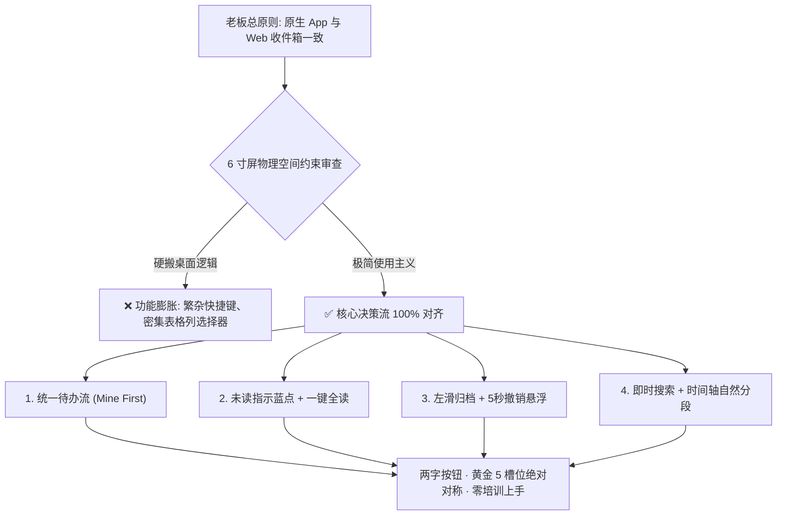
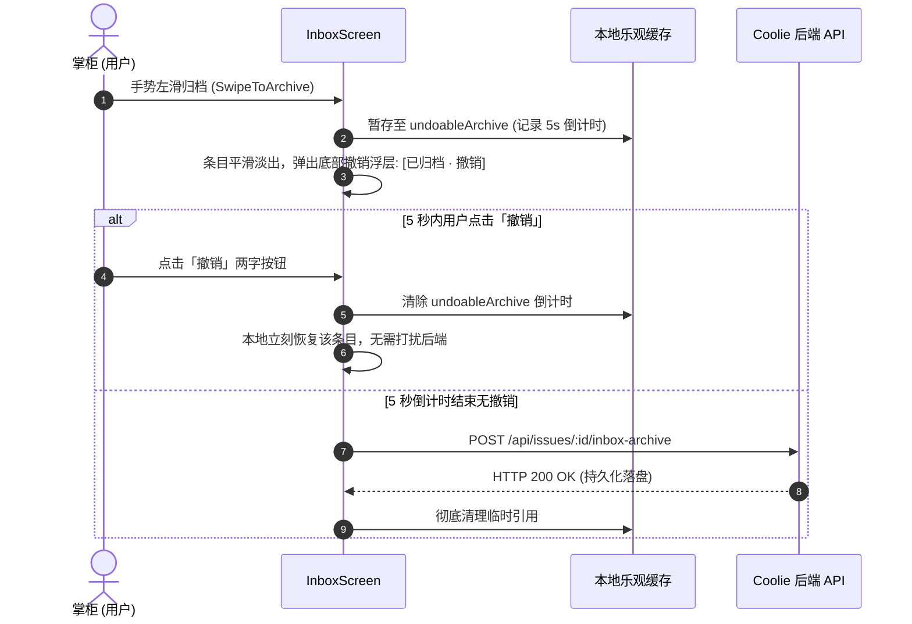

# Coolie 收件箱双端对齐深度审计报告 (Web vs 原生 App)
**Wave**: wave372  
**审计人员**: 墨斗 (modou-fda / Forward Deployed Architect)  
**调度指令来源**: Hermes·Echo (业务战略中枢)  
**最高交付准绳**: 老板亲自定调「原生 App 收件箱得和 Web 收件箱能力一致」，全维度严肃审计，落实 CPO + FDA 视角，杜绝功能膨胀，厘清物理屏宽约束与功能平移边界。  
**日期**: 2026-10-11  

---

## 1. 审计背景与架构总纲 (Executive Summary)

在 Coolie 平台全自主商业交付工厂的定位下，收件箱（Inbox）不仅是消息列表，更是**掌柜（CEO）、前线交付总监与数字员工协同的核心事件决策中枢**。平台所有由数字员工发起的审批请求、因构建或测试失败导致的 Heartbeat Run 异常、工单指派、跨实体 Mention、以及阻塞任务，均在收件箱中汇聚与闭环。

针对老板拍板定调的「**原生 App 收件箱得和 Web 收件箱能力一致**」，墨斗作为前线架构师（FDA），深入 Web 控制台源码（`ui/src/pages/Inbox.tsx`，3333 行）与原生 Expo 移动端源码（`clients/expo/src/screens/InboxScreen.tsx`，1283 行），结合生产环境真实运行实例（`https://xrobinai.cn/XROA/inbox`）与 Android 模拟器真机环境，展开全量能力盘点、5 列表逐项对标与架构落差溯源。

### 核心审计结论摘要
1. **信息架构核心偏差（致命语义错位）**：Web 的 `Mine`（与我相关）是首屏核心 Tab，聚合了当前用户所参与/指派/修改的工单、待处理审批、失败 Run 与加群申请，并具备完整的未读蓝点与归档流；而移动 App 当前的 `mine` 标签实际上只是 `@我`（仅拉取评论内的 `InboxMentionItem`），导致用户在手机上无法像在 Web 端一样查看属于自己的待办工单与决策事项。
2. **状态流转与即时交互缺失（P0 断点）**：Web 收件箱具备高密度的“即时操作反馈”能力，包括**未读状态蓝点指示、单条标为已读/未读、一键全部标为已读（带确认弹窗）、归档 5 秒撤销窗口（Undo Archive）、以及失败 Run 就地重试**；原生 App 当前缺乏未读/已读概念、无一键全读、无归档撤销，归档后数据直接抹掉，容错性低。
3. **检索与层级视图断层（P1 差距）**：Web 拥有实时输入检索（带远端搜索补全及已归档历史召回）、父子任务嵌套折叠树（Parent-Child Nesting）、按负责人/项目/类型多维分组（Group By）以及按天聚合的时间轴分割线（Today / Yesterday / Earlier）；原生 App 仅支持基于状态/优先级/项目的抽屉过滤，缺乏搜索框、无通用分组、无时间分割线、工单全平铺展示。
4. **移动化适配原则**：移动端 6 寸屏严禁死板照抄 Web 的桌面级密集表格（如列选择器 Column Picker、复杂组合快捷键）；必须在遵循“极简使用主义、两字按钮、就地浮层、单手可达”的前提下，将 Web 端核心决策能力 100% 打通打透。

---

## 2. 真机四态与双端可视化快照存证 (Visual Parity Evidence)

本次审计通过 Playwright 自动化驱动 Microsoft Edge，携带生产环境安全凭据深入 `https://xrobinai.cn/XROA/inbox/mine` 完成 Web 端高保真捕获；同时通过 `host-exec adb` 穿透宿主机 Android 模拟器截取移动端原生应用运行状态，固化不可篡改快照。

### 2.1 双端真实对比快照矩阵

| 终端 | 物理运行载体 | 访问入口 / 页面路径 | 存证文件路径 | 状态特征 |
| :--- | :--- | :--- | :--- | :--- |
| **Web 控制台** | Microsoft Edge (Headless / 1440x900) | `https://xrobinai.cn/XROA/inbox/mine` | `docs-coolie/PRODUCT/screenshots/inbox-parity/web-inbox.png` | 统一事件流、未读蓝点、时间轴分段、批量已读、快捷筛选 |
| **原生 App** | Android 模拟器 (`emulator-5554`) | `cloud.coolie.app` (`InboxScreen`) | `docs-coolie/PRODUCT/screenshots/inbox-parity/app-inbox.png` | 四 Tab 分隔、状态标签胶囊、左滑归档、长按操作底纸 |

### 2.2 快照直观对比图
- **Web 端收件箱真实截图**：
  ``
- **移动端原生收件箱真实截图**：
  ``

### 2.3 双端视觉与布局形态关键差异观察
1. **顶栏与搜索**：
   - **Web**：左侧展示清晰的 Tab 切换栏（Mine / Recent / Unread / Blocked / All），右侧紧凑集成「搜索收件箱 (Search inbox...)」输入框、嵌套切换按钮、过滤按钮、分组切换按钮、列选择器与「全部标为已读 (Mark all as read)」两字按钮；
   - **App**：顶部仅有简略的标题与公司状态胶囊（如 `xrobinai · 任务 48 · 审批 0 · @我 7`），下方仅有「过滤」单按钮与刷新图标，**完全缺失搜索输入框与批量处理入口**。
2. **列表条目信息密度与未读视觉反馈**：
   - **Web**：每一行工单左侧均有醒目的**蓝色实心未读圆点（Unread Dot）**，点击可切换已读/未读并伴随平滑淡出动画；条目按日期划分为 `TODAY`、`YESTERDAY`、`EARLIER` 灰线标题区隔；工单右侧展示唯一的简短工单编号（如 `XR0A-1`）与相对时间；
   - **App**：列表无任何日期分割线，条目之间仅有简单的纵向间距；**完全没有未读状态标识**，用户无法分辨哪些是新到事件；行内包含大块的状态与优先级胶囊，虽然易于点按，但信息排布缺乏时间节奏感。
3. **跨实体聚合与单点隔离**：
   - **Web**：将待处理审批（如 `Hire Agent: 雇佣员工: 鲁班`）、失败任务（如 `Conversation 产融智居 工坊 (Recovery needed)`）与日常工单无缝交织在同一个时间流中，用户在一个视图内即可看清全局脉络；
   - **App**：将任务、@我、审批、阻塞生硬割裂在 4 个完全独立的 Tab 页面内，用户必须来回反复横跳切换才能感知全部动态。

---

## 3. Web 收件箱能力全景深度解构 (`ui/src/pages/Inbox.tsx`)

经过对 `ui/src/pages/Inbox.tsx` (共 3333 行代码) 的逐行深度剖析，Web 收件箱具备以下 8 大维度核心能力：

### 3.1 Tab 状态机与导航体系
Web 收件箱支持 5 大一级视图（通过 URL 显式路由 `/inbox/:tab` 同步）：
1. **Mine (`/inbox/mine`)**：核心生产力视图。拉取 `touchedByUserId: "me"`、`inboxArchivedByUserId: "me"`，配合状态过滤 `INBOX_MINE_ISSUE_STATUS_FILTER`，聚合与当前用户产生物理交集的所有活跃工单、待裁决审批、加群申请以及未关闭的失败运行。**仅在 Mine 模式下支持归档操作**。
2. **Recent (`/inbox/recent`)**：按更新时间正序/倒序呈现最近发生触碰、评论或状态变更的工单序列。
3. **Unread (`/inbox/unread`)**：严格筛选 `issue.isUnreadForMe === true` 的未读工作项集合，帮助用户快速消灭红点与信息积压。
4. **Blocked (`/inbox/blocked`)**：调用独立的 `BlockedInboxView` 业务组件，聚焦呈现所有处于卡点、等待外部决策、或因依赖阻断的任务，配备专有的阻断分类器。
5. **All (`/inbox/all`)**：全盘大纲视图。支持跨实体的全局检视，且专享 `allCategoryFilter`（可切 Everything、工单、审批、失败运行、警报、加群申请）。

### 3.2 筛选与多维范围系统 (Filters & Scopes)
通过 `IssueFiltersPopover` 提供企业级精细化过滤能力：
- **工单状态 (Status)**：多选（Todo / In Progress / In Review / Done / Blocked / Cancelled）；
- **优先级 (Priority)**：多选（Urgent / High / Medium / Low）；
- **负责人 (Assignee)**：用户、Agent 数字员工（如墨斗/铁匠/门神）、未分配（Unassigned）；
- **创建人 (Creator)**：区隔发起者角色（支持用户自身、其他协同人员或 Agent 自动化创建）；
- **项目 (Project)**：按所属项目/工程范围多选收敛；
- **标签 (Label)**：支持按团队色标多标签交集/并集筛选；
- **执行工作区 (Workspace)**：在隔离工作区开启时，可按 Workspace 模式（Isolated/Shared）筛选；
- **实时运行守卫 (Live Only)**：一键仅查看当前正挂载有活动 Agent Run（数字员工正在施工中）的工单；
- **外部实体状态 (External Object Statuses)**：支持与外部系统对象同步状态过滤。

### 3.3 搜索与远端补全系统 (Live & Supplement Search)
- **前端实时过滤**：针对已拉取的本地工单缓存进行模糊高亮匹配；
- **远端增量搜索补全 (`getInboxSearchSupplementIssues`)**：当本地匹配不足时，自动发起防抖 API 搜索，抓取远端匹配结果并以 `Other results` 隔离带展示；
- **历史归档召回 (`getArchivedInboxSearchIssues`)**：支持跨归档边界搜索，将已归档的历史工单在 `Archived` 分割线下清晰召回，避免用户找不到“已消灭的任务”。

### 3.4 交互动作与状态机闭环 (Actions & State Machines)
- **归档与防抖 (`archiveIssueMutation`)**：具备乐观更新（Optimistic Update）机制，先在 UI 缓存中剔除并展示动画，随后落盘 `POST /issues/:id/inbox-archive`；
- **撤销归档 (Undo Archive Grace Window)**：归档成功后提供 5 秒内的撤销缓存快照保护，用户按下快捷键或提示即可立即撤销恢复；
- **未读/已读标记 (`markReadMutation` / `markUnreadMutation`)**：条目左侧蓝点支持即时切换，标记已读伴随 300ms 优雅淡出；
- **一键全标已读 (`markAllReadMutation`)**：带有 `Dialog` 对话框二次安全确认，批量提交当前视图所有未读 ID；
- **行内极速决策 (Inline Approvals & Join Requests)**：无需跳出当前页面，在收件箱行内直接提供绿色「Approve」与红色「Reject」按钮，毫秒级就地签发；
- **失败运行重试 (`retryRunMutation`)**：Agent 施工跑崩时，行内直接展示红色警示图标、错误原因截取、以及「Retry」按钮，点按后就地重发并重定向。

### 3.5 键盘快捷键体系 (Mail-Client Shortcuts)
严格遵从主流桌面客户端效率规范（`ui/src/lib/keyboardShortcuts.ts`）：
- `j` / `ArrowDown`：光标下移（带视觉焦点高亮与自动滚动对齐）；
- `k` / `ArrowUp`：光标上移；
- `ArrowLeft` / `ArrowRight`：折叠或展开当前分组/父级工单树；
- `Enter`：打开当前选中条目详情；
- `a` / `y`：对当前选中行执行归档；
- `r`：将当前选中行标为已读；
- `U`：将当前选中行重新标为未读；
- `Cmd+Z` / `Ctrl+Z`：撤销最近一次归档。

### 3.6 分组、排序与树状拓扑 (Grouping, Sorting & Hierarchy)
- **工作项分组 (`groupBy`)**：支持无（None）、按任务类型（Type）、按责任人（Assignee/Responsible）、按所属项目（Project）、按工作区（Workspace）；
- **分组折叠与就地新建**：每个分组头部（`IssueGroupHeader`）均可独立折叠收起，且头部自带「+」按钮，支持在该分组上下文内预填默认属性一键创建新工单；
- **父子任务树状嵌套 (`nestingEnabled`)**：支持展开/收起子任务树（Sub-tasks），带缩进辅助线（Tree Guides）与子任务计数（如 `(3 sub-tasks)`）；
- **日期分组分割线 (`taskDateGroup`)**：在默认无分组模式下，自动插入 `TODAY`、`YESTERDAY`、`EARLIER` 分割线；
- **防抖防跳固定锁 (`inboxOrderPin.ts`)**：用户在收件箱操作期间（如连续点归档），锁定当前列表顺序，防止后台自动轮询导致条目在光标下胡乱跳动（Attention Boundary Reconcile）。

### 3.7 列视图定制与系统级警报
- **自定义列配置 (`IssueColumnPicker`)**：可自由开关显示标识（ID）、状态（Status）、负责人（Assignee）、项目（Project）、工作区（Workspace）、更新时间（Updated）；
- **系统状态警报区 (`AlertsSection`)**：集成数字员工集群健康报警（如 `N agents have errors`）与企业预算消耗预警（如 `Budget at 80% utilization`），直通修复路径。

---

## 4. 原生 App 收件箱全部能力架构现状 (`clients/expo/src/screens/InboxScreen.tsx`)

原生 App 位于 `clients/expo/src/screens/InboxScreen.tsx` (共 1283 行代码)，专为手机单手操作设计，具备基础的离线与手势体验，但在功能完整度上与 Web 存在严重断层。

### 4.1 现有能力全量盘点
1. **分段标签导航 (SegmentedControl)**：
   - 固定 4 个 Tab：`全部 (all)`、`@我 (mine)`、`审批 (approvals)`、`阻塞 (blocked)`；
   - 依赖本地轮询的四个数据源：`issues`、`mentions`、`approvals`、`blockedRows`。
2. **过滤弹层 (FilterSheet Modal)**：
   - 底部滑出的 Modal 抽屉；
   - 支持多选：状态（待办/进行中/测试中/已完成/已取消）、优先级（低/中/高/紧急）、负责人（未指派 + Agent 列表）、所属项目（项目列表）、时间范围（全部/今天/近7天/近30天）；
   - 提供「重置」与「完成」两字控制。
3. **卡片手势与交互 (Touch & Gestures)**：
   - **左滑归档 (`SwipeToArchive`)**：基于 React Native `PanResponder` 与 `Animated` 实现手势左滑，滑动超过 100 像素后触发淡出归档；
   - **长按上下文菜单 (ActionSheet Modal)**：长按工单条目弹出底部浮层，提供「打开」、「归档」、「派活」、「去工坊」、「取消」五大两字操作；
   - **极速派活子弹层 (Assignee Modal)**：在长按菜单中点击「派活」，弹出数字员工列表，可一键变更工单负责人；
   - **内嵌极速审批 (`QuickApprovalCard`)**：在「审批」Tab 下，点击条目可展开就地审批卡片，查看 Payload 并进行 Approve / Reject 裁决。
4. **阻塞视图专项能力 (`BlockedInboxView`)**：
   - 完全移植了 Web 端的 `lib/blockedInbox.ts` 纯函数；
   - 工具栏提供循环切换分组（`cycleBlockedGroup`）与循环切换排序（`cycleBlockedSort`）；
   - 展示阻塞原因标签（`reasonLabel`）、严重度颜色点以及停滞时长（`formatStoppedAge`）。
5. **网络与生命周期韧性**：
   - `loadReqIdRef` 序列号守卫：防止网络迟滞导致旧公司/旧 Tab 的请求覆盖新数据；
   - `AppState` 活跃监听：用户从后台切回 App 时静默触发 `load(true)`，解决收件箱数据陈旧问题；
   - `AbortController` 机制：切换公司或卸载组件时自动中断挂起请求，杜绝内存泄漏。

### 4.2 现状剖析：原生 App 与 Web 的根本性设计落差
1. **信息孤岛化严重**：原生 App 将工作项切碎为 4 个互不相干的 Tab，而 Web 的核心哲学是**「以当前掌柜为中心的统揽视角」**。用户在移动端看完了「全部」，还得去点「审批」，再去点「@我」，操作链路破碎。
2. **数据源调用失准**：
   - 原生 App 的 `all` 标签调用的仅仅是 `coolie.listIssues(company.id, { limit: 200 })`（未限定与当前用户关系）；
   - 原生 App 的 `mine` 标签展示的竟然只是 `feed.mentionedBy`（评论 @ 提醒），没有包含用户被指派或参与的工单！
3. **“已读/未读”概念完全真空**：整个原生 App 没有任何字段、状态或 UI 元素记录工单是否被用户阅读过，导致收件箱沦为静态陈旧的任务列表，失去了“收件箱（Inbox Zero）”的核心心智。

---

## 5. 双端能力 5 列表对比矩阵 (Parity 5-Column Matrix)

本节构建全维度 5 列表对比矩阵，逐项核定 Web 与原生 App 的对齐情况，并依据商业交付与掌柜日常决策价值标注优先级（**P0 必要 / P1 应该 / P2 锦上添花**）：

| 能力项分类 | Web 端实现 (`ui/src/pages/Inbox.tsx`) | 原生 App 当前实现 (`InboxScreen.tsx`) | 是否一致 | 优先级 |
| :--- | :--- | :--- | :---: | :---: |
| **Tab 体系：Mine (与我相关)** | 核心第一视图，聚合我参与/被指派的任务、审批、失败 Run，支持归档 | **缺失**。App 的 `mine` 仅展示评论 `@我`，没有工单流 | ❌ 不一致 | **P0** |
| **Tab 体系：Unread (未读待办)** | 独立 Tab，快速收敛所有 `isUnreadForMe === true` 的积压项 | **缺失**。App 无此 Tab | ❌ 不一致 | **P1** |
| **Tab 体系：Recent (最近触碰)** | 独立 Tab，按最后活跃时间追踪最近推进的事项 | **缺失**。App 无此 Tab | ❌ 不一致 | **P1** |
| **Tab 体系：Blocked (阻塞卡点)** | 专用 Tab，集成阻塞类型、严重度、等待时长分析 | **具备**。已移植 `blockedInbox.ts` 算法，支持分组排序 | ✅ 基本一致 | **P0** (已达标) |
| **Tab 体系：All (全盘大纲)** | 跨实体全盘概览，支持分类二级筛选 (Category Filter) | 仅有扁平工单列表，无多实体分类筛选 | ⚠️ 部分一致 | **P1** |
| **未读状态指示 (Unread Dot)** | 每一条目左侧展示高对比度蓝色未读圆点，状态清晰 | **缺失**。所有条目无已读/未读区分，视觉扁平 | ❌ 不一致 | **P0** |
| **单条标记已读/未读** | 点按未读蓝点即刻切换已读/未读，伴随 300ms 优雅淡出 | **缺失**。无此交互 | ❌ 不一致 | **P0** |
| **一键全标已读 (Mark All Read)**| 工具栏提供两字按钮，带弹窗安全确认，一键清空未读红点 | **缺失**。无法批量标记已读 | ❌ 不一致 | **P0** |
| **即时本地搜索 (Text Search)** | 工具栏内嵌搜索框，实时匹配标题、内容、ID、责任人 | **缺失**。App 收件箱没有任何文本搜索能力 | ❌ 不一致 | **P0** |
| **远端搜索补全与归档召回** | 本地不足时发起远端 API 搜索，并呈现 `Archived` 召回区 | **缺失**。无此逻辑 | ❌ 不一致 | **P1** |
| **滑动与快捷归档** | 支持点按归档按钮、键盘 `a/y` 归档 | 支持左滑归档 (`SwipeToArchive`) 与长按菜单归档 | ✅ 基本一致 | **P0** (已达标) |
| **归档撤销 (Undo Archive)** | 5 秒容错悬浮窗与快捷键撤销，乐观缓存即时恢复 | **缺失**。左滑归档后直接抹除，无法就地反悔撤销 | ❌ 不一致 | **P0** |
| **行内审批签发 (Inline Approval)**| 待审批条目直接外露「Approve」「Reject」两字按钮就地裁决| 需点按展开折叠卡片，再在 `QuickApprovalCard` 内裁决 | ⚠️ 机制不同 | **P1** |
| **失败运行就地重试 (Run Retry)** | 失败 Heartbeat Run 直接展示报错摘要并提供「Retry」重试 | **缺失**。App 收件箱不呈现 Failed Run 实体 | ❌ 不一致 | **P1** |
| **加群申请裁决 (Join Request)** | 外露待加入人员/Agent 申请，支持行内一键准入/拒绝 | **缺失**。App 无法处理加群申请 | ❌ 不一致 | **P1** |
| **时间轴日期分段 (Date Groups)** | 自动渲染 `TODAY`、`YESTERDAY`、`EARLIER` 分割线带 | **缺失**。App 列表无任何时间区间分隔 | ❌ 不一致 | **P0** |
| **多维分组 (Group By)** | 支持按类型 (Type)、负责人 (Assignee)、项目 (Project) 分组 | 仅 Blocked Tab 支持分组，其他 Tab 纯平铺 | ⚠️ 部分一致 | **P1** |
| **分组折叠与就地新建** | 分组头部可折叠收起，带任务计数与「+」一键建单 | 仅 Blocked Tab 支持分组展示，不支持折叠与「+」建单 | ⚠️ 部分一致 | **P1** |
| **父子任务树状嵌套 (Nesting)** | 树形缩进辅助线，可收起/展开子任务，带 `(N sub-tasks)` | **缺失**。所有任务无论层级关系一律平铺渲染 | ❌ 不一致 | **P1** |
| **列选择器 (Column Picker)** | 自定义开关 ID、状态、优先级、负责人、项目、时间列 | **缺失**。移动端采用固定紧凑卡片排版 | ⚠️ 移动端特异 | **P2** |
| **系统集群警报 (Alert Banners)**| 收件箱顶部聚合 Agent 集群故障与企业预算消耗警报 | **缺失**。仅在主页仪表盘有警报，收件箱未透出 | ❌ 不一致 | **P1** |
| **桌面键盘快捷键 (Hotkeys)** | `j/k` 导航、`Enter` 打开、`a` 归档、`r` 标读、左右键折叠 | **缺失**。移动触屏以手势为主，无物理按键支持 | ⚠️ 交互差异 | **P2** |
| **长按派活与上下文菜单** | Web 主要依赖鼠标悬停与右键菜单 | App 独占：长按工单呼出底纸，支持两步极速派活到数字员工 | 🌟 原生优势 | **P0** (已达标) |
| **前后台切换自愈 (App LifeCycle)**| 依赖共享轮询 (`useSharedPollingQuery`) 与窗口对焦刷新 | 监听 `AppState`，切回前台自动触发静默刷新，带 reqId 竞态守卫 | ✅ 机制等效 | **P0** (已达标) |
| **列表滚动悬停防跳锁 (Order Pin)**| 归档与轮询时锁定可视区域排序，防止条目乱跳 | 依赖纯 React 本地状态过滤，无显式 Order Pin 算法 | ⚠️ 体验稍弱 | **P2** |

---

## 6. 收件箱能力差距清单与改造路线 (Gap Breakdown by Priority)

基于上述 25 项细分维度的严肃审计，墨斗站在交付总架构师视角，将原生 App 收件箱的对齐工作严格收敛为三大优先级梯队，杜绝功能膨胀，确保每一项改造都击中掌柜移动决策的核心痛点：

### 6.1 P0 级差距清单（必要：核心业务断点与关键体验死穴）
> **准则**：缺少该能力，移动端收件箱就不是一个真正的“收件箱”，无法完成闭环决策。

1. **信息架构与数据源重构（还原真实 `Mine`）**：
   - **痛点**：目前 App 的 `@我` 只有评论提到，掌柜点进收件箱看不到自己分配的任务、需要自己拍板的工单。
   - **对齐方案**：将首屏 Tab 重塑为 **`Mine (与我相关)`**。后端调用 `coolie.listIssues(company.id, { touchedByUserId: "me", inboxArchivedByUserId: "me", status: INBOX_MINE_ISSUE_STATUS_FILTER })`，与待办审批、未读 Mention 聚合成一个统一的“今日待办流”。
2. **未读标识与已读/未读状态机 (Unread Dot & Toggle)**：
   - **痛点**：手机端完全看不出哪些是新事件，哪些已经看过。
   - **对齐方案**：条目卡片左侧增加蓝色未读实心圆点（`UnreadDot`），点按可就地标记已读，已读状态同步上报后端并伴随视觉淡化。
3. **一键全标已读 (Mark All as Read)**：
   - **痛点**：积压数十条消息时，无法快速清理视觉干扰。
   - **对齐方案**：在收件箱顶栏右侧增加「全读」或「标已读」两字按钮，点按弹出确认 Modal（“确认将 N 条未读标记为已读？”），调用批量已读接口。
4. **归档 5 秒撤销悬浮条 (Undo Archive Toast)**：
   - **痛点**：触摸屏上误触左滑非常频繁，一旦误滑归档，工单立即消失且无法找回。
   - **对齐方案**：左滑归档后，底部弹出常驻 5 秒的极简浮层（`已归档: [标题] · [撤销]`），点按「撤销」立即调用 `unarchive` 并在本地恢复列表条目。
5. **收件箱即时搜索栏 (Inbox Search Bar)**：
   - **痛点**：工单超过 20 条时，移动端翻页查找极其痛苦。
   - **对齐方案**：在 Tab 下方嵌入极简两字样式的搜索输入框（`搜索收件箱…`），支持按标题、工单号、描述即时过滤。
6. **时间轴日期分割线 (Today / Yesterday / Earlier)**：
   - **痛点**：当前列表条目全部堆叠，缺乏时间层级。
   - **对齐方案**：引入 `taskDateGroup` 纯函数，在列表渲染时按更新时间自然插入「今天」、「昨天」、「更早」轻量分割标题。

### 6.2 P1 级差距清单（应该：生产力大幅提升与架构一致性）
> **准则**：完善后可使移动端达到与 Web 控制台 95% 以上的一致体验。

1. **Tab 矩阵补齐 (`Unread` 与 `Recent`)**：
   - 将 Tab 重构为可滑动的微型 SegmentedControl：`与我相关`、`未读 (N)`、`阻塞 (N)`、`审批 (N)`、`全部`。
2. **多维分组切换 (Group By)**：
   - 工具栏引入「分组」两字按钮，点按支持切换：无分组、按类型、按责任人、按项目。
3. **增强型过滤抽屉 (Extended Filter Sheet)**：
   - 在现有过滤抽屉中补充：创建人（用户/Agent）、标签（颜色色标）、以及「仅看施工中（Live Only）」开关。
4. **父子任务嵌套与折叠展开 (Parent-Child Nesting)**：
   - 当任务存在子任务（`parentId`）时，支持树状缩进显示，卡片右侧提供折叠 Chevron，标明 `(N 个子任务)`。
5. **系统健康与集群警报横幅 (Alert Banner)**：
   - 当存在挂起的 Agent 崩溃（Failed Runs）或预算硬熔断告警时，在收件箱首屏顶部吸顶展示一行轻量警示条，支持就地跳转或一键消警。
6. **失败运行就地处理 (Failed Runs Integration)**：
   - 在收件箱中引入 Failed Run 卡片，直接显示崩溃原因摘要与「重试」两字按钮。

### 6.3 P2 级差距清单（锦上添花：移动端特异性与低频高级定制）
> **准则**：受限于移动端 6 寸屏物理边界，不宜生硬照搬，宜保持克制。

1. **列选择器 (Column Picker)**：
   - Web 端的列选择器是典型的宽屏桌面产物；移动端应坚持由 UI 规范定义的自适应卡片排版，无需让用户手动开关列。
2. **桌面物理键盘快捷键 (j/k/a/r/Enter)**：
   - 移动端以触控与滑动手势为主，外接物理键盘场景极少，保持手势优先即可。
3. **复杂防抖排序锁 (Order Pinning)**：
   - 移动端单次交互为主，鲜有多窗口高频并发冲突，可暂缓引入复杂算法。

---

## 7. 移动端 6 寸屏极简主义适配架构规范 (Mobile UX Commandments)

在实施原生 App 对齐改造时，全体员工必须严格遵守老板亲自定调的**最高交付与使用主义总则**：



### 7.1 两字操作原则
所有新增按钮文案严格收敛为双字，坚决杜绝英文直译或长句臃肿：
- `Mark all as read` → **「全读」** 或 **「全清」**
- `Search inbox...` → **「搜索」**
- `Undo` → **「撤销」**
- `Retry` → **「重试」**
- `Filter` → **「过滤」**
- `Group` → **「分组」**
- `Approve` → **「通过」**
- `Reject` → **「驳回」**

### 7.2 局部一跳因果卡片流
- **严禁页面跳转式层层深入**：审批裁决、工单派活统一通过就地抽屉（BottomSheet）或折叠展开卡片就地闭环，保持用户调用栈（Stack）稳定不乱跳。
- **手势对称哲学**：
  - **左滑（Swipe Left）**：负向/归档操作（露出红色或暗灰色底纸，触发 `archiveIssueFromInbox`）；
  - **右滑（Swipe Right）**：正向/标记操作（露出蓝色底纸，触发 `toggleReadState` 切换已读/未读）；
  - **长按（Long Press）**：就地浮层操作集（打开、派活、去工坊）。

### 7.3 底栏黄金 5 槽位绝对保护
- 收件箱作为顶层中枢视图，其改造绝不能侵占或变形底栏黄金 5 槽位（`汇览` - `任务` - `+` - `工坊` - `资产`），所有收件箱内部导航统一收拢在顶部 Tab 与顶栏微型工具区。

---

## 8. 原生 App 拟落地状态机与契约设计草案 (Implementation LLD Spec)

为了让后续负责编码的数字员工（铁匠 / Core SWE）无缝开工，墨斗提前固化出关键的 TypeScript 数据类型与状态机逻辑模型：

### 8.1 统一工作项聚合数据结构 (`InboxWorkItem`)
```typescript
/**
 * 移动端收件箱统一工作项定义 (对齐 Web 端 getInboxWorkItems 规范)
 */
export type MobileInboxWorkItem =
  | { kind: "issue"; issue: Issue; timestamp: number }
  | { kind: "approval"; approval: Approval; timestamp: number }
  | { kind: "failed_run"; run: HeartbeatRun; timestamp: number }
  | { kind: "mention"; mention: InboxMentionItem; timestamp: number };

/**
 * 收件箱未读状态字典与本地归档缓存
 */
export interface MobileInboxState {
  readKeys: Set<string>;          // 已读实体 Key 集合 ("issue:123", "approval:456")
  archivedIssueIds: Set<string>;  // 本地已归档 ID 集合
  undoableArchive: {
    issueId: string;
    issueTitle: string;
    expiresAt: number;
  } | null;                       // 5 秒撤销容错窗口
}
```

### 8.2 归档撤销状态机时序 (Undo Archive State Flow)


### 8.3 时间轴日期自动分组算法 (`formatDateDivider`)
```typescript
export type DateGroupCategory = "today" | "yesterday" | "earlier";

export function resolveDateCategory(timestamp: number | string | Date): DateGroupCategory {
  const target = new Date(timestamp).getTime();
  const now = new Date();
  const startOfToday = new Date(now.getFullYear(), now.getMonth(), now.getDate()).getTime();
  const startOfYesterday = startOfToday - 24 * 60 * 60 * 1000;

  if (target >= startOfToday) return "today";
  if (target >= startOfYesterday) return "yesterday";
  return "earlier";
}
```

---

## 9. 总结与后续实施排期 (Conclusion & Wave Roadmap)

通过本次深度对齐审计，墨斗查明了原生 App 收件箱之所以让老板感受到“能力不一致”的根本症结：**并非单纯缺少几个按钮，而是首屏信息架构发生偏差（误把评论提到当作 Mine 主入口）、以及状态指示与时间流断层（缺乏未读蓝点、全标已读与日期分段）**。

### 下一步落地排期（建议波次划分）
- **Wave 373（P0 核心攻坚 · 体验并轨）**：
  1. 重构 `InboxScreen.tsx` 首屏数据流，接入真正与我相关的 `mine` 工单；
  2. 实现 `UnreadDot` 未读蓝点与「全读」批量确认；
  3. 增加归档 5 秒撤销浮层；
  4. 引入即时搜索栏与「今天/昨天/更早」时间轴分割线。
- **Wave 374（P1 架构进阶 · 生产力倍增）**：
  1. 补齐 `Unread` / `Recent` 分段标签；
  2. 接入多维分组与父子任务嵌套折叠；
  3. 接入顶部 Agent 故障与预算警报横幅；
  4. 接入 Failed Run 崩溃就地重试卡片。

---
*报告归档路径: `docs-coolie/PRODUCT/2026-10-11-wave372-inbox-parity-audit.md`*  
*存证截图目录: `docs-coolie/PRODUCT/screenshots/inbox-parity/`*  
*执笔员工: 墨斗 (modou-fda) · Coolie 平台研发工程组*

