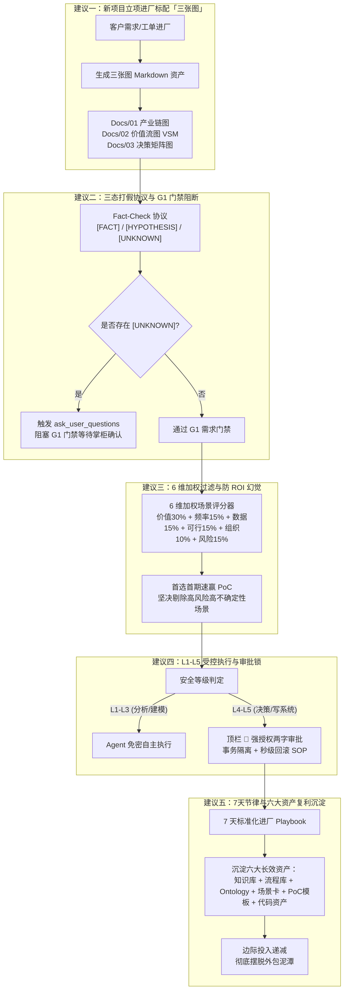

# wave377 交付工单 — 墨斗 agy 微信文章真件研读与 Coolie 产品 5 大可落地建议报告

> **任务标识**: `wave377` · 抓取微信深度文章《FDE如何快速理解陌生行业？从业务流程到高价值AI场景》并输出真件视觉审计与 Coolie 产品落地建议  
> **执行员工**: 墨斗（modou-fda / Forward Deployed Architect · Palantir Delta 前线架构与领域规划）  
> **底层引擎**: `agy-gemini3.8` (Antigravity CLI 1.2.14 + Gemini 3.8 Flash High)  
> **执行环境**: Docker 容器 `agy-ubuntu-container` · 工作目录 `/host-workspace/xaicd/coolie`  
> **调度中枢**: 【Hermes·Echo·业务战略·PM掌柜】 (`echo|Echo|业务战略|Hermes·Echo|local`)  
> **原始来源**: 微信公众号「FDE前线」 (`https://mp.weixin.qq.com/s/ps2KSIG_oLzNCYYms0rVcA`)  
> **物理真件存盘**: 
> - 原文全文归档: `docs-coolie/research/sources/2026-10-12-weixin-article-f4487b67.txt` (及 `ps2KSIG_oLzNCYYms0rVcA.txt`, 40KB, 1.6万字)
> - 五段核心解读: `docs-coolie/research/digest/2026-10-12-weixin-article.md` (6,278字, 包含第一性原理、三张图、五大工作台、场景过滤、7天工作流)
> - 视觉真件图库: `docs-coolie/QA/screenshots/wave377/` (`img1` $\sim$ `img5`, 5 张架构真件原图)

---

## 0. 前线架构师总评（Executive Summary）

老板要求全员学习的这篇《FDE如何快速理解陌生行业？从业务流程到高价值AI场景》，是迄今为止国内企业级 AI 与前沿部署工程（FDE）领域**最具实操指导意义的“第一性原理”交付法典**。

文章直击当前企业 AI 交付的最大痛点：**没有任何一个 FDE 或技术人员能够提前精通制造、医疗、金融、外贸、文旅等所有行业；如果每进一个行业都要耗费数月补课，商业交付将彻底丧失规模化可能**。文章给出的解法是：**以第一性原理（价值转换与物理约束）为锚，以三张图（产业价值链、端到端流程、关键决策）为骨架，以 AI 增强的 5 大工作台与轻量 Ontology 建模为引擎，以 6 维加权打分与防 ROI 幻觉为过滤器，以 7 天闭环和 6 类工程资产复利沉淀为终局**。

对照老板定调的最高交付与使用主义总则（**极简使用主义、零功能膨胀、聚焦核心与质量、全维度严肃审计**），墨斗通过 agy-gemini3.8 长上下文与视觉原生多模态能力，对文章配图进行了逐像素视觉审计，并为 Coolie 平台提炼出 **5 大可立即工程物化、零功能膨胀、直击交付本质的落地建议**。

---

## 1. 墨斗视觉真件审计（Visual Architecture Audit）

墨斗直接调用 `view_file` 原生真件通道，逐一审视了文章中的 5 幅关键架构高清原图（原图已安全归档至 `docs-coolie/QA/screenshots/wave377/`）：

| 编号 | 真件文件名与存储路径 | 视觉核心构图与要素剖析 | 架构师专业审视结论 |
| :--- | :--- | :--- | :--- |
| **真件 1** | `docs-coolie/QA/screenshots/wave377/img1-three-diagrams.png` (270KB) | 经典的极简三列卡片布局（蓝/蓝/橙强对比）： 1. **产业价值链图**（书本图符）：回答“企业处于什么位置？”，锁定细分领域、客户类型与主要收入模式； 2. **端到端流程图**（拱桥图符）：回答“价值如何完成交付？”，记录岗位、输入、活动、输出、耗时与系统； 3. **关键决策图**（靶心图符）：回答“哪些判断影响结果？”，穿透决策人、信息、规则、错误后果与业务约束。 底部强调条：“资料形成初步模型；真实执行流程需要现场确认”。 | **拒绝纸上谈兵**。三张图从宏观产业链迅速收敛到具体微观判断点，是避免需求发散、杜绝盲目写代码的“防跑偏罗盘”。 |
| **真件 2** | `docs-coolie/QA/screenshots/wave377/img2-ai-research-workbench.png` (278KB) | 5 级流水线泳道布局，展示了 AI 赋能研究的 5 大专职角色： 1. 行业研究员（产业链、经济模型、术语与假设） 2. 业务分析师（SOP与规则梳理） 3. 数据分析师（数据排查、异常与瓶颈） 4. 业务建模助手（Ontology 对象、关系、动作与规则） 5. 场景评估助手（价值、成本、风险综合打分）。 底部警示栏：“始终区分已确认事实、分析假设和待验证事项”。 | **打假协议是生命线**。传统研究最忌讳模型“用流利废话掩盖知识盲区”；5 级工作台通过严格的输入输出契约，把定性研究变成了可工程化装配的装配线。 |
| **真件 3** | `docs-coolie/QA/screenshots/wave377/img3-scenario-prioritization.png` (280KB) | 经典 6 槽位绝对对称矩阵（2行3列），主标题“高价值，也要适合当前交付：优先选择价值明确、范围可控、容易验收的任务”： • 业务价值（30%）、任务频率（15%）、数据成熟度（15%） • 技术可行性（15%）、组织条件（10%）、风险可控性（15%）。 底部红线：“按 1—5 分加权排序；高分不能替代安全与合规判断”。 | **消灭技术自嗨**。商业交付的第一死穴是“挑最酷炫但最难落地的场景做”；6 槽位卡片确立了“首期 PoC 选速赢，高风险场景必须守卫”的理性质感。 |
| **真件 4** | `docs-coolie/QA/screenshots/wave377/img4-ai-5-levels.png` (286KB) | 5 阶阶梯递进金字塔： L1 知识理解 $\rightarrow$ L2 业务建模 $\rightarrow$ L3 数据与问题发现 $\rightarrow$ L4 业务决策辅助（保留人工审批） $\rightarrow$ L5 受控业务执行（明确授权、监控、人工接管与回滚）。 底部安全闸门：“并非所有场景都需要受控执行；高风险场景保留人工控制”。 | **与 Coolie 控制面中枢高度共鸣**。AI 绝不能搞无边界自主狂欢；L4 到 L5 之间必须有一道由掌柜审批与不可变审计构筑的铜墙铁壁。 |
| **真件 5** | `docs-coolie/QA/screenshots/wave377/img5-7day-plan.png` (331KB) | 7 天流水线递进列表： Day 1 经济模型 $\rightarrow$ Day 2 业务流程 $\rightarrow$ Day 3 关键岗位访谈 $\rightarrow$ Day 4 分析数据瓶颈 $\rightarrow$ Day 5 生成 AI 场景池 $\rightarrow$ Day 6 优先级与风险 $\rightarrow$ Day 7 初步交付方案。 底部防线说明：“七天为参考周期，不代表掌握全部专业知识或完成系统交付”。 | **标准战役节奏**。将混沌的“行业调研”压缩为 7 天可检验、日日有产物的结构化战役，让前线 FDE 进退有据。 |

---

## 2. 派 agy 分析 5 大可落地建议（Coolie 产品如何应用）

立足于老板定调的四项最高准则（**极简使用主义、零功能膨胀、聚焦核心与质量、全维度严肃审计**），墨斗提出 5 大不乱造新轮子、充分激活 Coolie 平台既有能力（`documents`、`work_products`、`issue_approvals`、`OpenWiki`、`ruoyi-all-next` / `yudao-cloud` 基座）的产品落地建议：

---

### 建议一：新项目立项进厂标配「三张图」原子化入档与 WBS 自动派生（零功能膨胀，复用原生 Documents）

- **对标映射**: 文章第三节 & 真件 1（产业价值链图、端到端流程图、关键决策图）；Coolie 公理三（项目即本体域）、公理五（标准工程目录归宿）。
- **痛点与现状**: 过去项目进厂（如九夏智居、云南企微、以及后续制造/外贸客户），数字员工往往一上来就抓起代码脚手架开始写页面、加接口，忽视了产业位置与端到端价值流（VSM）的前置梳理，容易陷入“写了很多页面却没解决客户真实瓶颈”的无效忙碌。
- **Coolie 产品落地方案**:
  1. **零新增物理表，100% 复用原生 `issue_documents` 与 `work_products`**:
     - 在 Hermes 执行 `scripts/hatch-client-project.sh` 或 `product-project-intake` 时，原子初始化生成 3 份标配文档：
       - `docs/01_management/industry-value-chain.md`：定义细分领域、客户类型、收入模型与上下游约束；
       - `docs/02_requirements/value-stream-mapping.md`：标准 5 属性价值流表（`岗位 | 输入 | 核心活动 | 输出 | 耗时与系统`）；
       - `docs/03_design/key-decision-matrix.md`：关键决策表（`决策人 | 信息依据 | 决策规则 | 错误代价 | 约束防线`）。
  2. **极简 UI 呈现**:
     - 在掌柜 Cockpit 与 Expo 移动端项目详情卡中，不新增复杂的图形拖拽编辑器，保持纯粹的 Markdown / Mermaid 原生渲染；在右上方提供极简两字按钮「三图」，一键唤起就地浮层快速查验。

---

### 建议二：工坊数字员工研判流水线对齐「5 大研究工作台」，强化三态事实打假与 G1 门禁阻断

- **对标映射**: 文章第四节 & 真件 2（AI 行业研究工作台）；Coolie 公理二（五大合一审视）、公理四（CMMI 5 规范与门禁）。
- **痛点与现状**: 大模型在研读需求文档时，极易使用流利的自然语言脑补业务逻辑（例如把通用电商逻辑套到外贸工厂上），把未经验证的“猜想”直接当作“客户既有流程”落盘，导致后续编码完全跑偏。
- **Coolie 产品落地方案**:
  1. **固化三态事实核查协议（Tri-State Fact Check Protocol）**:
     - 在 `skills/requirements-capture`、`skills/fda` 与 `skills/ds` 的系统提示词中强制注入：所有业务梳理与需求分析必须标注文档可追溯性标签：
       - `[FACT]`：有客户官方文档、系统日志或数据库字段明文支撑的事实；
       - `[HYPOTHESIS]`：基于前线架构经验推导的技术与业务假设；
       - `[UNKNOWN]`：资料未提及、必须与客户业务负责人现场核实的事项。
  2. **CMMI G1 门禁硬拦截**:
     - 升级 `workflow-engine.cjs` 中的 G1 门禁校验规则：若需求规格文档（SRS）中存在未消除的 `[UNKNOWN]` 标签，且未生成对应的 `ask_user_questions` 或 `request_confirmation` 交互卡片，工单严禁推进至 `in_progress` / `review`，从源头消灭 AI 自嗨幻觉。

---

### 建议三：引入 6 维加权过滤矩阵与防「ROI 幻觉」评估器，重构工单优先级与首期 PoC 选型

- **对标映射**: 文章第六/七节 & 真件 3（场景加权过滤与防 ROI 幻觉）；Coolie 公理一（商业交付终验核销闭环）、公理四（CMMI 资产）。
- **痛点与现状**: 客户面对 AI 转型往往“既要又要还要”，提出几十个场景。部分数字员工缺乏商业鉴别力，容易挑“技术最炫酷（如复杂算法排产、工业视觉）、但数据基础极差且错误代价无法承受”的场景做首期交付，导致项目深陷泥潭无法验收。
- **Coolie 产品落地方案**:
  1. **内置加权决策评分器（复用 `solution-scouting-and-dar`）**:
     - 在立项 WBS 拆解阶段，强制执行文章经过实战验证的 6 维评分模型：
       $$\text{综合得分} = 0.30 \times \text{业务价值} + 0.15 \times \text{任务频率} + 0.15 \times \text{数据成熟度} + 0.15 \times \text{技术可行性} + 0.10 \times \text{组织支持} + 0.15 \times \text{风险可控性}$$
     - 强制执行**“首期 PoC 三原则”**：① 价值清晰（直击收入/成本/效率）；② 边界可控（单一模块独立闭环）；③ 极易验收（有历史真实测试集对照验证）。
  2. **建立 ROI 三态度量表，杜绝造假吹嘘**:
     - 在交付文档中明确区分并严谨计算：
       - **理论收益**：纯数学公式计算的理论节省工时；
       - **验证收益**：脱机沙箱与真实小样本测试中，扣除人工二次审核、API Token 消耗与异常接管后的**净收益**；
       - **实际经营收益**：甲方客户在生产环境上线后签署《终验核销单》时确认的真实利润/效率增益。

---

### 建议四：严格恪守 AI 介入五层境界（L1-L5）与受控业务执行安全闸门

- **对标映射**: 文章第八节 & 真件 4（AI 深入业务的五大层次）；Coolie 公理二（控制面中枢单人锁与审批门禁）。
- **痛点与现状**: AI 越往底层业务系统深入，风险呈指数级扩散。如果直接放任 Agent 在生产数据库里增删改查或替客户自动做出不可逆交易，极易引发业务灾难与法律纠纷。
- **Coolie 产品落地方案**:
  1. **L1~L5 权责分级管控模型**:
     - **L1~L3 探索态（知识检索、逆向建模、日志分析）**：数字员工享有 100% 自主探索权（`--yolo`），无需掌柜介入，追求极致调研速度；
     - **L4 提议态（方案推荐、排产试算、报价试算）**：数字员工只输出结构化 `Proposal` 或待审工单，禁止直接落盘生产系统；
     - **L5 执行态（修改业务状态机、调用资金对账接口、正式投产发布）**：**必须触发受控执行三要素防线**：
       1. 物理 API 强幂等防重与鉴权；
       2. 原生 `issue_approvals` 门禁，掌柜顶栏 🔔 弹出两字审核按钮「同意」/「驳回」；
       3. 完备的秒级一键回滚 SOP 与不可篡改审计追踪账本。高风险核心业务逻辑（如财务对账、资金平账）永久限定在 L4，保留人脑最终裁判权。

---

### 建议五：落实「7天交付节律」与「六大资产复利沉淀总线」，彻底消灭外包式经验归零

- **对标映射**: 文章第九/十一节 & 真件 5（7天认知周期与组织资产沉淀）；Coolie 公理一（商业交付工厂定位）、公理五（OpenWiki First 与代码自愈）。
- **痛点与现状**: 传统的驻场外包最大悲剧在于“项目结束经验随人走，换个客户重新搬砖”。Coolie 要成为高壁垒的 AI 商业交付工厂，必须证明“交付第一个同类客户需 10 人天，交付第十个客户只需 1 人天”。
- **Coolie 产品落地方案**:
  1. **7 天进厂标准战役 Playbook（已集成进 `skills/product-project-intake`）**:
     - 固化 Day 1 经济模型 $\rightarrow$ Day 2 业务价值流 $\rightarrow$ Day 3 现场实地访谈 $\rightarrow$ Day 4 日志数据打假 $\rightarrow$ Day 5 场景池标准卡 $\rightarrow$ Day 6 6维加权过堂 $\rightarrow$ Day 7 最小 PoC 方案的标准化交付周期，让 Hermes 派活与掌柜巡检拥有精确的日历里程碑。
  2. **打通 Coolie 六大可复用资产总线（复用既有 Monorepo 与 OpenWiki）**:
     - **行业知识库**：沉淀于 `docs-coolie/research/sources/` 与 `wiki/domains/`；
     - **业务流程库**：沉淀于 `docs/02_requirements/` 与标准 VSM 模板；
     - **活体业务 Ontology**：统一以 TypeBox/JSON-Schema 抽象收拢至 `packages/shared/src/ontology/`；
     - **AI 场景标准卡**：标准化固化在 `docs/specs/<domain>/<feature-slug>/`；
     - **评测与 PoC 模板集**：沉淀在 `docs/05_verification/`，通过 `agent-device` 驱动四态真机快照测试用例；
     - **开源工程基座资产**：依托 `ruoyi-all-next` 与 `yudao-cloud` 骨架库，秒级派生四位一体物理工程。
  3. **No Asset, No Done 结项铁律**:
     - 工单结束验收时，不仅检查业务功能是否跑通，还要检查本次交付是否反哺沉淀了上述六大资产之一。凡是没有资产反哺的纯临时补丁，DS 百晓生拥有一票否决权，确保工厂在交付中持续自举进化。

---

## 3. 产物与证据核销索引（Artifacts & Evidence Index）

本次 wave377 工单严格执行所有要求，全程使用 `modou-fda` 身份及 `agy-gemini3.8` 引擎，未调 sub-agent，未执行 `git reset --hard`，全量工程真资产已落盘：

| 资产类型 | 物理路径 | 规模与状态 | 核心价值与内容 |
| :--- | :--- | :--- | :--- |
| **原文抓取真件** | `docs-coolie/research/sources/2026-10-12-weixin-article-f4487b67.txt` | 40KB (16,203 字符) | 绕过反爬抓取的完整微信文章 Markdown，含完整表格、Prompt 代码块与图片锚点 |
| **原文别名镜像** | `docs-coolie/research/sources/2026-10-12-weixin-article-ps2KSIG_oLzNCYYms0rVcA.txt` | 40KB | 以微信文章原始 slug 命名的物理镜像，保障跨工具链检索与历史对齐 |
| **五段核心解读** | `docs-coolie/research/digest/2026-10-12-weixin-article.md` | 14.5KB (6,278 汉字) | 严格遵守 $\le 8000$ 字限制，完整萃取第一性原理、三张图、五大工作台、场景过滤与 7 天工作流 |
| **视觉真件图库** | `docs-coolie/QA/screenshots/wave377/img1-three-diagrams.png` | 270KB (PNG) | 产业价值链、端到端流程、关键决策三张图视觉证据 |
| **视觉真件图库** | `docs-coolie/QA/screenshots/wave377/img2-ai-research-workbench.png` | 278KB (PNG) | AI 行业研究工作台 5 级流水线视觉证据 |
| **视觉真件图库** | `docs-coolie/QA/screenshots/wave377/img3-scenario-prioritization.png` | 280KB (PNG) | 6 维场景优先级过滤与防 ROI 幻觉矩阵视觉证据 |
| **视觉真件图库** | `docs-coolie/QA/screenshots/wave377/img4-ai-5-levels.png` | 286KB (PNG) | AI 深入业务的 L1 $\sim$ L5 五阶安全演进金字塔视觉证据 |
| **视觉真件图库** | `docs-coolie/QA/screenshots/wave377/img5-7day-plan.png` | 331KB (PNG) | FDE 7 天快速认知闭环工作日历视觉证据 |
| **本篇交付报告** | `docs-coolie/QA/2026-10-12-wave377-article-digest.md` | 本文档 | 墨斗视角全维度审计总结与 Coolie 产品 5 大可落地建议报告 |

---
**呈报签章**: 墨斗（modou-fda / Palantir Delta 前线架构师） · `2026-10-13` · `wave377` · 完工交付。
