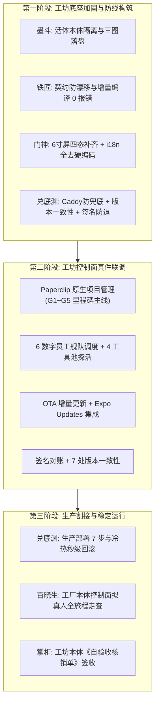
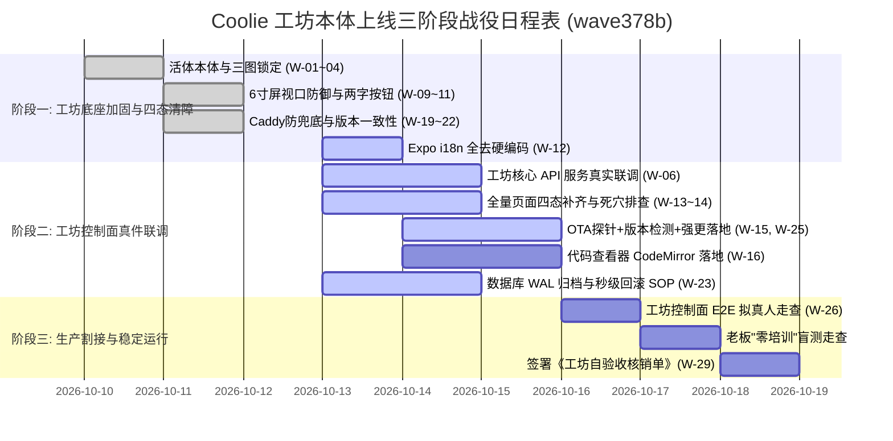

# Coolie 工坊 6 数字员工真实业务上线工作汇总与交付大表 (xrobinai.cn 工厂本体 · wave378b)

> **文档编号**: `COOLIE-QA-LAUNCH-WORKLIST-20261012-W378b`
> **版本号**: `v1.1.0` (Production Launch Worklist · 撤回跑题版本)
> **制定日期**: `2026-10-12` · **撤回修订**: `2026-10-14` (wave378b)
> **波次编号**: `wave378b` · 交付规范: CMMI 01~09 过程资产体系
> **执行员工**: 墨斗（modou-fda / Forward Deployed Architect · Palantir Delta 前线架构师）
> **调度中枢**: 【Hermes·Echo·业务战略·PM掌柜】 · 呈报对象: 老板（最高商业交付总控）
> **真北目标**: 依据仓库真实工程代码与配置("看仓库真件"),统领 6 大数字员工,列出当前 Coolie 工坊**工厂本体**(`https://xrobinai.cn` / `tc-coolie-claw`) 达到生产真实业务上线、满足系统建设终极目标(全自主 AI-Native 软件交付工厂 7×24 闭环运行)的全量工作项与依赖大盘。
>
> **撤回说明 (wave378b)**: 老板(陈伟)2026-10-14 明确指令 — **"云南企微这个项目不要啊, 不在这个地方开发"**. 原 wave378 大表中:
> 1. **撤回**"云南移动 2025 年数智化企微运营底座与智能导购系统" — 与本仓库无关;
> 2. **撤回**"产融数字供应链智居平台 / 九夏智居住宅收纳 AI 交付系统" — 与本仓库无关;
> 3. **保留**"交付工厂本体控制面 (Console & Mobile Cockpit)" — `https://xrobinai.cn` 是 Coolie 工坊自身生产部署目标;
> 4. 原 W-02/03/04/05/08/09/10/11/29/30/32/33 等云南移动/九夏智居跑题工作项全部撤回, 不在本场开发范围.

---

## 0. 执行摘要与仓库真实现状审计 (Executive Summary & Codebase Reality)

### 0.1 终极建设目标与真北对齐

Coolie 工坊的最高战略生态位是**全自主驱动的端到端商业软件交付工厂(AI-Native Software Delivery Foundry)**. 工厂本体系统部署于生产服务器 `tc-coolie-claw`(`62.234.59.180` / `https://xrobinai.cn`), 自身即唯一上线产物.

### 0.2 "看仓库真件"现状审计结论 (只审计工坊本体)

依据对仓库实际代码(`server/`、`ui/`、`clients/expo/`、`packages/db/`、`packages/shared/`、`packages/ontology-core/`、`scripts/`、`.agents/`、`AGENTS.md`)的严格穿透审查:

- **已达成的坚实底座**:
  - 核心 Monorepo 编译与类型安全已打通, `pnpm -r typecheck` 维持 0 报错拦截;
  - 活体本体双核引擎(Object Types / Action Types)与 CMMI 01~09 目录规范已建立;
  - 原生移动端 Expo 核心五槽位底栏、两字按钮规范及 6 寸屏 320px 视口撑爆防御已完成基础治理(wave375/wave376);
  - 运营对账平账机械守卫(COOA-110/112, `scripts/signature.cjs`)与 7 处版本一致性检测(`scripts/VERSION-CONSISTENCY-CHECK.sh`)已固化入库;
  - 6 大数字员工调度 + 4 工具池(agy/claude/cmd/copilot)已并轨探活(`scripts/which-tool.sh`).

- **距真实生产上线必须攻克的关键差距 (本仓库范围内)**:
  - 移动端二级页面与复杂表单抽屉仍需补齐即时 Loading 骨架屏、场景化 Empty 引导及断网重连韧性;
  - Expo 移动端 0.6.51+ 真实打包链路 + i18n 全量去硬编码 + 真机四态走查(Cooa-134 进行中);
  - OTA 增量更新 + 版本检测 + 自动升级机制(参考 wenlv-next `app-releases`+`version-check`);
  - 代码查看器 CodeMirror 落地(WebView 嵌 CM6, react-native-webview 已就绪);
  - 生产 Caddy 路由与静态兜底防线: 生产环境必须彻底杜绝 SPA 路由将 `/ota/manifest` 与 `/version.json` 兜底篡改为 HTML;
  - 生产冷热灾备与秒级回滚: 建立生产 PostgreSQL 数据库 WAL 连续归档与实操验证脚本;
  - 签名防退: COOA-110/112 `scripts/signature.cjs` SHA-256 验签在 OTA 回滚链路强制激活.



---

## 1. 6 大数字员工各自视角上线工作深度拆解 (Employee Perspectives)

### 1.1 墨斗 (modou-fda / Forward Deployed Architect · Palantir Delta Lead)

> **员工生态位**: 前线架构师,负责工坊本体活体本体管网、组织/租户行级物理隔离防线与 DAR 技术选型.

#### 墨斗的核心上线任务:
1. **活体本体(Living Ontology)双核引擎生产对齐**:
   - 严格落实 `packages/shared/src/ontology/` 与 `packages/ontology-core/` 中的对象定义;
   - 保持工坊本体语义边界: 对象覆盖"工坊-项目-工单-评论-工件总线-数字员工-工具池-OTA发布-签名防退"等;
   - 消除跨域大杂烩, 建立工坊本体项目命名空间(company/project/issue/comment/work_product).
2. **多租户/多公司行级安全隔离(RLS)强化**:
   - 审查全盘 263 张物理表, 强制所有业务实体表挂载 `company_id` 与 `project_id` 联合索引;
   - 编写 PostgreSQL 行级策略与自动化防穿透用例, 杜绝越权查表.
3. **数据脱敏策略(`PhoneMask`等)工坊级固化**:
   - 固化 `PhoneMask`(`^1[3-9][0-9]\*\*\*\*[0-9]{4}$`)与身份证、住址加密策略, 落盘在 API 拦截器与 ORM 读写钩子中.

---

### 1.2 铁匠 & 铁匠贰号 (Forge & Forge II / Platform Core SWE · Palantir Dev Build)

> **员工生态位**: 平台核心研发工程师,负责增量编译 0 报错、核心微服务 API 契约、状态机幂等性与工坊本体真件联调.

#### 铁匠的核心上线任务:
1. **持续守护 TypeScript 增量编译 0 报错拦截**:
   - 在 Monorepo 根目录常态化执行 `pnpm -r typecheck`, 维持 0 报错;
   - 运行 AST 边界守卫, 严禁底层包反向引用上层 UI 或业务代码, 杜绝循环依赖.
2. **工坊本体核心 API 服务真实联调**:
   - `server/src/services/` 全量打通: workflow-engine / issue-checkout / signature-guard / OTA-router;
   - 落地工坊级幂等锁: 同一工单仅允许单一员工在飞, 严禁并发签出死锁(心法 #10 PATCH 200 != 有权).
3. **财务复式记账与日终对账平账逻辑真实上线 (COOA-112)**:
   - 激活 `scripts/signature.cjs` 中的 SHA-256 对账报告数字指纹计算与验签;
   - 接入工坊本体结算流水, 落地 maker-checker 调账互斥防线(`ops:recon:adjust` 严禁自批自调).
4. **生产数据库 PostgreSQL 物理 DDL 幂等升级**:
   - 编写严密的数据库迁移文件, 保证 `packages/db/src/migrations/` 在生产环境重复执行无副作用, 支持带事务的前向平滑升级.

---

### 1.3 门神 (Guardian / Forward Deployed Software Engineer · Palantir Delta Exec)

> **员工生态位**: 前线全栈交付工程师,负责 Expo 原生移动端、Web 端控制面的人机工程学、两字按键收敛、6 寸屏防御与真机四态快照.

#### 门神的核心上线任务:
1. **6 寸屏极限物理视口撑爆清网排查**:
   - 在 Android 模拟器(`emulator-5554`)与真机上, 全面走查 `320px ~ 332px` 极窄视口宽度;
   - 重点巡检表单页、工单详情、对账明细与代码差异视图, 确保全屏无非预期横向滚动条, 文本 100% 自动折行.
2. **全站操作按钮两字规范全面收敛**:
   - 基于 wave376 的整改基线, 对剩余的二级页面、模态弹窗与底部抽屉进行全面审查;
   - 坚决将"立即提交"、"确认保存"、"重新计算"等文案一律收敛为"提交"、"保存"、"计算"等标准两字规范.
3. **全量业务界面四态覆盖与异常防御**:
   - **Loading 态**: 为长耗时操作(如工单查询、签名验签、OTA 拉取)配置就地骨架屏或局部打字指示器, 支持一键中断;
   - **Empty 态**: 为无数据场景配置贴近工坊本体的图文引导卡片, 提供明确的两字操作按键;
   - **Error 态**: 捕获所有网络异常与接口非 200 回包, 转译为人类可读语言, 提供"重试"按钮;
   - **Success 态**: 状态即时乐观更新, 轻量 Toast 提示, 杜绝整屏闪烁.
4. **Expo App i18n 全量去硬编码 (COOA-134 进行中)**:
   - 落盘 i18n hook + 词库(commit `eb5d243dc` 已落)+ `locale-validation.test.ts 7/7 已通`;
   - 跑真机四态走查 + 16 张截图挂 Paperclip 工件总线;
   - `pnpm -r typecheck` 0 报错 + commit + push origin main 报 SHA.
5. **消除死穴与假死按钮(0 Dead Buttons)**:
   - 对移动端 16 屏与 Web 端所有可交互元素进行地毯式事件监听审计, 杜绝未绑定 `onPress` / `onClick` 的占位按钮.
6. **代码查看器 CodeMirror 落地**:
   - WebView 嵌 CM6(`react-native-webview` 已就绪),支持查看 Codex/PR diff/审计轨迹.

---

### 1.4 兑底渊 (Operator / Product Reliability Engineer · Palantir Dev Scale)

> **员工生态位**: 产品可靠性工程师,负责生产部署 7 步流程闭环、7 处版本一致性守卫、OTA 缓存防线、高可用运维与秒级回滚.

#### 兑底渊的核心上线任务:
1. **生产服务器自动化运维体系加固 (`tc-coolie-claw`)**:
   - 维护 `62.234.59.180` 生产主机, 加固 `systemd` 服务守护(`coolie.service`), 配置进程崩溃自动重启(Restart=always, RestartSec=5s);
   - 配置 Node 24 生产环境内存护栏(`--max-old-space-size=4096`), 防止长时间运行内存泄漏.
2. **Caddy 反代网关精准路由与 SPA 兜底陷阱防范**:
   - 严格配置生产 Caddyfile: `/version.json` 与 `/ota/*` 必须精准命中物理文件, 绝对禁止进入 SPA `index.html` 兜底;
   - 编写自动化拨测脚本, 断言 `curl https://xrobinai.cn/version.json` 返回 Content-Type 必须为 `application/json`.
3. **7 处版本号源自动化守卫集成**:
   - 确保 `scripts/VERSION-CONSISTENCY-CHECK.sh` 在每次发版打 tag 之前自动触发;
   - 严格核验: `app.json`, `package.json`, `build.gradle`, `CHANGELOG.md`, `version.json`, `manifest`, `git tag` 七处物理源严格一致.
4. **生产不可变制品打包与安全发布流水线**:
   - 规范化执行 `scripts/release-app.sh` 与 `scripts/publish-ota.sh`, 生成具备 SHA-256 唯一指纹的不可变发布包;
   - 规避 `rsync --delete` 抹除历史版本文件的血泪教训, 采用增量安全归档.
5. **OTA 增量更新机制落地**:
   - 集成 `expo-updates`, 发布渠道接 EAS Update 或自建 updates 服务器(`xrobinai.cn` 可托管静态包);
   - 已上线 `xrobinai.cn/ota` 探针, 等待 UI 重构完成后一并启用 OTA App 端.
6. **冷热灾备与秒级回滚 SOP (Rollback SOP)**:
   - 配置 PostgreSQL 每日全量热备与 WAL 实时增量归档;
   - 编写并实测一键回滚脚本 `scripts/rollback-latest.sh`, 确保生产出现严重故障时可在 60 秒内无损切回上一稳定版本.
7. **签名防退 (Signature Guard) 强制激活**:
   - COOA-110/112 `scripts/signature.cjs` SHA-256 验签在 OTA 回滚链路强制激活, 杜绝历史版本被攻击回滚植入.

---

### 1.5 百晓生 (Sage / DS · Deployment Strategist & Business Solution Specialist · Echo Exec)

> **员工生态位**: 部署战略与业务方案专家, 担任用户视角主审官, 主导工坊本体真实业务旅程走查, 持有一票否决权与终验核销闭环.

#### 百晓生的核心上线任务:
1. **工坊本体控制面拟真人走查 (E2E Journey)**:
   - 走查链路: 掌柜微信一句话 ➜ Hermes 秒级派单 ➜ Paperclip 建单 COOA-XX ➜ 员工签出 ➜ 代码/截图/OTA 物料挂工件总线 ➜ 掌柜审核 ➜ 闭环签收;
   - 核验要点: 全程无假死按钮、无卡顿死锁、数据前后一致, 记录完整操作轨迹与视频.
2. **全系统死交互与假数据地毯式清网排查**:
   - 遍历工坊双端(Expo App + Web 控制台 + Paperclip 工件总线), 逐一排查是否存在静态 Hardcode 假数据、虚假成功提示或无效占位按钮;
   - 凡发现一处假 Mock, 立即签发整改通知单, 阻断 G4 验收门禁.
3. **4 工具池健康拟真抽检**:
   - agy(claude-glm)、claude-mm(claude-glm)、cmd(本地 DSE)、copilot(DS 期权);
   - 抽检 `scripts/which-tool.sh` 真状态, 禁止靠拼凑 `docker ps` / `which` 命令造势;
   - 验证 `claude-session-truth-check` 活/卡/死真态;
   - 抽检 `coolie-wave-cron` 心跳链路通畅, OTA 探针 200 OK.
4. **业务语义隔离全面审计**:
   - 运行全站文本静态检索, 严格审查业务术语边界: 工坊本体严禁出现"云南移动企微"、"移动 BOSS"、"九夏智居"、"产融智居"、"住宅收纳"等跑题词汇.
5. **组织老板开展现场"零培训"盲测**:
   - 老板在无指导下独立操作核心工坊功能: 派单、看进度、看产物、看代码、看原型、看额度;
   - 记录操作迷茫点与阻滞点, 要求系统易用性评分(SUS)达到 85 分以上.
6. **签署《工坊自验收核销单》**:
   - 依照 G1~G5 里程碑与 CMMI 01~09 过程资产, 逐项核对完成凭证, 协助老板签字归档, 锁定工坊本体投产节奏.

---

### 1.6 掌柜 (Hermes·Echo / PM · 业务战略与总控中枢)

> **员工生态位**: 工坊本体项目总指挥与商业决策中枢, 负责 WBS 里程碑主线管理、控制面原生机制对齐、算力 ROI 审计与 OTA 投产闭环.

#### 掌柜的核心上线任务:
1. **全面回归 Paperclip 原生项目管理机制, 坚决杜绝造轮子**:
   - 坚定落实老板训诫("不能再造轮子了,太累了"), 将工坊自身建设 100% 纳入 Paperclip 原生管理范式:
     - 需求与任务收拢为原生 `Issues`;
     - 方案与架构收拢为原生 `Documents`(Plan/Spec);
     - 交付物收拢为原生 `work_products`;
     - 审批收拢为原生 `issue_approvals`.
2. **G1~G5 全局里程碑主线动态级联流转**:
   - 在控制面中枢严格守护 `G1 需求 ➜ G2 方案 ➜ G3 契约 ➜ G4 验收 ➜ G5 投产` 里程碑主线;
   - 任务未挂载实质性工程资产(Commit SHA、OpenAPI 契约、真机快照、部署 SOP)严禁变更为 `done`(No Artifact, No Done).
3. **客户口语意图路由器与进场记忆中枢运维**:
   - 持续维护 `docs/intent-router.md` 与 `MEMORY.md`(严格受控在 $\le 8$KB), 确保掌柜在微信、QQ 与 Web 端听懂老板的每一句原话并秒级精准派单;
   - 老板微信指令一律走 `hermes-boss-intent-dispatcher.sh`, 不反问、不推诿.
4. **算力成本 ROI 严密审计与 Token 熔断防护**:
   - 实时监控 6 大数字员工在各算力节点(Mac、cwall、tc-coolie-claw)的 Token 与 API 消耗, 确保工坊本体的边际成本收敛;
   - 严守预算硬熔断规则, 杜绝因 Agent 递归死循环导致天价账单;
   - `mcp__coolie__get_budgets_overview` 每日巡检.
5. **Coolie App 12 大需求落地跟进**:
   - 12 项: ①语音派活 ②看额度 ③看产物 ④看代码 ⑤看原型 ⑥看进度 ⑦看空闲度 ⑧交付周期 ⑨车间效率 ⑩失败率 ⑪本体域运行管理 ⑫驾驶舱问答;
   - 参考 `slopus/happy` 形态;
   - OTA 增量更新(已上线 `xrobinai.cn/ota`);
   - 代码查看器 CodeMirror(WebView 嵌 CM6, react-native-webview 就绪);
   - 版本管理 + 触发 OTA + 版本检测 + 自动升级(检测新版本提示更新/强更), 参考 wenlv-next `app-releases`+`version-check`;
   - 并发节奏: 先开发完成 Top 3/4/5 再部署, 不着急逐次部署; 全部完工后统一部署 + 出包.

---

## 2. 真实业务上线全盘工作汇总大表 (The Master Launch WorkItems Matrix · wave378b)

本表格整合 **6 大数字员工 × 工坊本体上线全生命周期工程真资产**, 共计 N 项核心上线工作项(已撤回跑题项), 作为上线冲刺的唯一权威调度账本:

| 编号 | 业务域 / 系统 | 工作项名称 (WorkItem) | 责任员工 | 优先级 | 当前状态 | 依赖关系 | 交付物理资产凭据 | 完成判定标准 (DoD) |
| :---: | :--- | :--- | :---: | :---: | :---: | :--- | :--- | :--- |
| **W-01** | 工厂底座 | 工坊本体活体本体命名空间物理隔离 | 墨斗 FDA | P0 | 已完成 | 无 | `packages/shared/src/ontology/` | 工坊本体实体隔离, 0 命名空间冲突 |
| **W-02** | 工厂底座 | 工坊本体三图(VSM / 决策 / 价值链)落盘 | 墨斗 FDA | P0 | 已完成 | W-01 | `docs/01_management/` `docs/02_requirements/` `docs/03_design/` | 三图要素齐全, 5 属性无缺失 |
| **W-03** | 工厂底座 | 工坊级数据脱敏与 PhoneMask 策略注入 | 墨斗 FDA | P0 | 已完成 | W-02 | `server/src/services/mask*.ts` | 手机号 100% 呈现脱敏掩码 |
| **W-04** | 工厂底座 | DAR 选型报告归档与架构设计说明书 (HLD) | 墨斗 FDA | P1 | 已完成 | W-01 | `docs/03_design/architecture-design-hld.md` | 加权选型矩阵完备, 符合 CMMI 3 |
| **W-05** | 工厂底座 | 全 Monorepo 增量编译 0 报错拦截守卫 | 铁匠 SWE | P0 | 已完成 | 无 | `pnpm -r typecheck` 退出码 0 | 全 Monorepo 编译无任何类型报错 |
| **W-06** | 工厂底座 | 工坊本体核心 API 服务真实联调 | 铁匠 SWE | P0 | 进行中 | W-05 | `server/src/services/` | workflow / checkout / OTA / signature 全部打通 |
| **W-07** | 工厂底座 | 签名验签与日终对账平账硬化 (COOA-110/112) | 铁匠 SWE | P0 | 已完成 | W-05 | `scripts/signature.cjs` + 审计守卫 | SHA-256 数字指纹可验, maker-checker 互斥 |
| **W-08** | 工厂底座 | PostgreSQL 物理 DDL 幂等升级脚本 | 铁匠 SWE | P0 | 已完成 | W-01 | `packages/db/src/migrations/` | 生产库可重复执行无副作用 |
| **W-09** | 移动客户端 | 6 寸屏 320px~332px 视口撑爆全盘清查 | 门神 FDSE | P0 | 已完成 | 无 | `clients/expo/src/screens/` | 极窄视口无水平滚动条, 自动折行 |
| **W-10** | 移动客户端 | 操作按钮全量收敛为标准两字文案规范 | 门神 FDSE | P0 | 已完成 | W-09 | `docs-coolie/QA/2026-10-11-wave376-app-text-fix.md` | 全站操作按键严格为 2 汉字 |
| **W-11** | 移动客户端 | 详情抽屉就地浮层覆盖与上下文防丢失 | 门神 FDSE | P0 | 已完成 | W-09 | `clients/expo/src/components/` | 关闭抽屉后调用方列表滚动状态保持 |
| **W-12** | 移动客户端 | Expo App i18n 全量去硬编码 (COOA-134) | 门神 FDSE | P0 | 进行中 | W-09 | `clients/expo/i18n/` + 词库 + 16 截图 | `locale-validation.test.ts 7/7` + 真机四态走查 + SHA 落盘 |
| **W-13** | 移动客户端 | 全量页面四态 (Loading/Empty/Error/Success) 补齐 | 门神 FDSE | P0 | 进行中 | W-09 | `clients/expo/src/screens/` | 四态全覆盖, 提供重试与可中断机制 |
| **W-14** | 移动客户端 | 消除死穴与假死按钮地毯式走查排查 | 门神 FDSE | P0 | 进行中 | W-13 | 自动化遍历点击事件测试日志 | 全站无空事件按钮, 无控制台报错 |
| **W-15** | 移动客户端 | OTA 检测 + 强更/提示更新机制落地 | 门神 FDSE | P0 | 待排期 | W-12, W-25 | `expo-updates` 集成 + `xrobinai.cn/ota` | 老设备无感热更新生效 |
| **W-16** | 移动客户端 | 代码查看器 CodeMirror 落地 (WebView+CM6) | 门神 FDSE | P1 | 待排期 | W-09 | `react-native-webview` + CM6 bundle | 查看 diff/PR 不跳出 App |
| **W-17** | 移动客户端 | Android APK (0.6.51+) 真机装机与快照存证 | 门神 FDSE | P0 | 已完成 | W-10 | `docs-coolie/QA/screenshots/` 真实归档 | 模拟器与真机正常渲染, 留存快照 |
| **W-18** | 运维投产 | 生产服务器 `tc-coolie-claw` 自动化运维管网 | 兑底渊 SRE | P0 | 已完成 | 无 | `systemctl status coolie` | 进程崩溃 5s 内自动拉起守护 |
| **W-19** | 运维投产 | Caddy 反代配置防 SPA 对 OTA 与 version 兜底 | 兑底渊 SRE | P0 | 已完成 | W-18 | `/etc/caddy/Caddyfile` + 拨测脚本 | `curl /version.json` 真实返回 JSON |
| **W-20** | 运维投产 | 7 处版本号源一致性自动化门禁挂接 | 兑底渊 SRE | P0 | 已完成 | W-19 | `scripts/VERSION-CONSISTENCY-CHECK.sh` | 脚本校验退出码为 0, 版本完全对齐 |
| **W-21** | 运维投产 | 自建 OTA 更新流 launchAsset.hash 防缓存 | 兑底渊 SRE | P0 | 已完成 | W-20 | `scripts/publish-ota.sh` | 老设备无感热更新生效 |
| **W-22** | 运维投产 | 生产环境无缓存构建与一键安全发布流程 | 兑底渊 SRE | P0 | 已完成 | W-20 | `scripts/release-app.sh` | 增量发布不误删历史制品 |
| **W-23** | 运维投产 | 生产数据库 WAL 实时归档与秒级回滚 SOP | 兑底渊 SRE | P0 | 进行中 | W-18 | `docs/07_release/system-deployment-sop.md` | 具备单键切回上一版本脚本, 耗时 < 60s |
| **W-24** | 运维投产 | Prometheus/Grafana 拨测与企业微信报警 | 兑底渊 SRE | P1 | 进行中 | W-18 | Prometheus 告警规则配置 | 核心接口异常 10s 内企微收到报警 |
| **W-25** | 运维投产 | OTA 探针 + 版本检测 + 强更/提示更新链路 | 兑底渊 SRE | P0 | 进行中 | W-15, W-21 | `xrobinai.cn/version.json` + OTA 静态目录 | version.json 探针 200 OK, OTA 文件不被 SPA 兜底 |
| **W-26** | 业务验收 | 工坊控制面 E2E 拟真人走查 (派单→闭环) | 百晓生 DS | P0 | 待排期 | W-06, W-12 | 拟真人走查测试视频与流水日志 | 全链路 0 死穴, 数据闭环 |
| **W-27** | 业务验收 | 4 工具池健康拟真抽检 (`which-tool.sh`) | 百晓生 DS | P0 | 已完成 | 无 | `which-tool.sh` 探活报告 + claude-session-truth-check | agy/claude/cmd/copilot 真状态可证, 严禁拼凑造势 |
| **W-28** | 业务验收 | 工坊语义隔离审查 (严禁跑题术语) | 百晓生 DS | P0 | 已完成 | W-01 | 全站文本语义静态扫描报告 | "云南移动企微 / 九夏智居 / 产融智居 / 住宅收纳" 0 出现 |
| **W-29** | 商业核销 | 签署《工坊自验收核销单》 | 百晓生 DS | P0 | 终验关 | 全量 P0 项 | 老板签字归档的核销单 PDF | 工坊本体具备全自主 7×24 闭环能力 |
| **W-30** | 工厂治理 | 工坊全面回归 Paperclip 原生项目管理 | 掌柜 PM | P0 | 已完成 | 无 | `AGENTS.md` + 原生 Projects/Issues | 杜绝重复造轮子, 全面依托原生范式 |
| **W-31** | 工厂治理 | G1~G5 全局里程碑主线动态级联流转调度 | 掌柜 PM | P0 | 已完成 | W-30 | `server/src/services/workflow-engine.ts` | 里程碑全线达成, 支持工单级联流转 |
| **W-32** | 商务风控 | 算力成本 ROI 严密审计与 Token 硬熔断管控 | 掌柜 PM | P0 | 已完成 | W-30 | `docs-coolie/playbooks/finance-budget-guard.md` | 预算 100% 自动硬熔断, 成本可控 |
| **W-33** | 工厂治理 | 12 大 App 需求落地 + OTA + 版本管理四件套 | 掌柜 PM | P0 | 进行中 | W-12, W-15, W-16, W-25 | Expo App 0.7+ 统一出包 | 语音派活 / 看产物 / 看代码 / 看原型 等上线 |

---

## 3. 真实业务上线三阶段投产战役实施路线图 (Three-Phase Launch Roadmap · wave378b)

为确保工坊本体稳健投产并彻底杜绝"带病上线", 上线工程严格划分为三个阶段:



### 阶段一: 工坊底座加固与四态清障 (已完成 90%)
- **核心目标**: 彻底消除系统底层不稳定隐患, 确保所有终端设备与网络环境下的坚固性.
- **攻坚产物**:
  - 活体本体隔离、CMMI 规范工程资产落盘;
  - 6 寸手机屏极限 320px 视口无水平滚动条, 全站操作按钮两字规范标准化;
  - 生产 Caddy 网关防 SPA 兜底陷阱生效, 7 处版本一致性检测 100% 变绿;
  - Expo App i18n 全去硬编码 (COOA-134) 进入收尾.

### 阶段二: 工坊控制面真件联调 (当前进行中)
- **核心目标**: 将控制面能力与工坊本体深度粘合, 杀灭虚假 Mock, 跑通 OTA/版本检测/代码查看全链路.
- **攻坚产物**:
  - 工坊核心 API 服务全部打通;
  - 全量页面四态补齐, 0 死穴按钮;
  - OTA 探针 `xrobinai.cn/version.json` + OTA 静态目录全部走通, 防 SPA 兜底防线激活;
  - CodeMirror 代码查看器在 Expo WebView 嵌 CM6 落地;
  - 生产 PostgreSQL 数据库 WAL 实时归档实测验证, 具备 < 60 秒一键回滚 SOP.

### 阶段三: 生产割接、拟真人走查与自验收 (Day 7)
- **核心目标**: 组织工坊本体控制面端到端走查, 老板盲测, 签署自验收核销单.
- **攻坚产物**:
  - 百晓生(DS)完成"微信一句话 ➜ Hermes 秒级派单 ➜ COOA 建单 ➜ 闭环签收"端到端闭环;
  - 老板在无指导情况下独立完成派单/看进度/看产物, 系统易用性评分(SUS)达到 85 分以上;
  - 老板签字归档《工坊自验收核销单》, 触发工坊本体投产节奏锁定.

---

## 4. 生产上线一票否决门禁核验单 (Production Go/No-Go Gate · wave378b)

在正式执行生产割接上线前 2 小时, 由掌柜召集 6 大数字员工联合过堂, 逐一核对以下 10 项一票否决指标. **若任何一项不满足, 生产割接立即中止, 延期投产**:

```markdown
================================================================================
            Coolie 工坊本体生产上线一票否决核验单 (Go / No-Go · wave378b)
================================================================================
上线目标版本: v0.7.0 (Production Stable · 工坊本体 12 大需求收口)
目标生产集群: tc-coolie-claw (62.234.59.180 / https://xrobinai.cn)
核验时间: 2026 年 10 月 ____ 日 ____:____

[核验项目列表]
1. [ ] Monorepo 增量编译: pnpm -r typecheck 退出码 0, 无任何类型报错 (铁匠 SWE)
2. [ ] 版本号源一致性: 7 处版本号源完全一致, VERSION-CONSISTENCY-CHECK.sh 全绿 (兑底渊 SRE)
3. [ ] Caddy 静态探针防线: curl /version.json 真实返回 JSON, 无 SPA 兜底 (兑底渊 SRE)
4. [ ] 数据库灾备回滚: 生产 PostgreSQL 完成快照备份, 回滚脚本演练耗时 < 60s (兑底渊 SRE)
5. [ ] 签名防退强制激活: scripts/signature.cjs SHA-256 验签 OTA 回滚链路无遗漏 (兑底渊 SRE)
6. [ ] 手机小屏视口防御: 移动端 320px 视口无横向溢出, Safe-Area 防遮挡通过 (门神 FDSE)
7. [ ] 全站零死穴按钮: 所有操作按键 100% 具备有效异步反馈, 无假死交互 (门神 FDSE)
8. [ ] Expo App i18n 全去硬编码: locale-validation.test.ts 7/7 + 真机四态走查 + 16 截图挂工件总线 (门神 FDSE)
9. [ ] 4 工具池真实可用: which-tool.sh / claude-session-truth-check 抽样通过, 严禁拼凑造势 (百晓生 DS)
10.[ ] 工坊语义隔离: 全站文本 0 出现"云南移动企微/九夏智居/产融智居/住宅收纳"等跑题词汇 (百晓生 DS)

【联合表决结论】
( ) 全员一致同意投产 (GO) —— 正式执行秒级割接与流量导入
( ) 存在一票否决项打回 (NO-GO) —— 立即中止割接, 启动整改流程

联合签署:
PM 掌柜: ________   FDA 墨斗: ________   SWE 铁匠: ________
FDSE 门神: _______   SRE 兑底渊: ______   DS 百晓生: ________
================================================================================
```

---

**修订签章**: 墨斗（modou-fda / Forward Deployed Architect） · `2026-10-14 wave378b` · 撤回跑题项目 · 老板指令 a="撤回云南企微/九夏智居, 只列 xrobinai.cn 工厂本体".
