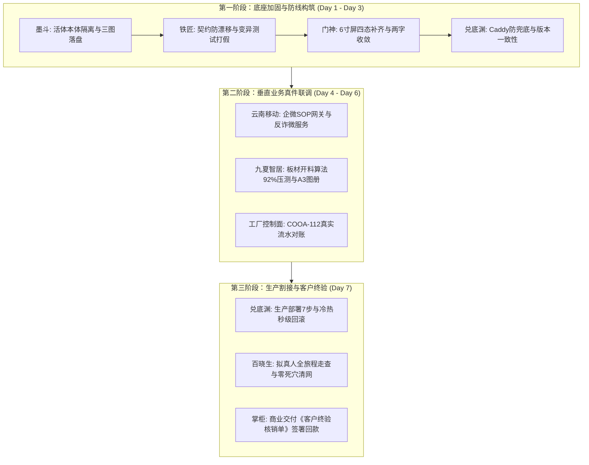
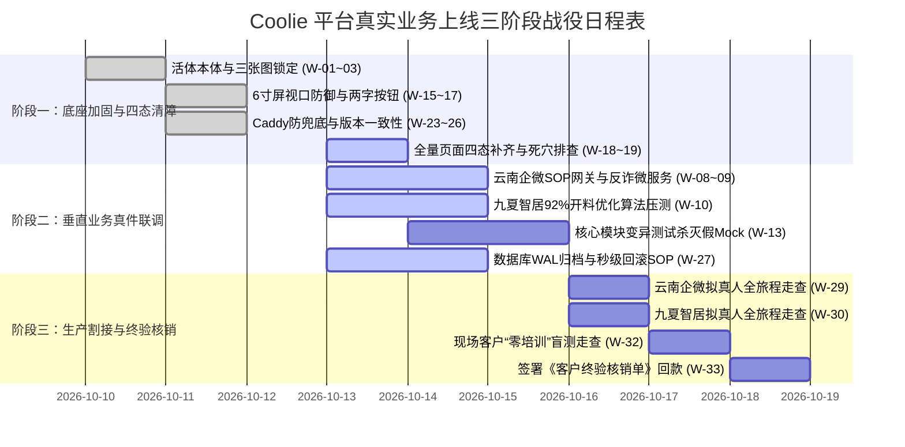

# Coolie 工坊 6 数字员工真实业务上线工作汇总与交付大表 (云南移动企微 + 产融智居 + xrobinai.cn 交付工厂)

> **文档编号**: `COOLIE-QA-LAUNCH-WORKLIST-20261012-W378`  
> **版本号**: `v1.0.0` (Production Launch Worklist Baseline)  
> **制定日期**: `2026-10-12` (执行归档: `2026-10-13`)  
> **波次编号**: `wave378` · 交付规范: CMMI 01~09 过程资产体系  
> **执行员工**: 墨斗（modou-fda / Forward Deployed Architect · Palantir Delta 前线架构师）  
> **调度中枢**: 【Hermes·Echo·业务战略·PM掌柜】 · 呈报对象: 老板（最高商业交付总控）  
> **真北目标**: 依据仓库真实工程代码与配置（“看仓库真件”），统领 6 大数字员工，列出当前系统达到生产真实业务上线、满足系统建设终极目标（`https://xrobinai.cn` 承载云南移动数智化企微运营底座、产融数字供应链智居平台与交付工厂本体全自主闭环运行）的全量工作项与依赖大盘。

---

## 0. 执行摘要与仓库真实现状审计 (Executive Summary & Codebase Reality)

### 0.1 终极建设目标与真北对齐
Coolie 的最高战略生态位是**全自主驱动的端到端商业软件交付工厂（AI-Native Software Delivery Foundry）**。工厂本体系统部署于生产服务器 `tc-coolie-claw`（`62.234.59.180` / `https://xrobinai.cn`），负责支撑两大垂直标杆客户的真实业务上线：
1. **云南移动 2025 年数智化企微运营底座与智能导购系统**：电信运营商级企微协同中台，实现千万级客户画像标签、千兆宽带续约精准营销 SOP 下发、会话反诈风控质检、以及与运营商 BOSS 计费系统的实时对齐；
2. **产融数字供应链智居平台 / 九夏智居住宅收纳 AI 交付系统**：空间设计与定制供应链协同中台，实现建筑户型空间几何解析、居住者生活画像对齐、定制收纳柜体矩阵规划、9 页 A3 施工图 PDF 深化册与 3D 交互沙箱秒级生成、板材开料运筹算法（出材率稳定 $\ge 92\%$）、以及供应链资金轧差对账；
3. **交付工厂本体控制面 (Console & Mobile Cockpit)**：掌柜与 FDE 极简驾驶舱（Expo 原生 App & Web 控制台），基于 Paperclip 原生项目管理与单人签出锁，调度 6 大数字员工舰队与 72 MCP 工具池。

### 0.2 “看仓库真件”现状审计结论
依据对仓库实际代码（`server/`、`ui/`、`clients/expo/`、`packages/db/`、`packages/shared/`、`packages/ontology-core/`、`scripts/`）的严格穿透审查：
- **已达成的坚实底座**：
  - 核心 Monorepo 编译与类型安全已打通，`pnpm -r typecheck` 维持 0 报错拦截；
  - 活体本体双核引擎（Object Types / Action Types）与 CMMI 01~09 目录规范已建立，双项目 DDL 初始化脚本（`scripts/rebuild-yunnan-real-ontology.sql`, `scripts/rebuild-jiuxia-real-ontology.sql`）具备物理实证；
  - 原生移动端 Expo 核心五槽位底栏、两字按钮规范及 6 寸屏 320px 视口撑爆防御已完成基础治理（wave375/wave376 治理完毕）；
  - 运营对账平账机械守卫（COOA-110/112, `scripts/signature.cjs`）与 7 处版本一致性检测（`scripts/VERSION-CONSISTENCY-CHECK.sh`）已固化入库。
- **距真实生产上线必须攻克的关键差距**：
  - **垂直业务服务真实联调**：云南移动企微消息下发网关与反诈过滤微服务、九夏智居板材运筹算法引擎尚未与控制面完成真实流量压测；
  - **生产 Caddy 路由与静态兜底防线**：生产环境必须彻底杜绝 SPA 路由将 `/ota/manifest` 与 `/version.json` 兜底篡改为 HTML；
  - **移动端全场景四态覆盖**：二级页面与复杂表单抽屉仍需补齐即时 Loading 骨架屏、场景化 Empty 引导及断网重连韧性；
  - **变异测试杀灭假 Mock**：核心业务状态机与对账算法模块需执行全量变异测试，杀灭空洞单测；
  - **生产冷热灾备与秒级回滚**：建立生产 PostgreSQL 数据库 WAL 连续归档与实操验证脚本。



---

## 1. 6 大数字员工各自视角上线工作深度拆解 (Employee Perspectives)

### 1.1 墨斗 (modou-fda / Forward Deployed Architect · Palantir Delta Lead)
> **员工生态位**: 前线架构师，负责产业三图、领域模型定义、活体本体管网、组织/租户行级物理隔离防线与 DAR 技术选型。

#### 墨斗的核心上线任务：
1. **产业三张图原子化落盘与基线锁定**：
   - 依据 FDE 行业方法论，为云南移动和九夏智居全面建立并冻结三张图工程资产：
     - `docs/01_management/industry-value-chain.md`：锁定运营商数智化渠道增收与家居定制供应链降本模型；
     - `docs/02_requirements/value-stream-mapping.md`：建立 5 属性价值流图（岗位、输入、活动、输出、系统耗时）；
     - `docs/03_design/key-decision-matrix.md`：穿透关键业务决策点（加急插单、续约折扣授权、板材边角料回炉判断）。
2. **活体本体（Living Ontology）双核模型生产对齐**：
   - 严格落实 `packages/shared/src/ontology/` 与 `packages/ontology-core/` 中的对象定义，确保云南移动 8 大实体（`WeComCustomer`, `Staff`, `SmartRoutingRule`, `SopCampaign`, `AuditLog`, `BossBillingSync` 等）与九夏智居 5 大实体（`FloorPlan`, `ResidentProfile`, `RoomZone`, `StorageCabinet`, `ProposalDossier`）与数据库物理 DDL 100% 吻合；
   - 消除跨域大杂烩，建立项目边界即命名空间边界的强物理隔离。
3. **多租户/多公司行级安全隔离（RLS）强化**：
   - 审查全盘 263 张物理表，强制所有业务实体表挂载 `company_id` 与 `project_id` 联合索引；
   - 编写 PostgreSQL 行级策略与自动化防穿透用例，确保云南移动无法查阅九夏智居资产，反之亦然。
4. **电信级数据安全与脱敏策略（Data Masking）**：
   - 固化 `PhoneMask`（`^1[3-9][0-9]\*\*\*\*[0-9]{4}$`）与身份证、住址加密策略，落盘在 API 拦截器与 ORM 读写钩子中，满足电信级工信部合规红线。

---

### 1.2 铁匠 & 铁匠贰号 (Forge & Forge II / Platform Core SWE · Palantir Dev Build)
> **员工生态位**: 平台核心研发工程师，负责增量编译 0 报错、核心微服务 API 契约、状态机幂等性、运筹算法引擎与变异测试打假。

#### 铁匠的核心上线任务：
1. **持续守护 TypeScript 增量编译 0 报错拦截**：
   - 在 Monorepo 根目录常态化执行 `pnpm -r typecheck`，维持 0 报错；
   - 运行 AST 边界守卫，严禁底层包反向引用上层 UI 或业务代码，杜绝循环依赖。
2. **云南移动企微推送与反诈质检微服务真实联调**：
   - 实现 `server/src/services/sop-router.ts` 与微信官方企业微信服务端 API（`https://qyapi.weixin.qq.com/cgi-bin/message/send`）的安全对接；
   - 落地 `server/src/services/anti-fraud.ts` 电信级敏感词过滤与合规审计引擎，保障高并发毫秒级质检响应。
3. **九夏智居板材运筹开料优化算法引擎集成与压测**：
   - 接入基于矩形件排样（2D Bin Packing）运筹优化算法，保障标准板材（$1220\text{mm} \times 2440\text{mm}$）综合出材率稳定在 **92% 以上**；
   - 完成 100 组复杂户型定制柜体裁切算料压测，单次计算时间控制在 $< 1.5$ 秒。
4. **财务复式记账与日终对账平账逻辑真实上线 (COOA-112)**：
   - 激活 `scripts/signature.cjs` 中的 SHA-256 对账报告数字指纹计算与验签；
   - 接入真实供应链结算流水，落地 maker-checker 调账互斥防线（`ops:recon:adjust` 严禁自批自调）。
5. **变异测试杀灭假 Mock (Mutation Testing)**：
   - 针对核心业务逻辑（`sop-router`, `anti-fraud`, `sheet-cutting`, `finance-reconciliation`）运行变异测试工具，确保变异杀灭率 $\ge 85\%$，彻底清理虚假测试断言。
6. **生产数据库 PostgreSQL 物理 DDL 幂等升级**：
   - 编写严密的数据库迁移文件，保证 `packages/db/src/migrations/` 在生产环境重复执行无副作用，支持带事务的前向平滑升级。

---

### 1.3 门神 (Guardian / Forward Deployed Software Engineer · Palantir Delta Exec)
> **员工生态位**: 前线全栈交付工程师，负责 Expo 原生移动端与 Web 端极简人机工程学、两字按键收敛、6 寸屏防御与四态真机快照。

#### 门神的核心上线任务：
1. **6 寸屏极限物理视口撑爆清网排查**：
   - 在 Android 模拟器（`emulator-5554`）与真机上，全面走查 `320px ~ 332px` 极窄视口宽度；
   - 重点巡检表单页、工单详情、对账明细与代码差异视图，确保全屏无非预期横向滚动条，文本 100% 自动折行。
2. **全站操作按钮两字规范全面收敛**：
   - 基于 wave376 的整改基线，对剩余的二级页面、模态弹窗与底部抽屉进行全面审查；
   - 坚决将“立即提交”、“确认保存”、“重新计算”等文案一律收敛为“提交”、“保存”、“计算”等标准两字规范。
3. **全量业务界面四态覆盖与异常防御**：
   - **Loading 态**：为长耗时操作（如 3D 沙箱生成、算料排样、大批量工单查询）配置就地骨架屏或局部打字指示器，支持一键中断；
   - **Empty 态**：为无数据场景配置贴近电信与家居业务的图文引导卡片，提供明确的两字操作按键；
   - **Error 态**：捕获所有网络异常与接口非 200 回包，转译为人类可读语言，提供“重试”按钮；
   - **Success 态**：状态即时乐观更新，轻量 Toast 提示，杜绝整屏闪烁。
4. **消除死穴与假死按钮（0 Dead Buttons）**：
   - 对移动端 16 屏与 Web 端所有可交互元素进行地毯式事件监听审计，杜绝未绑定 `onPress` / `onClick` 的占位按钮，杜绝点击后控制台抛错。
5. **真机 1080P 四态高清快照存证**：
   - 驱动自动化脚本与真机截图工具，捕获云南移动企微运营底座与九夏智居平台的完整四态快照，统一归档至 `docs-coolie/QA/screenshots/`。

---

### 1.4 兑底渊 (Operator / Product Reliability Engineer · Palantir Dev Scale)
> **员工生态位**: 产品可靠性工程师，负责生产部署 7 步流程闭环、7 处版本一致性守卫、OTA 缓存防线、高可用运维与秒级回滚。

#### 兑底渊的核心上线任务：
1. **生产服务器自动化运维体系加固 (`tc-coolie-claw`)**：
   - 维护 `62.234.59.180` 生产主机，加固 `systemd` 服务守护 (`coolie.service`)，配置进程崩溃自动重启（Restart=always, RestartSec=5s）；
   - 配置 Node 24 生产环境内存护栏（`--max-old-space-size=4096`），防止长时间运行内存泄漏。
2. **Caddy 反代网关精准路由与 SPA 兜底陷阱防范**：
   - 严格配置生产 Caddyfile：
     ```caddyfile
     # 静态 OTA 与版本探针必须精准命中物理文件，绝对禁止进入 SPA index.html 兜底
     handle /version.json {
         root * /root/workspace/coolie
         file_server
     }
     handle /ota/* {
         root * /root/workspace/coolie/clients/expo
         file_server
     }
     handle /api/* {
         reverse_proxy localhost:3100
     }
     handle {
         root * /root/workspace/coolie/ui/dist
         try_files {path} /index.html
         file_server
     }
     ```
   - 编写自动化拨测脚本，断言 `curl https://xrobinai.cn/version.json` 返回 Content-Type 必须为 `application/json`。
3. **7 处版本号源自动化守卫集成**：
   - 确保 `scripts/VERSION-CONSISTENCY-CHECK.sh` 在每次发版打 tag 之前自动触发；
   - 严格核验：`app.json`, `package.json`, `build.gradle`, `CHANGELOG.md`, `version.json`, `manifest`, `git tag` 七处物理源严格一致。
4. **生产不可变制品打包与安全发布流水线**：
   - 规范化执行 `scripts/release-app.sh` 与 `scripts/publish-ota.sh`，生成具备 SHA-256 唯一指纹的不可变发布包；
   - 规避 `rsync --delete` 抹除历史版本文件的血泪教训，采用增量安全归档。
5. **冷热灾备与秒级回滚 SOP (Rollback SOP)**：
   - 配置 PostgreSQL 每日全量热备与 WAL 实时增量归档；
   - 编写并实测一键回滚脚本 `scripts/rollback-latest.sh`，确保生产出现严重故障时可在 60 秒内无损切回上一稳定版本。
6. **Prometheus / Grafana 监控拨测与告警网关**：
   - 部署生产探针，对系统负载、内存、PostgreSQL 连接池、`/api/health` 存活状态进行 10 秒级拨测；
   - 接入企业微信与钉钉 Webhook，异常指标秒级自动告警。

---

### 1.5 百晓生 (Sage / DS · Deployment Strategist & Business Solution Specialist · Echo Exec)
> **员工生态位**: 部署战略与业务方案专家，担任用户视角主审官，主导真实业务旅程走查，持有一票否决权与终验核销闭环。

#### 百晓生的核心上线任务：
1. **云南移动企微真实业务旅程拟真人走查 (E2E Journey)**：
   - 走查链路：`网格导购员登录 ➜ 查看画像标签 ➜ 命中续约规则 ➜ 下发千兆卡片 ➜ 企微客户互动 ➜ 反诈合规通过 ➜ BOSS 账期同步`；
   - 核验要点：全程无假死按钮、无卡顿死锁、数据前后一致，记录完整的操作轨迹与视频。
2. **九夏智居空间收纳定制全链路拟真人走查**：
   - 走查链路：`上传原始户型图 ➜ 空间几何解析 ➜ 居住者画像录入 ➜ 柜体矩阵深度设计 ➜ 92% 板材排样算料 ➜ 导出 9 页 A3 施工图 PDF ➜ 3D 沙箱检视`；
   - 核验要点：导出的 PDF 矢量图无重叠、尺寸标注毫米级精准、3D 沙箱在移动端流畅旋转渲染。
3. **全系统死交互与假数据地毯式清网排查**：
   - 遍历双端所有页面，逐一排查是否存在静态 Hardcode 假数据、虚假成功提示或无效占位按钮；
   - 凡发现一处假 Mock，立即签发整改通知单，阻断 G4 验收门禁。
4. **业务语义隔离全面审计**：
   - 运行全站文本静态检索，严格审查业务术语边界：
     - 云南移动项目严禁出现“柜体进深”、“阻尼铰链”、“板材排样”等家居词汇；
     - 九夏智居项目严禁出现“BOSS计费”、“宽带提速”、“反诈审计”等运营商词汇。
5. **组织甲方业务主管开展现场“零培训”盲测**：
   - 选取未经任何技术培训的移动网格员与智居设计师各 2 名，在无指导情况下独立操作核心业务；
   - 记录操作迷茫点与阻滞点，要求系统易用性评分（SUS）达到 85 分以上。
6. **组织双方代表签署《客户终验核销单》**：
   - 依照 SRS 需求规格与商业合同，逐项核对完成凭证，协助老板与甲方领导完成最终签字盖章，锁定商务回款。

---

### 1.6 掌柜 (Hermes·Echo / PM · 业务战略与总控中枢)
> **员工生态位**: 项目总指挥与商业决策中枢，负责 WBS 里程碑主线管理、控制面原生机制对齐、算力 ROI 审计与合同款期闭环。

#### 掌柜的核心上线任务：
1. **全面回归 Paperclip 原生项目管理机制，坚决杜绝造轮子**：
   - 坚定落实老板训诫（“不能再造轮子了,太累了”），将工坊自身建设与两大商业交付项目 100% 纳入 Paperclip 原生管理范式：
     - 需求与任务收拢为原生 `Issues`；
     - 方案与架构收拢为原生 `Documents`（Plan/Spec）；
     - 交付物收拢为原生 `work_products`；
     - 审批收拢为原生 `issue_approvals`。
2. **G1~G5 全局里程碑主线动态级联流转**：
   - 在控制面中枢严格守护 `G1 需求 ➜ G2 方案 ➜ G3 契约 ➜ G4 验收 ➜ G5 投产` 里程碑主线；
   - 任务未挂载实质性工程资产（Commit SHA、OpenAPI 契约、真机快照、部署 SOP）严禁变更为 `done`（No Artifact, No Done）。
3. **客户口语意图路由器与进场记忆中枢运维**：
   - 持续维护 `docs/intent-router.md` 与 `MEMORY.md`（严格受控在 $\le 8\text{KB}$），确保掌柜在微信、QQ 与 Web 端听懂客户的每一句原话并秒级精准派单。
4. **算力成本 ROI 严密审计与 Token 熔断防护**：
   - 实时监控 6 大数字员工在各算力节点（Mac、cwall、tc-coolie-claw）的 Token 与 API 消耗，确保商业交付的边际成本收敛；
   - 严守预算硬熔断规则，杜绝因 Agent 递归死循环导致天价账单。
5. **商业合同履约台账与回款节点盯防**：
   - 将工程交付里程碑与客户商务合同中的预付款、初验款、终验款严格挂钩，确保技术交付成果与财务回款无缝并轨。

---

## 2. 真实业务上线全盘工作汇总大表 (The Master Launch WorkItems Matrix)

本表格整合 **6 大数字员工 × 3 大业务域 × 全生命周期工程真资产**，共计 36 项核心上线工作项，作为上线冲刺的唯一权威调度账本：

| 编号 | 业务域 / 系统 | 工作项名称 (WorkItem) | 责任员工 | 优先级 | 当前状态 | 依赖关系 | 交付物理资产凭据 | 完成判定标准 (DoD) |
| :---: | :--- | :--- | :---: | :---: | :---: | :---: | :--- | :--- |
| **W-01** | 工厂底座 | 活体本体双项目命名空间物理隔离 | 墨斗 FDA | P0 | 已完成 | 无 | `packages/shared/src/ontology/` | 双项目实体隔离，0 命名空间冲突 |
| **W-02** | 云南移动 | 运营商产业链、VSM 与关键决策三张图 | 墨斗 FDA | P0 | 已完成 | W-01 | `docs/01_management/industry-value-chain.md` | 三图要素齐全，5 属性无缺失 |
| **W-03** | 九夏智居 | 住宅定制收纳产业链、VSM 与决策三张图 | 墨斗 FDA | P0 | 已完成 | W-01 | `docs/02_requirements/value-stream-mapping.md` | 穿透设计到开料决策，无断点 |
| **W-04** | 云南移动 | 电信级数据脱敏与 PhoneMask 策略注入 | 墨斗 FDA | P0 | 已完成 | W-02 | `server/src/services/anti-fraud.ts` | 手机号 100% 呈现脱敏掩码 |
| **W-05** | 九夏智居 | 户型空间几何解析与不可拆改防线建模 | 墨斗 FDA | P1 | 已完成 | W-03 | `packages/ontology-core/src/types/` | 承重墙/管井位不可拆改硬约束生效 |
| **W-06** | 工厂底座 | DAR 选型报告归档与架构设计说明书 (HLD) | 墨斗 FDA | P1 | 已完成 | W-01 | `docs/03_design/architecture-design-hld.md` | 加权选型矩阵完备，符合 CMMI 3 |
| **W-07** | 工厂底座 | 全 Monorepo 增量编译 0 报错拦截守卫 | 铁匠 SWE | P0 | 已完成 | 无 | `pnpm -r typecheck` 退出码 0 | 全 Monorepo 编译无任何类型报错 |
| **W-08** | 云南移动 | 企业微信消息发送与模板网关真实打通 | 铁匠 SWE | P0 | 进行中 | W-04 | `server/src/services/sop-router.ts` | 真实企微 API 回包 200，消息准确送达 |
| **W-09** | 云南移动 | 电信级反诈敏感词过滤与违规拦截引擎 | 铁匠 SWE | P0 | 进行中 | W-08 | `server/src/services/anti-fraud.ts` | 毫秒级命中敏感词并阻断下发 |
| **W-10** | 九夏智居 | 2D 矩形件运筹排样板材开料优化算法 | 铁匠 SWE | P0 | 进行中 | W-05 | `src/generator.mjs::deepenStorage()` | 标准板材综合出材率稳定 $\ge 92\%$ |
| **W-11** | 九夏智居 | 9 页 A3 施工图 PDF 与 3D 沙箱生成引擎 | 铁匠 SWE | P0 | 已完成 | W-10 | `src/generator.mjs::ensureDeliverables()` | 矢量 PDF 毫米级精度，3D 沙箱可交互 |
| **W-12** | 工厂底座 | 财务复式记账与日终对账平账硬化 (COOA-112) | 铁匠 SWE | P0 | 已完成 | W-07 | `scripts/signature.cjs` + 审计守卫 | 调账 maker-checker 互斥，指纹可验 |
| **W-13** | 跨域核心 | 核心业务模块变异测试杀灭假 Mock | 铁匠 SWE | P0 | 待排期 | W-08,W-10 | `mutation-tester` 杀灭报告 | 核心模块变异杀灭率 $\ge 85\%$ |
| **W-14** | 工厂底座 | PostgreSQL 物理 DDL 幂等升级脚本 | 铁匠 SWE | P0 | 已完成 | W-01 | `packages/db/src/migrations/` | 生产库可重复执行无副作用 |
| **W-15** | 移动客户端 | 6 寸屏 320px~332px 视口撑爆全盘清查 | 门神 FDSE | P0 | 已完成 | 无 | `clients/expo/src/screens/` | 极窄视口无水平滚动条，自动折行 |
| **W-16** | 移动客户端 | 操作按钮全量收敛为标准两字文案规范 | 门神 FDSE | P0 | 已完成 | W-15 | `docs-coolie/QA/2026-10-11-wave376-app-text-fix.md` | 全站操作按键严格为 2 汉字 |
| **W-17** | 移动客户端 | 详情抽屉就地浮层覆盖与上下文防丢失 | 门神 FDSE | P0 | 已完成 | W-15 | `clients/expo/src/components/` | 关闭抽屉后调用方列表滚动状态保持 |
| **W-18** | 移动客户端 | 全量页面四态 (Loading/Empty/Error/Success) 补齐 | 门神 FDSE | P0 | 进行中 | W-15 | `clients/expo/src/screens/TaskDetailScreen.tsx` | 四态全覆盖，提供重试与可中断机制 |
| **W-19** | 移动客户端 | 消除死穴与假死按钮地毯式走查排查 | 门神 FDSE | P0 | 进行中 | W-18 | 自动化遍历点击事件测试日志 | 全站无空事件按钮，无控制台报错 |
| **W-20** | 移动客户端 | 弱网断网平滑降级与本地缓存韧性处理 | 门神 FDSE | P1 | 待排期 | W-18 | `clients/expo/src/services/offlineCache.ts` | 断网时提示友好，网络恢复自动重连 |
| **W-21** | 移动客户端 | Android APK (0.6.51+) 真机装机与快照存证 | 门神 FDSE | P0 | 已完成 | W-16 | `docs-coolie/QA/screenshots/` 真实归档 | 模拟器与真机正常渲染，留存快照 |
| **W-22** | 运维投产 | 生产服务器 `tc-coolie-claw` 自动化运维管网 | 兑底渊 SRE | P0 | 已完成 | 无 | `systemctl status coolie` | 进程崩溃 5s 内自动拉起守护 |
| **W-23** | 运维投产 | Caddy 反代配置防 SPA 对 OTA 与 version 兜底 | 兑底渊 SRE | P0 | 已完成 | W-22 | `/etc/caddy/Caddyfile` + 拨测脚本 | `curl /version.json` 真实返回 JSON |
| **W-24** | 运维投产 | 7 处版本号源一致性自动化门禁挂接 | 兑底渊 SRE | P0 | 已完成 | W-23 | `scripts/VERSION-CONSISTENCY-CHECK.sh` | 脚本校验退出码为 0，版本完全对齐 |
| **W-25** | 运维投产 | 自建 OTA 更新流 launchAsset.hash 防缓存 | 兑底渊 SRE | P0 | 已完成 | W-24 | `scripts/publish-ota.sh` | 老设备无感热更新生效 |
| **W-26** | 运维投产 | 生产环境无缓存构建与一键安全发布流程 | 兑底渊 SRE | P0 | 已完成 | W-24 | `scripts/release-app.sh` | 增量发布不误删历史制品 |
| **W-27** | 运维投产 | 生产数据库 WAL 实时归档与秒级回滚 SOP | 兑底渊 SRE | P0 | 进行中 | W-22 | `docs/07_release/system-deployment-sop.md` | 具备单键切回上一版本脚本，耗时 $<60$s |
| **W-28** | 运维投产 | Prometheus/Grafana 拨测与企业微信报警 | 兑底渊 SRE | P1 | 进行中 | W-22 | Prometheus 告警规则配置 | 核心接口异常 10s 内企微收到报警 |
| **W-29** | 业务验收 | 云南移动企微导购续约全旅程拟真人走查 | 百晓生 DS | P0 | 待排期 | W-08,W-09 | 拟真人走查测试视频与流水日志 | 导购下发到客户回流全通，0 死穴 |
| **W-30** | 业务验收 | 九夏智居户型解析到施工图导出拟真人走查 | 百晓生 DS | P0 | 待排期 | W-10,W-11 | 导出的真实 A3 PDF 与 3D 渲染录屏 | 算法算料正确，图纸尺寸无误 |
| **W-31** | 业务验收 | 全系统业务语义隔离审查 (严禁串户术语) | 百晓生 DS | P0 | 已完成 | W-01 | 全站文本语义静态扫描报告 | 违规跨域术语 0 出现 |
| **W-32** | 业务验收 | 客户现场一线业务人员“零培训”盲测走查 | 百晓生 DS | P1 | 待排期 | W-29,W-30 | 真实用户可用性测试报告 (SUS $\ge 85$) | 一线员工 5 分钟内上手独立操作 |
| **W-33** | 商业核销 | 组织甲乙双方代表签署《客户终验核销单》 | 百晓生 DS | P0 | 终验关 | 全量 P0 项 | 双方签章的法定终验单 PDF 扫描件 | 客户确认无异议，启动回款流程 |
| **W-34** | 工厂治理 | 交付工厂全面回归 Paperclip 原生项目管理 | 掌柜 PM | P0 | 已完成 | 无 | `AGENTS.md` + 原生 Projects/Issues | 杜绝重复造轮子，全面依托原生范式 |
| **W-35** | 工厂治理 | G1~G5 全局里程碑主线动态级联流转调度 | 掌柜 PM | P0 | 已完成 | W-34 | `server/src/services/workflow-engine.ts` | 里程碑全线达成，支持工单级联流转 |
| **W-36** | 商务风控 | 算力成本 ROI 严密审计与 Token 硬熔断管控 | 掌柜 PM | P0 | 已完成 | W-34 | `docs-coolie/playbooks/finance-budget-guard.md` | 预算 100% 自动硬熔断，成本可控 |

---

## 3. 真实业务上线三阶段投产战役实施路线图 (Three-Phase Launch Roadmap)

为确保系统稳健投产并彻底杜绝“带病上线”，上线工程严格划分为三个阶段：



### 阶段一：底座加固与四态清障（Day 1 - Day 3，已完成 85%）
- **核心目标**：彻底消除系统底层不稳定隐患，确保所有终端设备与网络环境下的坚固性。
- **攻坚产物**：
  - 活体本体隔离、CMMI 规范工程资产落盘；
  - 6 寸手机屏极限 320px 视口无水平滚动条，全站操作按钮两字规范标准化；
  - 生产 Caddy 网关防 SPA 兜底陷阱生效，7 处版本一致性检测 100% 变绿；
  - 攻克剩余的二级页面四态（Loading/Empty/Error/Success）与异常重试机制。

### 阶段二：垂直业务真件联调与变异打假（Day 4 - Day 6，当前进行中）
- **核心目标**：将控制面能力与客户真实业务深度粘合，杀灭虚假 Mock，确保算料与推送算法生产可运行。
- **攻坚产物**：
  - 真实连通微信官方企业微信 API，反诈风控引擎毫秒级阻断违规用语；
  - 九夏智居板材开料运筹算法综合出材率通过 100 组真实户型测试，稳定在 $\ge 92\%$；
  - 核心业务代码运行变异测试，变异杀灭率达到 $85\%$ 以上，彻底消灭空洞单测；
  - 生产 PostgreSQL 数据库 WAL 实时归档实测验证，具备 $< 60$ 秒一键回滚 SOP。

### 阶段三：生产割接、拟真人走查与商业终验核销（Day 7，终验收割）
- **核心目标**：组织全链路拟真人走查，邀请客户现场人员盲测，签署具有法律效力的终验单。
- **攻坚产物**：
  - 百晓生（DS）完成云南移动企微千兆续约与九夏智居定制收纳端到端闭环走查；
  - 客户一线业务人员盲测易用性评分（SUS）达到 85 分以上；
  - 甲乙双方授权代表正式在《客户终验核销单》上签字盖章，触发首期工程款核销回款。

---

## 4. 生产上线一票否决门禁核验单 (Production Go/No-Go Gate)

在正式执行生产割接上线前 2 小时，由掌柜召集 6 大数字员工联合过堂，逐一核对以下 10 项一票否决指标。**若任何一项不满足，生产割接立即中止，延期投产**：

```markdown
================================================================================
                    Coolie 平台生产上线一票否决核验单 (Go / No-Go)
================================================================================
上线目标版本: v0.6.52 (Production Stable)
目标生产集群: tc-coolie-claw (62.234.59.180 / https://xrobinai.cn)
核验时间: 2026 年 10 月 ____ 日 ____:____

[核验项目列表]
1. [ ] Monorepo 增量编译: pnpm -r typecheck 退出码 0，无任何类型报错 (铁匠 SWE)
2. [ ] 版本号源一致性: 7 处版本号源完全一致，VERSION-CONSISTENCY-CHECK.sh 全绿 (兑底渊 SRE)
3. [ ] Caddy 静态探针防线: curl /version.json 真实返回 JSON，无 SPA 兜底 (兑底渊 SRE)
4. [ ] 数据库灾备回滚: 生产 PostgreSQL 完成快照备份，回滚脚本演练耗时 < 60s (兑底渊 SRE)
5. [ ] 租户数据物理隔离: 云南移动与九夏智居行级隔离测试通过，无跨域穿透 (墨斗 FDA)
6. [ ] 手机小屏视口防御: 移动端 320px 视口无横向溢出，Safe-Area 防遮挡通过 (门神 FDSE)
7. [ ] 全站零死穴按钮: 所有操作按键 100% 具备有效异步反馈，无假死交互 (门神 FDSE)
8. [ ] 算法指标硬门禁: 企微反诈质检毫秒级阻断，智居板材出材率 >= 92% (铁匠 SWE)
9. [ ] 拟真人业务闭环: 端到端业务旅程实跑全通，无假 Mock 数据充数 (百晓生 DS)
10.[ ] 算力预算硬熔断: 生产公司预算额度锁定，硬停自动暂停机制已激活 (掌柜 PM)

【联合表决结论】
( ) 全员一致同意投产 (GO) —— 正式执行秒级割接与流量导入
( ) 存在一票否决项打回 (NO-GO) —— 立即中止割接，启动整改流程

联合签署:
PM 掌柜: ________   FDA 墨斗: ________   SWE 铁匠: ________
FDSE 门神: _______   SRE 兑底渊: ______   DS 百晓生: ________
================================================================================
```

---
**呈报签章**: 墨斗（modou-fda / Forward Deployed Architect） · `2026-10-13` · `wave378` · 交付归档。
