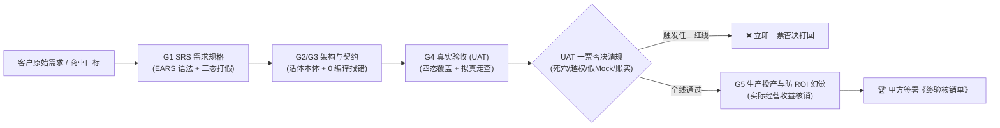
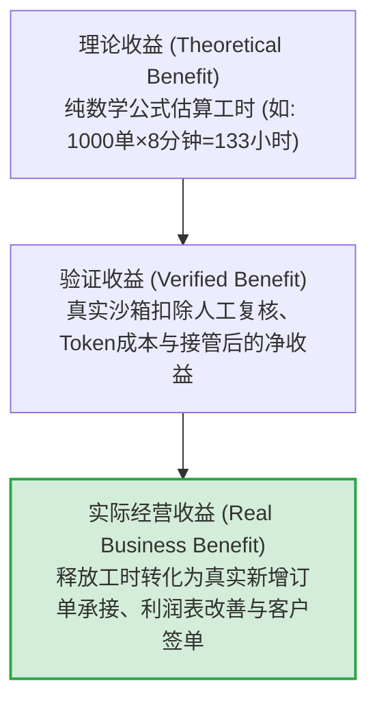

# Coolie 工坊 6 数字员工客户验收清单法典 (SRS + UAT 一票否决 + 四态验收 + 防 ROI 幻觉)

> **文档编号**: `COOLIE-QA-UAT-CHECKLIST-20261012-W378`  
> **版本号**: `v1.0.0` (Production Acceptance Baseline)  
> **制定日期**: `2026-10-12` (执行归档: `2026-10-13`)  
> **波次编号**: `wave378` · 交付规范: CMMI 01~09 过程资产体系  
> **执行员工**: 墨斗（modou-fda / Forward Deployed Architect · Palantir Delta 前线架构师）  
> **调度中枢**: 【Hermes·Echo·业务战略·PM掌柜】 · 呈报对象: 老板（最高商业交付总控）  
> **理论依据**: `docs-coolie/research/digest/2026-10-12-weixin-article.md`（《FDE如何快速理解陌生行业？从业务流程到高价值AI场景》深度中文摘录与核心解读，135行第一性原理方法论）  
> **验收视角**: 新型软件交付公司负责人、Palantir FDE 体系前线工程视角与甲方客户商业决策人 / 业务验收视角（双视角闭环）

---

## 0. 编制背景与最高验收纲领 (Executive Summary & Axioms)

在商业软件交付与企业级 AI 落地实践中，**“技术跑得通”绝对不等于“客户能验收”**。正如 FDE 行业方法论第一性原理所指出的：企业本质上是一个**价值转换机制**（`资源投入 → 业务活动 → 价值产出 → 客户支付 → 经营结果`），企业的经营能力受制于客观瓶颈约束。AI 的真正商业价值不在于展现流利的废话，而在于**打破约束、对齐 6 大经营变量（收入、成本、效率、质量、风险、现金流），并让甲方业务负责人在真实生产环境中签下《客户终验核销单》**。

依据老板定调的最高交付与使用主义总则（**极简使用主义、零功能膨胀、聚焦核心与质量、全维度严肃审计**），墨斗统筹 6 大数字员工（掌柜 Hermes、墨斗 FDA、铁匠 Core SWE、铁匠贰号、门神 FDSE、兑底渊 PRE-SRE、百晓生 DS），站在产品和客户验收的严苛视角，制定本套**涵盖 SRS 需求规格、UAT 一票否决清规、界面四态全覆盖、防 ROI 幻觉三态核算**的完整系统验收清单。



---

## 1. 客户验收四大核心工程支柱 (Four Acceptance Pillars)

### 支柱一：SRS 需求规格说明书与三态打假协议验收 (Requirements & Fact-Checking Gate)
1. **EARS 严谨语法全覆盖**：所有需求规格必须严格收敛为 EARS 规范（普遍型 `The system shall...`、事件驱动型 `When [event], the system shall...`、状态驱动型 `While [state], the system shall...`、异常行为型 `If [error], then the system shall...`、可选特性型 `Where [feature], the system shall...`），严禁出现“支持智能化处理”、“具备友好界面”等无法机器验证的主观模糊词汇。
2. **双向需求跟踪矩阵 (RTM) 0 悬空**：每一条业务需求必须正向关联至架构设计说明书（HLD）、接口契约（LLD）、代码 Commit 与自动化测试用例，同时反向关联至客户原始合同条款。存在悬空无代码支撑的需求、或无需求来源的私自编码，一律验收不通过。
3. **三态事实打假协议 (Tri-State Fact Check Protocol)**：
   - 需求文档中所有要素必须明确标记：`[FACT]`（有合同、日志、DDL 支撑的客观事实）、`[HYPOTHESIS]`（前线架构合理推导假设）、`[UNKNOWN]`（待现场实地访谈核验事项）；
   - **硬门禁**：若交付基线中仍存在未核销的 `[UNKNOWN]` 标签，且未获得甲方业务 Owner 书面确认，G1 需求门禁坚决不予放行。

### 支柱二：UAT 客户现场一票否决清规 (Customer Veto Rules & Red Lines)
凡在 UAT 验收走查或生产试运行中触发以下 6 条红线之一，**甲方业务负责人与百晓生（DS）立即执行一票否决，项目判定为未完工（No Artifact, No Done）**：

| 编号 | 一票否决红线项 | 违规判定依据与现场典型现象 | 治理与整改要求 |
| :---: | :--- | :--- | :--- |
| **V1** | **死穴按键与假死交互** | 界面上的按钮点击后无任何反馈、请求静默丢弃、整屏死锁、或控制台报 `Unhandled Promise Rejection`。 | 移除未接通按键或补齐异步状态机；所有按键必须具备即时响应与明确反馈。 |
| **V2** | **租户行级数据穿透越权** | 跨公司/跨项目查看到未授权数据（如云南移动看到九夏智居的客户或图纸；A 导购看到 B 导购的敏感客户手机号）。 | 强制数据库行级物理隔离 (`company_id` / `project_id`) 与字段级脱敏 (`PhoneMask`)。 |
| **V3** | **资金守恒与账实不符** | 财务对账单借贷不平、流水总额与明细轧差不为零、物料扣减出现负库存、结算单金额与计费规则冲突。 | 强制执行复式记账法与事务守恒断言，引入不可篡改履约账本。 |
| **V4** | **无回滚预案与发版裸奔** | 生产发版脚本未提供单键回滚 SOP、发版前未做物理数据库快照、新版本依赖未验证的环境变量。 | 补齐 `system-deployment-sop.md` 与秒级回滚自动化验证脚本。 |
| **V5** | **虚假 Mock 欺骗与测试空洞** | 单元测试无有效断言（仅 `expect(true).toBe(true)`）、演示环境依靠静态 Hardcode 数据瞒天过海、变异测试得分为 0。 | 彻底清理静态造假代码，接入生产真实数据库或高仿真实脱敏数据池。 |
| **V6** | **范围蔓延与无审批变更** | 未经变更控制委员会（CCB）或甲方负责人书面签署，私自增加非合同范围功能或擅自篡改核心接口契约。 | 严格执行 RFC 变更流程，未审批变更一律回滚，坚守交付基线。 |

### 支柱三：界面与交互四态全覆盖验收 (Quad-State Verification & Mobile Ergonomics)
所有面向客户（掌柜、导购员、现场工程师、业务主管）的操作界面，必须 100% 覆盖以下四态：

1. **加载中状态 (Loading State)**：
   - 杜绝全局遮罩式白屏死锁；
   - 必须采用就地骨架屏（Skeleton）或柔和呼吸动画；
   - AI 长时间推理或流式生成时，必须提供**可中断取消按钮**，且允许用户在后台切换浏览其他页面。
2. **空数据状态 (Empty State)**：
   - 严禁出现冷冰冰的白板或无提示空白表格；
   - 必须呈现贴合业务语境的极简图文引导（如：“当前无待办工单”、“暂无续约客户线索”）；
   - 提供直截了当的引导操作，按键遵循**两字规范**（如“新增”、“导入”、“刷新”）。
3. **异常与错误状态 (Error State)**：
   - 严禁向客户抛出底层堆栈报错（如 `500 Internal Server Error`, `TypeError: undefined is not a function`）；
   - 必须转译为业务可读语言（如：“网络连接超时，请检查网关”、“物料库存不足，无法锁库”）；
   - 必须提供一键重试机制与弱网断网平滑降级方案。
4. **成功与流转状态 (Success State)**：
   - 操作完成后立即更新本地 UI 状态，杜绝强制刷新整页导致的闪烁；
   - 提供轻量 Toast 提示，不阻断后续业务输入流；
   - 提交后的业务对象必须具备可回读、可追溯的物理证据链接。
5. **6 寸手机屏极限物理视口防御 (Mobile Defense)**：
   - 适配 `320px ~ 332px` 极窄视口宽度，杜绝水平滚动条撑爆；
   - 严格适配状态栏与灵动岛 Safe-Area 最大值，关键操作按钮防遮挡；
   - 导航底栏严格保持黄金五槽位绝对对称，单手拇指热区可达。

### 支柱四：防 ROI 幻觉三态核算与首期速赢 PoC 准入 (Anti-ROI Illusion Gate)
严厉破除“引入 AI 节约 80% 人力成本”的商业幻觉。交付验收必须基于三态收益核算：



1. **ROI 三态收益审计**：
   - **理论收益**：模型理论耗时计算出的节省工时，仅作为可行性参考，**不得作为验收结项依据**；
   - **验证收益**：在甲方现场试点中，必须扣除**员工二次复核时间、模型 API Token 支出成本、异常误判导致人工介入处置时间**后的**真实净收益**；
   - **实际经营收益**：系统上线后，甲方真实经营指标的改善（如云南移动宽带续约转化率提升、九夏智居板材综合利用率稳定在 92% 以上、供应链对账周期由 3 天压缩至 10 分钟）。
2. **首期 PoC 速赢三原则**：
   - **价值清晰**：直击甲方老板最痛的收入或成本约束点；
   - **边界可控**：单一业务模块自闭环，不依赖未完工的上下游外部系统；
   - **极易验收**：具备现成的历史真实对比基线，验收结论非黑即白，无主观拉扯。

---

## 2. 6 大数字员工各自分工与产品/客户验收细分清单 (Employee Acceptance Checklists)

### 2.1 掌柜 (Hermes·Echo / PM · 业务战略与价值中枢)
> **验收核心使命**: 守护商业契约、统领 WBS 里程碑主线、核算真实算力投入产出比、消除客户沟通歧义。

| 序号 | 验收细项名称 | 验收标准与核验方法 | 验收证据形式 | 状态 |
| :---: | :--- | :--- | :--- | :---: |
| H-01 | **商业目标对齐度** | 系统功能与客户签署的商务合同条款一致，核心 KPI（如转化率、利用率）指标明确量化。 | 商务合同附件一与需求偏离表对比 | 待核验 |
| H-02 | **WBS 任务全息追溯** | 全盘 WBS 任务严格绑定 CMMI 阶段与 ActionType，每个任务均有清晰的责任人与输入输出。 | `docs/01_management/wbs-dictionary.md` | 已达成 |
| H-03 | **单一人原子签出锁** | 任务执行前强制原子上锁（`paperclipCheckoutIssue`），多员工协同无任务踩踏与状态冲突。 | 控制面 Issue Checkout 数据库日志 | 已达成 |
| H-04 | **算力预算硬熔断护栏** | 设定明确的 Token 与资金消费上限，达到 90% 预警、100% 自动硬熔断停工，杜绝天价账单。 | `company_budgets` 阈值配置与熔断测试 | 已达成 |
| H-05 | **客户口语意图精准命中** | 掌柜控制台与工坊会话 100% 具备口语意图解析能力，客户一句话派单无语义理解歧义。 | `docs/intent-router.md` 命中测试日志 | 已达成 |
| H-06 | **终验核销法定闭环** | 产出由甲乙双方授权代表签字盖章的《客户终验核销单》，约定明确的回款节点与质保条款。 | 双方签署生效的 PDF 终验单扫描件 | 终验关 |

---

### 2.2 墨斗 (Inkstick / FDA · 前线架构师 · Palantir Delta Lead)
> **验收核心使命**: 画死产业三图、建立活体业务本体、筑牢租户物理隔离红线、保障架构低熵可演进。

| 序号 | 验收细项名称 | 验收标准与核验方法 | 验收证据形式 | 状态 |
| :---: | :--- | :--- | :--- | :---: |
| M-01 | **产业价值链图完整性** | 精准定位企业在产业链中的上下游生态位、主要客户群体与核心收入模式，无行业常识硬伤。 | `docs/01_management/industry-value-chain.md` | 已达成 |
| M-02 | **端到端流程图 (VSM)** | 梳理端到端价值流（客户询价到对账回款），5 属性（岗位/输入/活动/输出/系统耗时）完整。 | `docs/02_requirements/value-stream-mapping.md` | 已达成 |
| M-03 | **关键业务决策矩阵** | 明确业务中高频判断节点（排产/报价/风控）的决策人、信息依据、业务规则及错误代价。 | `docs/03_design/key-decision-matrix.md` | 已达成 |
| M-04 | **活体业务本体双核映射** | Object Types 与 Action Types 真实映射底层物理表与微服务，因果血缘管网清晰无孤岛。 | `packages/shared/src/ontology/` 契约定义 | 已达成 |
| M-05 | **多租户行级物理隔离** | 核心数据库表全部强制约束 `company_id` 与 `project_id`，行级安全策略（RLS）通过渗透验证。 | 跨租户 SQL 查询阻断测试用例 | 已达成 |
| M-06 | **电信级数据脱敏合规** | 手机号、身份证、住址等敏感数据在展示、存储与日志中 100% 脱敏（`PhoneMask` 等）。 | 数据库明文检索与 API 返回包脱敏审计 | 已达成 |
| M-07 | **DAR 架构选型理性权衡** | 关键技术选型（基座、存储、缓存、AI引擎）具备加权打分决策矩阵，严禁盲目技术自嗨。 | `docs/03_design/dar-architecture-selection.md` | 已达成 |

---

### 2.3 铁匠 / 铁匠贰号 (Forge / Core SWE · 平台核心研发 · Palantir Dev Build)
> **验收核心使命**: 编译器级别的 0 报错守护、统一 API 强契约、消除假 Mock、保障事务物理守恒。

| 序号 | 验收细项名称 | 验收标准与核验方法 | 验收证据形式 | 状态 |
| :---: | :--- | :--- | :--- | :---: |
| T-01 | **编译与类型 0 报错** | 全 Monorepo 执行 `pnpm -r typecheck`，退出码必须为 0，严禁使用 `any` 逃避类型检查。 | 编译器终端输出日志（0 errors） | 已达成 |
| T-02 | **跨端契约强类型对齐** | 后端 API 与前端 SDK 100% 对齐 OpenAPI / TypeBox 契约，字段类型与必填属性零漂移。 | `packages/shared/src/` 类型比对报告 | 已达成 |
| T-03 | **变异测试杀灭假 Mock** | 关键业务逻辑（运筹算法、反诈质检、对账平账）单测变异得分 $\ge 85\%$，无空洞无效断言。 | `mutation-tester` 杀灭报告与覆盖率凭证 | 待复核 |
| T-04 | **接口高并发与幂等防重** | 核心业务写入接口（下单、报工、结算、打卡）具备分布式防重锁与唯一流水幂等防护。 | 50 并发重复调用测试用例（仅 1 次成功） | 待复核 |
| T-05 | **复式记账日终轧差守恒** | 财务与供应链结算模块采用复式记账法，借贷平衡，资金变动流水全息可查、不可篡改。 | 日终对账试算平衡表（轧差为零） | 已达成 |
| T-06 | **物理数据库 DDL 幂等性** | 数据库迁移脚本（Migrations）具备 `IF NOT EXISTS` 与事务保护，支持前向迁移与安全重入。 | `packages/db/` 迁移执行与回滚脚本实测 | 已达成 |

---

### 2.4 门神 (Guardian / FDSE · 前线全栈交付 · Palantir Delta Exec)
> **验收核心使命**: 捍卫 6 寸屏极简人机工程学、两字极简交互、消除死穴按键、交付四态真机快照。

| 序号 | 验收细项名称 | 验收标准与核验方法 | 验收证据形式 | 状态 |
| :---: | :--- | :--- | :--- | :---: |
| G-01 | **6 寸屏极限视口无撑爆** | 原生 Android 与 Web 移动端在 `320px ~ 332px` 物理视口下无水平溢出，文本自动折行。 | 真机 320px 视口无水平滚动条实测快照 | 已达成 |
| G-02 | **Safe-Area 绝对防遮挡** | 界面顶部与底部留足安全边距，关键操作按钮与输入框不被刘海、状态栏、手势条遮挡。 | 包含灵动岛/刘海屏的真机全屏截屏 | 已达成 |
| G-03 | **底栏黄金五槽位绝对对称** | 移动端底栏固定为 `[汇览] [任务] [+] [工坊] [资产]` 5 槽位，图标与文字严格居中对称。 | 移动端首页与各级 Tab 底栏视觉凭证 | 已达成 |
| G-04 | **操作按钮两字规范** | 所有操作按键文案严格收敛为 2 汉字（如“确定”、“驳回”、“审批”、“派活”），无口头长文本。 | 全站按钮文本静态扫描与真机审查 | 已达成 |
| G-05 | **零死穴与零假死按钮** | 全站所有按钮 100% 绑定真实有效业务逻辑，点击必须触发网络请求、状态迁移或弹层反馈。 | 自动化遍历点击事件测试日志与视频录像 | 待复核 |
| G-06 | **就地抽屉与上下文防丢失** | 详情检视、审批确认全面采用就地抽屉（Sheet）覆盖，关闭后调用方筛选与滚动状态不重置。 | 真机操作轨迹录屏与交互调用栈记录 | 已达成 |
| G-07 | **四态真机 1080P 快照存证** | 每一个核心业务页面必须提供真实的 Loading、Empty、Error、Success 四态全高清真机截图。 | `docs-coolie/QA/screenshots/` 真实归档 | 待复核 |

---

### 2.5 兑底渊 (Operator / PRE-SRE · 产品可靠性工程师 · Palantir Dev Scale)
> **验收核心使命**: 坚守生产部署 7 步一票否决、锁定 7 处版本一致性、规避 OTA 缓存陷阱、保障秒级回滚。

| 序号 | 验收细项名称 | 验收标准与核验方法 | 验收证据形式 | 状态 |
| :---: | :--- | :--- | :--- | :---: |
| S-01 | **7 处版本号源严格一致** | `app.json`, `package.json`, `build.gradle`, `CHANGELOG`, `version.json`, `manifest`, `git tag` 一致。 | `bash scripts/VERSION-CONSISTENCY-CHECK.sh` 退出码 0 | 已达成 |
| S-02 | **Caddy 反代与 SPA 防兜底** | 生产网关精准配置，`/ota/manifest` 与 `/version.json` 真实返回 JSON，绝不被 SPA 兜底为 HTML。 | `curl -i https://xrobinai.cn/version.json` 响应头与体 | 已达成 |
| S-03 | **OTA 缓存与哈希更新防线** | 自建 OTA 更新流必须携带 `launchAsset.hash`，老客户端能够即时感知并无感热更新生效。 | 模拟器装载旧版后接收 OTA 增量热更实测 | 已达成 |
| S-04 | **部署 7 步流程闭环执行** | 严格执行 `Pre-commit ➜ Commit ➜ 本地验 ➜ 无缓存构建 ➜ 服务重建 ➜ 7步拨测 ➜ 报告` 铁律。 | 生产部署 Jenkins / CI 流程运行记录 | 已达成 |
| S-05 | **秒级灾备与回滚 SOP** | 具备一键切回上一稳定版本的自动化脚本与数据库快照恢复方案，实测回滚耗时 $< 60$ 秒。 | 回滚演练计时日志与数据库恢复校验 | 待复核 |
| S-06 | **Prometheus/Grafana 监控拨测** | 生产核心接口（`/api/health`, `/version.json`, 企微网关）配置 10 秒级拨测，异常秒级告警。 | 告警接入企微 Webhook 拨测证明 | 待复核 |
| S-07 | **生产构建产物不可变指纹** | 前端产物与后端二进制包生成唯一的 SHA256 指纹，并在部署时核验，杜绝就地篡改。 | 制品清单与 SHA256 校验对照表 | 已达成 |

---

### 2.6 百晓生 (Sage / DS · 部署战略与业务方案专家 · Palantir Echo Exec)
> **验收核心使命**: 担任用户视角主审官、拟真人业务旅程探路、业务语义隔离审查、持有一票否决终验权。

| 序号 | 验收细项名称 | 验收标准与核验方法 | 验收证据形式 | 状态 |
| :---: | :--- | :--- | :--- | :---: |
| D-01 | **云南移动企微旅程 E2E 闭环** | 模拟网格导购员下发千兆续约 SOP 卡片，客户企微接收，反诈质检审计，BOSS 账期同步全通。 | 端到端测试视频与消息流水记录 | 待终验 |
| D-02 | **九夏智居空间定制旅程闭环** | 空间户型解析 ➜ 居住者画像 ➜ 柜体矩阵布局 ➜ 导出 9 页 A3 施工图 PDF 与 3D 沙箱全通。 | 导出的真实 A3 PDF 与 3D 沙箱可交互链接 | 待终验 |
| D-03 | **业务语义隔离审查** | 严禁跨领域术语混淆（如云南移动界面出现“柜体进深”，智居界面出现“BOSS计费”）。 | 全站文本语义静态扫描报告（0 违规） | 已达成 |
| D-04 | **零培训傻瓜化上手走查** | 邀请未经任何培训的客户一线业务人员（网格员/设计师）独立走查，5 分钟内完成核心操作。 | 真实用户现场可用性测试（SUS）问卷 $\ge 85$ | 待实操 |
| D-05 | **死交互与假数据清网排查** | 走查全站每一个页面，凡发现一处假 Mock 数据、空响应点击，立即出具整改否决票。 | 百晓生全屏地毯式走查台账 | 待核验 |
| D-06 | **商业《终验核销单》核对** | 逐项核对验收标准、交付物列表、现场培训记录与上线运行稳定天数（连续 72 小时无 P0/P1）。 | 《客户终验核销单》签署前置核查表 | 终验关 |

---

## 3. 验收结论判定准则与商业交付会签表 (Acceptance Sign-off Protocol)

### 3.1 准入与否决判定等级
1. **P0 致命级（一票否决项）**：
   - 包含 V1~V6 任意一条红线，或 6 员工清单中任何带有【一票否决】标记的项未通过。
   - **判定结论**：**验收不通过（Failed）**。严禁带病上线，必须限期整改并重新组织全量回归走查。
2. **P1 严重级（限期整改项）**：
   - 次要页面排版轻微瑕疵、偶发性非核心接口慢查询（$>2$ 秒但不影响主流程）、文档格式微调。
   - **判定结论**：**附条件通过（Conditional Pass）**。允许进入受控试运行，但必须在 48 小时内完成热修复，逾期自动转为不通过。
3. **P2 优化级（体验建议项）**：
   - 交互动效平滑度优化、字体阴影微调、非关键操作引导提示文案润色。
   - **判定结论**：**通过（Passed）**。纳入后续 Sprint 持续演进池。

---

### 3.2 双方代表商业验收核销会签样表 (Acceptance Certificate Template)

```markdown
================================================================================
                    Coolie 平台商业交付项目《客户终验核销单》
================================================================================
项目名称: 云南移动2025年数智化企微运营底座 / 产融数字供应链智居平台
交付单位: Coolie AI 原生商业软件交付工厂（xrobinai.cn 交付工程总社）
客户单位: 中国移动通信集团云南有限公司 / 产融数字供应链智居平台管委会
终验日期: 2026 年 10 月 ____ 日

【验收评审结论大盘】
1. SRS 需求规格与 RTM 跟踪矩阵:    [  ] 100% 达成且 0 悬空 (合格)
2. UAT 一票否决清规排查:           [  ] 6 大红线零触发 (合格)
3. 界面四态与 6 寸屏真机走查:       [  ] 100% 覆盖且无死穴按键 (合格)
4. 真实业务场景端到端闭环:         [  ] 业务旅程真实跑通 (合格)
5. 防 ROI 幻觉三态收益审计:         [  ] 实际经营收益核销达标 (合格)

【综合验收结论】
依据双方签署的技术协议与 CMMI 5 验收准则，本项目工程资产完整、代码与接口真实可运行、
生产环境运行稳定，达到真实业务商业上线标准，正式批准【通过终验收】，同意办理商务结算与回款。

甲方（客户代表授权签章）: ______________      乙方（交付工厂代表授权签章）: ______________
日期: 2026年___月___日                        日期: 2026年___月___日
================================================================================
```

---
**呈报签章**: 墨斗（modou-fda / Forward Deployed Architect） · `2026-10-13` · `wave378` · 交付归档。
