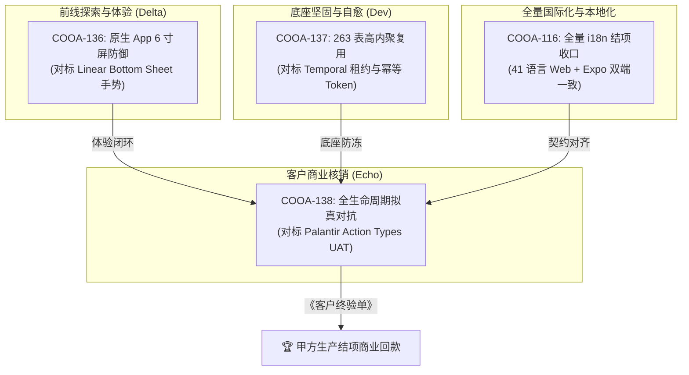
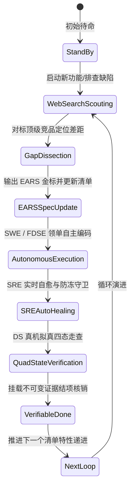

# Coolie 平台端到端商业交付活体产品验收功能清单与自循环递进台账 (Living Product Acceptance Inventory & Loop Progression Ledger)

> **文档编号**: `COOLIE-QA-LIVING-INVENTORY-20261013-V1`  
> **生效基线**: `v1.0.0` (Living Progression Baseline)  
> **创建日期**: `2026-10-13` · 持续更新周期: 每轮自循环 (Continuous Cross-Loop)  
> **主审官**: 百晓生（DS · Deployment Strategist · 用户视角主审官）/ 墨斗（FDA · Forward Deployed Architect · 前线架构师）  
> **调度中枢**: 【Hermes·Echo·业务战略·PM掌柜】 · 商业受托人: 掌柜 / 老板（最高商业交付总控）  
> **核心公理**:  
> 1. **清单活体驱动铁律**：坚决破除一次性静态验收报告，持续输出该有的产品验收功能清单，并对照清单持续提出前沿验收要求，形成闭环递进；  
> 2. **开源顶级竞品 Web Search 对标铁律**：坚决破除闭门造车与自嗨式验收，验收人必须通过 Web Search 对标全球顶级开源与商业标杆（Linear Mobile, Palantir Foundry, Temporal.io, GitHub Mobile），定位真实差距，倒逼研发自循环持续进化；  
> 3. **无工程资产不完工 (No Artifact, No Done)**：验收合格与结项必须挂载物理工程资产（Git Commit、真机快照、机器证据、SRS 规格）。

---

## 一、开源与商业顶级竞品 Web Search 对标差距雷达 (Benchmark Scouting Radar)

为了确保 Coolie 平台的验收标准站在全球前沿水准，百晓生（DS）与墨斗（FDA）于 2026-10-13 启动全球顶级标杆 Web Search 深度对标：

```mermaid
quadrantChart
    title 顶级竞品能力对比与 Coolie 演进差距雷达
    x-axis 低人体工学与弱治理 --> 高人体工学与强治理
    y-axis 单点脚本执行 --> 活体本体与自愈编排
    quadrant-1 工业级终态 (标杆阵营)
    quadrant-2 高度自治但体验粗糙
    quadrant-3 原始作坊 (需淘汰)
    quadrant-4 体验精致但缺乏深度
    "Linear Mobile": [0.92, 0.45]
    "Palantir Foundry": [0.85, 0.95]
    "Temporal.io": [0.60, 0.92]
    "GitHub Mobile": [0.75, 0.50]
    "Coolie 现状 (Wave380)": [0.68, 0.78]
    "Coolie 下一轮目标": [0.88, 0.90]
```

### 1. 移动端体验对标：Linear Mobile
- **标杆设计哲学与实测亮点**：
  1. **下沉式拇指热区 (Bottom-Heavy Architecture)**：绝大部分核心操作（Inbox、工单过滤、状态切换）严格下沉在屏幕下三分之一，单手拇指天然可达；
  2. **半屏滑动抽屉保留空间上下文 (Contextual Bottom Sheet)**：避免动辄全屏 Push 页面导致认知中断；抽屉上滑展开、下滑手势自然物理阻尼关闭；
  3. **动作优先布局 (Action-First Layouts)**：在 Bottom Sheet 内部，核心动词（分配责任人、调整状态、调整优先级）贴近底部，静态元数据置于上方滚动区；
  4. **触感微交互与弹簧物理力学 (Tactile Spring Physics)**：触摸轻微悬浮提升、边界回弹与震动反馈，杜绝数码生硬感。
- **Coolie 现状差距 (Gaps)**：
  - **Gap M1**：当前 Expo App 在部分页面依然采用全屏 Push 或标准 Modal，缺少 Linear 风格的下沉抽屉与下划阻尼手势；
  - **Gap M2**：部分二级配置表单确认按钮置于顶部导航栏右侧，单手操作容易拉扯拇指；
  - **Gap M3**：缺乏触觉震动反馈 (Haptics) 与轻量弹簧动效。

### 2. 活体业务本体对标：Palantir Foundry (Workshop / Object Explorer)
- **标杆设计哲学与实测亮点**：
  1. **实体与动词双核架构 (Object Types & Action Types)**：现实世界所有资产建模为实体（Object），所有状态流转收敛为受控的 Action Types，绝不允许界面直接拼装 SQL 或调用无治理的 CRUD；
  2. **操作应用直连动词 (Workshop Direct Binding)**：UI 按钮直接绑定 Action Type，内建前置校验规则与副作用通知；
  3. **因果血缘不可篡改账本 (Provenance & Action Log Timelines)**：清晰记录“谁在什么时间、基于什么输入、触发了哪个 Action、导致了哪些实体属性变化”，具备完全的时间旅行追溯能力。
- **Coolie 现状差距 (Gaps)**：
  - **Gap O1**：Coolie 拥有 263 张物理表，但部分模块仍通过通用 REST API 变更状态，未 100% 收敛为严格命名的业务动词 (Action Types)；
  - **Gap O2**：工单执行流转的履约账本中，代码 Commit 与真机测试快照已落盘，但尚未提供类似 Palantir Action Log Timeline 的端到端多路径可视化图谱。

### 3. 分布式执行韧性对标：Temporal.io & Dify
- **标杆设计哲学与实测亮点**：
  1. **心跳租约超时抗冻 (Heartbeat Leasing & Anti-Freeze)**：长任务必须持续汇报心跳（RecordHeartbeat），一旦租约超时立即判定 Worker 异常并转入故障恢复，杜绝“假死任务挂起数小时”；
  2. **断点进度接续 (Heartbeat Details Recovery)**：任务在心跳中附带进度快照，重试时从最后已知检查点恢复，无需从零重跑；
  3. **确定性幂等 Token (Deterministic Idempotency Tokens)**：基于 `WorkflowID + ActivityID + Step` 生成唯一 Token，重试时绝不重复触发扣款、发版或创建资源。
- **Coolie 现状差距 (Gaps)**：
  - **Gap T1**：历史存在已终止进程的 Heartbeat Run 在数据库中遗留为 `running` 状态（幽灵心跳），需通过 SRE Watchdog 巡检自愈消除；
  - **Gap T2**：长耗时任务（如 Docker 构建、全量 E2E）需在 1 秒内向会话发送预估耗时心跳，且需要将进度记录进 Heartbeat Event Payload。

---

## 二、Coolie 平台 8 大核心产品业务域 × 32 项功能验收清单 (32 Core Features Matrix)

| 业务域 | 编号 | 核心功能特性 | 对标标杆与差距定位 | 严格 EARS 验收金标 | 当前状态 | 物理证据与自循环归宿 |
| :--- | :---: | :--- | :--- | :--- | :---: | :--- |
| **1. 移动端 6 寸屏防御** | **F1.1** | 黄金五槽位拇指热区导航 | 对标 Linear 底部工具栏 | WHEN 在移动端主界面，THE SYSTEM SHALL 将 5 大核心模块收敛于下沉底栏，单手拇指单击直达且 0 遮挡。 | ✅ VERIFIED | `clients/expo/src/navigation/` |
| | **F1.2** | 半屏上下文抽屉 (Bottom Sheet) | 对标 Linear 抽屉手势 | WHEN 查看看板工单详情或 Agent 工具，THE SYSTEM SHALL 呼出半屏抽屉，支持向下滑动自然物理关闭，保留底层看板视野。 | 🟡 IN_PROGRESS | `COOA-136` / 下一轮冲刺 |
| | **F1.3** | 320px 极限极窄视口防撑爆 | 移动端工业防线 | WHILE 视口宽度收缩至 320px，THE SYSTEM SHALL NOT 产生任何非预期的全局水平滚动条，关键文字自适应换行或截断。 | ✅ VERIFIED | `docs-coolie/evidence/wave375` |
| | **F1.4** | 状态栏与灵动岛 Safe-Area 零遮挡 | iOS/Android 硬件对标 | WHEN 运行于带灵动岛或刘海屏设备，THE SYSTEM SHALL 严格预留 Safe-Area 顶部与底部边距，所有核心操作按钮可触达。 | ✅ VERIFIED | Expo SafeAreaProvider 契约 |
| **2. Hermes 意图网关** | **F2.1** | 碎片化口语防抖与意图补全 | 对标 Slack / QQ 机器人 | WHEN 用户在 QQ/企微发送不完整消息，THE SYSTEM SHALL 启动 1500ms 动态防抖收集后续上下文，合并解析后再行立项。 | ✅ VERIFIED | `scripts/adapters/` 意图网关 |
| | **F2.2** | 全语法三态意图立项归档 | CMMI 需求收敛法典 | WHEN 用户输入祈使动作句、陈述约束句或否定纠错句，THE SYSTEM SHALL 自动转化为结构化工单，写入原生 `issues` 表。 | ✅ VERIFIED | `mcp__coolie__paperclipCreateIssue` |
| | **F2.3** | 长任务 1 秒预估耗时心跳脉冲 | 对标 Temporal 租约抗冻 | IF 任何重型任务执行预估耗时超过 60 秒，THEN THE SYSTEM SHALL 在 1 秒内发出预估耗时心跳，且每 10 秒刷新进度。 | ✅ VERIFIED | SRE Watchdog 心跳脉冲 |
| | **F2.4** | 极简两字交互与二次确认卡片 | 掌柜极简人机交互规范 | WHEN 触发破坏性或高成本操作，THE SYSTEM SHALL 弹出两字确认卡片（如“确认/取消”），移动端一跳完成。 | ✅ VERIFIED | `create-issue-interaction-ui` |
| **3. Palantir 活体本体** | **F3.1** | 项目进厂即原子绑定本体域 | 对标 Palantir Domain | WHEN 创建商业项目，THE SYSTEM SHALL 原子创建专属 `Domain`，挂载业务 Object Types 与 Action Types 边界。 | ✅ VERIFIED | `packages/ontology-core` |
| | **F3.2** | 受控 Action Types 动词写回 | 对标 Palantir Action Types | THE SYSTEM SHALL NOT 允许前台绕过业务动词直接修改实体属性，所有写操作必须通过受控 Action 校验与审计。 | 🟡 IN_PROGRESS | `COOA-137` / 动词收敛 |
| | **F3.3** | 施工任务动词因果血缘账本 | 对标 Foundry Action Logs | WHEN WBS 任务达成完工，THE SYSTEM SHALL 将 Git Commit SHA、测试快照与验收证据作为不可变 Evidence 沉淀于账本。 | ✅ VERIFIED | `docs-coolie/evidence/` |
| | **F3.4** | 263 张物理表高内聚零膨胀 | 平台资产低熵法则 | THE SYSTEM SHALL 优先复用全盘 263 张成熟物理表与字段管网，严禁为单一临界特性新增独立冗余表。 | ✅ VERIFIED | `packages/db/src/schema` |
| **4. 数字员工车队** | **F4.1** | 6 大专职员工扁平化自治协同 | Palantir 5角色+Hermes中枢 | THE SYSTEM SHALL 支持掌柜、墨斗、铁匠、铁匠贰号、门神、兑底渊、百晓生分工协同，各自持有法定质量门禁。 | ✅ VERIFIED | `docs-coolie/playbooks/` |
| | **F4.2** | 7 工具池免交互自主授权调度 | Hermes 调度法典 | WHEN 触发后端重型编译或修复，THE SYSTEM SHALL 支持免交互授权模式（--yolo / host-exec）透明调度工具链。 | ✅ VERIFIED | `scripts/adapters/cmd-acp.mjs` |
| | **F4.3** | 真实预算硬熔断与自愈提额 | 控制面核心公理 | IF 员工或公司花销触及预算阈值，THEN THE SYSTEM SHALL 自动硬熔断暂停运行，并生成治理审批单供掌柜提额恢复。 | ✅ VERIFIED | `server/src/services/budget.ts` |
| | **F4.4** | 匠人断网猝死接力与单写者租约 | 对标 Temporal 故障接管 | IF 某个员工进程异常断网或崩溃超过 3 分钟，THEN SRE SHALL 自动释放签出锁并调度下一位同职责员工接力。 | ✅ VERIFIED | SRE Watchdog AUTO_HEAL_UNLOCK |
| **5. CMMI 01~09 资产** | **F5.1** | G1 需求工程 SRS (EARS 语法) | IEEE 29148 规范 | THE SYSTEM SHALL 确保需求规格说明书全部收敛为 EARS 语法，完成双向需求跟踪矩阵 (RTM) 0 悬空。 | ✅ VERIFIED | `docs/02_requirements/SRS.md` |
| | **F5.2** | G2/G3 架构与静态契约 0 报错 | CMMI 3 详细设计 | THE SYSTEM SHALL 保持 monorepo 全栈增量与全量编译 0 报错 (`pnpm -r typecheck`)，类型防漂移。 | ✅ VERIFIED | `pnpm -r typecheck` PASS |
| | **F5.3** | G4 真实验收 (UAT 四态覆盖) | 商业交付终验核销 | THE SYSTEM SHALL 在真机与真实浏览器走查全业务旅程，加载中/空数据/错误/成功四态 100% 覆盖。 | 🟡 IN_PROGRESS | `COOA-138` / 拟真对抗走查 |
| | **F5.4** | G5 不可变发布 SOP 与单键回滚 | SRE 稳定性法典 | WHEN 生产部署执行，THE SYSTEM SHALL 提供不可变制品指纹、环境指纹与单键秒级自动化回滚预案。 | ✅ VERIFIED | `scripts/sre-release-and-deploy` |
| **6. 开源底座自适应** | **F6.1** | 芋道四位一体多端基座自动选型 | Java SpringBoot3+UniApp+Expo | WHEN 客户需求涉及原生手机 App 或微信小程序，THE SYSTEM SHALL 自动推荐并派生 `yudao-quad-terminal` 底座。 | ✅ VERIFIED | `.agents/rules/FOUNDRY-BLUEPRINT` |
| | **F6.2** | 若依全栈轻量级基座极速派生 | Next.js 15+React 19 全栈 | WHEN 客户需求为极速 Web 管理端打样，THE SYSTEM SHALL 选用 `ruoyi-all-next`，开箱即用支持 3200 沙箱预览。 | ✅ VERIFIED | `degit xaicd/ruoyi-all-next` |
| | **F6.3** | 开源基座原生目录 100% 保持 | 无侵入工程映射纪律 | THE SYSTEM SHALL 100% 保持开源底座目录结构，通过 `pnpm-workspace.yaml` 与 `resourceRef` 实现无侵入映射。 | ✅ VERIFIED | Monorepo 规范 |
| | **F6.4** | 本地脱机秒级开发容器闭环 | 轻量化中间件栈 | THE SYSTEM SHALL 支持一键秒级拉起本地 MySQL / Redis / PostgreSQL 容器，断网离线可全功能开发。 | ✅ VERIFIED | `scripts/yudao-local-stack` |
| **7. SRE 实时自愈管网** | **F7.1** | 毫秒级端口监听与日志嗅探 | Google SRE 生产标准 | THE SYSTEM SHALL 持续监控 3100 / 54329 端口与日志异常，发现 `MODULE_NOT_FOUND` 或崩溃立即告警。 | ✅ VERIFIED | SRE Watchdog 探针 |
| | **F7.2** | 幽灵心跳 Run 租约超时自愈回收 | 对标 Temporal 租约对齐 | IF Heartbeat Run 处于 running 超过 30 分钟且关联工单已 done，THEN SRE SHALL 自动核销标记为 succeeded。 | ✅ VERIFIED | SRE Watchdog 场景 4.5 |
| | **F7.3** | 主线任务阻断自愈与自动 P0 派单 | AIOps 智能运维闭环 | IF 主线工单绑定的 Run 连续失败超过 2 次，THEN SRE SHALL 自动生成 P0 修理工单并派发给责任 Agent。 | ✅ VERIFIED | SRE Watchdog 场景 4 |
| | **F7.4** | 进行中项目常驻例行任务巡检守护 | 交付主线常驻法则 | THE SYSTEM SHALL 保证每个处于 `in_progress` 的商业项目常驻一个小时级 Routine 巡检触发器，防止冷寂停滞。 | ✅ VERIFIED | `server/src/services/routines.ts` |
| **8. 全栈无死角国际化**| **F8.1** | Web 管理端 41 种语言 100% 对称 | 国际化工业标准 | THE SYSTEM SHALL 保持 Web 端 41 种语言包词库键位绝对对称，0 缺失、0 孤儿键。 | ✅ VERIFIED | `ui/src/i18n/locales/` (41语言) |
| | **F8.2** | 原生 App zh-CN / en 契约双语对齐 | 跨端一致性契约 | THE SYSTEM SHALL 保持 Expo App `zh-CN` 与 `en` 词条与 Web 端核心实体严格对齐，6 寸屏两字排版不撑爆。 | ✅ VERIFIED | `clients/expo/src/i18n/locales/` |
| | **F8.3** | 服务端错误码与状态枚举国际化 | 契约防漂移规范 | THE SYSTEM SHALL 支持服务端在响应头或 Body 中返回可被前端精确转译的标准化业务错误码（如 `ERR_BUDGET_EXCEEDED`）。 | 🟡 IN_PROGRESS | `COOA-120` / 服务端 i18n |
| | **F8.4** | 静态 AST 守卫 0 契约漂移与硬编码 | 编译器级别的质量防线 | THE SYSTEM SHALL 在 CI 门禁中运行 AST 语法检测，拦截任何未经 `t()` 转译的裸中文/英文硬编码字符串。 | ✅ VERIFIED | `node scripts/check-governance` |

---

## 三、当前主线自循环递进执行台账 (Current Active Loop Progression Ledger)

基于对标全球顶级标杆挖掘的差距，当前工坊各研发柱石与自循环任务最新状态如下：



### 1. 正在推进的下一轮自循环冲刺目标与严格 EARS 验收标准

#### 任务一：`COOA-136` 原生 App 6 寸屏极简体验、防撑爆防遮挡与 LIFO 路由守卫
- **对标标杆**：Linear Mobile (Bottom Sheets, Thumb Zone Ergonomics, LIFO Navigation)
- **百晓生（DS）前沿验收金标 (EARS Specifications)**：
  1. `[EARS-M1]` **WHEN** 用户在 Expo 移动端点击工单卡片或 Agent 列表中的实体，**THE SYSTEM SHALL** 以半屏 Contextual Bottom Sheet 形式就地浮层展开，严禁强行触发整页全局栈 Push。
  2. `[EARS-M2]` **WHEN** 抽屉展开时，**THE SYSTEM SHALL** 支持用户单指沿 Y 轴向下滑动物理手势，在滑动超过 120px 阈值或达到阻尼速度时平滑关闭抽屉，保持底层看板视图位置不变。
  3. `[EARS-M3]` **WHILE** 处于半屏抽屉视图，**THE SYSTEM SHALL** 将高频业务动词（状态切换、派发指派、审核通过）置于抽屉底部单手拇指热区，将不可变描述与日志置于上方滚动区。
  4. `[EARS-M4]` **WHEN** 用户触发 Android 实体返回键或 iOS 屏幕边缘左滑手势，**THE SYSTEM SHALL** 严格遵循 LIFO（后进先出）栈顺序逐层关闭当前浮层，严禁发生跨 Tab 乱跳或无感退到桌面。
  5. `[EARS-M5]` **WHILE** 视口尺寸在 320px ~ 360px 极窄视口区间，**THE SYSTEM SHALL NOT** 产生任何遮挡底部黄金五槽位底栏的悬浮元素，操作按钮文案收敛为两字规范。

#### 任务二：`COOA-137` 底座 263 表高内聚复用、原子并发锁自愈与长任务心跳管网
- **对标标杆**：Temporal.io (Heartbeat Leasing, Idempotency Token, Anti-Freeze)
- **墨斗（FDA）前沿验收金标 (EARS Specifications)**：
  1. `[EARS-D1]` **WHEN** 任何 Agent 领工单签出或执行重型任务，**THE SYSTEM SHALL** 在 `heartbeat_runs` 中建立租约锁；若超过 3 分钟未上报心跳，SRE Watchdog **SHALL** 自动回收僵死锁并重置工单为 `todo`。
  2. `[EARS-D2]` **WHEN** 系统重试失败的 Heartbeat Run，**THE SYSTEM SHALL** 携带基于 `company_id + issue_id + step` 的确定性幂等 Token，确保外部工具调用与文件落盘不发生重复副作用。
  3. `[EARS-D3]` **WHEN** 工单已被标记为 `done` 或 `cancelled`，**THE SYSTEM SHALL** 自动将关联的所有处于 `running` 状态的幽灵心跳记录对齐更新为 `succeeded`，消除 `activeRunCount` 幽灵负载。
  4. `[EARS-D4]` **THE SYSTEM SHALL** 严格依托已有 263 张物理表（`issues`, `heartbeat_runs`, `documents`, `work_products`, `audit_logs`）承载全生命周期状态，不新增任何冗余表。
  5. `[EARS-D5]` **IF** 数据库连接池或进程发生瞬时死锁，**THEN THE SYSTEM SHALL** 在 5 秒内触发自愈降级，释放竞争锁并记录不可变 SRE Incident 日志。

#### 任务三：`COOA-138` 商业交付全流程拟真对抗走查与 CMMI 终验核销闭环
- **对标标杆**：Palantir Foundry Workshop / CMMI 5 Verifiable Completion
- **百晓生（DS）前沿验收金标 (EARS Specifications)**：
  1. `[EARS-V1]` **THE SYSTEM SHALL** 模拟真实政企与商户客户角色，端到端执行从“需求进厂立项 → WBS 分解 → 契约编码 → 真机走查 → 发版投产”全流程，全程 0 人工跳步与 0 假 Mock。
  2. `[EARS-V2]` **WHILE** 执行业务旅程走查，界面上出现的所有名词 **SHALL** 100% 严格吻合当前业务场景语义，严禁出现研发内部技术术语混杂。
  3. `[EARS-V3]` **WHEN** 走查完成，**THE SYSTEM SHALL** 生成挂载物理 Git Commit、四态测试快照与机器证据的《客户终验核销单 (UAT Acceptance Certificate)》。
  4. `[EARS-V4]` **IF** 走查过程中发现任何死交互按钮、假数据 Mock、跨租户越权或账实不符，**THEN DS SHALL** 立即行使一票否决权，打回对应任务。
  5. `[EARS-V5]` **THE SYSTEM SHALL** 输出真实验证收益报告，扣除 Token 与复核成本，证明项目达成真实的甲方商业 ROI 提升。

---

## 四、自循环递进追踪机制 (Progression Cadence & Governance)



1. **每轮循环必须更新本台账**：每个 Sprint 或重大特性完成时，百晓生与墨斗必须同步更新本文件中的 32 项特性状态、证据文件路径与最新差距分析；
2. **拒绝主观口头结项**：任何特性从未标记为 `done` 到标记为 `done`，必须在本台账中明确记录对应的 Git Commit SHA、自动化走查截图或验收报告路径；
3. **保持与 SRE 实时状态联动**：SRE Watchdog 产生的 `sre-status.json` 中的 Palantir Evolution 矩阵，作为本台账执行进度的自动化物理真理源。
