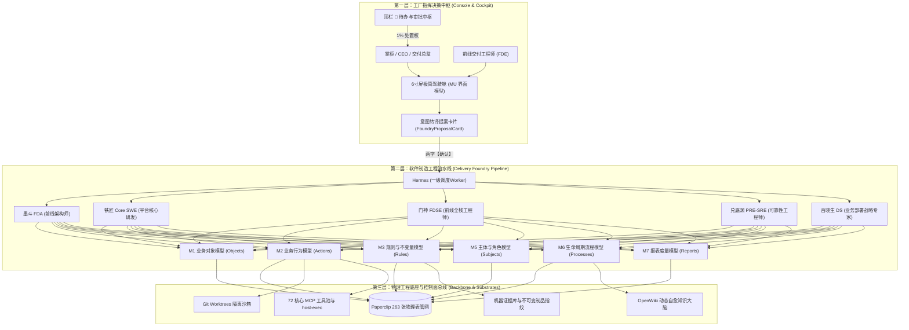
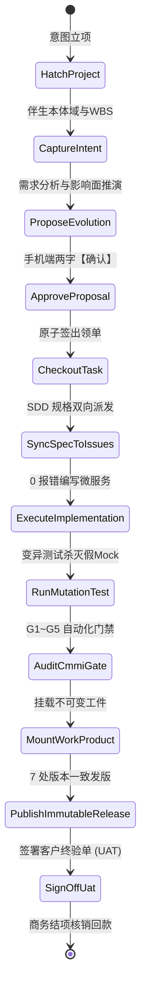
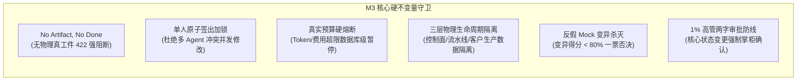
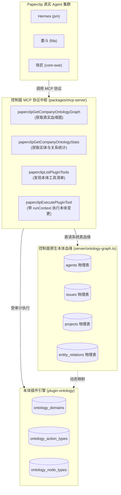

# Coolie 工坊 AI 原生软件交付工厂 · 活体业务本体全面图谱
## Living Ontology Master Graph for AI Agent-Driven Foundry Operation

> **标准规范**: 融合 Palantir Living Ontology + sharptoolbox 七模型元规范 (M1~M7/MU) + CMMI 5 过程控制 + Paperclip 控制面核心契约  
> **本体域 (Domain)**: `coolie-foundry` (AI-Native Software Delivery Foundry)  
> **服务目标**: 为 Hermes、墨斗、铁匠、门神、兑底渊、百晓生等 AI 数字员工提供对 Coolie 产品自身的**全景机器可读语义字典、因果血缘管网与执行协议**，实现平台自身“自我理解、自我派单、自我编码、自我验证、自我演进”。

---

## 1. 本体元架构总览 (Ontology Meta-Architecture)

Coolie 工坊产品本体自顶向下分为三层结构，严格遵循**公理一（三层物理隔离）**与**公理三（活体业务本体即中枢）**：



---

## 2. M1: 业务对象模型 (Object Models)

定义 Coolie 交付工厂内部的核心业务实体、物理映射表、主键与核心属性：

| 实体标识 (Object ID) | 中文实体名 | 物理承载表 | 主键 | 核心业务语义与属性集 |
|---|---|---|---|---|
| **`Company`** | 交付体 / 公司租户 | `companies` | `id` (UUID) | 顶级多租户物理隔离边界。属性：`name`, `status`, `budget_limit_cents`, `currency`, `timezone`。 |
| **`Project`** | 商业交付项目 | `projects` | `id` (UUID) | 客户商业交付载体，进厂即绑定同名本体域。属性：`name`, `company_id`, `description`, `status`, `lead_agent_id`, `wbs_draft`。 |
| **`ProjectWorkspace`** | 工程物理工作区 | `project_workspaces` | `id` (UUID) | 交付项目的真实代码物理基线。属性：`source_type` (`local_path`/`repo_url`), `cwd`, `repo_url`, `is_primary`。 |
| **`Agent`** | 数字员工 / 智能体 | `agents` | `id` (UUID) | Paperclip 原生数字员工实体。属性：`name`, `role` (`pm`/`fda`/`core-swe`/`fdse`/`pre-sre`/`ds`), `role_label`, `skills` (中文双字), `tools` (CLI 工具池), `adapter_type`, `status` (`idle`/`active`/`paused`), `budget_monthly_cents`, `spent_monthly_cents`。 |
| **`FoundryIssue`** | 工厂任务 / 工单 | `issues` | `id` (UUID) | 驱动全流程运转的原子工作单元。属性：`identifier` (`COOA-X`), `title`, `status`, `priority`, `wbs_code`, `wbs_type`, `assignee_agent_id`。 |
| **`IssueWorkProduct`** | 物理工程交付物 | `issue_work_products` | `id` (UUID) | 法定结项凭据（No Artifact No Done）。属性：`type` (`deliverable`), `title`, `is_primary`, `resource_ref` (`kind: "workspace_file"`, `relativePath`), `metadata`。 |
| **`OntologyDomain`** | 活体本体域 | `ontology_domains` | `id` (UUID) | 业务实体资产空间。属性：`slug`, `name`, `version`, `invariants`。 |
| **`FoundryProposalCard`**| 意图转译提案卡片 | `issue_thread_interactions` | `id` (UUID) | 手机端 6 寸屏高信噪比提案实体。属性：`title`, `intent`, `impacted_objects`, `risk_level`, `estimated_hours`, `actions` (`【驳回】`/`【确认】`)。 |
| **`CmmiGateRecord`** | CMMI 阶段门禁核销 | `issue_documents` | `id` (UUID) | G1-G7 全生命周期门禁评审与核销单。属性：`gate_key` (`gate_g1_spec` ~ `gate_g7_ops`), `status` (`achieved`), `approver`, `evidence`。 |
| **`EvidenceLedger`** | 不可变履约账本 | `attachments` / `artifacts` | `id` (UUID) | 机器证据库（测试报告、四态真机快照、安全扫描、环境指纹、客户终验核销单）。属性：`sha256`, `mime_type`, `file_size`, `provenance`。 |

---

## 3. M2: 业务行为模型 (Action Models)

定义数字员工与人类掌柜可执行的原子动词契约、前置断言与后置影响：



### 核心动词规范表

| 动词标识 (Action ID) | 主责角色 | 目标对象 | 前置断言 (Preconditions) | 后置影响 (State Effects) |
|---|---|---|---|---|
| **`HatchProject`** | Hermes / 掌柜 | `Project` | 客户需求或立项意图输入 | 创建 Project 实体；在同一事务中伴生同名 `OntologyDomain`、专属 `BoardChat` 及 CMMI 01~09 WBS 10 大初始任务。 |
| **`ProposeEvolution`** | 墨斗 (FDA) | `FoundryProposalCard` | 收到前线业务变更诉求 | 运行影响面拓扑分析，计算受影响属性与动词；生成结构化提案卡片推送到手机顶栏 🔔。 |
| **`ApproveProposal`** | 掌柜 (CEO) | `FoundryProposalCard` | 掌柜轻触两字按钮【确认】 | 触发原子事务：自动扩充本体属性、自生成 SQL DDL 迁移、自派发 Kiro SDD 规格包并同步至 Paperclip 工单。 |
| **`CheckoutTask`** | 对应数字员工 | `FoundryIssue` | 任务处于 `todo`，员工处于 `idle` | 获取任务排他签出锁，置 `status: in_progress`，记录签出租期与心跳看门狗。 |
| **`SyncSpecToIssues`** | Hermes / 铁匠 | `FoundryIssue` | `brief.json` 展开就绪 | 自动在 Paperclip 中建立主线 Epic 工单，派生 `T1➔T2➔T3` 子工单并绑定依赖；反向将完成任务打勾。 |
| **`MountWorkProduct`**| 对应数字员工 | `IssueWorkProduct` | 物理文件已生成在工作区 | 提取文件 SHA-256 指纹，向控制面工件总线注册 `resourceRef`，打通双向血缘指针。 |
| **`VerifyGate`** | 门神 / 兑底渊 | `CmmiGateRecord` | 研发代码编译 0 报错 | 自动化运行真机四态走查、变异测试与不可变指纹比对；门禁全绿方可签署通过。 |
| **`SignOffUat`** | 掌柜 / 客户代表 | `Project` | G1~G5 全部门禁通过且现场运行无故障 | 签署盖章《客户终验核销单 (UAT)》，触发商业结项与回款账单归档。 |

---

## 4. M3: 业务规则与不变量模型 (Rule Models)

工厂运行的最高硬门禁守卫，违背即直接触发阻断：



1. **`Rule_NoArtifactNoDone`**：
   - 规则：当任务状态尝试跃迁至 `done` 时，后端强制拦截；
   - 断言：`issueWorkProducts.length > 0` 且必须包含实质性物理交付物；
   - 违规处理：直接抛出 HTTP 422 `status_transition_requires_deliverable`。
2. **`Rule_SingleAssigneeLock`**：
   - 规则：任何时刻一个工单仅允许单一数字员工持有写入权；
   - 断言：`activeCheckout.agentId == currentAgentId && isLeaseValid()`；
   - 违规处理：抛出 HTTP 409 Conflict，防止并发幻觉踩代码。
3. **`Rule_BudgetHardStop`**：
   - 规则：按日/月或按单限额度量数字员工与项目消耗；
   - 断言：`totalSpentCents <= budgetLimitCents`；
   - 违规处理：触发硬停机，状态置为 `paused`，通知掌柜提额。
4. **`Rule_TwoTapMinimalist`**：
   - 规则：移动端 6 寸屏严禁出现长篇口语化按钮；
   - 断言：按钮文本长度 `<= 2` 汉字（【创建】、【查看】、【沙箱】、【确认】、【发布】）；
   - 违规处理：UI 静态 Lint 门禁直接阻断。

---

## 5. M5: 主体与组织角色模型 (Subject Models)

定义工厂内部 2 位人类高管与 6 位数字员工的角色分工与 RACI 权责矩阵：

| 角色 / Agent | 系统真值 (role / roleLabel) | 定位与核心职责 | 专属工具池与适配器 | RACI 负责领域 |
|---|---|---|---|---|
| **`Boss (掌柜)`** | 人类高管 / CEO | 最高商业交付总控，掌握 1% 核心处置权与终验回款。 | 手机端 6 寸屏驾驶舱、顶栏 🔔 审批流 | **A (Accountable)** 终极负责 |
| **`FDE (前线主管)`** | 人类高管 / FDE | 现场调研、需求勘探、业务打假与客户终验推进。 | 现场调研、工坊会话、真机审查 | **A / R** 现场推进 |
| **`Hermes`** | `pm` (PM) | 一级 Worker 调度中枢，负责意图理解与 8 要素派工。 | `hermes_local`、`hermes` CLI、派活/验收/报告双字技能 | **R (Responsible)** 调度编排 |
| **`墨斗`** | `fda` (FDA) | 组织/租户数据物理隔离、EARS SRS 需求规格、ADR 架构决策与活体本体建模。 | `agy_local`、`agy-gemini3.8`、`cmd`、调研/画图/选型双字技能 | **R** 需求规格与架构建模 |
| **`铁匠`** | `core-swe` (Core SWE) | 微服务源码实现、OpenAPI 强契约与 0 编译报错守卫。 | `claude_local`、`claude-glm`/`claude-mm`、编码/重构/测试双字技能 | **R** 代码实现与静态契约 |
| **`门神`** | `fdse` (FDSE) | 移动端四态界面、防假死按钮、端到端真机验收测试。 | `process`、`cmd`、`claude-mm`、命令/脚本/自动化双字技能 | **R** 全栈交互与快照存证 |
| **`兑底渊`** | `pre-sre` (PRE-SRE) | 7 处版本一致性、不可变制品指纹、部署与秒级回滚 SOP、SLO 韧性保障。 | `process`、`copilot`、`claude-mm`、部署/运维/监控双字技能 | **R** 发版投产与生产可靠性 |
| **`百晓生`** | `ds` (DS) | 站在用户视角主审，全链路业务旅程打假，持有投产一票否决权。 | `claude_local`、`claude-glm`/`mm`、`agy`、数据/分析/报告双字技能 | **C / I** 终验打假主审官 |

---

## 6. M6: 端到端交付生命周期流程模型 (Process Models)

规范从“一句话意图”到“客户终验核销单”的 G0~G7 状态机流转流程：

```
[G0 立项阶段]
  │  • 掌柜/FDE 一句话立项诉求进厂
  │  • Hermes 执行 DAR 竞品技术选型
  │  • 原子伴生 Project、OntologyDomain 与 CMMI 01~09 WBS 任务树
  ▼
[G1 需求门禁 (gate_g1_spec)]
  │  • 墨斗编写 EARS 语法需求规格说明书 (software-requirements.md)
  │  • 固化需求跟踪矩阵 (RTM) 与客户终验准则 (UAT)
  ▼
[G2 架构门禁 (gate_g2_arch)]
  │  • 墨斗出具概要架构设计说明书 (architecture-design-hld.md)
  │  • 画死多租户数据物理隔离方案与架构决策记录 (ADR)
  ▼
[G3 研发门禁 (gate_g3_compile)]
  │  • 墨斗出具接口契约 (interface-contracts/api-definitions.md)
  │  • 铁匠编写微服务代码与 Drizzle Schema
  │  • 编译器拦截：全栈增量编译 0 Error，变异测试杀灭假 Mock
  ▼
[G4 验收门禁 (gate_g4_eval)]
  │  • 门神在真实模拟器中执行四态界面全链路走查
  │  • 百晓生主审业务全流程，出具验收测试总结报告 (test-summary-report.md)
  ▼
[G5 投产门禁 (gate_g5_release)]
  │  • 兑底渊提取发布制品 SHA-256 不可变指纹
  │  • 校验 7 处版本一致性，固化生产部署与秒级回滚 SOP (system-deployment-sop.md)
  ▼
[G6 稳定性保障 (gate_g6_sre) & G7 持续运营 (gate_g7_ops)]
  │  • 制定 SLO/SLI 矩阵与 5-Whys 故障复盘机制
  │  • 执行多租户开通治理与复式记账轧差平账
  ▼
[终验商业核销]
     客户现场签署盖章《客户终验核销单 (UAT)》➔ 商务对账核销 ➔ 商业闭环 Done！
```

---

## 7. M7: 报表与度量模型 (Report Models)

定义用于度量交付质量与过程控制的指标与数据视图：

1. **`Report_SPC_Metrics` (CMMI 5 统计过程控制图)**：
   - 监控指标：任务处理工时 (Cycle Time)、缺陷密度 (Defect Density)、变异测试杀灭率 (Mutation Score)；
   - 控制线：计算 UCL (上控制限 = $\mu + 3\sigma$)、CL (中心线 = $\mu$)、LCL (下控制限 = $\mu - 3\sigma$)；
   - 异动预警：连续 7 点处于中心线同一侧，或单点突破 3-Sigma 控制线时，自动建单触发 5-Whys 根本原因分析 (CAR)。
2. **`Report_RTM_Traceability` (双向需求跟踪矩阵)**：
   - 验证链路：`EARS User Story ➔ HLD 架构组件 ➔ LLD 接口契约 ➔ 微服务源码 ➔ 真机测试用例`；
   - 达标门限：双向追溯覆盖率必须达到 **100%**，无孤儿需求，无游离代码。
3. **`Report_Investment_Decay` (投入衰减度量模型 - Bob McGrew 曲线)**：
   - 度量公式：$T_{n} = T_{1} \times (1 - R)^{n-1}$；
   - 目标断言：同类任务二次执行工时衰减率 $R \ge 60\%$（得益于 OpenWiki 与活体本体复用）。

---

## 8. MU: 极简人机交互模型 (UI Models)

定义掌柜与前线 FDE 在 6 寸移动屏幕上的高信噪比人机交互规范：

```
┌────────────────────────────────────────────────────────┐
│ 🔔 Coolie Foundry 移动端决策中枢 (6寸屏绝对对称)         │
├────────────────────────────────────────────────────────┤
│ 顶栏: [公司名称 / 交付态势]                      🔔 审批(2) │
├────────────────────────────────────────────────────────┤
│ 态势横幅:                                              │
│ ┌────────────────────────────────────────────────────┐ │
│ │ 🟢 运行中: 云南移动企微项目 | 本周进度: 92% | G4 门禁中 │ │
│ └────────────────────────────────────────────────────┘ │
│                                                        │
│ 就地因果卡片流 (FoundryProposalCard):                   │
│ ┌────────────────────────────────────────────────────┐ │
│ │ 提案: 高危反诈双人会签流程演进                     │ │
│ │ 影响: CustomerProfile (+3字段) | 风险: 极低        │ │
│ │ 预计交付工时: 2.5 小时                             │ │
│ │ ────────────────────────────────────────────────── │ │
│ │                   [ 驳回 ]          [ 确认 ]       │ │
│ └────────────────────────────────────────────────────┘ │
│                                                        │
│ 详情抽屉 (单手可达, 不跳页, 保持上下文不丢):           │
│ ┌────────────────────────────────────────────────────┐ │
│ │ ‹ 返回  [COOA-85] 企微反诈微服务实现                 │ │
│ │ 状态: 进行中 | 主责: 铁匠 | 产物: 已挂载 2 份      │ │
│ └────────────────────────────────────────────────────┘ │
├────────────────────────────────────────────────────────┤
│ 黄金 5 槽位绝对对称底栏:                               │
│ [ 汇览 ]     [ 任务 ]     [ ➕ ]     [ 工坊 ]     [ 资产 ] │
└────────────────────────────────────────────────────────┘
```

1. **绝对对称底栏**：固定 5 槽位（汇览、任务、中心快速入口、工坊、资产），单手盲操可达；
2. **两字按钮契约**：核心操作统一收敛为两个汉字，禁止长句与技术黑话泄露；
3. **就地浮层防丢失**：实体检视采用抽屉层级覆盖（Sheet Overlay），点击【‹ 返回】原位回到上下文，禁止跨 Tab 乱跳。

---

## 9. AI Agent 自主驱动本项目的运行协议 (Agent-Driven Protocol)

当 AI 数字员工（Hermes、墨斗、铁匠等）操作 Coolie 平台自身时，严格执行以下协议代码：

```bash
# 1. 进场认知同步 (OpenWiki First - 上下文消耗直降 80%)
cat wiki/index.md

# 2. 检查待办任务与签出锁
node scripts/inspect-and-clean-dev-tasks.mjs inspect

# 3. 客户意图进厂 -> 活体本体驱动演进
node scripts/ontology-ops.cjs propose --project <proj> --intent "<客户诉求>"

# 4. 掌柜确认后 -> 原子应用并派发 Kiro SDD 规格
node scripts/ontology-ops.cjs apply --project <proj> --proposal <proposal-name>

# 5. SDD 规格双向同步至 Paperclip 工单与工件总线
node scripts/spec-ops.cjs sync --spec <proposal-name> --project <proj>

# 6. 代码实现与变异测试杀假 Mock (0 编译报错守卫)
host-exec "cd /Users/mac/workspace/xaicd/coolie/server && pnpm tsc --noEmit"

# 7. 全栈验收测试与四态快照
node projects/<proj>/scripts/run-tests.mjs

# 8. 全盘治理审计防线 (18 道门禁全绿方可结项)
node scripts/check-governance-audit.mjs
```

---

## 9. 深度剖析：本体插件历史移植孤岛与 Paperclip Agent 真实对接

### 9.1 员工实体真名归正：彻底弃用 `DigitalEmployee`，100% 对齐 `Agent`
在历史演进中，曾短暂出现过将员工实体命名为 `DigitalEmployee` 的偏差，导致模型与真实系统脱节。
在 Paperclip / Coolie 底座中，员工的唯一合法物理实体为 **`Agent`**（数据表为 `agents`，API 路径为 `/api/companies/:id/agents` 与 `/api/agents/:id`）。
其实体真值严格受控于以下物理字段：
- **`role`**: 系统调度枚举代码（`pm`, `fda`, `core-swe`, `fdse`, `pre-sre`, `ds`, `general`）；
- **`role_label`**: 5 大 CMMI 岗位的友好中文标签（`PM`, `FDA`, `Core SWE`, `FDSE`, `PRE-SRE`, `DS`）；
- **`skills`**: 中文双字能力标签数组（如 `["调研", "画图", "选型", "编码", "测试", "部署", "验收"]`）；
- **`tools`**: 物理工具池数组（如 `["cmd", "agy-gemini3.8", "claude-glm", "claude-mm", "copilot", "hermes"]`）；
- **`adapter_type`**: 底座适配器类型（如 `hermes_local`, `agy_local`, `claude_local`, `process`）；
- **`budget_monthly_cents` / `spent_monthly_cents`**: 成本与硬停熔断阈值。

所有本体对象（`ontology/objects/Agent.json`）、模型定义（`ontology/models/`）以及血缘关系必须 100% 绑定 `Agent`，杜绝任何二次命名漂移。

### 9.2 本体插件历史移植孤岛根因复盘 (Forensic Autopsy)
`packages/plugins/plugin-ontology` 本质上是从旧项目 `DigitalStaff` clean-room 移植而来，在早期定开中形成了“三脱节”的移植孤岛：
1. **数据源脱节（假 Mock 节点）**：
   在插件的样本数据（`src/samples/enterprise-domain.ts`）中，残留着旧系统的静态 `employee` 图节点（`employee_hermes`, `employee_fda` 等）。这些只是内存或插件私有 schema 里的假数据，与 Paperclip 真实 PostgreSQL 的 `agents` 表毫无物理联动。
2. **调度脱节（自嗨式数字副手 Aide）**：
   插件内部的 `src/aide/`（`ClaudeClient.ts`, `agentTools.ts`, `agentLoop.ts`, `SandboxTab.tsx`）绕开了 Paperclip 原生 Agent 调度引擎、心跳运行日志（`heartbeat_runs`）和模型连接配置，私自读取宿主机 `~/.claude/settings.json` 直连 Anthropic API。这导致未配置私人 key 的环境直接瘫痪，且整个会话脱离了 Paperclip 的预算与行为审计。
3. **工具协议脱节（MCP 服务 0 本体工具）**：
   Paperclip 原生 MCP 服务（`packages/mcp-server`）拥有 72 个工具，但此前**没有任何一个本体工具**。导致真实的 Paperclip Agent（墨斗 FDA、铁匠 CoreSWE）在执行工单时，根本无法通过 MCP 发现、查询或修改本体！

### 9.3 闭环并轨解决方案与已落地成果



1. **主控 MCP 服务新增 4 大本体工具 (`packages/mcp-server/src/tools.ts`)**：
   - `paperclipGetCompanyOntologyGraph`：实时拉取公司实体血缘图（真实连接 `agent`, `project`, `issue`, `spec`, `work_product`）；
   - `paperclipGetCompanyOntologyStats`：查询实体与关系分布；
   - `paperclipListPluginTools`：列出本体插件导出的领域工具；
   - `paperclipExecutePluginTool`：经由 `/api/plugins/tools/execute` 携带 `runContext` 安全执行本体查询与推演。
   - **单测 32/32 全绿，编译 0 报错**。
2. **模型资产全面真值化**：
   - 彻底删除 `DigitalEmployee.json`，创建 `Agent.json`；
   - 更新 `domain.json`、`Company.json`、`Issue.json` 与 M1/M2/M3/M5 YAML 规范。
3. **后续清退演进规划**：
   - 全面清退 `enterprise-domain.ts` 中死板的 mock 假数据，由 `ontologyGraphService` 实时动态投影真实 `agents`；
   - 清退 `src/aide/ClaudeClient.ts` 私有直连通道，将 `ChatTab` 交互彻底融入工坊（Board-Chat）原生数字员工协同总线。

---
*本图谱作为 Coolie 工坊产品自身的核心元架构宪法，由全体数字员工与人类高管共同遵从执行。*
