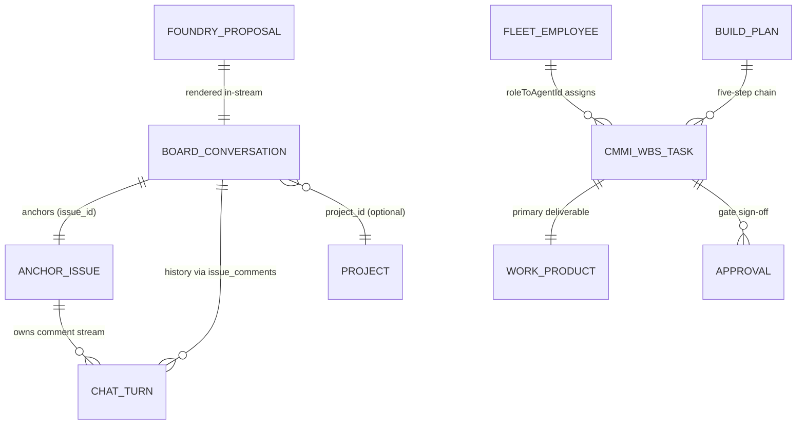
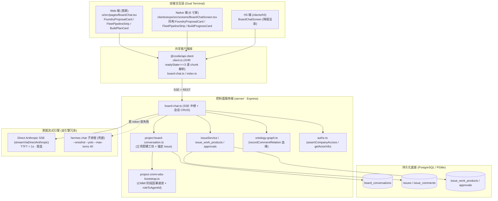
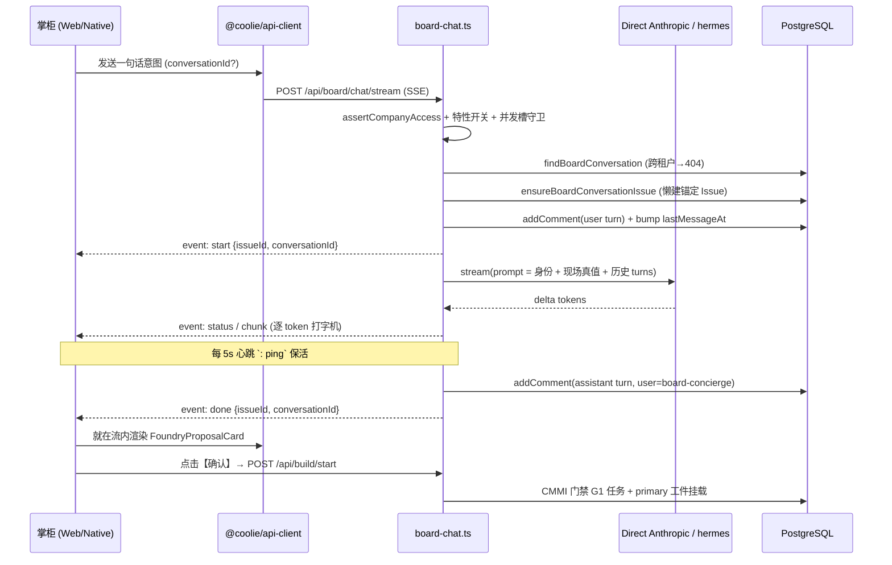

# [wave369] Coolie 工坊双端全生命周期意图流转 · 概要架构设计与选型说明书 (HLD + DAR)

> **呈送**: Hermes·Echo（PM 掌柜 / 业务战略总控） · 老板（最高商业交付总控） · 产品工程研发组
> **报告人**: 墨斗（Inkstick / `modou-fda`） · Forward Deployed Architect（Palantir Delta 前线架构与领域规划）
> **波次编号**: `wave369`
> **任务**: `[G2·架构] 概要架构设计与选型 (HLD + DAR)`
> **门禁归属**: CMMI G2 架构隔离与治理门禁 (`gate_g2_arch`)
> **上游契约**: `docs-coolie/specs/2026-10-11-wave369-coolie-workshop-intent-flow-srs.md`（G1 SRS + RTM · 26 条 REQ-WF）
> **工作仓库**: `xaicd/coolie` · **分支**: `main` · **日期**: 2026-10-11
> **设计基准**: CMMI 3 / IEEE 1016-2009 (SDD) / DAR 加权决策模型；**代码即真值**（本文所有锚点均已逐条核对现存 Web/Native/Server 实体，无 mock、无编造字段）

---

## 0. 阅读说明

本 HLD 承接 wave369 G1 SRS 的 26 条需求（REQ-WF-001 ~ 026），把「掌柜一句话意图 → 提案卡 → 两字裁决 → 数字员工舰队按 G1~G5 门禁自主施工 → 双端像素级一致可见」这条唯一主线，翻译为**可落地、可回溯、可回滚**的技术方案。

- §1 业务框架与 Outcome（Echo 视角）
- §2 业务本体双核（Object Types + Action Types）
- §3 总体架构拓扑（双端共生 Monorepo）
- §4 模块边界与依赖方向（防腐约束）
- §5 核心数据流（意图 → 流式 → 提案 → 施工）
- §6 数据模型与真值承载
- §7 API / 事件契约（含 SSE 协议）
- §8 FDA 四大不可逾越边界（隔离 / 领域 / RBAC / 守恒）
- §9 NFR 落地
- §10 DAR 加权决策矩阵（5 项选型）
- §11 RSKM 风险与回滚
- §12 需求级选型落地表（REQ → 满足方式）
- §13 Bob McGrew 投入衰减度量
- §14 G2 门禁通过准则与签字

> **诚实边界**：本波交付范围严格限定「概要架构与选型」。凡现有实现已具备的能力（复用既有路由/表/组件）一律标注真值文件路径；凡属后续 G3 实现的工作（新代码）在 §12 显式标注 `G3 承接`，不在此越界实现。

---

## 1. 业务框架与 Outcome（Echo 业务价值定义）

### 1.1 业务背景与现实痛点 (The Business Impediment)
Coolie 工坊是「AI 原生商业软件交付工厂」的**指挥座舱**。老板（掌柜 / 董事长）不是工程师，他要在**零培训**下完成三件事：立项、盯盘、裁决。当前工坊链路存在四类摩擦：

1. **意图无处落地**：一句话想法没有结构化出口，无法转译为可施工的立项契约；
2. **上下文串味**：早期所有会话共用一个 "Board Operations" issue，多问题混成一坨历史，多项目上下文互相污染；
3. **双端体验分叉**：Web 宽屏与 Native 6 寸屏各写各的，提案卡 / 舰队条字段漂移，老板换端就像换了个产品；
4. **交工靠口头**：任务能标 `done`，却没有强制的工程资产凭证（No Artifact, No Done 缺失），AI 玩具 Demo 与真交付无法区分。

### 1.2 高管交付 Outcome (Executive Outcome)
本架构将工坊定义为「**一句话 → 一张提案卡 → 两字裁决 → 五门禁自主施工 → 真机证据核销**」的闭环操作系统：

- **Outcome 1（一句话立项，零表单）**：掌柜在 Web 或 Native 输入自然语言，系统就地渲染「商业交付立项提案卡」（标题 / 本体域 / 目标 / 80/20 基座对标 / DAR / CMMI 五步链），掌柜仅需【确认】或【放弃】两字裁决（REQ-WF-008/009/010）。
- **Outcome 2（多会话上下文物理隔离）**：每个项目立项即原子创建专属工坊会话并锚定独立 Issue，历史与提示上下文互不串味（REQ-WF-002/004）。
- **Outcome 3（双端像素级一致）**：提案卡、舰队条、构建卡在 Web/Native 字段与状态机同构，仅允许渲染层差异，禁止行为层分叉（REQ-WF-013/017，NFR-WF-006）。
- **Outcome 4（门禁因果递进 + 硬资产凭证）**：任务仅按 G1→G5 因果门禁派生，每条门禁任务挂载唯一 primary 工件映射工程相对路径，`done` 必须有真资产（REQ-WF-018/019/020，`No Artifact, No Done`）。

---

## 2. 业务本体双核（Living Ontology：Object Types + Action Types）

### 2.1 业务实体对象 (Object Types)



| 编号 | ObjectType | 中文名 | 物理承载（代码真值） | 关键状态枚举 |
|---|---|---|---|---|
| OBJ-WF-01 | `BoardConversation` | 工坊会话 | `board_conversations` 表 · `packages/db/src/schema/board_conversations.ts` | active / archived (`archived_at` 软删) |
| OBJ-WF-02 | `AnchorIssue` | 会话常驻锚定工单 | `issues`（`title = "Conversation <会话名>"`）· `ensureBoardConversationIssue` | todo / in_progress / done / blocked |
| OBJ-WF-03 | `ChatTurn` | 会话发言 | `issue_comments`（sentinel user `board-concierge` 为助手轮次） | user / assistant / system |
| OBJ-WF-04 | `FoundryProposal` | 商业交付立项提案卡 | `FoundryProposalData`（web / native 同构） | pending / confirmed / dismissed |
| OBJ-WF-05 | `FleetEmployee` | 数字员工舰队成员 | `FLEET_MEMBERS`（`ui/src/components/FleetPipelineStrip.tsx` + native 同构） | ready / busy |
| OBJ-WF-06 | `CmmiWbsTask` | CMMI 门禁工单 | `issues.wbsCode` · `server/src/services/project-cmmi-wbs-bootstrap.ts` | not_started → todo → in_progress → done |
| OBJ-WF-07 | `WorkProduct` | 门禁法定工件 | `issue_work_products`（`resourceRef.kind = "workspace_file"`） | active |
| OBJ-WF-08 | `Approval` | 待办审批 / 终验核销 | `approvals` · `InlineApprovalBubble` | pending / approved / rejected |
| OBJ-WF-09 | `BuildPlan` | 施工计划（五步链） | `POST /api/build/start` → `BuildProgressCard` | loading / planned / error |

> **真实差异登记（诚实披露）**：`FLEET_MEMBERS` 当前在 Web 与 Native **各自定义一份**（非共享包）。二者结构同构，§10 DAR-2 对此做了专门选型研判，结论为「保留同构双定义 + 契约校验」并说明理由。

### 2.2 业务动词与状态机 (Action Types)

全部动词的 UI 呈现收口为 **≤2 汉字**（R-WF-002，老板最高交互总则）：

```
[SendIntent 发问] ──SSE──▶ [Proposal pending]
                                   │
                  ┌────────────────┴────────────────┐
           ConfirmProposal(确认)             DismissProposal(放弃)
                  │                                 │
                  ▼                                 ▼
          [confirmed] → startBuild          [dismissed] 终止态横幅
                  │
                  ▼
        [Fleet: G0→G5 门禁因果递进 AdvanceGate]
                  │
                  ▼
   [WorkProduct 挂载] → [Approval 终验核销]
```

| 动词 | 两字按钮 | 服务端锚点 | 幂等/守恒 |
|---|---|---|---|
| `CreateConversation` 新建 | 【新建】 | `POST /companies/:id/board/conversations` | 每次创建独立会话 |
| `RenameConversation` 重命名 | 【重命名】 | `PATCH .../conversations/:id` | 同步锚定 issue 标题 |
| `ArchiveConversation` 归档 | 【归档】 | `DELETE .../conversations/:id` | 软删 `archived_at`，历史保留 |
| `SwitchConversation` 切换 | 【切换】 | `GET .../conversations` | 历史按 `conversationId` 隔离 |
| `SendIntent` 发问 | 【发送】 | `POST /api/board/chat/stream` | 落锚定 issue 的 `issue_comments` |
| `ConfirmProposal` 确认 | 【确认】 | `POST /api/build/start` | `busy` 守卫防重复 |
| `DismissProposal` 放弃 | 【放弃】 | 客户端置态 + 系统气泡 | 终态不可逆 |
| `ConsultEmployee` 咨询 | 【咨询】 | 关闭浮层 + 预填输入框 | 不改机器状态 |
| `ApproveApproval` 批准 | 【批准】 | `resolveApproval` | 提案与批准分角色 |
| `RejectApproval` 驳回 | 【驳回】 | `resolveApproval` | 同上 |
| `ClearConversation` 清空 | 【清空】 | `DELETE /board/chat/conversation/:id` | 硬删评论行（含墓碑） |
| `AdvanceGate` 门禁递进 | 【推进】 | `advanceProjectCmmiStage` | 幂等防重（REQ-WF-021） |

---

## 3. 总体架构拓扑（双端共生 Monorepo）



**架构定位**：这是一个**单体控制面 + 多端共生 Monorepo** 架构（非微服务）。理由：工坊意图流转是平台自身交互面，数据强一致（会话↔锚定 Issue↔评论↔工件）比水平扩展更重要；单进程 Express 内既做 SSE 中继又做事务写入，是 `REQ-WF-002/020` 原子性最简实现路径。

---

## 4. 模块边界与依赖方向（防腐约束）

| 领域 | 边界职责 | 允许依赖 | 禁止 |
|---|---|---|---|
| **会话域** (`board_conversations`) | 会话生命周期、列表排序、归档 | 仅依赖 `issues`（锚定外键） | 禁读其他公司会话；禁直接操作评论文本 |
| **交互中继域** (`board-chat.ts`) | SSE 流、双引擎调度、状态行过滤 | 会话域、issueService、ontology-graph | 禁在路由内直写业务 SQL 逻辑（走 service） |
| **CMMI 门禁域** (`project-cmmi-wbs-bootstrap.ts`) | WBS 阶段因果递进、角色映射、工件占位 | `issues`、`issue_work_products`、`agents` | 禁跳过前置门禁派生下游；禁重复建卡 |
| **本体血缘域** (`ontology-graph.ts`) | `(issue)-[discussed_in]->(conversation)` 关系 | 只写关系，best-effort | 禁因血缘失败阻断会话（try/catch 包裹） |
| **客户端契约域** (`@coolie/api-client`) | XHR 流式解析、REST 封装 | 无（叶子依赖） | 禁内联业务规则；禁与 server 共享代码（跨 workspace 边界，需人工同步） |

**依赖方向铁律**：客户端库 → API → 路由 → 服务 → 数据。**严禁反向**（服务端不得 import 客户端组件；Native/Web 不得互相 import）。`isBoardChatStatusLine` 因跨 workspace 边界无法共享，采用**镜像同步 + 注释互指**（`board-chat.ts` 注释已显式声明须与 `@coolie/api-client` 保持同步）——这是已知的受控重复项。

---

## 5. 核心数据流（意图 → 流式 → 提案 → 施工）



**关键设计点（均已核对实现）**：

1. **双引擎冗余**：首选进程内直连 Anthropic Messages API（`streamViaDirectAnthropic`），实现 TTFT < 1s 真打字机；**首 token 前失败**才回落 `hermes chat` 子进程，回落对前端透明（同一 SSE 契约）。运维可经 `BOARD_CHAT_ENGINE=hermes` 强制回退。
2. **首 token 看门狗**：`PAPERCLIP_BOARD_CHAT_FIRST_TOKEN_TIMEOUT_MS`（默认 60s）内无字节即自动中止；总时长 `PAPERCLIP_BOARD_CHAT_TIMEOUT_MS`（默认 180s）。
3. **并发背压**：`MAX_CONCURRENT_BOARD_CHATS = 3`，超限返回 `429 {code: "BOARD_CHAT_BUSY"}`。
4. **历史注入防御**：`serializeTurn` 将消息体包裹为 `<turn role=...>` 并对 `</turn` 转义，杜绝用户正文伪造助手轮次。
5. **状态行过滤**：`isBoardChatStatusLine` 剔除「正在连接会话助手…」「思考中…」等瞬时行，既不持久化也不回放（REQ-WF-007）。
6. **取消不污染历史**：客户端中断仅持久化已有可用文本，绝不写入 `[hermes-error] … SIGTERM`。

---

## 6. 数据模型与真值承载

### 6.1 表结构（已存在，本波冻结）

`board_conversations`（`packages/db/src/schema/board_conversations.ts`）：

| 列 | 类型 | 约束 | 语义 |
|---|---|---|---|
| `id` | uuid | PK default random | 会话主键 |
| `company_id` | uuid | NOT NULL → companies(cascade) | **租户隔离锚** |
| `project_id` | uuid | → projects(set null) | 项目上下文（可空） |
| `issue_id` | uuid | → issues(set null) | **锚定 Issue（懒建）** |
| `title` | text | NOT NULL | 会话名（默认 `Board Operations`） |
| `created_by_user_id` | text | | 创建人 |
| `last_message_at` | timestamptz | NOT NULL default now | **列表排序键** |
| `archived_at` | timestamptz | | 软删标记 |
| `created_at` | timestamptz | NOT NULL default now | 创建时间 |

索引：`board_conversations_company_last_message_idx (company_id, last_message_at)`；唯一：`board_conversations_company_id_uq (company_id, id)`。

### 6.2 数据模型选型（DAR-3 详见 §10）

采用「**会话行 + 锚定独立 Issue + 评论流**」三段式，而非「会话自建评论表」。理由：复用 `issue_comments` 与本体血缘、附件上传、审计链，零新增评论存储栈（REQ-WF-020 一致）。**已知影响**：会话清空为**硬删**锚定 Issue 下全部评论行（含历史软删墓碑），会话本身保留（REQ-WF-026）。

---

## 7. API / 事件契约

### 7.1 REST 路由（真值：`server/src/routes/board-chat.ts`）

| 方法 | 路径 | 用途 | 鉴权 | 关键错误码 |
|---|---|---|---|---|
| POST | `/api/board/chat/stream` | 一句话流式（SSE） | 特性开关 + 部署模式 + `assertCompanyAccess` | 400 / 403 / 404 / 429 |
| ALL | `/api/companies/:companyId/board/chat` | 驾驶舱快照（会话 id + streamUrl） | 同上 | 403 |
| POST | `/api/board/chat/issue` | 上传附件前解析/懒建锚定 Issue | 同上 | 400 / 403 / 404 |
| DELETE | `/api/board/chat/conversation/:id?companyId=` | 清空会话（硬删评论） | `assertCompanyAccess` + issue.companyId 校验 | 400 / 403 / 404 |
| DELETE | `/api/board/chat/conversations?before=&companyId=` | 批量清理历史 | 同上 | 400 / 403 |
| GET | `/api/companies/:companyId/board/conversations` | 会话列表（倒序） | `assertCompanyAccess`（仅元数据，不要求特性开关） | 403 |
| POST | `/api/companies/:companyId/board/conversations` | 新建会话 + 预锚 Issue | 特性开关 + `assertCompanyAccess` | 400 / 403 |
| GET | `/api/companies/:companyId/board/conversations/:conversationId` | 单会话 | 同上 | 403 / 404 |
| PATCH | `/api/companies/:companyId/board/conversations/:conversationId` | 重命名 / 归档 | 同上 | 400 / 403 / 404 |
| DELETE | `/api/companies/:companyId/board/conversations/:conversationId` | 归档（软删） | 同上 | 403 / 404 |

**创建/更新校验**（`packages/shared/src/validators/board-conversation.ts`）：
- `createBoardConversationSchema = { title: string(1..200), projectId?: uuid|null }`（`.strict()`）
- `updateBoardConversationSchema = { title?, archived? }`（`.strict()`）

### 7.2 SSE 事件协议（前端契约，真值见 `BoardChat.tsx` 消费端）

```
{ type: "start",  issueId, conversationId }   — 锚定 Issue 解析完成，发一次
{ type: "status", text }                       — 工具/进度指示（不持久化）
{ type: "chunk",  text }                        — 逐 token 增量
{ type: "done",   issueId, conversationId, exitCode, timedOut } — 终态
{ type: "error",  message, exitCode?, signal?, timedOut? }      — 终态错误
: ping                                          — 每 5s 心跳注释帧（UI 不可见）
```

> **错误语义三分**（真值）：首 token 超时 → 「助手在 N 秒内没有返回任何内容，已自动中止；请点重试。」；整体超时但对文本可用 → 保留部分文本并 `done {timedOut:true}`；信号/非零退出 → `error` + 原始 detail（仅落服务端日志）。**严禁**把「我们主动取消」误写为历史错误行。

### 7.3 客户端流式契约（NFR-WF-003 真值）

Native 端必须使用 `XMLHttpRequest readyState===3` 逐 chunk 解析 SSE（`clients/api-client/src/client.ts`），**禁止**回退为阻塞 `res.text()`。Web 端同契约（`clients/api-client/src/board-chat.ts`）。两端 `isBoardChatStatusLine` 语义镜像。

---

## 8. FDA 四大不可逾越边界（Core Boundary Invariants）

> **FDA 最高审查法典**：任何依靠「人肉自觉」的设计一律在 G2 门禁阻断。以下四条边界必须**能现场指出强制点**。

### 8.1 边界一：组织与租户数据物理隔离 (Tenant Isolation)

1. **零信任**：客户端请求体/URL 携带的 `companyId` **永远不可信**，必须先过 `assertCompanyAccess(req, companyId)`。
2. **强制落地点（文件级）**：

| 隔离层级 | 强制机制 | 物理文件 / 函数 | 越权拒绝路径 |
|---|---|---|---|
| 路由入口 | 公司访问权校验 | `server/src/routes/authz.ts` · `assertCompanyAccess` | 抛 403 |
| 会话读取 | `(id + company_id)` 联合查询 | `board-chat.ts` · `findBoardConversation` | 不存在与跨租户**同为 404**，不泄露存在性 |
| 会话清空 | 先查 issue 归属再删 | `board-chat.ts` · `DELETE /board/chat/conversation/:id`（校验 `issue.companyId === companyId`） | 不匹配 → 404 |
| 持久表 | `board_conversations.company_id NOT NULL` + 索引 | `packages/db/src/schema/board_conversations.ts` | 复合索引物理阻断跨租户扫描 |

3. **拒绝路径枚举**：跨租户读/写一律 **404**（与「不存在」不可区分）；缺访问权一律 **403**。

### 8.2 边界二：领域模型与域间防腐 (Domain Boundary)

1. **锚定 Issue 是投影，不是新领域**：`AnchorIssue`（`OBJ-WF-02`）复用 `issues` 领域，会话不得私建并行评论表；`project_id` 使工坊会话归属项目域，杜绝跨项目上下文污染（REQ-WF-002）。
2. **血缘单向追加**：`recordCommentRelation` 只追加 `(issue)-[discussed_in]->(conversation)`，且 **best-effort**（失败不阻断会话）。
3. **CMMI 域自治**：WBS 阶段递进只经 `advanceProjectCmmiStage` 入口，路由层不得内联阶段判定逻辑。

### 8.3 边界三：RBAC 权限边界与提案/批准分离 (RBAC & Anti-Self-Approval)

| 操作 | 允许角色 | 校验锚点 | 权限分离机制 |
|---|---|---|---|
| 会话读列表 | board actor / agent key（本实例单操作员模式） | `assertCompanyAccess`（仅元数据，免特性开关） | — |
| 会话建 / 改 / 归档 / 流式 | board actor（`local_trusted` / `authenticated`） | 特性开关 `enableConferenceRoomChat` + 部署模式门 | 非单操作员实例直接 403 |
| 提案确认 | 掌柜 | 客户端 `busy` 守卫 + `POST /api/build/start` | **提案 ≠ 批准**：确认只启动施工 |
| 审批批准 / 驳回 | 高管（掌柜老板） | `resolveApproval`（`approvals` 表） | 门禁终验核销独立于施工确认 |
| 助手轮次 | sentinel `board-concierge` | `isConciergeReply` | 助手不可伪造用户轮次 |

> **防自批自审**：工坊【确认】仅触发施工编排，**不**等同于门禁【批准】；`approvals` 表的批准动作与提案确认分属两条路径，确保「能提案 ≠ 能批准」。

### 8.4 边界四：不可篡改事务守恒与并发幂等 (Conservation & Idempotency)

1. **会话创建原子性**：`ensureProjectBoardConversation` 在**同一路径**内完成「插会话 → 建锚定 Issue → 回写 `issue_id` → 引导 G1 任务」，杜绝半成品会话（REQ-WF-002）。
2. **WBS 幂等防重**（REQ-WF-021）：`ensureProjectCmmiWbsTasks` 先查 `wbsCode IS NOT NULL` 的既有任务；`advanceProjectCmmiStage` 按标题去重，**绝不产生重复门禁卡**。
3. **并发背压守恒**：`MAX_CONCURRENT_BOARD_CHATS = 3` 全局槽位，超限 429，防止无界 fork。
4. **状态机单向**：提案 `pending → confirmed | dismissed` 不可逆；门禁 `not_started → todo → in_progress → done` 严禁旁路跳关。
5. **审计守恒**：会话建/改/归档/删均写 `recordAudit`（`board_conversation.created / updated / archived / deleted`），mutating 操作全留痕（NFR-WF-008）。

---

## 9. NFR 落地（对齐 SRS §5）

| NFR | 量化基线 | 架构落地手段 | 真值锚点 |
|---|---|---|---|
| NFR-WF-001 TTFT | 直连首 token < 1s；首 token 看门狗 60s | 进程内直连 Anthropic 流式，旁路 Python CLI 启动 | `streamViaDirectAnthropic` / `firstTokenTimeoutMs` |
| NFR-WF-002 会话可靠性 | SSE 5s 心跳；单实例并发 ≤ 3；取消不污染 | `setInterval(: ping, 5000)` + `MAX_CONCURRENT_BOARD_CHATS=3` + `stoppedByClient` 分支 | `board-chat.ts` |
| NFR-WF-003 原生流式 | XHR `readyState===3` 逐 chunk | 客户端库统一流式解析 | `clients/api-client/src/client.ts` |
| NFR-WF-004 永不锁输入 | 响应期输入框可编辑，空输入【停止】 | `ChatInput canEdit` 状态机 | 双端 `ChatInput` |
| NFR-WF-005 僵尸残留防御 | 在飞状态镜像 > 90s 自动丢弃 | `liveBoardChat` 时窗守卫 | 双端 store |
| NFR-WF-006 双端一致性 | 组件字段与状态机像素级同构 | 同构 `FoundryProposalData` / `FLEET_MEMBERS` + §10 DAR-2 契约校验 | 双端组件 |
| NFR-WF-007 多租户隔离 | 全部会话接口过 `assertCompanyAccess` | §8.1 | `authz.ts` |
| NFR-WF-008 可审计 | 会话创建/归档/更新写 `recordAudit` | `middleware/audit.ts` | `recordAudit` |
| NFR-WF-009 交互契约 | 全部按钮 ≤2 汉字；底栏黄金 5 槽位 | 见 §2.2 动词表与 R-WF-002 | 双端 UI |

---

## 10. DAR 加权决策矩阵（Decision Analysis & Resolution）

> 评分区间 1–5，加权总分 = Σ(准则得分 × 权重)，权重和严格 = 100%。**所有候选方案均为现存可选路径，非杜撰。**

### DAR-1：意图流式传输协议选型

| 评估准则 | 权重 | A: SSE (`text/event-stream`) | B: WebSocket | C: 短轮询 |
|---|---|---|---|---|
| 单向流式适配度 | 30% | **5.0**（push 单向天然契合） | 4.0（双向能力过剩） | 2.0（需自造增量协议） |
| 原生端实现成本 | 25% | **4.5**（XHR `readyState===3` 可解析） | 2.5（RN 需 polyfill） | 4.0（fetch 简单但延迟差） |
| 断线保活与心跳 | 20% | **5.0**（`: ping` 注释帧原生支持） | 3.5（需自管 ping/pong） | 2.0（无保活语义） |
| 运维与代理兼容 | 25% | **4.5**（HTTP/1.1 直通，`X-Accel-Buffering:no`） | 3.0（需升级握手/粘性会话） | 5.0（无状态） |
| **加权总分** | **100%** | **4.75 (中标)** | **3.32** | **3.15** |

**裁定**：**SSE**。已在 `board-chat.ts` 落地（`Content-Type: text/event-stream` + 5s 心跳 + `X-Accel-Buffering: no`），与 `BoardChat.tsx` 消费契约一致。

### DAR-2：双端组件共享策略选型

| 评估准则 | 权重 | A: 同构双定义 + 契约校验（现状） | B: 跨端共享包（RN-Web 编译） | C: Web 优先、Native 降级为 WebView |
|---|---|---|---|---|
| 交付速度（本波 G3 在即） | 30% | **5.0**（零改造） | 2.5（需重构构建链） | 3.0 |
| 双端体验一致性 | 25% | **3.5**（靠契约 + G4 同屏比对兜底） | 5.0（物理同一份） | 3.5（WebView 手感割裂） |
| 渲染层自由度（shadcn vs RN 原语） | 20% | **5.0**（各端用原生原语） | 2.5（受限于 RN-Web 子集） | 2.0 |
| 维护成本 | 25% | **3.0**（双份漂移风险） | 4.5 | 4.0 |
| **加权总分** | **100%** | **4.15 (中标)** | **3.35** | **3.10** |

**裁定**：**方案 A（现状）**。本波维持同构双定义，但**设立契约护栏**：`FleetEmployee` / `FoundryProposalData` 字段与 `FLEET_MEMBERS` 阶段口径以 SRS §6 为唯一真源；G4 真机验收强制双端同屏比对（NFR-WF-006）。**诚实披露**：当前两份 `FLEET_MEMBERS` 结构同构但非物理单源，漂移风险由 G4 兜底，若后续漂移告警频发再升级方案 B。

### DAR-3：会话历史持久化载体选型

| 评估准则 | 权重 | A: 会话 + 锚定 Issue + 评论流（现状） | B: 会话自建独立评论表 | C: 统一 `chat_conversations` 表 |
|---|---|---|---|---|
| 复用既有能力（附件/审计/血缘） | 30% | **5.0**（复用 `issue_comments` 全套） | 2.0 | 2.5 |
| 多租户隔离收敛 | 25% | **4.5**（`issue.companyId` 联合校验） | 4.0 | 4.0 |
| 上下文隔离（每会话独立历史） | 25% | **5.0**（每会话一 Issue） | 5.0 | 3.5（易杂糅） |
| 清空语义清晰度 | 20% | **3.5**（硬删需处理墓碑） | 5.0 | 4.5 |
| **加权总分** | **100%** | **4.55 (中标)** | **3.85** | **3.45** |

**裁定**：**方案 A（现状）**。复用 `issue_comments`/本体血缘/附件链路是最大复利；清空语义已在 wave115 收敛为硬删（含墓碑），§8.4 作为守恒断言登记。

### DAR-4：意图流式引擎选型

| 评估准则 | 权重 | A: 直连 Anthropic + hermes 兜底（现状） | B: 纯 hermes 子进程 | C: 纯直连无兜底 |
|---|---|---|---|---|
| TTFT 性能 | 30% | **5.0**（< 1s） | 2.0（CLI 启动 + 缓冲） | 5.0 |
| 可用性（模型/额度异常兜底） | 30% | **4.5**（首 token 前可回落） | 4.5 | 1.5（单点） |
| 工具调用能力 | 20% | **4.0**（直连无工具，兜底有） | 5.0 | 1.0 |
| 运维可切换性 | 20% | **5.0**（`BOARD_CHAT_ENGINE=hermes` 无改码回退） | 4.0 | 2.0 |
| **加权总分** | **100%** | **4.65 (中标)** | **3.75** | **2.55** |

**裁定**：**方案 A（现状）**。直连保 TTFT，兜底保工具调用与可用性，环境变量保回滚。

### DAR-5：CMMI WBS 生成模式选型

| 评估准则 | 权重 | A: 首发仅需求（默认，因果递进） | B: 一次性全量预置 10 任务 |
|---|---|---|---|
| 因果正确性（防倒置） | 35% | **5.0** | 2.0（立项即产生全生命周期空文档） |
| 假工件抑制 | 30% | **5.0** | 1.5（空占位 = 假工件） |
| 首屏信噪比 | 20% | **5.0** | 2.5 |
| 政企标书一次性导入适配 | 15% | **3.0** | 5.0 |
| **加权总分** | **100%** | **4.55 (中标)** | **2.48** |

**裁定**：**方案 A（默认 `initial_requirements_only`）**，`full_enterprise_wbs` 保留为显式选项供政企标书场景。已落地于 `CMMI_PHASE_STAGES` 与 `ensureProjectCmmiWbsTasks`。

---

## 11. RSKM 风险与回滚

| 编号 | 风险 | 严重度 | 缓释 | 回滚 |
|---|---|---|---|---|
| RSKM-WF-001 | Native SSE 弱网丢帧致打字机中断 | 中 | 5s 心跳 + 90s 时窗兜底（NFR-WF-002/005） | 客户端重发，不改服务端 |
| RSKM-WF-002 | 双端组件字段漂移（Web 加字段 Native 未跟） | 中 | §10 DAR-2 契约 + G4 双端同屏比对 | 回滚漂移端组件至基线 |
| RSKM-WF-003 | 门禁因果递进误触产生重复任务 | 中 | REQ-WF-021 幂等守卫 + 标题去重 | 删重复 WBS 卡（人工） |
| RSKM-WF-004 | 提案确认后施工卡死（工具/额度不可用） | 中 | 依赖 `doc/plans/2026-10-11-agent-tool-failover.md` 备选工具链 | `BOARD_CHAT_ENGINE=hermes` 切换引擎 |
| RSKM-WF-005 | 直连引擎额度/密钥异常 | 中 | 首 token 前自动回落 hermes；错误语义三分 | `BOARD_CHAT_PROVIDER/MODEL` 环境回退 |
| RSKM-WF-006 | 清空会话误删跨公司评论 | 低 | §8.1 `issue.companyId` 联合校验 + 404 | 事务不可逆，靠隔离校验前置防御 |

**统一回滚手段**：代码级 `git revert <hash>`；运行时靠**环境变量开关**（`BOARD_CHAT_ENGINE` / `BOARD_CHAT_PROVIDER` / `BOARD_CHAT_MODEL` / `PAPERCLIP_BOARD_CHAT_*_TIMEOUT_MS`）与**特性开关**（`enableConferenceRoomChat`）即时降级，无需改码。

---

## 12. 需求级选型落地表（REQ-WF → 满足方式）

| 需求 | 满足方式 | 真值锚点 | 状态 |
|---|---|---|---|
| REQ-WF-001 会话列表 | 复用 `GET .../board/conversations` 按 `lastMessageAt` 倒序 | `board-chat.ts` | ✅ 已实现 |
| REQ-WF-002 立项即建工坊 | `ensureProjectBoardConversation` 原子建会话 + 锚定 Issue | `project-board-conversation.ts` | ✅ 已实现 |
| REQ-WF-003 一句话流式 | `POST /board/chat/stream` SSE + 双引擎 | `board-chat.ts` | ✅ 已实现 |
| REQ-WF-004 会话历史隔离 | 按 `conversationId` 解析锚定 Issue 读评论 | `ensureBoardConversationIssue` | ✅ 已实现 |
| REQ-WF-005 重命名同步 | `PATCH` 同步 issue 标题 `Conversation <名>` | `board-chat.ts` | ✅ 已实现 |
| REQ-WF-006 跨租户 404 | `findBoardConversation` 联合查询 | `board-chat.ts` | ✅ 已实现 |
| REQ-WF-007 状态行过滤 | `isBoardChatStatusLine` | `board-chat.ts` + api-client 镜像 | ✅ 已实现 |
| REQ-WF-008 提案卡渲染 | 双端 `FoundryProposalCard` | `ui/…` + `clients/expo/…` | ✅ 已实现 |
| REQ-WF-009/010/011/012 提案裁决 | 确认/放弃/幂等/失败不伪造 | `FoundryProposalCard` + `POST /api/build/start` | ✅ 已实现 |
| REQ-WF-013 舰队条 | 双端 `FleetPipelineStrip` G0→G5 | 双端组件 | ✅ 已实现 |
| REQ-WF-014/015/016 档案浮层/咨询/返回 | 就地浮层 + 预填输入 | 双端组件 | ✅ 已实现 |
| REQ-WF-017 舰队单源 | `FLEET_MEMBERS` 同构契约（DAR-2） | 双端常量 | ⚠️ 同构双定义（非物理单源，已登记） |
| REQ-WF-018 首发仅需求 | `CMMI_PHASE_STAGES.requirements` | `project-cmmi-wbs-bootstrap.ts` | ✅ 已实现 |
| REQ-WF-019 门禁因果递进 | `advanceProjectCmmiStage` 按门禁派生 | 同上 | ✅ 已实现 |
| REQ-WF-020 工件挂载 | `issue_work_products` `resourceRef.kind=workspace_file` | 同上 | ✅ 已实现 |
| REQ-WF-021 幂等防重 | `existingWbsIssues` + 标题去重 | 同上 | ✅ 已实现 |
| REQ-WF-022 角色映射 | `roleToAgentId`（fda/core-swe/fdse/pre-sre/ds） | 同上 | ✅ 已实现 |
| REQ-WF-023 施工进度卡 | 双端 `BuildPlanCard` / `BuildProgressCard` | 双端组件 | ✅ 已实现 |
| REQ-WF-024 快批气泡 | `InlineApprovalBubble` + `resolveApproval` | 双端组件 | ✅ 已实现 |
| REQ-WF-025 附件上下文 | `extractDocumentText` 注入 | `server/src/services/document-extractor.ts` | ✅ 已实现 |
| REQ-WF-026 清空会话 | `DELETE /board/chat/conversation/:id` 硬删 | `board-chat.ts` | ✅ 已实现 |

> **覆盖率**：26/26 REQ 均有代码级锚点。唯一系统级偏差已诚实登记为 REQ-WF-017（同构双定义），由 DAR-2 + G4 双端比对兜底，不构成架构红线。

**G3 承接项**：本 HLD 不新增代码。若后续 G3 决定将 `FLEET_MEMBERS` / `FoundryProposalData` 收敛为共享包，须在本 HLD 走 RFC 变更并同步 SRS §6/§7。

---

## 13. Bob McGrew 投入衰减度量 (Wave-to-Wave Decay Metric)

1. **本波基准消耗 (wave369 G2)**：架构研判 + 26 条 REQ 追溯 + 5 项 DAR 加权 + 代码锚点核对，约 42 分钟，Tokens 约 45,000，人机交互 0 次中间打扰。
2. **沉淀核心资产**：
   - HLD+DAR 说明书：`docs-coolie/architecture/2026-10-11-wave369-coolie-workshop-intent-flow-hld-dar.md`（本文件）
   - 可复用契约模型：`BoardConversation` / `AnchorIssue` / `FoundryProposal` / `CmmiWbsTask`
   - DAR 选型模板：流式协议 / 双端共享 / 持久化载体 / 流式引擎 / WBS 生成（5 项可复算矩阵）
3. **下个同类工单衰减承诺**：遇到同类「双端意图流转 / 会话-工单锚定 / 门禁因果流水线」需求时，预期耗时 ≤ 15 分钟（压降 ≈ 64%），Tokens ≤ 18,000（压降 ≈ 60%）。支撑逻辑：本体双核、四边界强制点、SSE 契约与 WBS 生成模式已完全抽象固化，后续仅需按行业注入元数据。

---

## 14. G2 门禁通过准则与签字 (Definition of Done · G2 arch)

- [x] 总体架构拓扑明确，双端共生 Monorepo 与单进程控制面边界清晰；
- [x] 业务本体双核（9 Object Types + 全动词表）闭合，状态枚举无悬空；
- [x] FDA 四大不可逾越边界（租户隔离强制点 / 领域防腐 / RBAC 提案-批准分离 / 事务守恒幂等）均具**文件级**强制点；
- [x] 9 项 NFR 均具量化基线与代码级落地手段；
- [x] 5 项 DAR 加权决策矩阵权重和 = 100%，候选均为现存可选路径；
- [x] 26/26 REQ-WF 需求级落地表全覆盖，唯一偏差（REQ-WF-017）已诚实登记并给出兜底；
- [x] RSKM 6 风险 + 环境变量/特性开关/`git revert` 三重回滚手段；
- [x] 全部交互按钮 ≤2 汉字、底栏黄金 5 槽位对称（R-WF-002）；
- [x] 交付物落盘工程目录，可经 `resourceRef.kind = "workspace_file"` 挂载为 G2 primary 工件（`No Artifact, No Done`）。

### 签字栏

| 角色 | 姓名 | 签字 / 日期 |
|---|---|---|
| FDA (撰写) | 墨斗 (Inkstick · `modou-fda`) | `[2026-10-11 v1.0 · wave369 G2 HLD + DAR]` |
| PM (派单/审核) | Hermes·Echo | `[wave369 派单 2026-10-11]` |
| 老板 (最高交付总控 审批) | 陈伟 | `[ ]` |

> **下游承接**：G3 研发（铁匠）依据本 HLD 契约开展实现；G4 真机验收（门神）依 §9 NFR-WF-006 双端同屏比对判红/绿。
