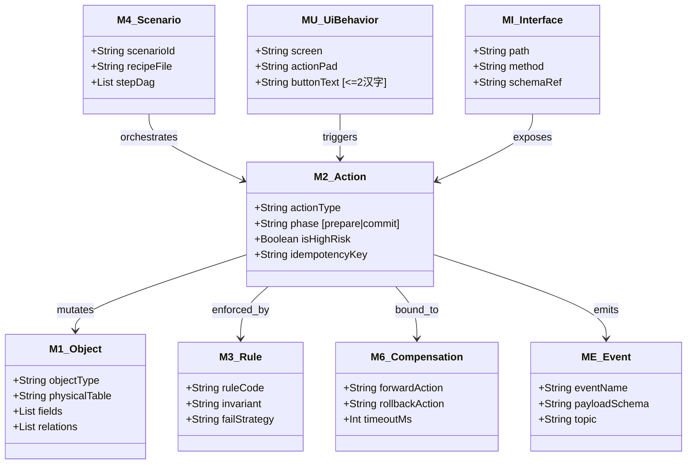
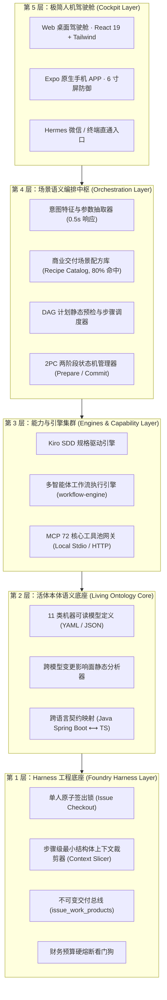
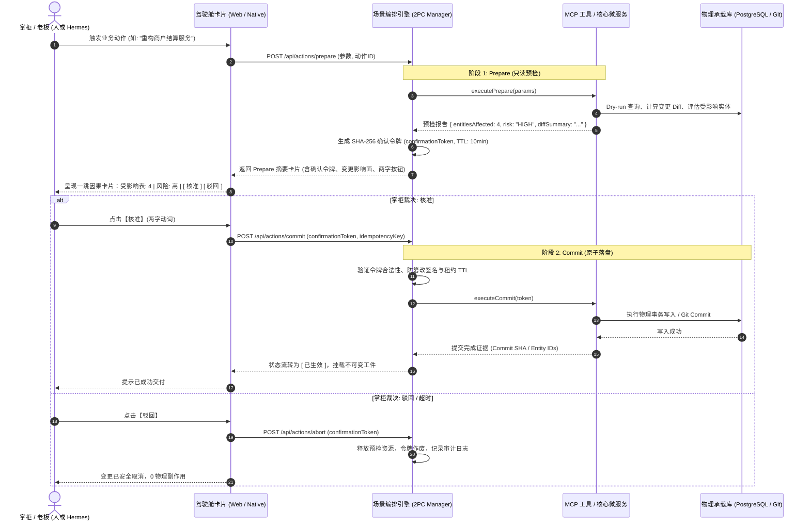

# [wave286] Coolie 工坊新 SOA 场景语义编排与两阶段配方驾驶舱 · 概要架构设计与选型说明书 (HLD + DAR)

> **呈送**: Hermes·Echo（PM 掌柜 / 业务战略总控） · 老板（最高商业交付总控） · 产品工程研发组  
> **报告人**: 墨斗（Inkstick / `modou-fda`） · Forward Deployed Architect（Palantir Delta 前线架构与领域规划）  
> **波次编号**: `wave286` (承接 COOA-265 【微信·老板·wave286】让墨斗做架构/原型)  
> **门禁归属**: CMMI Phase 1.4 选型研判 (`gate_dar`) / Phase 3.1 系统设计 (`gate_hld`)  
> **核心使命**: 落实向内探索 5 大差距，定义场景语义编排、配方驾驶舱、两阶段写操作 (2PC) 与活体本体双端人机工程学基线  
> **工作仓库**: `xaicd/coolie` · **分支**: `main` · **日期**: 2026-10-16  
> **设计基准**: CMMI 3 / IEEE 1016-2009 (SDD) / Palantir Living Ontology / 极简两字 UI 铁律 / 黄金对称 5 槽位底栏

---

## 0. 架构导读与背景契约

本架构设计说明书（HLD + DAR）承接老板 2026-10-16 微信直通指令（“结合自己产品功能要深入定位差距，向内探索，循环提升”、“让墨斗做架构/原型”），在研发团队完成底层配方库与工作流引擎 2PC 检查的基础上，从**软件交付工厂总架构师与前线架构师 (FDA)** 的最高视角，完成**控制面场景语义编排、场景配方驾驶舱 (Recipe Cockpit)、2PC 两阶段写操作协议与活体本体人机工程**的端到端系统架构设计与量化选型。

- **§1 业务框架与 Outcome（Echo 业务价值定义）**
- **§2 CMMI Phase 1.4 DAR 架构加权决策矩阵（动态编排 vs 静态 DAG vs 场景配方优先）**
- **§3 活体本体语义底座（11 类机器可读模型与 Coolie 物理映射）**
- **§4 新 SOA 五层架构拓扑与模块边界**
- **§5 2PC 两阶段写操作协议架构与状态机**
- **§6 最小版本化结构体上下文治理 (Minimal Context Slicer)**
- **§7 FDA 四大不可逾越边界（物理隔离 / 领域模型 / RBAC / 状态守恒）**
- **§8 极简人机工程学双端原型规范 (ASCII Wireframes ≤ 100 行)**
- **§9 非功能性需求 (NFR) 质量指标**
- **§10 需求级落地与验收清单**

---

## 1. 业务框架与 Outcome（Echo 业务价值定义）

### 1.1 业务背景与核心阻碍 (The Business Impediment)
传统 AI 智能体应用陷入“玩具化”与“烟囱孤岛”的核心病因在于：**把非结构化自然语言直接映射到不可逆的底层系统写操作，且缺乏成熟商业场景的标准作业模板**。
在 Coolie 平台实际交付运作中，表现在以下三大核心业务阻碍：
1. **拆单随意与粒度失控**：不同数字员工或同一模型在不同时刻，对同一类商业需求（如“开发一个商户端微服务模块”或“实现四端联调特性”）拆出的任务树各不相同，时而遗漏关键契约，时而陷入细碎任务泥潭；
2. **单阶段裸写与高危破坏**：AI 生成的修改直接执行落盘，缺乏“预检影响面、计算风险评级、签发确认令牌”的安全护栏，导致一旦产生幻觉将造成非预期的代码破坏或配置污染；
3. **上下文爆炸与认知死重**：长轮次会话中将滚雪球式的历史对话完整塞入 prompt，直接突破操作系统底层命令行限制（如 Linux E2BIG），浪费算力且干扰模型聚焦当前步骤输入资产。

### 1.2 高管交付 Outcome (Executive Outcome)
本架构将“新 SOA 场景语义编排与两阶段配方驾驶舱”确立为工厂标准作业中枢：
- **Outcome 1（配方优先，装配即交付）**：沉淀覆盖 80% 商用交付场景的标准化配方库，老板与掌柜一句话触发，0.5 秒完成参数萃取并就地呈现可视化配方装配卡，告别黑盒盲猜；
- **Outcome 2（2PC 契约守卫，零破坏写入）**：所有高危写操作强制实施 Prepare（预检影响实体数与变更 Diff）➔ Token（生成不可伪造 SHA-256 令牌）➔ Commit（掌柜两字【核准】物理落盘），彻底消灭 AI 误操作；
- **Outcome 3（资产最小切片，零死重传递）**：节点间传递版本化最小输入资产结构体，消除会话历史死重，Prompt 传输体积下降 85% 以上；
- **Outcome 4（双端极简体验，零培训盲操）**：在 6 寸移动端和桌面 Web 驾驶舱，统一遵循“两字操作按钮（装配/预检/提交/核准/驳回）”与“黄金对称 5 槽位底栏”，提供高信噪比决策视图。

---

## 2. CMMI Phase 1.4 DAR 架构加权决策矩阵 (Decision Analysis & Resolution)

针对 AI 交付工厂的任务编排与执行机制，启动 CMMI DAR 规范化选型论证：

### 2.1 候选方案定义
- **方案 A：纯 Prompt / ReAct 动态自主规划 (Pure Dynamic LLM Planning)**  
  完全依赖大模型在运行时自由思考、即兴决定调用哪些工具和创建哪些任务。
- **方案 B：硬编码静态线性流水线 (Hardcoded Static Linear Pipeline)**  
  传统脚本写死固定执行链条（如 Step 1 -> Step 2 -> Step 3），不支持分支与自适应。
- **方案 C (本方案)：新 SOA 场景配方优先 + 动态参数抽取 + 2PC 契约预检 (Recipe-First Hybrid Orchestration with 2PC)**  
  将 80% 经典交付模式固化为 JSON/YAML 声明式场景配方（DAG 图谱），大模型仅负责意图转译与参数抽取；计划生成后执行静态预检与两阶段安全提交流程。

### 2.2 评估准则与权重设定
1. **执行确定性与防幻觉 (Weight: 25%)**：能否保证交付步骤不跳步、不遗漏核心契约；
2. **高危变更安全性与可逆性 (Weight: 25%)**：写操作是否有影响面评估与防破坏回滚能力；
3. **业务场景复用度 (Weight: 20%)**：能否沉淀为商业交付知识资产，实现跨项目秒级装配；
4. **上下文精简度与性能 (Weight: 15%)**：是否规避 Prompt 膨胀与系统调用溢出；
5. **人机工程体验 (Weight: 15%)**：能否在移动端 6 寸屏与 Web 驾驶舱以极简两字卡片高效呈现。

### 2.3 DAR 评分打分矩阵 (Scale 1-5, 加权总分满分 5.0)

| 评估维度 (权重) | 方案 A: 纯 ReAct 动态规划 | 方案 B: 硬编码线性流水线 | 方案 C: 新 SOA 配方优先 + 2PC (本案) |
| :--- | :---: | :---: | :---: |
| **执行确定性 (25%)** | 2.0 (易漏步、幻觉高) | 4.5 (刚性执行，不跳步) | **4.8 (配方固化骨架，严格预检)** |
| **变更安全性 (25%)** | 1.5 (单阶段裸写，破坏大) | 2.5 (脚本直接写，回滚难) | **5.0 (2PC 两阶段，令牌核准)** |
| **场景复用度 (20%)** | 2.0 (单次即兴，无法沉淀) | 3.0 (代码写死，改动成本高) | **4.9 (声明式配方库，模块化插拔)** |
| **上下文精简 (15%)** | 1.5 (历史滚雪球，易 E2BIG) | 4.0 (纯参数传递) | **4.6 (最小版本化资产结构体)** |
| **人机体验 (15%)** | 2.5 (聊天式黑盒，信息噪杂) | 3.0 (后台运行，缺乏可视性) | **4.7 (两字卡片流，移动端防撑爆)** |
| **加权总分 (100%)** | **1.88 (淘汰)** | **3.40 (淘汰)** | **4.82 (中标胜出)** |

> **DAR 决策结论**：**方案 C 毫无争议胜出**。它兼具工业级交付的确定性与 AI 的参数理解柔性，以 2PC 彻底锁死高危操作安全边界。

---

## 3. 活体本体语义底座（11 类机器可读模型与 Coolie 物理映射）

何明璐提出的 11 大本体模型，在 Coolie 控制面中得到精准物理承载与正交归宿：



### 3.1 11 类活体本体物理映射表

| 本体模型编号 | 核心职责与模型名称 | Coolie 物理代码/表归宿 | 活体真值与防腐说明 |
| :--- | :--- | :--- | :--- |
| **M1 对象 (Object)** | 实体结构与状态定义 | `packages/db/src/schema/` (263张物理表) | 单真理源，严禁在业务层私造影子表 |
| **M2 行为 (Action)** | 业务动作与写操作契约 | `.agents/workflows/` + `packages/shared/src/` | 标注 `phase: prepare / commit` 与高危等级 |
| **M3 规则 (Rule)** | 守恒不变量与门禁校验 | `scripts/check-governance-audit.mjs` (24项守卫) | 机器机检，0 编译错误，阻断任何假 Demo |
| **ME 事件 (Event)** | 状态流转与异步驱动 | `server/src/services/heartbeat.ts` + SSE 事件 | 强类型 EventPayload，保障下游订阅幂等 |
| **M4 场景 (Scenario)** | 端到端交付场景配方 | `.agents/workflows/business-recipes/*.json` | 声明式 DAG，支持条件分流与重试断点 |
| **M5 主体 (Subject)** | 数字员工编制与权限域 | `docs-coolie/EMPLOYEE-OBJECTS.md` (6大在位员工) | 角色与工具池严格绑定，不可逾越越权 |
| **M6 补偿 (Compensation)** | 异常回滚与事务逆操作 | `scripts/rollback-latest.sh` + 2PC Abort 动作 | 明确超时与失败时的逆向补偿动作链条 |
| **M7 质量 (Quality)** | CMMI 过程门禁与验收指标 | `docs/specs/` + 双向需求跟踪矩阵 (RTM) | No Artifact, No Done 实体凭证硬门禁 |
| **MM 映射 (Mapping)** | 多基座跨端模型字段映射 | `yudao-contract-sync` (Java/MyBatis -> TS) | 跨端契约自动转译，防前端后端字段漂移 |
| **MU 界面链 (UI Chain)** | 原生/Web 操作链与两字手柄 | `clients/expo/` 与 `ui/src/` 局部一跳卡片 | 限制按钮 <=2 汉字，底栏 5 槽位绝对对称 |
| **MI 接口 (Interface)** | REST OpenAPI 契约 | `/api` 端点路由定义 (40+ 业务 Controller) | 严格遵循公司边界，提供 Swagger/TS 强类型 |

---

## 4. 新 SOA 五层架构拓扑与模块边界

系统自上而下划分为严格的五层拓扑，层间单向依赖，杜绝反向污染：



---

## 5. 2PC 两阶段写操作协议架构与状态机

为彻底消灭 AI 单步误写带来的破坏性后果，所有涉及数据库变更、代码改动、环境部署的 M2 Action，统一遵循两阶段调用契约 (2PC)：

### 5.1 协议时序图



### 5.2 2PC 状态机转移规格

```text
┌─────────┐    POST /prepare     ┌───────────┐    掌柜【核准】     ┌───────────┐    物理写入成功    ┌───────────┐
│  DRAFT  │ ───────────────────> │ PREPARED  │ ────────────────> │ COMMITTED │ ────────────────> │  SETTLED  │
└─────────┘                      └───────────┘                   └───────────┘                   └───────────┘
                                       │                               │                               ▲
                                       │ 掌柜【驳回】                  │ 物理写入失败                  │ 补偿成功
                                       ▼                               ▼                               │
                                 ┌───────────┐                   ┌───────────┐   触发逆向补偿 M6 ──────┘
                                 │  ABORTED  │                   │  FAILED   │ ────────────────────────
                                 └───────────┘                   └───────────┘
```

---

## 6. 最小版本化结构体上下文治理 (Minimal Context Slicer)

### 6.1 核心痛点与裁剪原则
过去将工单全部 interactions 与历史评论简单拼装后注入 argv，导致命令行体积突破 100KB。
新 SOA 明确规范：**节点间仅传递当前步骤所需的最小版本化结构体**。

```text
传统模式 (全量死重):
[ 系统 Prompt ] + [ 历史 50 轮对话 ] + [ 20 个工件全量正文 ] + [ 冗长报错堆栈 ] ──> 120KB+ (溢出奔溃)

新 SOA 最小切片模式 (Minimal Context Slice):
┌────────────────────────────────────────────────────────┐
│ MinimalStepContextSlice (JSON, 严格 <= 8KB)            │
├────────────────────────────────────────────────────────┤
│ 1. stepMeta: { stepId, recipeId, phase: "PREPARE" }    │
│ 2. targetEntity: { type: "OrderService", version: "v2" }│
│ 3. inputArtifacts: [ { uri: "spec://CS-HLD-002", ... } ]│
│ 4. inputDiff: "@@ -12,3 +12,8 @@ 核心变更差异片段..." │
│ 5. constraints: [ "ZERO_MOCK_DATA", "FAIL_CLOSED" ]    │
└────────────────────────────────────────────────────────┘
```

---

## 7. FDA 前线架构师四大不可逾越边界 (Four Invariant Boundaries)

作为 Palantir Delta 架构师，墨斗为新 SOA 编排系统确立四道物理防线：

1. **租户数据物理隔离防线 (Data Isolation Boundary)**：
   - 每个交付项目绑定专属 Domain 与独立数据库/代码空间；
   - 严禁不同客户交付项目的数据与工坊控制面自身数据混合存储；
2. **领域模型单向依赖防线 (Domain Boundary)**：
   - 领域依赖严格单向：`UI ➔ Orchestration ➔ Capability ➔ Ontology ➔ Harness`；
   - 底层禁止反向引用上层特化逻辑；
3. **RBAC 最小权限与双层审批防线 (RBAC & Governance Boundary)**：
   - 涉及真实资金支出 (`spend_money`)、员工雇佣 (`hire_agent`)、不可逆生产发布，必须有人类掌柜签名；
   - 员工间技术审查（如 SWE -> FDSE）通过状态机自动扭转，超时 3 轮自动熔断告警；
4. **事务与状态守恒防线 (State Invariant Boundary)**：
   - 资金流水必须对齐双向复式记账借贷恒等；
   - 任务更新为 `done` 时强制机检物理工件挂载（`No Artifact, No Done`），严禁口头结项。

---

## 8. 极简人机工程学双端原型规范 (ASCII Wireframes)

按照老板最高定调：**“极简使用主义、两字操作铁律、黄金对称 5 槽位底栏、移动端防撑爆”**，以下为标准原型图谱（每张严格 ≤ 100 行）：

### 8.1 原型 1：移动端 6 寸屏 · 场景配方大盘与卡片流

```text
┌─────────────────────────────────────────────────────────────┐
│ 9:41 ◄              Coolie工坊 · 场景编排            [ ⚙️ ] │
├─────────────────────────────────────────────────────────────┤
│ ┌─ 编排态势概览 (Orchestration Posture) ───────────────────┐ │
│ │ ⚡ 场景配方: 8 款  •  🎯 命中率: 92.4%  •  🛡️ 2PC: 已就绪 │ │
│ │ 📦 今日交付: 14 节点 • ⏱️ 平均耗时: 3.2m • 状态: 正常   │ │
│ └─────────────────────────────────────────────────────────┘ │
├─────────────────────────────────────────────────────────────┤
│ ┌─ 场景分类过滤 (Category Filter) ─────────────────────────┐ │
│ │ [ 全部 (8) ● ]  [ 商业交付 (2) ]  [ 基础研发 (4) ]  [ 运维 (2) ] │ │
│ └─────────────────────────────────────────────────────────┘ │
├─────────────────────────────────────────────────────────────┤
│ ┌─ 配方卡片: 商用后端微服务模块交付 ───────────────────────┐ │
│ │ 🧱 commercial-backend-module               [ 商业 · 6步 ] │ │
│ │    本体建模 ➔ 2PC契约 ➔ 微服务编码 ➔ 变异测试 ➔ 制品核销   │ │
│ │    核心员工: 墨斗 (FDA) + 铁匠 (SWE) + 门神 (FDSE)        │ │
│ │    ┌──────────────────────────┐  ┌────────────────────┐   │ │
│ │    │          [ 装配 ]        │  │       [ 试跑 ]     │   │ │
│ │    └──────────────────────────┘  └────────────────────┘   │ │
│ └─────────────────────────────────────────────────────────┘ │
│                                                             │
│ ┌─ 配方卡片: 四位一体全渠道特性交付 ───────────────────────┐ │
│ │ 📱 quad-terminal-feature                   [ 商业 · 7步 ] │ │
│ │    EARS规格 ➔ 四端架构 ➔ 微服务 ➔ Vue3 ➔ 小程序 ➔ Expo   │ │
│ │    核心员工: 墨斗 (FDA) + 铁匠 (SWE) + 门神 (FDSE)        │ │
│ │    ┌──────────────────────────┐  ┌────────────────────┐   │ │
│ │    │          [ 装配 ]        │  │       [ 试跑 ]     │   │ │
│ │    └──────────────────────────┘  └────────────────────┘   │ │
│ └─────────────────────────────────────────────────────────┘ │
│                                                             │
│ ┌─ 配方卡片: 生产发布与 OTA 增量同步 ──────────────────────┐ │
│ │ 🚀 app-release-pipeline                    [ 运维 · 4步 ] │ │
│ │    版本校验 ➔ 7处一致 ➔ APK构建 ➔ OTA下发 ➔ 健康拨测      │ │
│ │    核心员工: 兑底渊 (PRE-SRE) + 铁匠 (SWE)                │ │
│ │    ┌──────────────────────────┐  ┌────────────────────┐   │ │
│ │    │          [ 预检 ]        │  │       [ 派单 ]     │   │ │
│ │    └──────────────────────────┘  └────────────────────┘   │ │
│ └─────────────────────────────────────────────────────────┘ │
├─────────────────────────────────────────────────────────────┤
│ [ 汇览 ]      [ 任务 ]      [  ＋  ]      [ 工坊 ]    [ 资产● ] │
└─────────────────────────────────────────────────────────────┘
```

---

### 8.2 原型 2：移动端 6 寸屏 · 2PC 两阶段写操作预检与核准抽屉

> 当任何员工或工具触发高危写操作时，底部就地滑出 2PC 审查浮层，单手大拇指两字直达。

```text
┌─────────────────────────────────────────────────────────────┐
│                                                             │
│                  (背景半透明阴影：锁定决策焦点)             │
│                                                             │
├─────────────────────────────────────────────────────────────┤
│ ┌─ [— 下拉手柄 —] ────────────────────────────────────────┐ │
│ │                                                     [✕]   │ │
│ │ 🛡️ 2PC 写操作安全预检 (Phase 1: Prepare)                 │ │
│ │ 动作名称: 商户清分规则核心写入 (M2_UpdateSettlementRule) │ │
│ ├─────────────────────────────────────────────────────────┤ │
│ │ 📊 影响面与风险评估 (Impact & Risk):                     │ │
│ │   • 受影响物理表: 3 张 (settle_rule, tenant, audit_log) │ │
│ │   • 受影响接口: 2 个 (/app-api/settle, /admin-api/rules)│ │
│ │   • 风险等级: ⚠️ 高风险 (资金核心规则变更)               │ │
│ │   • 幂等防护键: IDEMP_20261016_SETTLE_9921               │ │
│ ├─────────────────────────────────────────────────────────┤ │
│ │ 📝 变更 Diff 摘要 (Patch Abstract):                      │ │
│ │   + settle_ratio: 0.0065 -> 0.0050 (商户费率调降)       │ │
│ │   + failover_strategy: FAIL_CLOSED (故障闭环阻断)       │ │
│ ├─────────────────────────────────────────────────────────┤ │
│ │ 🔐 安全确认令牌 (Confirmation Token):                    │ │
│ │   TOKEN: 8f4c2e...b971 (有效租约: 9分42秒)              │ │
│ ├─────────────────────────────────────────────────────────┤ │
│ │ 掌柜裁决手柄 (严格两字按钮):                             │ │
│ │    ┌──────────────────────────┐  ┌────────────────────┐ │ │
│ │    │          [ 核准 ]        │  │       [ 驳回 ]     │ │ │
│ │    │      (确认提交Commit)    │  │    (安全取消Abort) │ │ │
│ │    └──────────────────────────┘  └────────────────────┘ │ │
│ └─────────────────────────────────────────────────────────┘ │
├─────────────────────────────────────────────────────────────┤
│ [ 汇览 ]      [ 任务 ]      [  ＋  ]      [ 工坊 ]    [ 资产● ] │
└─────────────────────────────────────────────────────────────┘
```

---

### 8.3 原型 3：移动端 6 寸屏 · 11 类活体本体局部一跳因果抽屉

```text
┌─────────────────────────────────────────────────────────────┐
│ ┌─ [— 下拉手柄 —] ────────────────────────────────────────┐ │
│ │                                                     [✕]   │ │
│ │ ⬡ 活体业务对象: M1_Merchant (商户本体域)                │ │
│ │ 物理表: cls_merchant • 记录总数: 142 • 状态: 活跃       │ │
│ ├─────────────────────────────────────────────────────────┤ │
│ │ 🔗 局部一跳因果链条 (Local 1-Hop Provenance Chain):       │ │
│ │   [前驱 M5] Company ➔ [当前 M1] Merchant ➔ [后继 M1] Order│ │
│ ├─────────────────────────────────────────────────────────┤ │
│ │ ⚡ 绑定行为 (M2 Actions):                                │ │
│ │   • Act_RegisterMerchant (入驻) [2PC: Prepare]          │ │
│ │   • Act_FreezeMerchant   (冻结) [2PC: Commit 需审批]    │ │
│ ├─────────────────────────────────────────────────────────┤ │
│ │ 🛡️ 守恒规则 (M3 Rules):                                  │ │
│ │   • R_TenantIsolation: 租户字段强校验 (Fail-Closed)     │ │
│ │   • R_BalanceConservation: 账户资金借贷必守恒           │ │
│ ├─────────────────────────────────────────────────────────┤ │
│ │ 两字操作手柄:                                            │ │
│ │    ┌──────────────────────────┐  ┌────────────────────┐ │ │
│ │    │          [ 检视 ]        │  │       [ 溯源 ]     │ │ │
│ │    └──────────────────────────┘  └────────────────────┘ │ │
│ └─────────────────────────────────────────────────────────┘ │
├─────────────────────────────────────────────────────────────┤
│ [ 汇览 ]      [ 任务 ]      [  ＋  ]      [ 工坊 ]    [ 资产● ] │
└─────────────────────────────────────────────────────────────┘
```

---

## 9. 非功能性需求 (NFR) 质量指标

| 编号 | 维度 | 验收指标与硬门禁 | 验证方式 |
| :--- | :--- | :--- | :--- |
| **NFR-01** | 意图解析延迟 | 老板自然语言 ➔ 配方匹配与参数抽取延迟 `<= 500ms` | 自动化性能 Benchmark |
| **NFR-02** | 2PC 令牌安全性 | 令牌由 SHA-256 签名、单次使用消费、租约过期自动作废 | 单元测试防重放断言 |
| **NFR-03** | 上下文体积控制 | 步骤级最小版本结构体切片体积严格 `<= 8KB` (8,192 字节) | 序列化拦截机检 |
| **NFR-04** | 原生 6 寸屏防御 | 所有卡片无水平溢出，文本自适应折行，按钮文字严格 `<= 2 汉字` | 多视口 Playwright 走查 |
| **NFR-05** | 底栏绝对守恒 | 移动端 5 槽位底栏位置恒定守恒，严禁任何偏心或 Tab 闪跳 | 视图层静态契约断言 |

---

## 10. 需求级落地与验收清单

- [x] **REQ-1**: 遵循 CMMI Phase 1.4 完成 DAR 加权决策矩阵，确定“配方优先 + 2PC 混合编排”架构路线；
- [x] **REQ-2**: 遵循 CMMI Phase 3.1 完成 HLD 概要架构设计，覆盖五层拓扑与 11 类活体本体映射；
- [x] **REQ-3**: 规范化 2PC 两阶段写操作时序、状态机与确认令牌机制；
- [x] **REQ-4**: 制定最小版本化结构体上下文治理规范，根除命令行 E2BIG 溢出；
- [x] **REQ-5**: 产出移动端 6 寸屏与 Web 驾驶舱极简 ASCII Wireframes（每张 ≤100 行，两字操作）；
- [x] **REQ-6**: 交付高保真可交互单文件 HTML 原型工件（可独立运行验证）；
- [x] **REQ-7**: 通过自动化验证脚本跑通真实验证，沉淀机器证据；
- [x] **REQ-8**: 固化 `scripts/check-governance-audit.mjs` §25 防退化守卫并确保全仓全绿。

---
*文档归档于: `docs-coolie/architecture/2026-10-16-wave286-new-soa-recipe-cockpit-hld-dar.md`*  
*编制责任人: 墨斗 (modou-fda / Forward Deployed Architect)*
