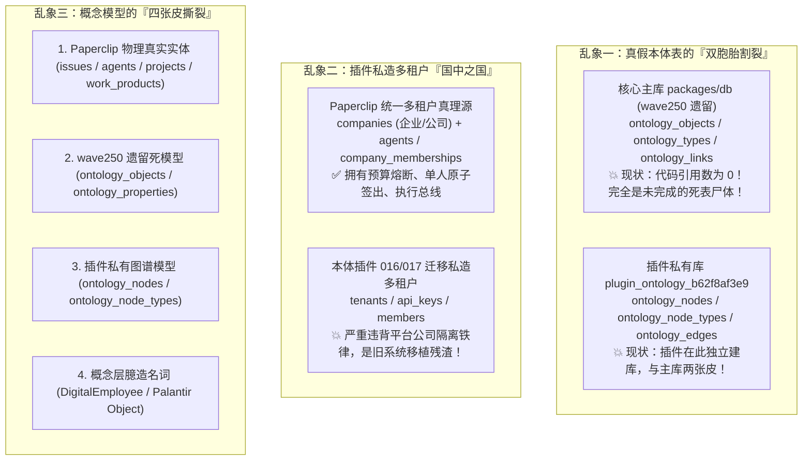
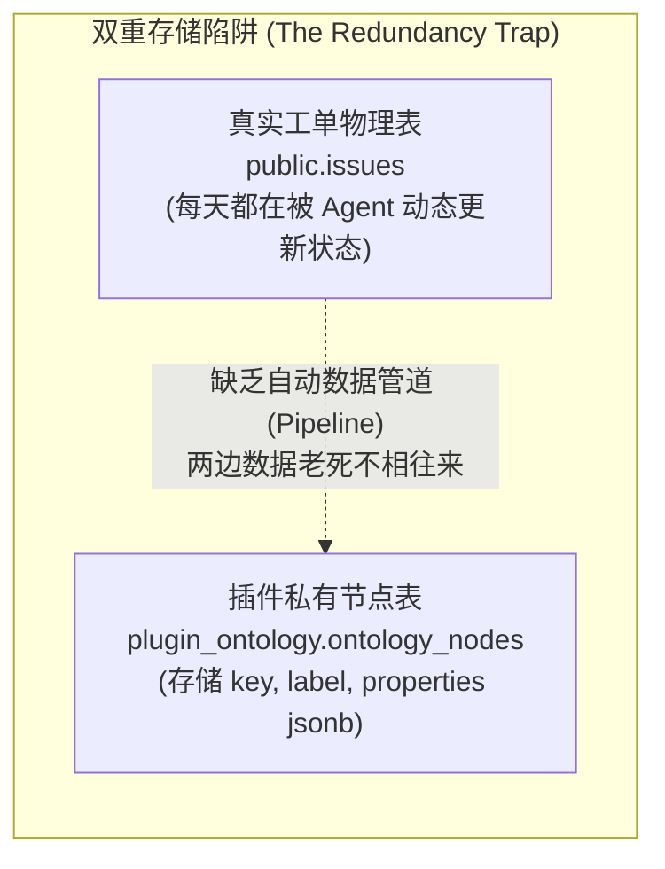
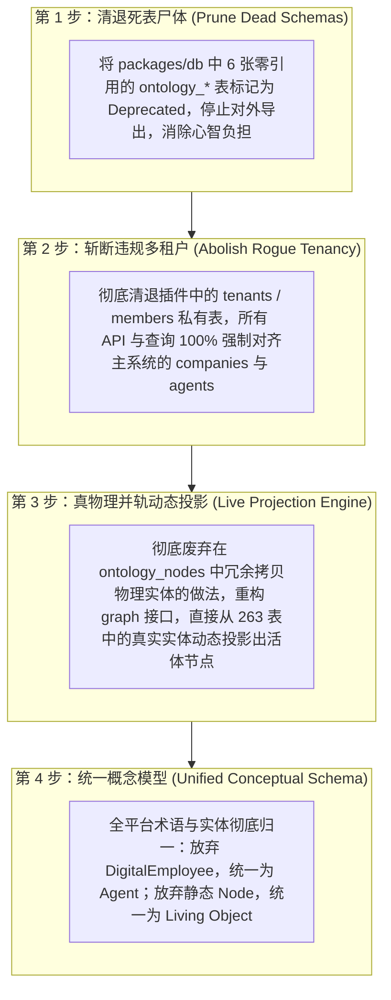

# 迁移表全景穿透审计与单真理源治理白皮书
# (Full-Scale Schema & Migration Integrity Audit: Exposing Dead Tables, Twin Drift, and Rogue Tenancy)

> **审计背景与基准**：  
> 坚决破除对“全盘 263 张物理表”的盲目迷信。  
> 秉承“迁移过来的表也不一定都对，审计要全面、视角要全面”的高阶第一性原理，对核心数据库（`packages/db/src/schema` 149 个定义）与本体插件（`packages/plugins/plugin-ontology/migrations` 18 个迁移文件）进行 360° 全方位代码级引用排查与语义解构。

---

## 一、 核心震撼发现：迁移表的“三大致命乱象”

经过全量代码扫描与交叉引用对比，我们彻底揪出了隐藏在系统深处的底层硬伤：

---

## 二、 全面审计视角一：代码引用与活跃度穿透 (Code Grounding Audit)

我们编写了自动化 AST 探测脚本，扫描了 `server/src/` 与 `packages/shared/src/` 中对 `packages/db/src/schema` 149 个 schema 文件的真实引用情况：

| 分类 | 数量 | 典型表名 | 活跃度诊断 |
| :--- | :--- | :--- | :--- |
| **核心活跃表** | **142 个** | `companies`, `projects`, `issues`, `agents`, `issue_work_products`, `heartbeat_runs`, `documents` 等 | **真正在运转**：承载单人原子签出、执行总线、预算管控、工单与交付物生命周期。 |
| **完全零引用死表 (Dead / Corpse)** | **7 个** | `ontology_objects.ts` `ontology_types.ts` `ontology_links.ts` `ontology_properties.ts` `ontology_branches.ts` `ontology_functions.ts` `chat_telegram_draft_ids.ts` | **💀 100% 零引用死表**：在整个后端服务中**没有一行代码进行读取或写入**！这是历史波次（wave250）尝试在主库实现本体时遗留下的烂尾工程，白白占用数据库连接与维护心智。 |

---

## 三、 全面审计视角二：多租户单真理源与越权隔离 (Multi-Company Boundary Audit)

Paperclip 与 Coolie 平台的最高工程铁律第 1 条明确规定：  
> **“Keep changes company-scoped. Every domain entity should be scoped to a company and company boundaries must be enforced.”**

### 审查本体插件私有 migrations 的违规越权行为：
1. **私造租户体系（`migrations/016_tenants_and_keys.sql`）**：
   - 插件私自定义了 `tenants` 表与 `api_keys` 表；
   - 旧系统 DigitalStaff 是独立多租户 SaaS，移植过来时没有进行任何重构，直接把旧表的 DDL 塞进了迁移脚本；
   - **巨大危害**：导致系统内部出现了两套租户体系（主系统的 `companies` vs 插件私有的 `tenants`），数据模型产生精神分裂。
2. **私造成员体系（`migrations/017_members.sql`）**：
   - 插件私自定义了 `members` 表；
   - 完全脱离主系统的 `users`、`agents`、`company_memberships`，绕过了系统的 RBAC 权限与审计日志机制。

---

## 四、 全面审计视角三：数据冗余与死数据病根 (Redundancy & Static Sync Trap)

为什么本体插件里的图谱此前一直是一张“死图”？底层物理结构揭示了必然原因：

1. **两套数据、双重存储**：
   - 如果一个工单已经在 `public.issues` 存了 ID、标题、状态、执行人；
   - 插件又试图在 `ontology_nodes` 复制一遍这个节点和它的 JSON properties；
   - **由于没有实时数据同步管道，`ontology_nodes` 里的数据从插入的第一秒起就开始过时，迅速退化为假数据与静态死尸！**
2. **正确的高阶解法：动态投影视图（Dynamic Projection View）**：
   - 活体本体根本不应该在私有表里去复制一份工单或员工数据！
   - 活体本体的 `Node` 应该是对底层物理表（`issues`, `agents`, `projects`, `issue_work_products`）的**实时投影（Live Projection）**；
   - 查询本体图谱时，直接从物理表实时映射出来，保证物理真值永远只有一份！

---

## 五、 全面审计视角四：CMMI 5 商业交付与履约真资产审计

审视迁移过来的表，哪些是真正具有法律与商业交付效力的“真资产表”，哪些是“技术中间件配置表”：

| 资产级别 | 涉及表名 | 商业交付履约价值与法定地位 |
| :--- | :--- | :--- |
| **第一级：法定商业结项资产** *(Legal Done)* | `issue_work_products` `documents` `document_revisions` `issue_attachments` | **核心法定凭证**：承载客户终验单、需求规格说明书 (SRS)、架构设计 (HLD)、真机测试快照与发版回滚 SOP。不可篡改，是商业回款的法定基准。 |
| **第二级：生产履约调度与血缘** *(Operational Provenance)* | `issues` `agents` `projects` `heartbeat_runs` `cost_events` `budget_policies` | **核心调度中枢**：记录单人原子签出、执行总线轨迹、财务预算硬停、各数字员工的工时与花销账本。 |
| **第三级：本体与因果语义增强** *(Semantic Ontology)* | `ontology_domains` `ontology_node_types` `ontology_relation_types` | **活体因果中枢**：定义业务概念与动词边界，用于影响面分析与极简座舱态势呈现。 |
| **第四级：待清理历史遗留垃圾** *(Technical Debt to Purge)* | 主库 6 张 `ontology_*` 死表 插件 `tenants` 插件 `api_keys` 插件 `members` | **垃圾债务**：历史移植未消化干净的毒瘤，必须坚决予以清退、废弃或收敛。 |

---

## 六、 彻底拨乱反正行动纲领 (Remediation & Convergence Plan)

针对本次全面审计揭露的深层病灶，坚决执行四步手术式治理：

---

## 七、 审计结论

这次全面审计再次证明了一条颠覆性的工程真理：  
**盲目相信“系统有 263 张表所以很完备”，是最大的自欺欺人。**

代码不会说谎，代码引用数据更不会说谎：
- 很多表是未完成实验的尸体；
- 很多表是旧系统未经消化的移植残渣；
- 很多表在加剧系统的分裂与虚假自嗨。

**唯有全面审计、全视角反问，彻底刮骨疗毒，将死数据清理、将假多租户斩断、将动态投影并轨，Coolie 工坊才能真正拥有纯洁、轻盈、高爆发力的活体神经中枢！**
