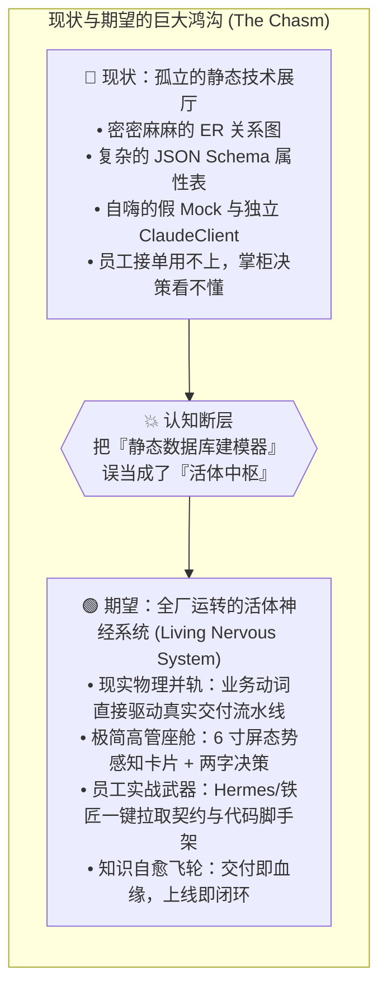
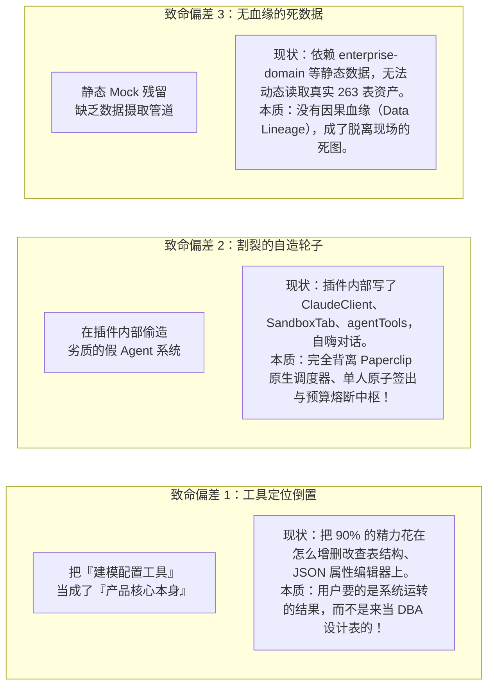
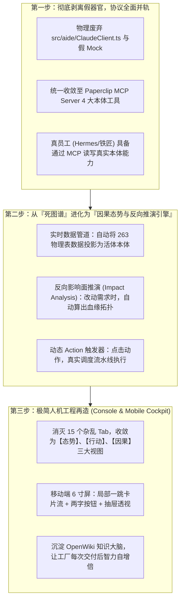

# 本体插件高阶全视角审计与下一代活体中枢蓝图
# (Ontology Plugin High-Order Audit & Next-Gen Living Nervous System Blueprint)

> **审计基准**：  
> 站在“AI 原生端到端商业交付工厂最高指挥官”与“Palantir 活体本体总架构师”的双重视角反向审视。  
> 抛弃“代码跑得通、单测全绿、界面有连线”的自嗨与平庸验收标准，直面残酷现实：**本体插件目前的形态，离真正支撑商业交付与数字员工自循环运转的期望，还差得远。**

---

## 一、 为什么我们现在的本体插件“差得远”？五大高阶审视视角诊断

---

## 二、 五大高阶审计视角与硬伤体检表

| 审计视角 | 核心反向追问 (Interrogation) | 现状病根诊断 (Current Reality) | 期望终局形态 (Desired Target) |
| :--- | :--- | :--- | :--- |
| **1. 交付总控视角** *(掌柜 / FDE)* | 掌柜看大盘、前线跟甲方交涉时，这东西能解决什么问题？能帮掌柜 3 秒看懂风险吗？ | **像个极客玩具/数据库设计器**。密密麻麻的节点、连线和 JSON，信息严重过载。没有绑定项目交付主线（SRS/门禁/终验单），无法预警商业交付瓶颈。 | **高信噪比决策透视镜**。不推几百个节点，只推【业务态势卡片】；甲方改需求时，一键透视出影响的面（哪几个接口契约变动、增加几天工时、需哪些角色介入）。 |
| **2. 数字员工实战视角** *(Hermes / 墨斗 / 铁匠)* | 真实员工在终端接单干活时，本体插件给了他们什么实质性武器？ | **严重双轨自嗨**。插件自己在前端塞了个假 `ClaudeClient`，而真实的 6 大员工（Hermes/铁匠/门神）在命令行跑任务时根本调不到它，两帮人老死不相往来。 | **数字员工战斗力倍增器**。Hermes 接单一键解析本体域与动词；墨斗一键生成带防御性断言的 LLD 契约；铁匠一键拉取代码脚手架；门神把真机快照反哺挂载存证。 |
| **3. Palantir 活体真理视角** *(Living Dual-Core)* | 这是具备生命力、双向反射的“活体孪生”，还是冷冰冰的“尸体标本”？ | **伪孪生与死图谱**。大部分时间只是静态数据查看器。现实物理表（`issues`, `work_products`）变化了无法实时反射，在上面点动词也驱动不了现实交付，没有因果血缘。 | **双向实时物理并轨中枢**。现实物理世界的每一个 commit、每一个测试报告，实时反射为本体节点；在本体上批准一个动词，现实系统原子执行并沉淀不可变履约证据。 |
| **4. 极简人机工程视角** *(6 寸屏移动座舱)* | 现场掌柜单手拿着手机，拇指 3 秒内能看懂并做出正确决策吗？ | **PC 时代的大杂烩迷宫**。一口气堆了 15 个 Tab（图谱、表格、结构、动作、事件、驾驶、数据集、转换……），在手机上是灾难级不可用。 | **就地一跳 + 两字动词**。手机端只保留【态势卡片流】，核心动词收敛为两个字，因果图谱作为就地抽屉浮层按需下钻，彻底杜绝把大图硬塞给高管。 |
| **5. CMMI 5 度量演化视角** *(质量防退化与自愈)* | 交付完一个项目，这个系统变聪明了吗？还是代码又变成了一堆负债？ | **缺乏全生命周期质量感知**。完全不懂什么是 G1-G5 门禁、什么是变异测试打假，无法通过本体拓扑做 SPC 统计控制与 CAR 缺陷预防。 | **自学习与自愈知识大脑**。交付产生的契约、架构决策、排障记录，自动回流同步至 OpenWiki 机器维基，形成全舰队秒级免疫力。 |

---

## 三、 深度解构：本体插件目前的致命设计偏差

经过对 `packages/plugins/plugin-ontology/` 全盘代码的深度透视，我们发现导致“差得远”的三个底层致命偏差：

---

## 四、 期望的产品终局形态：下一代“活体交付神经中枢” (Living Foundry Nervous System)

为了让本体插件真正达到预期，必须进行**三步跨越式进化**：

### 1. 员工视角的终极体验：
- 铁匠（Core SWE）领到任务，打开终端输入 `agy`，数字员工自动调用 MCP 工具 `paperclipGetCompanyOntologyGraph`，不仅知道任务要做什么，还瞬间拿到了关联的 `Object` 数据模型、契约约束、以及上下游依赖，代码 0 冗余直接生成。

### 2. 掌柜视角的终极体验：
- 掌柜在手机上打开 App，不看几百个点连线的大图，只看一张【交付态势卡】：
  - *“当前【云南移动企微交付项目】门禁状态：G3 契约已锁定，G4 测试快照缺失 1 项”*；
  - 下方只有两个字：**【催办】** 或 **【透视】**；
  - 点【透视】，弹出一个优雅的因果抽屉浮层，清晰标红卡住的那个用例与负责人。

---

## 五、 总结与结语

**审计不是为了自证其丑，而是为了锚定真正的山巅。**

我们不再满足于一个“功能繁复的静态建模插件”。我们要的是一个：
1. **能够让数字员工真正获得战术全景感知的协议中枢**；
2. **能够让高管在 6 寸屏幕上秒级决断的极简态势座舱**；
3. **能够将现实世界工程资产与商业终验牢牢锁死在不可变血缘中的活体大脑**。

这才是 Coolie 工坊期望的、远超想象的下一代产品形态！
