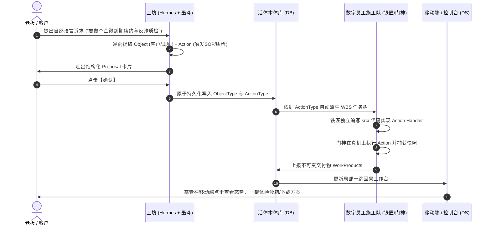

# Coolie 业务本体建设全景指导大纲与无限迭代工程法典
## (Living Operational Ontology Master Framework & Engineering Canon)

> **文档密级**：企业核心最高工程基准（终身受控）  
> **制定日期**：2026-10-07  
> **核心使命**：对标全球顶尖本体前沿（Palantir Foundry / Ant OpenSPG / TypeDB / W3C CCO），结合 Coolie 现有底层厚实积累，确立「以真实业务为中心、动静合一、代码咬合、支持无限迭代」的业务本体终极母大纲，彻底终结“概念空转、自嗨发散、丢了核心”的历史顽疾。

---

## 目录

1. [第一章：全球顶尖本体流派深度借鉴与 Coolie 的本质定位](#第一章全球顶尖本体流派深度借鉴与-coolie-的本质定位)
   - 1.1 传统学术语义网（RDF/OWL）的致命缺陷与工程破产
   - 1.2 Palantir Foundry 的杀手锏：可操作本体 (Operational Ontology) 与 O-L-A 范式
   - 1.3 蚂蚁集团 OpenSPG 与 TypeDB 的启示：强类型约束与 LLM 因果对齐
   - 1.4 Apache Ossie (Incubating) 的革命性贡献：三元解耦映射、自然语言口述 (Verbalization) 与强约束标量域 (ValueType)
   - 1.5 Semantica 的革命性贡献：因果决策智能、W3C PROV-O 证据链与 AI 问责制闭环
   - 1.6 Coolie 的终极定位：全球顶尖本体集大成之活体神经中枢
2. [第二章：Coolie 业务本体四层元大纲 (4-Tier Meta-Architecture)](#第二章coolie-业务本体四层元大纲-4-tier-meta-architecture)


   - 2.1 L1 领域自治层 (Domain & Bounded Context)
   - 2.2 L2 业务实体层 (Object Types & Property State Machines)
   - 2.3 L3 业务动词层 (Action Types & Code Handlers)
   - 2.4 L4 交付物与不可变证据层 (Deliverables & Work Products)
3. [第三章：新业务进厂与本体演进全生命周期闭环 (The Living Loop)](#第三章新业务进厂与本体演进全生命周期闭环-the-living-loop)
   - 3.1 阶段一：业务需求逆向提炼 (Extraction)
   - 3.2 阶段二：工坊交互提案与秒级落盘 (Proposal & Consensus)
   - 3.3 阶段三：WBS 任务强绑 Action 编码 (Contract Implementation)
   - 3.4 阶段四：真机四态断言与业务闭环验收 (DS Verification)
4. [第四章：两大标杆业务本体深耕实施范例 (Golden Case Studies)](#第四章两大标杆业务本体深耕实施范例-golden-case-studies)
   - 4.1 标杆 A：云南移动数智化企微运营平台（运营商电信级本体）
   - 4.2 标杆 B：九夏智居住宅收纳AI交付系统（空间设计级本体）
5. [第五章：支持无限迭代的五大防退化硬门禁 (Guards for Infinite Evolution)](#第五章支持无限迭代的五大防退化硬门禁-guards-for-infinite-evolution)
   - 5.1 门禁一：无 Action 不派单（任务准入硬拦截）
   - 5.2 门禁二：严禁外挂插件，代码必须归属业务独立仓库
   - 5.3 门禁三：移动端 6 寸屏去拓扑化，只做局部一跳因果工作台
   - 5.4 门禁四：生产环境假示例假数据物理清零
   - 5.5 门禁五：不可变版本链与演进血缘追踪

---

## 第一章：全球顶尖本体流派深度借鉴与 Coolie 的本质定位

### 1.1 传统学术语义网（RDF/OWL）的致命缺陷与工程破产
在 GitHub `topics/ontology` 下，大量项目属于传统学术型本体（基于 W3C RDF/RDFS/OWL、Protégé、SPARQL）：
* **致命缺陷**：**只管“是什么”（纯静态声明），不管“能干什么”（缺乏动作驱动）**。
* **工程灾难**：它把精力消耗在三元组（Subject-Predicate-Object）和复杂的形式化一阶谓词逻辑推理上，无法与企业关系型数据库、微服务 API 和现代前端交互直接咬合。企业花几百万元建了一堆 OWL 本体文件，最终只能当学术标本供着，在真实代码和日常生产中**完全无法运转，彻底沦为空转**。

### 1.2 Palantir Foundry 的杀手锏：可操作本体 (Operational Ontology) 与 O-L-A 范式
Palantir 之所以能拿下美国国防部、空中客车、BP、默克制药等巨头，核心在于它发明了 **Operational Ontology（可操作本体）**：
* **核心哲学**：本体不仅是**语义层 (Semantic)**，更是**动态层 (Kinetic)**。
* **O-L-A 经典三元闭环**：
  1. **Object Types (对象类型)**：定义现实世界实体（客户、飞机、订单、航班），映射到底层源数据；
  2. **Link Types (关联类型)**：定义对象之间的业务因果关系（客户拥有订单、飞机分配航班）；
  3. **Action Types (动作类型)**：**闭环的灵魂！** 它是被严格治理、带权限、带参数校验的业务动词（“批准折扣”、“调整航班”、“分派维修工”）。用户或 AI 只能通过 Action 改变系统状态，Action 触发后原子写回数据源并记录全量审计日志。
* **双向数据流通道**：OMS (元数据服务) 管模式，OSS (对象集服务) 管高并发读取，Funnel (数据漏斗) 管动作写回与策略门禁。

### 1.3 蚂蚁集团 OpenSPG 与 TypeDB 的启示：强类型约束与 LLM 因果对齐
* **Ant Group OpenSPG (语义增强可编程图)**：
  - 用严格的 Schema 约束大模型（LLM）的输入与输出，消灭 AI 幻觉；
  - 将大模型的统计概率能力与符号逻辑的规则（Rules/Predicates）结合，实现端到端的因果链路可追溯。
* **TypeDB (强类型超图本体数据库)**：
  - Schema 是数据库的第一公民，原生支持类型多态性（Polymorphic Inheritance）；
  - 杜绝传统弱类型属性图的散乱无章，任何实体和关系都必须服从严格的本体类型定义。

### 1.4 Apache Ossie (Incubating) 的革命性贡献：三元解耦映射、自然语言口述 (Verbalization) 与强约束标量域 (ValueType)
Apache Ossie（前身为 Snowflake、GoodData、Databricks 等联合发起的 **Open Semantic Interchange - OSI**，已捐赠至 Apache 软件基金会作为顶尖工业级语义交换标准）：
* **使命与背景**：专为跨 BI 引擎、数据湖仓与 **AI Agents** 建立厂商无关的“单一真实语义源 (Single Source of Truth)”，彻底终结同一个 KPI/指标在 dbt、Tableau、PowerBI 中各自定义导致的大模型胡言乱语与对齐灾难。
* **杀手锏一：自然语言活体口述标准 (`verbalizes`)**：
  - Ossie 规定每条概念关系（Relationship）必须显式附带 `verbalizes` 模版，例如：`verbalizes: [ "{Staff} serves {Customer}", "{Runway} belongs to {Airport}" ]`；
  - **对 AI Agent 的降维打击**：过去向大模型灌图数据，LLM 面对生硬的关系三元组或外键极易产生幻觉与歧义；Ossie 原生将因果关系转译为流利的自然语言业务命题，使得 AI 数字员工在 Prompt 组装与因果推理中天然对齐领域语义！
* **杀手锏二：业务概念与物理表的三元解耦映射 (`mapping.yaml`)**：
  - **`ontology.yaml`**（业务概念层：实体、角色、约束）；
  - **`semantic_model.yaml`**（物理数仓层：数据集、物理字段、聚合度量）；
  - **`mapping.yaml`**（解耦映射层：通过 `object_mappings` 与 `link_mappings` 树，将物理表字段无冗余投射到概念对象与关系）；
  - **重大工程启示**：企业业务模型与底层存储库表必须解耦！改变底层数据库字段绝不应破坏上层业务概念。
* **杀手锏三：带约束的强语义标量 (`ValueType` + `requires`)**：
  - 拒绝将业务字段弱化为纯 string/number，显式定义如 `BudgetAmount`（继承 Decimal，要求 `0 < BudgetAmount <= 150000`）、`PhoneNumberMask` 等，从源头消灭非法业务数据。
* **Coolie 的升维与超越 (Semantic Read vs Kinetic Action)**：
  - **Ossie 的边界**：Ossie 核心聚焦于**“语义只读与对齐标准”**（Semantic Read, Metrics & Agent Q&A），缺乏类似 Palantir Foundry 的**动态变更动作（Kinetic Actions）**；
  - **Coolie 的综合超越**：Coolie 汲取 Ossie 的 `verbalizes` 自然语言口述模版与三元解耦映射，与 Palantir 的可操作动作 (ActionTypes) 及不可变工作产物 (WorkProducts) 强力并轨，构筑出**“既能高保真自然语言口述推理，又能原子执行代码副作用”**的活体运行中枢！

### 1.5 Semantica 的革命性贡献：因果决策智能、W3C PROV-O 证据链与 AI 问责制闭环
Semantica（开源于 [github.com/semantica-agi/semantica](https://github.com/semantica-agi/semantica)，MIT License）：
* **使命与背景**：专为解决企业级大模型与自主智能体的**“问责制危机 (Accountability Crisis)”**而生。在金融、医疗、法律、电信等强合规行业，纯概率型大模型（RAG、Vector DB）无法自证“决策原因何在”（缺少“The Why”），极易被监管部门一票否决。Semantica 定位于大模型底座之下的“图原生上下文与决策问责层 (Graph-Native Context Layer)”。
* **杀手锏一：决策全生命周期智能 (`DecisionRecorder` & `CausalChainAnalyzer`)**：
  - **`Decision` 核心数据模型**：显式追踪决策 ID、类别、业务场景（Scenario）、推理链（Reasoning）、最终结果（Outcome）、置信度与决策人/Agent 角色；
  - **因果关系网络 (`add_causal_relationship`)**：显式对决策因果进行四态关系建模——`triggers` (触发), `enables` (赋能), `causes` (导致), `precedes` (前序)；
  - **双向因果链追踪 (`get_causal_chain`)**：支持上游前序根因回溯 (`upstream`) 与下游影响面穿透 (`downstream`)，并基于 Node2Vec 与混合图相似度进行“历史决策先例匹配 (`find_precedents`)”。
* **杀手锏二：国际标准 W3C PROV-O 不可变证据溯源 (`ProvenanceEntry`)**：
  - 全流程严格对标国际 W3C PROV-O 规范（`prov:Entity`, `prov:Activity`, `prov:Agent`, `prov:wasDerivedFrom`, `prov:used`, `prov:generatedAtTime`）；
  - 绑定源文档精确行/页/图表引用（`source_document`, `source_location`, `source_quote`）与 SHA-256 完整性指纹，并采用墓碑机制（`invalidated` tombstone）替代物理硬删除。
* **杀手锏三：确定性质量守卫与本体门禁 (`OntologyQualityGate`)**：
  - 坚决杜绝口头人工规范，在 CI/CD 中落地机器可读的质量门禁；
  - 对 Schema 违规、循环死锁、命名契约实施四级分级拦截 (`QualitySeverity`: INFO, WARNING, ERROR, CRITICAL)，超阈值硬性阻断构建！
* **杀手锏四：标准 MCP 协议服务化 (`semantica_mcp`)**：
  - 通过标准 Model Context Protocol 向 IDE 与 Agent 暴露 `record_decision`, `link_decisions`, `get_causal_chain`, `find_precedents` 等工具，零代码接通全生态。
* **Coolie 的升维与结合 (Semantica vs Coolie)**：
  - **生态互补**：Semantica 是纯 Python 的底层因果推理与 W3C 合规分析库；Coolie 是全栈企业级控制面（Node.js/Express + Expo 原生移动端 + Hermes PM 调度数字员工）；
  - **证据闭环升维**：Coolie 的 CMMI G1-G5 证据账本 (`issue_work_products`, SHA-256 指纹, Commit 证据链) 原生融合 W3C PROV-O 规范，赋予商业交付物国际法定义务的合规出海能力；
  - **因果交互升维**：Coolie 拒绝 Semantica 繁杂的桌面端全景大图，在 6 寸手机屏独创**【局部一跳因果工作台】**，让 Semantica 复杂的 `CausalChainAnalyzer` 降维转化为移动端单手即点即穿透的极致人机体验！

### 1.6 Coolie 的终极定位：全球顶尖本体集大成之活体神经中枢
融合全球五大前沿流派（Palantir O-L-A 动态可操作闭环 + Apache Ossie 三元解耦口述 + Semantica 决策因果与 W3C PROV-O 审计 + Ant OpenSPG/TypeDB 强类型规则），结合 Coolie 自身 `packages/ontology-core`（228KB 引擎、递归 CTE 影响分析、版本演化）的厚实底座，Coolie 的本体定位明确为：
> **「以真实业务对象为核心态势感知，以声明式解耦映射为底层底盘，以自然语言口述 (Verbalization) 为数字员工推理语言，以因果决策链与 W3C PROV-O 为合规不可变证据，以合法业务动词为代码控制闭环，以局部一跳因果为移动极简人机体验，由工坊大模型驱动数字员工自主施工的活体运行本体 (Living Operational Ontology)！」**


---

## 第二章：Coolie 业务本体四层元大纲 (4-Tier Meta-Architecture)

任何业务进入 Coolie，必须且只能严格按照以下四层结构进行定义和演进，**多一层是冗余，少一层是半成品**：

```
┌────────────────────────────────────────────────────────────────────────┐
│ L1: 领域自治层 (Domain)                                                │
│     每个商业项目 = 一个独立自治的业务本体域 (如: yunnan-mobile-wecom)     │
├────────────────────────────────────────────────────────────────────────┤
│ L2: 业务实体层 (Object Types)                                          │
│     业务里的“核心名词”，带强类型属性、状态机枚举与生命周期              │
│     [实例: 客户 / 导购 / 户型图 / 空间分区]                           │
├────────────────────────────────────────────────────────────────────────┤
│ L3: 业务动词层 (Action Types)                                          │
│     业务里的“合法动词”，改变 Object 状态的唯一通路，强绑代码 API Handler │
│     [实例: 分配导购 / 触发续约SOP / 拦截敏感词 / 渲染3D沙箱]            │
├────────────────────────────────────────────────────────────────────────┤
│ L4: 交付物与凭证层 (Deliverables / Work Products)                      │
│     Action 产生的不可变物理结果，供高管审阅、客户使用、真机验收        │
│     [实例: PDF深化册 / 3D交互沙箱 / 测试报告 / 部署基线]                │
└────────────────────────────────────────────────────────────────────────┘
```

### 2.1 L1 领域自治层 (Domain & Bounded Context)
* **硬性约束**：每个商业交付项目对应一个独立的 `Domain`（`domain_id`），数据与权限物理隔离；
* **严禁全局大杂烩**：云南移动的实体绝不能和九夏智居的实体混在一个命名空间，领域边界即项目边界；
* **物理表**：`plugin_ontology_domains`（包含 `slug`, `display_name`, `category`, `lifecycle_state`）。

### 2.2 L2 业务实体层 (Object Types, Value Types & AI Verbalization)
* **本质**：客户现实世界的数字孪生（Digital Twin）；
* **五大必备要素**（对标 Apache Ossie & Palantir）：
  1. **标识契约 (Key & Identification)**：全局唯一命名（如 `wecom_customer`、`floor_plan`），复合标识须遵循 `identify_by` 显式列出；
  2. **强语义标量类型 (Value Types & Requires)**：拒绝将属性弱化为裸 string/number，对业务关键字段（如 `BudgetCeiling`、`PhoneMask`、`SopCode`）定义带 `requires` 范围约束的值类型；
  3. **实体状态机 (State Machine)**：定义该实体的合法生命周期状态（如：`待确认` ➔ `已深化` ➔ `已交付`）；
  4. **数字员工活体口述契约 (AI Verbalization Pattern)**：学习 Apache Ossie，每条 Link 必须声明自然语言双向口述模版（如：`verbalizes: ["{网格导购员} 服务 {企微客户}"]`），在 Hermes 组装 Prompt 与下发工单时无歧义输出领域语言；
  5. **263 物理底表声明式解耦映射 (Decoupled Mapping)**：活体实体不等于裸数据表。通过声明式映射将已有的 263 张物理底表字段投射到 L2 业务实体，杜绝由于业务迭代随意扩表！
* **物理表**：`ontology_node_types`、`ontology_nodes` 与 `ontology_edges`。


### 2.3 L3 业务动词层 (Action Types & Code Handlers)
* **本质**：系统的控制手柄与业务逻辑封装；
* **四大必备要素**：
  1. **输入参数契约 (Input Schema)**：调用该动作必须传入的字段；
  2. **前置条件断言 (Pre-conditions)**：只有处于某种状态的 Object 才能执行此 Action；
  3. **状态跃迁副作用 (Side Effects)**：动作执行成功后，哪个 Object 的哪个属性/状态发生跃迁；
  4. **代码绑定 (Handler Binding)**：显式指向工程源码中的具体服务或接口路由（如 `src/services/sop.ts::pushSopCard`）；
* **物理表**：`ontology_action_types`。

### 2.4 L4 交付物与不可变证据层 (Deliverables & W3C PROV-O Work Products)
* **本质**：交付给客户或高管的确定性物理成果与不可篡改合规审计凭证；
* **规范**（深度融合 Semantica W3C PROV-O 国际标准）：
  1. **不可变指纹**：每个 Action 执行后，必须产出带 SHA-256 完整性校验和的物理产物，持久化挂载至 `issue_work_products`；
  2. **W3C PROV-O 证据血缘映射**：
     - `prov:Entity`：交付物自身（PDF方案册 / 3D孪生沙箱 / 测试快照）；
     - `prov:wasGeneratedBy`：触发该产物的 ActionType 契约与 WBS Task ID；
     - `prov:wasAttributedTo`：施工员工（墨斗/铁匠/门神）或操作人；
     - `prov:wasDerivedFrom`：上游源文件（文彬户型CAD图纸、移动千兆资费标准）；
  3. **审计与合规防护**：杜绝物理硬删，采用软失效（tombstone）与不可变版本链，彻底解决 AI 系统的问责制危机（Accountability Crisis）；
* **呈现**：在手机端与 Web 端通过【产物交付中心】（下载）与【原型沙箱】（体验）就地呈现。


---

## 第三章：新业务进厂与本体演进全生命周期闭环 (The Living Loop)



### 3.1 阶段一：业务需求逆向提炼 (Extraction)
* 产品总监 (Hermes) 与前线架构师 (墨斗) 接收客户标书或输入（图纸、文档、一句话需求）；
* 坚决不直接派盲目工单，而是提炼出**候选业务实体**与**候选业务动词**。

### 3.2 阶段二：工坊交互提案与秒级落盘 (Proposal & Consensus)
* 工坊拒绝像普通聊天机器人那样输出长篇无用文字；
* 工坊通过标准卡片渲染 `Proposal`：清晰列出拟增补的实体字段与动作接口；
* 高管两字确认【落盘】，直接调用 `PostgresGraphStore` 写入本体库。

### 3.3 阶段三：WBS 任务强绑 Action 编码 (Contract Implementation)
* 每一个派发给铁匠 (Core SWE) 的开发任务，标题必须规范为：`[开发] 实现 Action: <ActionKey>`；
* 代码必须写在该项目独立的 `src/` 目录中，代码即该 Action 的真正 Handler。

### 3.4 阶段四：真机四态断言与业务闭环验收 (DS Verification)
* 门神 (FDSE) 与百晓生 (DS) 针对该 Action 进行验收；
* 验证标准：**触发 Action ➔ 验证 Object 状态改变 ➔ 沉淀真实真机快照与不可变文件**。

---

## 第四章：两大标杆业务本体深耕实施范例 (Golden Case Studies)

### 4.1 标杆 A：云南移动数智化企微运营平台（运营商电信级本体）

#### 1. 业务对象定义 (Object Types)
* **`Staff` (网格导购员)**
  - 属性：`staffNo` (工号), `name` (姓名), `gridName` (所属网格), `activeCustomers` (服务客户数), `satisfaction` (满意度);
  - 状态：`在岗 (active)` / `离岗 (off_duty)`.
* **`WeComCustomer` (企微高价值客户)**
  - 属性：`phoneMask` (脱敏手机号), `arpu` (月均消费), `broadbandExpiry` (到期日), `riskLevel` (流失风险);
  - 状态：`正常 (normal)` ➔ `到期预警 (expiring)` ➔ `跟进中 (following)` ➔ `已续约 (renewed)`.
* **`SopCampaign` (触达营销方案)**
  - 属性：`sopCode` (方案编号), `coupon` (权益包), `targetConversion` (目标转化率);
  - 状态：`生效中 (active)` / `已结束 (closed)`.
* **`AuditLog` (反诈与合规质检)**
  - 属性：`interceptedWords` (命中违规词), `riskScore` (风险值), `auditStatus` (拦截通过/违规阻断).

#### 2. 业务动词定义 (Action Types)
* **`AssignCustomerByGrid` (智能分流网格导购)**
  - 前置条件：Customer 处于 `到期预警`；
  - 副作用：Customer 的 `assignedStaffId` 绑定对应导购，状态跃迁为 `跟进中`；
  - 代码绑定：`src/services/wecom-sync.ts::assignCustomer()`.
* **`PushRenewalSopCard` (下发千兆续约卡片)**
  - 前置条件：Customer 处于 `跟进中`；
  - 副作用：生成一条触达会话，记录下发时间；
  - 代码绑定：`src/services/sop-router.ts::pushSop()`.
* **`InspectSensitiveViolation` (反诈违规拦截质检)**
  - 前置条件：导购员与客户发生会话；
  - 副作用：若包含违规承诺，实时拦截消息并生成 `AuditLog`，向网格长告警；
  - 代码绑定：`src/services/anti-fraud.ts::inspect()`.

#### 3. 活体口述契约 (AI Verbalization Patterns · 对标 Ossie)
* **`serves_customer`**:
  `verbalizes: ["{Staff} 专席服务 {WeComCustomer}", "{WeComCustomer} 由 {Staff} 负责企微触达"]`
* **`matched_by_rule`**:
  `verbalizes: ["{WeComCustomer} 命中智能分流规则 {SmartRoutingRule}"]`
* **`dispatches_sop`**:
  `verbalizes: ["{SmartRoutingRule} 自动触发下发营销方案 {SopCampaign}"]`
* **`monitored_by_compliance`**:
  `verbalizes: ["{SopCampaign} 会话交互受反诈质检审计 {AuditLog} 实时监管"]`
* **`reconciled_with_boss`**:
  `verbalizes: ["{WeComCustomer} 宽带资产与业务支撑网 {BossBillingSync} 实时对齐"]`

#### 4. 强语义标量类型 (Value Types & Requires)
* **`PhoneMask`**: `type: ValueType, extends: [String], requires: ["REGEXP_LIKE(PhoneMask, '^1[3-9][0-9]\\*\\*\\*\\*[0-9]{4}$')"]` (电信级脱敏掩码防泄漏)
* **`ARPU`**: `type: ValueType, extends: [Decimal], requires: ["ARPU >= 0"]` (客户月均消费)

---


### 4.2 标杆 B：九夏智居住宅收纳AI交付系统（空间设计级本体）

#### 1. 业务对象定义 (Object Types)
* **`FloorPlan` (建筑户型空间)**
  - 属性：`areaSqm` (套内面积), `height` (层高), `bearingWalls` (承重墙位置), `plumbingPipes` (管井位);
  - 状态：`原始图纸 (raw)` ➔ `空间解析完成 (parsed)`.
* **`ResidentProfile` (居住者画像)**
  - 属性：`occupants` (人口结构), `pets` (宠物习性), `workHabits` (双屏居家办公), `budgetCeiling` (15万上限).
* **`RoomZone` (功能空间分区)**
  - 属性：`zoneName` (玄关/书房/公卫), `area` (面积), `wetDryRatio` (干湿分离度);
  - 状态：`待布局 (pending)` ➔ `已确认 (confirmed)`.
* **`StorageCabinet` (定制收纳矩阵)**
  - 属性：`cabinetType` (鞋柜/餐边柜/书架), `dimensions` (宽宽高), `hiddenRatio` (80%隐藏+20%展示);
  - 状态：`空间规划 (draft)` ➔ `结构深化完成 (deepened)`.
* **`ProposalDossier` (双模态交付物包)**
  - 属性：`pdfFile` (9页A3施工深化册), `htmlSandbox` (3D交互设计室), `version` (V01);
  - 状态：`已生成 (ready)` ➔ `业主会签通过 (signed)`.

#### 2. 业务动词定义 (Action Types)
* **`ParseSpatialGeometry` (解析户型几何与不可拆改边界)**
  - 代码绑定：`src/generator.mjs::validateInputs()`.
* **`SynthesizeLivingZones` (生活画像与功能分区对齐)**
  - 代码绑定：`src/generator.mjs::synthesizeSpaceModel()`.
* **`DeepenStorageMatrix` (收纳矩阵毫米级深度设计与预算复核)**
  - 代码绑定：`src/generator.mjs::deepenStorage()`.
* **`RenderDualDeliverables` (一键编译输出 PDF 方案册与 3D 沙箱)**
  - 代码绑定：`src/generator.mjs::ensureDeliverables()`.

#### 3. 活体口述契约 (AI Verbalization Patterns · 对标 Ossie)
* **`profiles_living`**:
  `verbalizes: ["{FloorPlan} 测绘空间承载生活画像 {ResidentProfile}"]`
* **`allocates_zone`**:
  `verbalizes: ["{ResidentProfile} 生活画像规划划分功能生活区 {RoomZone}"]`
* **`embeds_cabinet`**:
  `verbalizes: ["{RoomZone} 空间分区量体嵌入高定收纳矩阵 {StorageCabinet}"]`
* **`synthesizes_package`**:
  `verbalizes: ["{StorageCabinet} 定制收纳矩阵综合编译为双模态交付物包 {ProposalDossier}"]`

#### 4. 强语义标量类型 (Value Types & Requires)
* **`BudgetCeiling`**: `type: ValueType, extends: [Decimal], requires: ["0 < BudgetCeiling", "BudgetCeiling <= 150000"]` (硬顶15万预算红线约束)
* **`AreaSqm`**: `type: ValueType, extends: [Decimal], requires: ["AreaSqm > 0"]` (套内测绘面积)
* **`HiddenRatio`**: `type: ValueType, extends: [Decimal], requires: ["HiddenRatio >= 0.7", "HiddenRatio <= 0.9"]` (收纳二八原则约束: 70%~90%隐藏)

---


## 第五章：支持无限迭代的五大防退化硬门禁 (Guards for Infinite Evolution)

为了确保这套大纲在未来的几百个任务、几十次迭代中**永远不分叉、永远不丢核心**，全系统强制执行以下五大物理硬门禁：

```
[无限迭代五大硬门禁 (Five Immutable Guards)]
├─ 1. 无 Action 不派单门禁 ─── 任何任务标题必须带 [开发] 实现 Action: xxx，违者编译器直接驳回
├─ 2. 代码独立性门禁 ────────── 必须写在独立项目 src/ 目录下，严禁做成任何平台的 plugin
├─ 3. 移动端去拓扑化门禁 ────── 坚决不画全景伪图谱，只做以实体为中心的“局部一跳因果工作台”
├─ 4. 生产环境纯粹性门禁 ────── 严禁遗留任何 demo/coffee 假数据，大盘必须 100% 对应真实商业项目
└─ 5. 不可变版本链门禁 ──────── 每次本体演进必生成原子 Proposal 与快照，支持无损秒级回滚
```

### 5.1 门禁一：无 Action 不派单（任务准入硬拦截）
* 平台自动化调度总线（`Runner Bridge`）强制校验：
  - 派发给 Core SWE 的代码任务，其元数据中必须包含合法的 `action_type_id`；
  - 若任务脱离本体动作，系统直接判定为“非法野任务”，拒绝生成派单 Receipt！

### 5.2 门禁二：严禁外挂插件，代码必须归属业务独立仓库
* 任何新项目的代码必须存放于 `/host-workspace/<project-name>/src`；
* 根目录标配独立 `Dockerfile` 与 `package.json`/`pom.xml`；
* 严禁在 Coolie 自身的 `packages/plugins/` 下建立业务项目，确保交付物具备 100% 脱机独立运行能力。

### 5.3 门禁三：移动端 6 寸屏去拓扑化，只做局部一跳因果工作台
* 彻底拔除 APP 端那个无用的文字假图谱抽屉；
* 统一采用人机工程学最高标准：**点击具体实体 ➔ 展开【上游输入 ➔ 实体状态 ➔ 合法动作 ➔ 下游交付物】局部一跳态势卡片**。
* 每一跳均可点击穿透，实现“单手盲操、即点即用”。

### 5.4 门禁四：生产环境假示例假数据物理清零
* 生产数据库 `plugin_ontology_domains` 严禁出现测试或样例数据；
* 必须保持大盘只呈现真实商业客户项目，保证高管看到的每一个指标都具备法律与商业实效。

### 5.5 门禁五：不可变版本链与演进血缘追踪
* 本体每一次变更（增删字段、调整规则），必须由工坊 Hermes 生成版本号自增的 Proposal（V1 ➔ V2）；
* 历史版本的快照持久化锁定，保证任何历史交付的代码和文档均可精确回溯至当时的本体状态。

---

> **结语**：  
> 本体不是抽象的文字游戏，本体是**现实世界的数字活体投影与业务动作的控制中枢**。  
> 守住本大纲的四层元架构与五大硬门禁，Coolie 就能在未来的无限迭代中，如磐石般扎实向前，做深做透，永不迷航！
