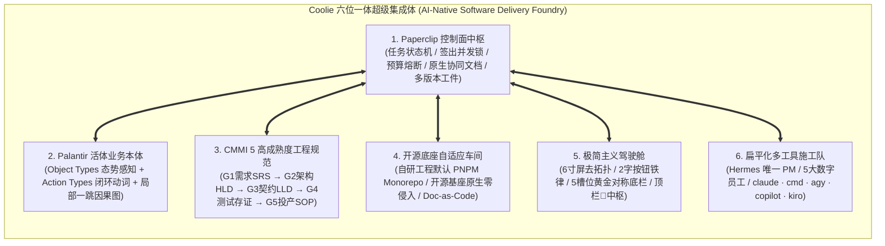

# Coolie 六位一体超级集成体白皮书与总架构师综合纲领
# (Coolie Integrated Super-Foundry Architecture & Master Synthesis)

> **发布日期**: 2026-10-08  
> **制定版本**: wave366  
> **指导思想**: 老板核心指示 —— 「我希望是继承 Paperclip 能力，别丢主线真实能力；咱们新建的目录方案不一定对，新建功能时候，视角也要同时站在 Paperclip 总产品架构师吧。视角要继续汇总沉淀啊，咱们现在是个集成体。」

---

## 目录
- [一、 战略定性：Coolie 是怎样的“集成体”？](#一-战略定性coolie-是怎样的集成体)
- [二、 六维合一：超级集成体的全景架构解析](#二-六维合一超级集成体的全景架构解析)
  - [1. 控制面中枢：Paperclip 原生骨干能力（神经系统）](#1-控制面中枢paperclip-原生骨干能力神经系统)
  - [2. 认知与决策：Palantir 活体业务本体（大脑与灵魂）](#2-认知与决策palantir-活体业务本体大脑与灵魂)
  - [3. 过程与质量：CMMI 5 高成熟度工程规范（工业级守卫）](#3-过程与质量cmmi-5-高成熟度工程规范工业级守卫)
  - [4. 底座与工程：开源基座自适应与全栈 Monorepo（制造车间）](#4-底座与工程开源基座自适应与全栈-monorepo制造车间)
  - [5. 人机与交互：极简主义驾驶舱与前线人机工程学（掌柜仪表盘）](#5-人机与交互极简主义驾驶舱与前线人机工程学掌柜仪表盘)
  - [6. 调度与算力：扁平化 AI 数字员工施工队（全天候生产力）](#6-调度与算力扁平化-ai-数字员工施工队全天候生产力)
- [三、 历史盲区反思：纠正“单机脚本孤岛”与“偏离控制面主线”](#三-历史盲区反思纠正单机脚本孤岛与偏离控制面主线)
- [四、 双轨闭环体系：Paperclip 原生实体与工作区工程映射](#四-双轨闭环体系paperclip-原生实体与工作区工程映射)
- [五、 AI 员工的四大合一顶层审视视角矩阵](#五-ai-员工的四大合一顶层审视视角矩阵)
- [六、 结语与演进路线](#六-结语与演进路线)

---

## 一、 战略定性：Coolie 是怎样的“集成体”？

过去，业内存在几类典型孤岛系统：
1. **纯智能体看板（如 Jira/Trello/裸 Paperclip）**：虽然有任务流转和 Agent 签出，但缺乏业务本体，AI 很容易沦为“只改代码、不通业务业务规则”的技术打工仔；
2. **纯企业级本体平台（如 Palantir Foundry）**：本体图谱强大，但缺乏面向 AI Agent 的全自主调度控制面、预算硬熔断与多工具池支持；
3. **传统外包工程体系（如传统 CMMI）**：文档繁琐、假套话连篇、无法直接映射到代码，缺乏 Spec-First 的自动化门禁；
4. **单点 AI 编程助手（如单机 Cursor/Claude Code/Agy）**：虽然编码快，但在多智能体协作、云端协同审阅、不可变证据归档上完全是断层的。

**Coolie 的本质是一个“超级集成体 (Integrated Super-Foundry)”**。
它不是简单的代码拼凑，而是以 **Paperclip 控制面为脊梁骨**，融合 **Palantir 活体本体**、**CMMI 5 质量门禁**、**开源基座生态**、**极简驾驶舱** 与 **扁平化多工具施工队** 的工业化软件交付工厂。



---

## 二、 六维合一：超级集成体的全景架构解析

### 1. 控制面中枢：Paperclip 原生骨干能力（神经系统）
我们绝不重造 Paperclip 已经拥有的第一公民资产，而是 100% 榨干其主线能力：
- **单一负责人与原子签出（Single-Assignee & Atomic Checkout）**：
  基于数据库级互斥锁与 `expectedStatuses` 校验，杜绝双 Agent 撞车；
- **真实预算熔断与暂停（Budget Hard-Stop）**：
  公司/Agent 级 Token 预算监控，超额即物理挂起，避免成本失控；
- **原生协同文档引擎（Documents & Issue Documents）**：
  利用 `documents`、`issue_documents`、`document_revisions` 实现多版本管理与全文搜索。
- **划线多模态批注（Annotation Threads）**：
  高管可以在 Web/移动端对需求规格或设计草案的任意段落划线留评，Agent 下个 Heartbeat 自动针对性修改；
- **不可变远端交付工件（Work Products & Deliverables）**：
  测试快照、测试视频（`.mp4`/`.webm`）通过 `register_deliverable` 归档为持久化 Attachment，沙箱即使销毁，高管与客户随时可在 Artifacts 抽屉查阅。

### 2. 认知与决策：Palantir 活体业务本体（大脑与灵魂）
- **业务双核**：
  - **Object Types**：现实世界实体的数字孪生，反映业务真实态势（客户、订单、板材、柜体、资金）；
  - **Action Types**：合法的业务动词与状态转移（【审批】、【扣款】、【排产】、【发布】）；
- **三大物理并轨契约**：
  - **项目进厂即本体域 (Project as Domain)**：立项原子生成 Domain，彻底消灭没有本体的裸项目；
  - **工坊会话即本体演进 (Conversation as Proposal)**：会话产生的想法由 Hermes 提炼为结构化 Proposal 卡片，两字确认即落盘；
  - **任务施工挂契约血缘 (Task as Action Execution & Provenance)**：WBS 任务强绑 ActionType，提交证据直接附着在本体对象上。

### 3. 过程与质量：CMMI 5 高成熟度工程规范（工业级守卫）
- **CMMI 0-1 软件工程资产全生命周期**：
  - G1 需求阶段：SRS 需求规格说明书与 RTM 追踪矩阵；
  - G2 架构阶段：HLD 概要设计与 DAR 加权方案选型表；
  - G3 详细设计：LLD 详细设计与 OpenAPI/Schema 静态契约，强制 0 编译报错；
  - G4 验收阶段：真机四态快照、端侧录屏存证与系统集成测试报告；
  - G5 投产阶段：生产制品全局唯一版本指纹与秒级回滚 SOP；
  - CMMI 5 度量：SPC 统计过程控制与 CAR 因果分析缺陷预防。
- **任务流转铁律：无物理交付物严禁结项 (No Artifact, No Done)**：
  凡结项时未挂载有效工程资产者，控制面强制阻断，消灭虚假完工。

### 4. 底座与工程：开源基座自适应与全栈 Monorepo（制造车间）
- **绝不闭门造车，尊重成熟生态**：
  - **自研全栈项目**：默认采用 **PNPM workspace monorepo**，与 Paperclip 官方工程哲学天然同构；
  - **开源基座（RuoYi 微服务、Semantica、Django、Next.js）**：
    100% 保持基座原生目录结构，通过 Paperclip 原生 `project_workspaces` 干净挂载；
    通过 `issue_work_products` 的 `resourceRef: { kind: "workspace_file" }` 建立双向血缘映射，**绝对严禁强行更改开源基座的代码结构，绝对严禁暴力污染开源基座**。

### 5. 人机与交互：极简主义驾驶舱与前线人机工程学（掌柜仪表盘）
- **移动端 6 寸屏去拓扑化**：
  手机屏杜绝复杂的全景网状图，提供业务对象中心的“局部一跳因果卡片流 (Local 1-Hop Chain)”；
- **两字按钮铁律**：
  核心操作收敛为纯 2 汉字（【创建】、【查看】、【沙箱】、【确认】、【放弃】、【发布】）；
- **5 槽位绝对对称底栏**：
  `[汇览] [任务] [+] [工坊] [资产]` 黄金对称，零重复入口，收件箱审批统一由顶栏 🔔 统领；
- **就地无感抽屉 (Inspect In-Place)**：
  全局详情层顶层覆盖，绝不跨 Tab 乱跳底栏，严格保持 LIFO 调用栈完整。

### 6. 调度与算力：扁平化 AI 数字员工施工队（全天候生产力）
- **Hermes 唯一 PM 总指挥**：
  下辖 5 大数字员工（墨斗-架构、铁匠-全栈、门神-测试、兑底渊-战略验收、百晓生-投产发布）；
- **后台免交互最大授权**：
  通过标准 ACP (Agent Client Protocol) 协议栈驱动底层工具池（`claude`, `cmd`, `agy`, `copilot`, `kiro-cli`），具备 `--yolo` 与 `--dangerously-skip-permissions` 最大自主权，彻底消灭管道挂起死锁。

---

## 三、 历史盲区反思：纠正“单机脚本孤岛”与“偏离控制面主线”

在前期探索中，我们曾设定“在本地磁盘强制创建 `.coolie/cmmi/01-srs.md` 等文件”的规则。站在 **Paperclip 总产品架构师** 的高度复盘，这个做法暴露了典型的局部盲区：

1. **沦为“本地磁盘孤岛”**：
   Paperclip 的设计初衷是支持云端沙箱（Daytona、远程 Docker 容器）执行。如果文件只写在 Agent 本地磁盘，一旦沙箱被销毁，控制面（Web/移动端）上的高管和客户根本看不见这些文档；
2. **侵入并污染客户现有代码库**：
   当客户接入已有成熟项目（如 RuoYi 微服务底座），强行在其 Git 根目录下创建非标准的 `.coolie/` 目录并提交，破坏了开源基座的代码整洁度；
3. **把 Paperclip 最值钱的交互与治理闭环丢了**：
   磁盘上的死 Markdown 文件无法享受 Paperclip 原生的 **文档多版本 Diff、划线批注讨论、Approval Gate 门禁流转与 Artifacts 侧边抽屉**。

**纠偏原则**：
**过程资产的第一真理来源永远是 Paperclip 控制面实体（Document / WorkProduct / Attachment）！**
工作区磁盘文件只是落盘实现或 Doc-as-Code 的载体之一，绝不可本末倒置。

---

## 四、 双轨闭环体系：Paperclip 原生实体与工作区工程映射

为了既完整继承 Paperclip 原生能力，又满足商业交付的严密质量规范，Coolie 确立以下**双轨闭环规范**：

```
                ┌───────────────────────────────────────────────┐
                │          Paperclip 原生控制面 (第一公民)        │
                ├───────────────────────────────────────────────┤
                │  • issue_documents (key: "plan", "srs", ...)  │
                │  • issue_work_products (多版本/review_state)   │
                │  • issue_attachments (不可变截图/录屏/二进制)  │
                └──────────────────────┬────────────────────────┘
                                       │ 双向血缘映射
                                       │ (resourceRef)
                ┌──────────────────────▼────────────────────────┐
                │          用户代码工作区 (自研 / 开源基座)       │
                ├───────────────────────────────────────────────┤
                │  • 自研全栈: 默认 PNPM Workspace Monorepo     │
                │  • 开源基座: 100% 保持基座原生架构 (零侵入)   │
                │  • Doc-as-Code (可选): 工程内部标准 docs/ 路径 │
                └───────────────────────────────────────────────┘
```

1. **需求与设计规格（SRS/HLD/LLD）**：
   - **首要动作**：在控制面调用 Paperclip 原生文档接口，挂载为 `issue_documents`（`key: "srs"` / `key: "hld"` / `key: "lld"`）；
   - **高管体验**：Web/移动端任务详情中直接打开 Document 面板，支持版本历史对比与逐行划线批注；
   - **代码映射（可选）**：若项目开启 Doc-as-Code，Agent 将其写入工程标准路径（如 `docs/`），并通过 `issue_work_products` 登记 `resourceRef: { kind: "workspace_file", relativePath: "..." }`。
2. **测试证据与产物（Test Snapshot / Video / Build Artifact）**：
   - **唯一标准**：100% 通过 `register_deliverable` 或 `paperclip-upload-artifact.sh` 上传为持久化附件；
   - **高管体验**：自动点亮任务的 **Artifacts 标签页**，离线可看、销毁不丢。
3. **开源基座代码治理**：
   - 尊重基座规范（Maven `pom.xml`、Gradle、Pipfile、package.json 等），不随意改变包结构；
   - 依赖 Paperclip 的 Workspaces 管理多 Repo，保持基座纯粹。

---

## 五、 AI 员工的四大合一顶层审视视角矩阵

在 Coolie 超级集成体中，所有 AI 员工（或人类开发者）在接到任何“修 Bug”、“加功能”或“立项交付”指令时，必须在内心同时运行以下**四大视角**：

| 视角维度 | 核心角色代表 | 灵魂拷问与审视准则 |
| :--- | :--- | :--- |
| **视角一：Paperclip 总产品架构师** | Upstream Chief Architect | - 这个功能是否继承了 Paperclip 的控制面主线？<br/>- 是否使用了原生 Document、Work Product、Attachment 实体？<br/>- 是否存在造孤岛轮子、绕过控制面直接写死本地磁盘的低级错误？ |
| **视角二：Palantir 活体本体架构师** | Palantir Foundry Lead | - 破坏了哪个现实世界的「业务实体 (Object)」或「合法动词 (Action)」？<br/>- 是否消灭了两张皮空转？项目是否原子绑定了本体域？任务是否有清晰的 Action 血缘？ |
| **视角三：CMMI 5 质量与交付总监** | Delivery & Quality Director | - 从 0 到 1 的软件工程交付物全不全？<br/>- 是否严格遵守了“No Artifact, No Done”？<br/>- 是否有自动化门禁与真机四态不可变存证？ |
| **视角四：极简人机产品总监** | Frontline Ergonomics Lead | - 手机 6 寸屏上能否单手盲操？是否收敛到了两字按钮？<br/>- 是否保持了 5 槽位绝对对称？是否破坏了就地无感抽屉与 LIFO 调用栈？ |

---

## 六、 结语与演进路线

Coolie 从来不是一个孤立的下游魔改版，而是**智能体时代商业软件交付体系的集大成者**。

通过把 Paperclip 控制面、Palantir 活体本体、CMMI 5 过程质量、开源基座生态与极简人机工程学融为一体，我们正在构筑的是一座真正能够全自动自举、全自主生产、交付高可靠工业级商业软件的**超级交付工厂**！

后续所有代码演进、规范制定与数字员工派单，均以此白皮书为最高行动纲领与终极基线。
