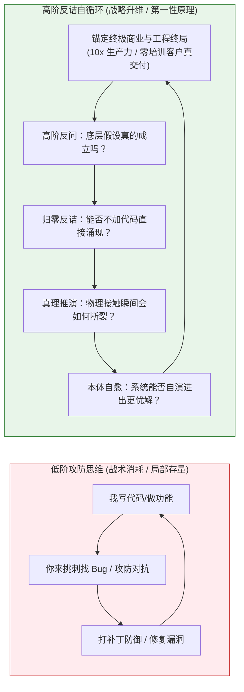
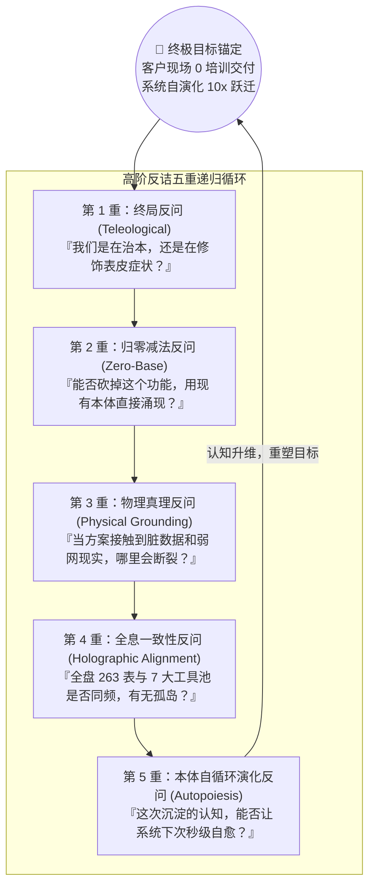
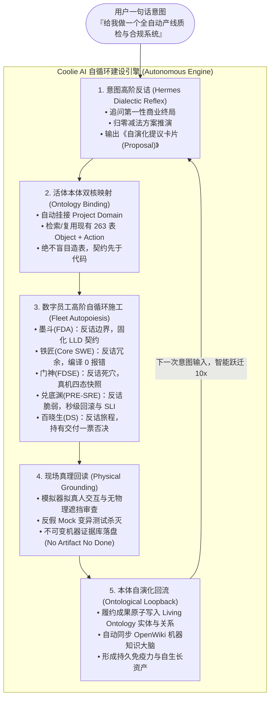

# 高阶反诘与 AI 自循环建设引擎：从低阶攻防到超想象产品自生长
# (High-Order Socratic Dialectic & Autonomous Self-Constructing Foundry)

> **核心哲学**：  
> **互搏思维绝非红蓝攻防的局部消耗，而是为了终极目标而发起的「高阶反问 (High-Order Socratic Dialectic)」。**  
> 攻防是存量挑刺与自我证明；高阶反问是从终局出发、推翻平庸妥协、击碎认知舒适区的第一性原理终极追问。  
> 建立自循环反问链，让 AI 摆脱机械流水线的平庸产出，自我推演、自我否定、自我升维，自循环建造出远超想象的商业交付工厂与活体系统。

---

## 一、 认知升维：为什么“互搏”不是攻防，而是“高阶反问”？

在传统的研发与安全体系中，“互搏”常被窄化为**红蓝对抗（Red vs. Blue Attack/Defense）**。这种模式存在致命的结构性瓶颈：

| 维度 | 低阶攻防思维 (Combat & Defense) | 高阶反诘思维 (Socratic Dialectic & Autopoiesis) |
| :--- | :--- | :--- |
| **思考原点** | “你怎么证明你没错？” / “看我怎么破你的防” | **“为了达成颠覆性的终极目标，我们当前被哪些隐性假设绑架了？”** |
| **关注焦点** | 局部的语法 Bug、注入漏洞、偶发异常、单点参数校验 | **系统本质、商业价值、极简减法、物理真实、自演进生命力** |
| **最终产物** | 一堆打满 `try-catch` 和防御性补丁的臃肿代码 | **极致凝练、直击现场、以本体驱动、具备自我造血演进能力的超预期产品** |
| **系统演化** | 熵增严重，系统越来越沉重，维护者疲于奔命 | **负熵自循环，每一次反问都在做减法，系统越跑越轻盈、越进化越聪明** |

---

## 二、 高阶反问五重递归链 (The 5-Order Interrogation Loop)

为了让 AI 数字员工（Hermes、墨斗、铁匠、门神、兑底渊、百晓生）在没有任何人类催促的情况下自驱动运转，必须在元认知层（Meta-Cognitive Layer）固化**五重递归反问链**：

### 1. 第一重：终局反问 (Teleological Interrogation) —— “为什么要做？终极商业闭环是什么？”
- **反诘靶心**：警惕“为了做功能而做功能”的机械接单。
- **自省追问**：
  - “客户老板要这个功能的终极诉求到底是什么？是算清一本账，还是卡住合规风险，还是提升前线流转速度？”
  - “如果我是现场掌柜，我需要看这 10 个报表图表，还是只需要 1 个风险警报和 1 个审批按钮？”
  - “我们现在的方案，是在让客户陷入新的使用负担，还是真正帮他彻底甩掉包袱？”

### 2. 第二重：归零减法反问 (Zero-Base & Subtractive Interrogation) —— “为什么不能砍掉？能否不写代码？”
- **反诘靶心**：警惕工程师“造轮子与加代码”的本能冲动。
- **自省追问**：
  - “这个需求，现有 263 张物理表、现有本体里的哪个 `Object` 和哪个 `ActionType` 已经能承载？”
  - “能不能不写一行前端新组件，直接用工坊通用的 Proposal 卡片和极简两字确认解决？”
  - “最牛逼的架构不是加无可加，而是减无可减。如果把这个模块砍掉 80%，剩下的 20% 能否释放 100% 的商业价值？”

### 3. 第三重：物理真理反问 (Physical Grounding Interrogation) —— “真实世界会怎样将这个方案撕碎？”
- **反诘靶心**：警惕脱离现场的“实验室自嗨与完美假象”。
- **自省追问**：
  - “我们假设网络永不断线、Token 永远充足、输入永远规范，但真实甲方现场是弱网、并发拥堵、乱点乱按。接触地面的一瞬间它会崩在哪？”
  - “6 寸手机屏幕上，单手拿着安全帽的前线工人，拇指真的能精准点到这个区域吗？键盘弹起时核心内容会不会被遮挡？”
  - “这个测试用例全绿，是因为代码完美，还是因为测试在配合代码演戏（假 Mock）？真实的生产脏数据灌进去会发生什么？”

### 4. 第四重：全息一致性反问 (Holographic Alignment Interrogation) —— “牵一发而动全身了吗？有无自嗨孤岛？”
- **反诘靶心**：警惕各模块各自为政、移植代码未对接的“烂尾孤岛”。
- **自省追问**：
  - “我们在某个插件或 UI 上改动了一个概念，数据库、共享契约（`packages/shared`）、控制面路由、MCP 协议网关、移动端 APP 知道吗？”
  - “这套代码是不是又造了一套私有的 `employee`，而没有接入 Paperclip 原生的单人原子签出、执行总线与真实 `Agent` 舰队？”
  - “系统内部是否还藏着私开 HTTP 客户端直连外部、绕过财务预算硬停机制的灰色后门？”

### 5. 第五重：本体自循环演化反问 (Autopoiesis Interrogation) —— “系统变聪明了吗？还是代码变成了尸体？”
- **反诘靶心**：警惕一次性消耗品代码，追求软件生命体的自我演进。
- **自省追问**：
  - “这次交付解决的问题，有没有沉淀为机器可读的《架构维基 (OpenWiki)》和《活体本体模型》？”
  - “下次系统面对同类问题或更复杂的变体时，是重新从零摸索，还是能基于本体直接秒级自愈？”
  - “这次运行产生的不可变履约证据，有没有反哺给商业终验单与过程资产库，完成因果闭环？”

---

## 三、 在 Coolie 工坊落地：AI 自循环建设引擎机制 (Self-Constructing Foundry Engine)

要让 AI 真正运转这套高阶反诘，必须将哲学转化为**冷酷、确定、可执行的产品机制**：

### 机制 1：反诘型意图解析器 (Hermes Reflexive Intent Processor)
- **告别“机械接单”**：用户说一句话，Hermes 不再直接老老实实去派生 10 个平庸任务，而是启动“元反省”，向用户和系统回抛高阶透视卡片：
  - **核心痛点提炼**：“您表面要的是质检表单，本质是要规避批次报废带来的罚款风险。”
  - **归零减法提案**：“建议不用单独开系统，直接复用工坊的 `WorkProduct` 证据链，在 6 寸屏上提供两字【合规】复核，节省 80% 建设周期。”
  - **两字决策闭环**：用户无需看长篇大论，仅需在手机端点击【确认】即可秒级落盘。

### 2. 机制 2：本体反射弧 (Ontological Reflex Arc)
- **拒绝死代码堆砌**：
  - 系统建立统一反射机制：任何新增特性必须首先映射到本体的 **Object Type**（业务实体）与 **Action Type**（业务动词）；
  - 如果一个需求能被现有的 `Project`, `Issue`, `Agent`, `WorkProduct`, `Document` 等核心实体及其组合所表达，**一律禁止新增数据库表**；
  - 业务动词执行后，自动向因果关系网（Causal Provenance Graph）写入不可变条目，形成“任务即动词执行，交付即血缘存证”。

### 3. 机制 3：防自嗨真实性检验 (Ground-Truth Physical Verifier)
- **让代码接受严酷现实的洗礼**：
  - **真机拟真人走查**：调用 `agent-device` 驱动真实的 Android / iOS 模拟器，在真实分辨率、弱网环境、软键盘顶起状态下走完业务旅程，进行像素级几何遮挡审查；
  - **变异测试反假 Mock (Mutation Guard)**：用变异注入故意弄坏底层代码，检验测试用例是否真能精准报警，彻底消灭“只为看测试全绿的虚假自嗨用例”；
  - **不可变证据闭环 (No Artifact, No Done)**：任务完工不看口头承诺，只看控制面工件总线（`issue_work_products`）和物理资产（代码 commit、真机快照、OpenAPI契约、回滚 SOP）。

### 4. 机制 4：跨代认知沉淀与自愈大脑 (OpenWiki & Living Memory)
- **让每一次交付都成为下一次的基石**：
  - 项目施工中推翻的所有平庸方案、排查出的深坑、高阶反问形成的架构决策，全部由 `scripts/sync-openwiki.mjs` 编译沉淀到 `wiki/`（OpenWiki）；
  - 新员工或新会话进场时，第一眼阅读机器维基大纲，Token 消耗直降 80%，同时天然具备历代高阶反问的沉淀智慧；
  - 系统从“冷冰冰的执行软件”，真正成长为“具备自我意识与自演进能力的商业交付生命体”。

---

## 四、 真实场景对比：机械流水线 vs. 高阶反诘自循环

| 场景 | 传统机械流水线产出 (平庸产品) | 高阶反诘自循环产出 (超想象产品) |
| :--- | :--- | :--- |
| **需求场景** “做一个移动端多级审批流” | • 设计了 5 个页面、复杂的状态机表单 • 用户在手机上需要不停翻页、填写长文本 • 代码写了 3000 行，充满各种临时判空 • 上线后老板根本不用，觉得太繁琐 | • **终局反问**：老板在手机上真的想填表吗？不，他只要看异常。 • **归零减法**：把审批流收敛为**“异常预警卡片”**，正常流自动过，异常流一跳触达。 • **极简交互**：两字按钮【批准】/【驳回】，就地浮层展开因果依据。 • **本体驱动**：直接绑定 `Issue` 状态机与预算熔断，代码仅 200 行，0 培训上手。 |
| **突发异常** “第三方接口偶发超时导致任务卡死” | • 简单加个重试 3 次或 try-catch 吞掉报错 • 界面一直转圈，用户不知所措 • 预算在重试中被悄悄烧光 | • **物理真理反诘**：网络不可靠是物理常态，怎么能依赖同步等待？ • **机制重塑**：引入异步因果解耦 + 预算硬熔断锁。 • **自愈能力**：将异常沉淀为本体的 `Incident` 实体，系统自动生成防退化断言并在 OpenWiki 登记 Gotcha，全舰队秒级免疫。 |

---

## 五、 结语：让 AI 成为真正的产品合伙人

高阶反问的终点，不是为了证明谁对谁错，而是为了把产品从**“平庸的工具”**淬炼为**“具有生命力的商业艺术品”**。

当 Coolie 工坊的每一位数字员工在敲下每一行代码、设计每一个界面、规划每一个架构时，脑海中都在自驱动地运转这五重反诘：
- *“这是真正的终局吗？”*
- *“我能把它减得更轻巧吗？”*
- *“现实世界会撕碎它吗？”*
- *“全盘契约真的同频了吗？”*
- *“系统变聪明了吗？”*

**自循环反诘一旦启动，进化的齿轮便永不停歇。这才是 AI-Native 商业交付工厂颠覆传统的真正力量。**
