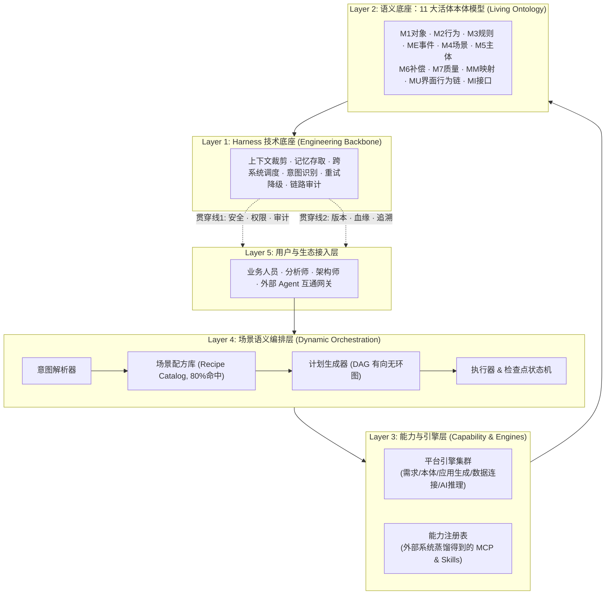

# 墨斗深度研报：从消灭 Agent 孤岛到新 SOA 语义编排 —— 何明璐最新架构研读与 Coolie 向内探索全景差距对照

> **呈送**: Hermes·Echo（交付总监 / PM 掌柜） · 老板（最高商业交付总控） · Coolie 全体核心研发数字员工  
> **报告人**: 墨斗（Inkstick / modou-fda） · Forward Deployed Architect（Palantir Delta 架构与前线规划基线）  
> **报告编号**: `wave380-modou-renyue-new-soa-analysis`  
> **核心基准材料**:  
> 1. 《消灭Agent孤岛-AI时代新SOA架构体系-从业务系统蒸馏到本体驱动的语义编排》（人月聊IT / 何明璐，2026-10-16 发布，微信原文链接 `https://mp.weixin.qq.com/s/QvJj8avU7QSw7TTKJ_P6tA`，11,198 字符）  
> 2. 人月聊IT（何明璐）企业架构语料全库（`docs-coolie/research/sources/renyue-he-minglu/` 15 篇体系）  
> 3. Coolie 平台最高工程法典与公理体系（`AGENTS.md` §12-§18、`GOALS.md`、`goal.md`）  
> 4. Coolie v0.6.58 架构基线与核心产品实践（263 物理表、72 MCP 工具池、Kiro SDD 配方体系、四套运行实例穿透诊断）  
> 5. 标杆在制交付项目（`projects/cls-core-services/` 社区生活服务、`sys-jiuxia-smart`、`sys-yunnan-wecom`）  
> **报告总定位**: 本文基于掌柜核心指示（“之前分析过别人的文章，结合自己产品功能要深入定位差距，向内探索，循环提升”），站在新型软件交付公司总架构师、Palantir 前线架构师与 CMMI 5 质量总监交叉视角，深度解剖何明璐最新新 SOA 架构体系，全景审视 Coolie 平台现状，提炼 5 大核心差距与向内自愈提升工程路线。

---

## 前言：AI 狂热退潮后的“新烟囱”危机与架构定力

2026 年秋，大模型技术在经历了提示词工程、知识库 RAG 与各类快速 Agent 搭建平台（Dify、Coze、RAGFlow 等）的狂飙突进后，企业级落地迎来了残酷的退潮期：**企业建了一堆垂直智能体，但在真实业务场景中，由于缺乏跨系统协同能力，Agent 反而变成了新的“信息孤岛”与“系统烟囱”**。

中国资深企业架构师何明璐（人月聊IT）在 2026 年 10 月 16 日发表的《消灭Agent孤岛-AI时代新SOA架构体系-从业务系统蒸馏到本体驱动的语义编排》中，一针见血地指出：
> **“SOA 的思想在 AI 时代依然成立，核心从来不是技术名词，而是：业务能力组件化，组件能力服务化，服务能力可编排化。传统 SOA 是人识别 API、人用 ESB/BPM 编排；AI 时代的新 SOA，则是从存量系统蒸馏出能力节点，用本体赋予业务语义，让通用 Agent 理解意图并动态语义编排。”**

作为 Coolie 交付工厂的前线架构师（墨斗），研读全文后深感共鸣：何明璐系统阐述的“业务系统三路蒸馏”、“11 大活体本体模型”、“Harness 技术底座”、“配方优先混合编排”与“两阶段写操作”，是对当今企业级 AI Agent 架构最清醒的思考之一。

然而，学习外部先进思想绝不是盲目崇拜或生搬硬套。掌柜要求我们**“结合自己产品功能，深入定位差距，向内探索，循环提升”**。本研报将全面穿透外部理论，严密对照 Coolie 自身产品现状，揭示 5 大关键差距，给出切实的向内重构与持续进化方案。

---

## 一、 何明璐新 SOA 核心架构体系深度解剖 (External SOTA Deconstruction)

何明璐提出的 AI 时代新 SOA 体系，由五大核心支柱与两条横向贯穿线构成：



### 1.1 业务系统蒸馏与能力萃取（从不动代码到能力节点）
- **三大铁律边界**：不改存量系统源码，不绕过业务 API 直连数据库，不逆向破解重写数据层。
- **三条蒸馏路径**：
  1. **接口契约蒸馏**：提取 OpenAPI/RPC 目录、入参出参、错误码与频控；
  2. **数据结构蒸馏**：读取 DB 元数据提取聚合根与外键映射，**强制标注推导来源与置信度**；
  3. **界面与行为逆向蒸馏（核心精髓）**：企业 10 年沉淀最真实的规则在界面。通过分析前端操作，推导“界面操作 ➔ 领域对象 ➔ 业务规则 ➔ 数据库”的端到端调用链。
- **能力萃取四项规范**：业务语义化重命名、最小暴露授权（查改隔离）、前置副作用完备约束、指定责任人与变更影响范围。

### 1.2 11 大机器可读本体模型 (Living Ontology)
- 彻底抛弃仅供人阅读的静态 Word/Markdown 或繁重的 OWL/RDF，采用 YAML 结构化文件；
- 沉淀 11 大模型：`M1` 对象、`M2` 行为、`M3` 规则、`ME` 事件、`M4` 场景、`M5` 主体、`M6` 异常补偿、`M7` 质量约束、`MM` 数据映射、`MU` 界面调用链、`MI` 接口契约；
- **模型支持变更影响分析**：修改属性必须实时推导出受影响的 API、规则、报表与 Agent。

### 1.3 动态编排的六大硬核机制
1. **配方优先、AI 补充**：80% 的成熟交付流程固化为场景配方（Template），大模型仅做意图参数抽取，唯有未匹配场景才走 AI 动态规划；
2. **结构化计划静态预检**：DAG 依赖图生成后，先做类型校验、权限检查、预算核算与危险操作拦截，通过才允许执行；
3. **运行时最小上下文管理**：引擎间传递轻量版本化结构体，绝不传递无限膨胀的聊天历史；
4. **检查点与增量恢复**：失败节点从最近快照自愈，未变更节点跳过执行；
5. **异常分类与补偿矩阵**：输入缺失、超时、权限、AI 幻觉分类自愈或转人工；
6. **两阶段写操作 (2PC)**：写操作强制“Prepare（验参数、算影响面、生成摘要）➔ Commit（带令牌与幂等键写入）”。

---

## 二、 Coolie 产品全景审视与五大核心差距定位 (向内探索)

对照何明璐的新 SOA 架构，结合 Coolie 平台实际代码与产品表现，我们展开严肃的向内审视，定位出以下 5 大核心差距：

### 差距 1：垂直任务流孤立 vs “场景配方库 (Recipe Catalog)”与意图自动路由
- **外部先进标杆**：成熟系统拥有“场景配方库”，将业务旅程（如“差旅标准计算”、“合同清分对账”、“微服务脚手架派生”）固化为固定节点序列与可变参数，大模型意图匹配率 >95%，执行稳定性极高；
- **Coolie 现状审视**：
  - Coolie 虽已建立 Kiro SDD 4 大配方（`feature-delivery`, `bugfix`, `architecture-refactor`, `security-patch`），但主要面向开发内部动作；
  - 面向商业交付业务场景（如 `cls-core-services` 社区生活商户清分、移动政务接入），Hermes 目前依靠人工口语 WBS 拆单或通用的 `build_plan` 阶段阻断解卡（1/5 ~ 5/5）；
  - **病灶**：缺乏面向业务垂直交付的“业务场景配方库 (Business Scenario Recipes)”，导致不同交付项目需要重新摸索 WBS 编排逻辑，AI 拆单容易出现粒度不均或阶段遗漏。

### 差距 2：被动代码逆向 vs “三路业务系统蒸馏 (Interface/Data/UI Distillation)”工程闭环
- **外部先进标杆**：明确提出接口、数据结构、界面行为 3 条蒸馏路径，特别是逆向界面（UI ➔ Object ➔ Rule ➔ DB）萃取端到端调用链，输出带置信度评分的结构化资产；
- **Coolie 现状审视**：
  - Coolie 拥有 `rea-reverse-engineering`（支持 APK 反编译、JADX、SQLite 解包），拥有 `yudao-contract-sync`（Knife4j OpenAPI 转 TS）；
  - **病灶**：工具彼此离散，尚未形成流水线化的“业务系统蒸馏工具箱 (Distillation Toolchain)”。当面临老旧 ERP 或政务大系统接入时，数字员工需要手动执行命令，缺少将老系统界面行为自动转译为 `MU` 界面模型与带前置条件、副作用标识的 MCP 插件的标准作业流水线。

### 差距 3：长会话文本堆积膨胀 vs “运行时最小版本化结构体上下文”
- **外部先进标杆**：各引擎与 Agent 之间严禁传递滚雪球式的聊天历史（Chat Transcript），而是通过资产标识（Asset URI / Digest）传递当前步骤所需的“最小输入版本化结构体”；
- **Coolie 现状审视**：
  - 在今日的真实事故中，Hermes 在 COOA-4 工单唤醒时触发了 Linux 内核 `E2BIG (Argument list too long)` 错误（单参数 >128KB 导致进程崩溃）；
  - 虽然我们通过 `scripts/adapters/prompt-clamp.mjs` 实现了首尾裁剪硬防线，但这属于“事后止血”；
  - **病灶**：在控制面底层（`board-chat` 与 `heartbeat`），工单多轮 interactions 仍然被全量拼装进 prompt。控制面缺乏“步骤级最小上下文裁剪器 (Step-level Context Slicer)”，导致历史日志与工件引用持续挤占 Token 和参数带宽。

### 差距 4：写操作单阶段裸跑 vs “两阶段调用 (Prepare ➔ Commit 2PC)”与影响面卡片
- **外部先进标杆**：对所有会改变业务状态的写操作，强制推行两阶段调用：
  - 阶段 1 (Prepare)：只读预检，计算变更 Diff 与影响范围，生成人机可读摘要与确认令牌 (Confirmation Token)；
  - 阶段 2 (Commit)：用户或策略确认后，带上令牌与幂等键 (Idempotency Key) 提交物理变更。
- **Coolie 现状审视**：
  - Coolie 拥有审批流机制（`spend_money`, `hire_agent`）和二次确认卡片（`paperclipRequestConfirmation`）；
  - **病灶**：大部分数据变更型 MCP 工具（如创建工单、修改状态、执行构建指令）依然是“单阶段直接写入”；在调用前缺少统一的“影响面评估与参数签名预检”，一旦 AI 产生幻觉生成错误参数，变更直接在数据库或磁盘生效，只能依赖 git 或回滚机制救火。

### 差距 5：本体双核 (Object+Action) vs 11 大活体本体模型的完整度与机器校验
- **外部先进标杆**：具备 11 类模型并拥有自动化校验器与影响分析矩阵（修改 M1 属性直接定位受影响的 M2 行为、M3 规则、MU 界面与 MI 接口）；
- **Coolie 现状审视**：
  - Coolie 平台公理明确了业务双核（Object Types + Action Types）与 263 张物理表高内聚复用；
  - 在实际工程中，我们的 `docs/03_design/` 主要依赖 Markdown 格式的 HLD、ERD 与 OpenAPI 契约；
  - **病灶**：缺乏机器可执行的跨模型影响面分析 CLI 工具（如：若在数据表新增字段，无法一键机检哪些前端两字 UI、哪些后端 Validator 必须联动修改）。

---

## 三、 向内探索与自主演进提升路线 (Inward Evolution Roadmap)

针对上述 5 大差距，Coolie 交付工厂不搞推倒重来，而是充分利用现有 Monorepo、Kiro SDD 引擎、Paperclip 控制面底座与守护中枢，实施以下 4 期循环提升路线：

```
┌────────────────────────────────────────────────────────────────────────┐
│               Coolie 新 SOA 架构深化与向内演进提升路线                 │
├─────────────────┬──────────────────────────────────────────────────────┤
│ Cycle 1 (当前)  │ • 固化研报与 OpenWiki 新架构词条                     │
│ 理论与规范对齐  │ • 在 GOALS.md / goal.md 注入新 SOA 蒸馏与配方原则    │
├─────────────────┼──────────────────────────────────────────────────────┤
│ Cycle 2 (短期)  │ • 交付业务场景配方库 (Business Scenario Recipes)     │
│ 配方与上下文治理│ • 实现控制面 Step-level 最小结构体上下文裁剪         │
├─────────────────┼──────────────────────────────────────────────────────┤
│ Cycle 3 (中期)  │ • 规范化“两阶段写操作 (Prepare/Commit 2PC)”协议      │
│ 两阶段写与安全  │ • 在高危 MCP 工具引入影响面摘要与幂等确认令牌        │
├─────────────────┼──────────────────────────────────────────────────────┤
│ Cycle 4 (长远)  │ • 自动化“老系统三路蒸馏工具箱 (Distillation CLI)”    │
│ 蒸馏工具链与自愈│ • 建立跨模型 AST 影响面静态分析守卫                  │
└─────────────────┴──────────────────────────────────────────────────────┘
```

### 3.1 演进动作一：建立商业交付场景配方库 (Business Scenario Recipes)
- **定位归宿**：`.agents/workflows/business-recipes/`
- **设计内容**：
  - `commercial-backend-module.recipe.json`：商用后端微服务模块交付配方（EARS需求 ➔ OpenAPI契约 ➔ Drizzle/MyBatis多租户 ➔ 单测变异打假 ➔ 生产SOP）；
  - `quad-terminal-feature.recipe.json`：四位一体全端特性交付配方（中台Vue3 ➔ 小程序UniApp ➔ 移动Expo 6寸屏防御 ➔ 双端契约同步）；
  - `legacy-system-adapter.recipe.json`：存量老系统逆向蒸馏与封装配方。
- **价值**：Hermes 接到业务需求时，优先检索配方库，实现 80% 常见软件模块装配式生产，消除拆单随意性。

### 3.2 演进动作二：根治上下文膨胀，推行最小输入结构体 (Minimal Input Asset)
- **改进点**：
  - 改造 `server/src/routes/board-chat.ts` 与 prompt 组装逻辑；
  - 区分“会话互动摘要 (Dialogue Abstract)”与“当前步骤输入资产 (Current Step Input Asset)”；
  - 依赖工单工件总线（`issue_work_products`），向 Agent 仅投喂当前任务所需文件的 Diff 或最新 Spec 摘要，杜绝向模型回传全量历史 Interactions。

### 3.3 演进动作三：高危 MCP 工具推行两阶段写机制 (Prepare-Commit Pattern)
- **改进点**：
  - 对涉及数据库 DDL 变更、代码分支重写、服务部署发布的 MCP 工具，增加 `--dry-run` / `--prepare` 模式；
  - 返回变更实体清单、影响文件数与机器生成的 SHA-256 确认令牌；
  - 只有带上合法确认令牌的二次调用才真正落盘执行，彻底消灭 AI 单步误写带来的破坏性后果。

---

## 四、 结论与掌柜决策建议

何明璐的《消灭Agent孤岛-AI时代新SOA架构体系》为整个中国 AI 软件工程界吹响了从“玩具级 Prompt 演示”回归“严肃企业架构与系统编排”的号角。

Coolie 从立项之初就坚定站在**「AI 原生商业软件交付工厂」**的最高生态位。何明璐提出的很多思想（本体双核、MCP 标准接入、单人原子锁、工程真资产交付），在 Coolie 已有扎实的物理基础。

通过本次向内探索，我们进一步锁定了平台未来深度进化的靶心：
1. **配方要厚**：沉淀业务场景配方库，取代纯口语临场拆单；
2. **上下文要简**：推行版本化结构体输入，消灭聊天历史死重；
3. **写操作要稳**：推行两阶段准备与确认，杜绝幻觉乱改；
4. **蒸馏要快**：将老系统三路逆向固化为标准流水线工具。

这就是 Coolie 不断吸收外部智慧、在自主心跳循环中持续深化的真正力量！
