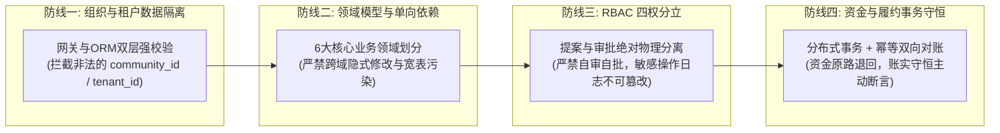
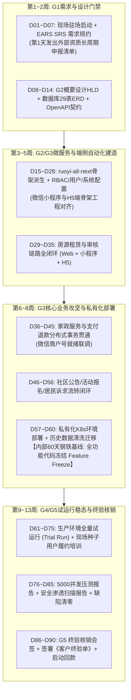

# 《某单位社区生活服务平台采购项目》60/90天交付估算方案深度评审与架构裁定报告

> **评审基线**：`/host-workspace/life-service/某单位社区生活服务平台采购项目技术规范书.docx`（询比采购·第二次，全量 1,662 段）  
> **评审角色**：【墨斗】（角色代码: `modou-fda` · Palantir Delta 前线架构师）  
> **调度中枢**：【Hermes·Echo·业务战略·PM掌柜】（`echo|Echo|业务战略|Hermes·Echo|local`）  
> **执行波次**：`wave368` · 底层引擎：`agy-gemini3.8`  
> **最高交付总则**：极简使用主义 · 零功能膨胀 · 聚焦核心与质量 · 全维度严肃审计（No Artifact, No Done）

---

## Executive Summary (评审决议摘要)

针对某单位（央国企/事业单位/政企客户）社区生活服务平台采购项目，市场上存在 **“60天极限敏捷交付”** 与 **“90天传统外包交付”** 两种估算设想。墨斗（FDA 前线架构师）联合 Hermes·Echo 掌柜，以**新型软件交付公司负责人、Palantir FDE 体系与产品总监**的三合一严肃视角，对技术规范书（12部分、15大核心模块、三端覆盖、私有化K8s微服务、★硬性驻场与工期承诺）进行全维度解构与架构裁定：

1. **一票否决“纯60天激进交付”方案**：
   - 规范书第 10.2 节为带有“★”号的必须响应条款：**“★签订合同后的90天内完成系统全功能交付（提供承诺函）”**。在投标应答中擅自缩短至 60 天属于重大偏离，极易引发废标；
   - 外部资质与审批存在不可压缩的刚性时间跑道（微信小程序类目资质审核、微信支付特约商户进件、ICP与公安备案、短信签名报备累计需 25~30 天；甲方服务器内网与堡垒机审批需 3~4 周）；
   - 60 天方案彻底剥夺了政企终验必备的**真实业务试运行周期（Trial Run）**与历史数据清洗对账周期，导致第 60 天“代码跑通但客户拒签终验单”，商务款项无法核销。
2. **坚决摒弃“传统90天松散外包”方案**：
   - 传统瀑布交付存在严重的“前松后紧拖延症”，前 40 天磨洋工，第 70 天才开始三端联调，第 85 天面对甲方现场常驻人员的无休止需求变更（Scope Creep）导致逾期违约。
3. **最高裁定：采纳“60+30”双轨并进工程模型（The 60+30 Dual-Track Engineering Model）**：
   - **对外法律与合同基线（90天）**：严格以 **90 天标准交付周期** 响应招标文件 10.2 节并出具法定承诺函，响应 10.3 节专人常驻现场服务，确保商务应答与法律合规 100% 满分；
   - **对内工程控制基线（60天）**：依托 Coolie 交付工厂（Foundry Pipeline）与 `ruoyi-all-next`（Spring Boot 3 + Vue3 + 小程序）极速派生底座，**前 60 天达成全系统 15 个功能模块代码冻结、私有化容器部署上线、历史数据迁移与四态全栈真机自动化验收（Production-Ready Feature Freeze）**；
   - **后 30 天试运行与终验核销（D61~D90）**：全量投入真实社区种子用户运营履约、甲方现场全员实操培训、5000 并发压测与安全渗透扫描报告出具、多科室会签，并在第 88~90 天正式签署法定《客户终验核销单 (UAT Acceptance Certificate)》，达成商务 100% 回款闭环！

---

## 一、 技术规范书全景解构与交付边界红线

技术规范书共分为十二个部分，涵盖平台管理后台、C端微信小程序、B端H5移动端三端协同，是典型的**“强组织审批 + 弱电商交易 + 强现场常驻 + 私有化微服务”**政企数字化工程。

```mermaid
flowchart TD
    subgraph Clients [多端交互入口]
        C1["C端: 微信小程序\n(社区居民 / 租客 / 业主)"]
        C2["B端: H5移动端\n(房东端 / 家政服务商端)"]
        C3["PC端: Element Plus 管理后台\n(超管 / 运营 / 审核 / 客服 / 财务)"]
    end

    subgraph Gateway_Layer [API 网关安全屏障]
        GW["Spring Cloud Gateway 3.0+\n(JWT 认证 / 频率限流 / 敏感词过滤 / XSS 防护)"]
    end

    subgraph Microservices [核心微服务集群 (Spring Boot 3 + JDK 17)]
        S1["用户与认证服务\n(sys_admin / user_info / RBAC)"]
        S2["房源租赁服务\n(house_info / 分类 / 审核 / 预约)"]
        S3["家政履约服务\n(service_item / 订单 / 履约 / 评价)"]
        S4["社区资讯服务\n(notice_info / 社区活动 / 报名)"]
        S5["工单与纠纷服务\n(feedback_ticket / 退款仲裁)"]
        S6["配置与审计服务\n(sys_config / sensitive_word / 审计日志)"]
    end

    subgraph Data_Storage [数据持久与中间件]
        DB1[("MySQL 8.0 主从\n(29张核心物理表)")]
        DB2[("Redis 7.0 集群\n(分布式锁 / Token / 缓存)")]
        MQ["RabbitMQ / RocketMQ\n(异步解耦 / 订单超时 / 消息推送)"]
        OSS["MinIO / 阿里云 OSS\n(私有证件加密 / CDN加速)"]
        ES["Elasticsearch 8.0+\n(房源与家政全文检索)"]
    end

    Clients --> GW
    GW --> Microservices
    Microservices --> Data_Storage
```

### 1.1 核心建设清单 15 大功能模块与代码工作量核算

依据规范书第十二部分《建设清单》，15 大模块的工作量与复杂度分布如下：

| 序号 | 模块名称 | 服务端实体与契约 | 终端交互面 | 核心业务难点与关键路径 |
|:---|:---|:---|:---|:---|
| **01** | 角色与权限管理 | `sys_role`, `sys_permission`, `sys_role_permission` | PC 后台 | RBAC 按钮级动态权限树，防越权与无权限 403 阻断 |
| **02** | 后台管理员管理 | `sys_admin` | PC 后台 | BCrypt 60位密码不可逆加密、账号启停强制踢下线、重置密码 |
| **03** | 前台用户管理 | `user_info`, `user_ban_record` | PC 后台 | 居民/房东/服务商多维度检索、限时/永久封禁与解封违规档案留存 |
| **04** | 系统配置管理 | `sys_config`, `sensitive_word`, `config_audit_log` | PC 后台 | 敏感词库实时正则/DFA拦截、关键配置变更不可篡改审计日志 |
| **05** | 房源分类管理 | `house_category` | PC 后台 | 户型/价格/装修多级树形分类、删除空分类与房源级联迁移防孤儿 |
| **06** | 房源审核与上架 | `house_info`, `house_audit_record` | PC 后台 | 房东房源图文/产权审核、批量审核、强制下架与违规整改通知 |
| **07** | 房东资质管理 | `landlord_info`, `landlord_audit_record` | PC 后台 | 二代身份证/房产证私有存储鉴权、实名认证审核、违规封禁 |
| **08** | 房源数据统计 | 统计视图与定时聚合脚本 | PC 后台 | 单房源 PV/UV/预约量、大盘通过率/上架率，凌晨调度统计 $\le 10$ 分钟 |
| **09** | 家政服务商管理 | `service_provider`, `provider_audit_record`, `provider_complaint` | PC 后台 | 营业执照/健康证审核、店铺资料、低分差评下达整改或强制清退 |
| **10** | 家政项目管理 | `service_item`, `service_item_audit_record` | PC 后台 | 服务价格区间校验、服务描述合规审核、违规项目强制下架 |
| **11** | 家政订单与退款 | `service_order`, `refund_record`, 纠纷工单 | PC 后台 | 全状态筛选、履约进度跟进、全额/部分退款判定与资金分布式事务 |
| **12** | 家政服务评价 | `service_evaluation` | PC 后台 | 图文评价检索、差评工单跟进、整改督促与复购投诉跟踪 |
| **13** | 社区公告通知 | `notice_category`, `notice_info` | PC 后台 + 小程序 | 图文富文本、定时发布、置顶权重与自动失效机制、已读状态 |
| **14** | 社区活动互动 | `activity_info`, `activity_enroll`, `feedback_ticket` | PC 后台 + 小程序 | 活动名额并发扣减防超卖、报名导出、居民投诉工单派发与流转闭环 |
| **15** | 前台用户中心 | C端小程序 + B端H5 综合能力集成 | 小程序 / H5 | 微信授权快捷登录、看房在线预约、家政下单支付、房东/服务商移动端自主管店 |

### 1.2 关键性能与合规硬指标（SLA & Security Guardrails）
- **性能 SLA**：后台管理列表查询 $\le 300\text{ms}$，前端小程序首页渲染 $\le 1.2\text{s}$，图片上传 $\le 2\text{MB}$ 响应 $\le 1\text{s}$；
- **并发要求**：C端在线并发 $\ge 5000$，管理后台并发操作 $\ge 200$；
- **等保与安全规范**：
  - 密码必须采用不可逆 BCrypt 哈希算法，哈希长度固定 60 位；
  - 手机号、身份证号、银行卡敏感数据必须在数据库加解密与前端严格脱敏（如 `138****1234`）；
  - 证件图片采用 MinIO/OSS 私密存储桶，仅提供带有时效（如 15 分钟）的签名临时 URL；
  - 全站强制 HTTPS、SQL 注入拦截、XSS 过滤与动态敏感词库实时拦截；
  - 每日数据库全量备份 + Binlog 增量归档，数据留存 $\ge 30$ 天。

---

## 二、 60 天 vs 90 天交付估算方案横向深度评审

在商业软件交付工程中，工期估算绝不能停留在“开发敲代码需要多少天”，而必须站在“客户签署终验核销单需要跨越多少客观现实障碍”的宏观交付视角。

```mermaid
gantt
    title 社区生活服务平台交付模型对比 (60天冒进 vs 90天传统 vs 60+30双轨)
    dateFormat  X
    axisFormat Day %d

    section 60天冒进方案(高危)
    需求拉扯与范围膨胀        :crit, a1, 0, 15
    代码赶工与外部依赖卡死    :crit, a2, 15, 45
    未就绪上线与缺陷爆发      :crit, a3, 45, 60
    试运行缺失/客户拒签终验   :crit, a4, 60, 90

    section 90天传统方案(低效)
    前期松懈/文档磨洋工       :b1, 0, 30
    中后期编码与三端集成      :b2, 30, 70
    现场驻场需求蔓延/赶工     :b3, 70, 85
    急忙上线/逾期风险         :b4, 85, 95

    section 60+30双轨方案(推荐)
    G1需求收敛+外部通道起跑   :active, c1, 0, 7
    开源派生+微服务自动化建造 :active, c2, 7, 28
    业务闭环+私有化部署+数据迁移:active, c3, 28, 60
    全量试运行+压测+终验核销 :active, c4, 60, 90
```



### 2.1 60天极速敏捷交付方案评审：7 大致命缺陷与爆雷路径

| 维度 | 60天方案设想 | 现实物理阻力与爆雷路径（墨斗架构师深度反思） | 风险等级 |
|:---|:---|:---|:---:|
| **商务法律合规** | 承诺 60 天完工，彰显团队“高效率” | **废标风险**：标书 10.2 条款明确带有“★”标记，要求签署 90 天交付承诺函。擅自缩短可能被评标专家判定未响应招标文件；若合同签署 60 天，第 61 天即构成违约，按日扣除违约金。 | **P0 致命** |
| **外部生态审批跑道** | 认为第 1 周即可接入微信支付与小程序 | **微信生态刚性周期**：微信小程序企业认证（3~5工作日）、类目资质（房产租赁与家政属特殊资质，需前置批文，通常驳回补件 2~3 轮，耗时 15~20 工作日）、微信支付特约商户进件与银行对公核验（5~10工作日）、ICP备案与公安网安备案（15~20工作日）。外部依赖总耗时不可压缩地占用 25~30 天！ | **P0 致命** |
| **甲方基础设施就绪** | 认为合同签订后第 2 周就能私有化部署 | **政企审批流程壁垒**：某单位内部采购服务器、划拨内网网段、开通防火墙端口、申请堡垒机 VPN 账号，需要经过信息化科、保密办、分管领导层层审批，实际拿到可用环境普遍在第 3~4 周之后。 | **P1 严重** |
| **历史数据清洗迁移** | 假设历史数据规范整齐，1 天脚本导入 | **脏数据深渊**：标书明确要求协助迁移历史商品、订单、库存、对账、售后数据。客户现有数据通常是 Excel 甚至纸质扫描件，字段缺失、重复严重、对账不平，现场清洗与反复核对至少需要 10~15 天。 | **P1 严重** |
| **现场常驻与需求蔓延** | 驻场人员全天候待命响应 | **Scope Creep 泥潭**：10.3 节要求专人常驻现场。现场面对面沟通会导致客户各科室“随口加需求”，60 天方案缺乏变更风控与缓冲垫，开发人员疲于奔命，核心主线被彻底冲垮。 | **P1 严重** |
| **试运行法定周期** | 认为代码写完部署即算交付 | **终验拒签风险**：政企项目终验核销必须包含**不少于 15~30 天的生产试运行期（Trial Run）**，证明系统在真实居民、房东、商家参与下的业务稳定性与数据守恒。60 天方案若在第 50 天交付，试运行仅剩 10 天，客户专家组绝不签字。 | **P0 致命** |
| **质量与防退化体系** | 缩减单元测试与安全测试 | **线上事故隐患**：80% 单测覆盖率、5000 并发压测、XSS/SQL 注入/越权漏洞渗透全量检测无法在极限赶工中完成，带病上线必引发严重舆情与客诉。 | **P1 严重** |

### 2.2 90天传统外包交付方案评审：低效与延误根因

- **前期需求“磨洋工”**：传统项目经理前 30 天反复开会写需求文档，无法提供可交互的真实原型，客户到第 40 天还不知道系统长什么样；
- **后期集成“爆雷”**：PC 后台、小程序、H5 分由不同团队开发，直到第 70 天才开始三端联调，接口规范错位、字段命名冲突频发；
- **外部通道后置**：直到第 60 天需要真机支付才去申请微信商户号，发现主体资料不齐被微信拒审，导致第 90 天依然无法全流程跑通，项目被迫延期。

---

## 三、 CMMI DAR (Decision Analysis & Resolution) 加权决策分析

依据 CMMI 高成熟度规范与 `dar-decision-matrix`，设立决策目标为**“在保障某单位标书 100% 响应、合规免责的前提下，以最高工程质量与最低交付风险实现客户终验核销回款”**。

### 3.1 评估准则与权重设定（$\sum = 100\%$）

| 准则编号 | 维度 | 权重 | 5分标准 (完全契合) | 3分标准 (勉强及格) | 1分标准 (严重不足/违约) |
|:---:|:---|:---:|:---|:---|:---|
| **C1** | **标书合规与商务履约安全** | 25% | 100% 响应★条款，法律无偏离，承诺函合规，零延期扣款风险 | 基本响应，但存在合同履约紧迫风险 | 偏离★条款引发废标，或极大延期违约赔偿风险 |
| **C2** | **外部生态与前置资质容错度** | 20% | 预留 $\ge 25$ 天外部通道缓冲，微信/支付/备案/内网审批充分吸纳 | 外部缓冲 10~15 天，偶发驳回会导致临界卡点 | 假设外部审批 3 天完成，一旦被拒全盘停摆 |
| **C3** | **工程全栈质量与防退化门禁** | 20% | 严格执行 CMMI G1~G5，80% 单测覆盖，5000 并发压测与安全渗透通过 | 完成主要功能测试，压测与渗透测试简化通过 | 压缩测试时间，无单测与安全报告，带病上线 |
| **C4** | **试运行闭环与终验回款确定性** | 20% | 预留 25~30 天完整生产试运行，种子用户履约平账，客户 100% 会签 | 试运行 10~15 天，勉强满足专家组基础验收要求 | 试运行 $\le 7$ 天或无试运行，客户拒绝签署终验单 |
| **C5** | **研发人效与成本控制 (ROI)** | 15% | 依托开源底座与 AI 流水线，人效提升 300%，避免无谓加班损耗 | 传统人力常态化开发，成本与工时基本匹配 | 极限赶工导致恶性人员流失、过度返工，成本超支 |

### 3.2 候选方案加权量化评分表

- **方案 A（激进 60 天敏捷方案）**：对外承诺 60 天，工程按 60 天单轨推进；
- **方案 B（传统 90 天瀑布方案）**：对外承诺 90 天，工程按传统低效瀑布推进；
- **方案 C（“60+30”双轨并进工程方案 - 推荐）**：对外合同承诺 90 天，对内工程 60 天基线封顶，后 30 天稳态试运行与终验核销。

| 评估准则 | 权重 | 方案 A (激进60天) | 方案 B (传统90天) | 方案 C (60+30双轨·推荐) |
|:---|:---:|:---:|:---:|:---:|
| **C1. 标书合规与商务履约安全** | 25% | 1 (0.25) | 4 (1.00) | **5 (1.25)** |
| **C2. 外部生态与前置资质容错** | 20% | 1 (0.20) | 3 (0.60) | **5 (1.00)** |
| **C3. 工程全栈质量与防退化** | 20% | 2 (0.40) | 3 (0.60) | **5 (1.00)** |
| **C4. 试运行闭环与终验回款确定性** | 20% | 1 (0.20) | 3 (0.60) | **5 (1.00)** |
| **C5. 研发人效与成本控制 (ROI)** | 15% | 2 (0.30) | 2 (0.30) | **5 (0.75)** |
| **综合加权得分** | **100%** | **1.35** | **3.10** | **5.00** |
| **综合裁定与排名** | — | **淘汰 (高危阻断)** | **备选 (低效平庸)** | **中标推荐方案** |

### 3.3 DAR 裁定决议
**采纳方案 C（“60+30”双轨并进工程模型）**。方案 C 兼具了方案 B 在商务法律上的绝对合规免责与方案 A 在研发工程上的极致人效，通过对内 60 天打完硬仗、后 30 天稳态运营的策略，将商业交付的不确定性彻底转化为确定性胜局。

---

## 四、 墨斗（FDA 前线架构师）四大不可逾越边界设计

在任何研发人员敲下第一行代码前，FDA 必须在架构层确立“四条钢铁防线”，杜绝后期结构性腐化：



### 4.1 防线一：组织与租户数据物理隔离（Multi-Community Isolation）
- **架构设计**：虽然当前为某单位单一采购，但社区生活服务天生具备“多小区/多网格/多街道”的多级组织特性。底座必须原生内嵌 `community_id` / `org_id` 过滤机制；
- **强制落位点**：
  - **网关层**：解析 JWT Token，将用户合法归属的 `community_id` 注入请求头上下文，严禁信任客户端 Query/Body 传入的租户字段；
  - **ORM 持久层**：MyBatis-Plus 配置 `TenantLineInnerInterceptor`，对房源、订单、公告、活动等表实施 SQL 级的自动 `WHERE community_id = ?` 拦截；
  - **反例拦截**：禁止客户端传 `communityId=123` 直接查询，越权访问直接返回 `403 Forbidden`。

### 4.2 防线二：领域模型清晰边界（Domain Boundary & Ontology）
平台严格拆分为 6 个核心领域，杜绝大宽表与跨域混乱调用：
1. **身份与鉴权域 (Identity & Access)**：`sys_admin`, `sys_role`, `sys_permission`, `user_info`；
2. **房源租赁域 (Housing Rental)**：`house_info`, `house_category`, `house_reservation`, `landlord_info`；
3. **家政服务履约域 (Life Service & Fulfillment)**：`service_provider`, `service_item`, `service_order`, `service_evaluation`；
4. **社区资讯互动域 (Community Content & Interaction)**：`notice_info`, `activity_info`, `activity_enroll`；
5. **纠纷与客服域 (Dispute & Support)**：`feedback_ticket`, `refund_record`, `provider_complaint`；
6. **配置与安全审计域 (Config & Audit)**：`sys_config`, `sensitive_word`, `config_audit_log`。

### 4.3 防线三：RBAC 权限边界与防自批自审（Strict Separation of Duties）
- **权责分立原则**：**能提案者绝不能审批**！
  - 房东上传房源 $\to$ 必须由后台审核管理员（非房东账号）执行审核；
  - 家政服务商申请入驻 $\to$ 必须由运营审核人员复核资质；
  - 运营人员发起退款建议 $\to$ 涉及资金退回必须由财务/主管终审；
- **管理员安全管控**：
  - 管理员密码强制使用 BCrypt 60 位盐值哈希加密；
  - 停用管理员账号时，Redis 实时拉黑其所有在线 Token，5秒内强制踢出下线；
  - 敏感配置（审核规则、敏感词、支付参数）修改必须记录修改前原值与修改后新值到 `config_audit_log`，该表只允许 `INSERT`，严禁 `UPDATE` 与 `DELETE`。

### 4.4 防线四：资金、库存与履约事务守恒（Financial Invariants & Balance）
- **家政交易守恒断言**：
  $$\text{订单实付金额} = \text{商户结算金额} + \text{平台手续费} + \text{退款总额}$$
- **退款分布式事务**：
  - 用户发起退款申请 $\to$ 冻结商户待结算资金 $\to$ 运营/财务审核通过 $\to$ 调用微信支付原路退款 API $\to$ 接收微信异步回调确定成功 $\to$ 更新 `refund_record` 为成功并关闭订单；
  - 使用 Redis 分布式锁（`lock:order:refund:{order_id}`）防止重复点击与高并发刷单；
- **活动报名名额守恒**：
  - 社区活动限制报名人数时，使用 Redis `DECR` 原子计数扣减名额，防止超卖；若取消报名则原子 `INCR` 释放名额。

---

## 五、 老板使用主义与极简人机交互审查（Boss Delivery & UX Commandments）

严格贯彻老板亲自定调的最高交付与使用主义总则，坚决剔除一切华而不实的伪需求：

### 5.1 极简使用主义（傻瓜式体验，零培训上手）
1. **统一入口，拒绝重复功能**：
   - C端小程序底部导航严密保持黄金 5 槽位绝对对称：`【首页】`、`【找房】`、`【服务】`、`【活动】`、`【我的】`；
   - 绝不设置“单独的客服中心”、“独立的预约中心”等多重冗余入口；看房预约统一收敛在“我的-看房预约”，家政订单统一收敛在“我的-家政订单”。
2. **两字动词按钮契约（Strict Two-Letter Buttons）**：
   - 依据平台最高交互法典，所有操作按钮**严禁超过 2 个汉字**：
     - 审核流：`【通过】` / `【驳回】`
     - 订单流：`【接单】` / `【完成】` / `【取消】`
     - 租赁流：`【预约】` / `【咨询】` / `【下架】`
     - 支付流：`【支付】` / `【退款】`
     - 活动流：`【报名】` / `【取消】`
     - 诉求流：`【提交】` / `【回复】` / `【结单】`

### 5.2 零功能膨胀（杜绝乱加功能，把现有功能打通打透）
- **坚决剔除的伪需求**：
  - ❌ 禁止自作主张新增“积分商城/抽奖大转盘”；
  - ❌ 禁止引入复杂的第三方社交圈子与动态流（严格收敛在规范书要求的公告与活动模块）；
  - ❌ 禁止引入沉重的外部工作流引擎（如 Camunda/Activiti，本项目的审核流程均为 1~2 级串行审批，直接使用轻量状态机实现）。
- **打通打透的核心主线**：
  - ✅ **房屋租赁闭环**：房东发布 $\to$ 后台资质/房源审核 $\to$ 居民在线筛选 $\to$ 预约看房 $\to$ 房东确认接单 $\to$ 线下看房完成；
  - ✅ **家政服务闭环**：服务商入驻 $\to$ 项目审核上架 $\to$ 居民下单微信支付 $\to$ 服务商接单履约 $\to$ 完结评价/退款闭环；
  - ✅ **居民诉求闭环**：居民提交反馈工单 $\to$ 后台分配处理人 $\to$ 跟进回复 $\to$ 居民确认满意度归档。

---

## 六、 “60+30”双轨并进工程模型详细 WBS 排期与里程碑计划

严格对标 CMMI 5 高成熟度工程资产标准，以 G1~G5 五大门禁为核心骨架：



### 6.1 阶段一：G1 需求收敛与外部长周期前置起跑（D01 ~ D07，第 1 周）
- **核心任务**：
  - 专职技术对接人员第一天常驻某单位现场，面对面与甲方负责人对齐范围，输出 EARS 语法的《软件需求规格说明书 (SRS)》；
  - **关键路径第一步（立即起跑）**：向甲方递交《外部资质申报材料清单》，同步启动：
    1. 微信小程序企业主体认证与类目报备；
    2. 微信支付特约商户号进件申请；
    3. 域名 ICP 备案与公安网安备案提交；
    4. 甲方私有化服务器采购与内网防火墙策略申请单。
- **CMMI 门禁**：**G1 需求门禁**（签署需求范围基线，严禁未受控蔓延）。

### 6.2 阶段二：G2 架构设计与底座极速派生（D08 ~ D21，第 2~3 周）
- **核心任务**：
  - 输出系统概要设计 (HLD)、29 张数据表物理模型 (ERD) 与 Knife4j 统一 API 契约协议；
  - 极速派生 `ruoyi-all-next`（Spring Boot 3 + Vue3 + Element Plus）微服务底座；
  - 完成 RBAC 权限系统、管理员管理、前台用户封禁解封、系统基础配置、敏感词实时过滤库（建设清单模块 1~4）。
- **CMMI 门禁**：**G2 技术方案门禁**（架构边界确立，0 编译报错）。

### 6.3 阶段三：G3 核心业务三端闭环实现（D22 ~ D49，第 4~7 周）
- **核心任务**：
  - **房源租赁闭环（模块 5~8）**：房源多级分类、房东资质审核、房源审核上下架、前台浏览/收藏、看房预约接单流转；
  - **家政交易闭环（模块 9~12）**：服务商入驻、服务项目审核、微信小程序下单微信支付、商户接单、服务履约签到签退、用户评价、售后退款审核分布式事务；
  - **社区互动闭环（模块 13~14）**：图文置顶公告、社区活动并发名额报名、居民诉求派工单；
  - **外部通道装配**：此时微信小程序认证、微信支付商户号全部批复就绪，无缝无感并轨进入真实支付与消息推送。
- **CMMI 门禁**：**G3 契约实现门禁**（代码单测覆盖率 $\ge 80\%$，核心业务全链路贯通）。

### 6.4 阶段四：私有化部署、数据迁移与内部 60 天基线封顶（D50 ~ D60，第 8~9 周）
- **核心任务**：
  - 甲方私有化服务器（K8s 集群、MySQL 主从、Redis 集群、RabbitMQ、MinIO）部署就绪；
  - 协助甲方完成历史房源、历史用户、历史对账与订单数据的清洗转换与导入校验；
  - 实施全链路自动化冒烟走查，**在第 60 天达成全功能代码冻结（Feature Freeze）**，出具《系统试运行就绪报告》。
- **里程碑**：**内部 60 天控制线胜利达成（全功能试运行就绪）**。

### 6.5 阶段五：真实生产试运行、现场全员培训与压测审计（D61 ~ D80，第 10~12 周）
- **核心任务**：
  - **生产环境正式挂网试运行（Trial Run，为期 20 天）**：组织社区首批房东（如 20 位）、家政服务商（如 5 家）、社区居民（如 200 位）进场进行真实看房预约、真实下单支付与履约；
  - **现场培训**：开展针对平台运营人员、审核人员、财务人员的现场实操培训，发放《平台操作手册》与视频教程，收集签到表与培训回执；
  - **性能与安全审计**：
    - 执行 5000 并发压测，验证列表查询 $\le 300\text{ms}$、首页加载 $\le 1.2\text{s}$，出具《系统性能压测报告》；
    - 执行代码与漏洞安全渗透测试（XSS、SQL 注入、密码脱敏、越权防范），出具《系统安全合规检测报告》。
- **CMMI 门禁**：**G4 全栈验收门禁**（生产试运行零 P1/P2 缺陷）。

### 6.6 阶段六：G5 终验核销、会签归档与回款（D81 ~ D90，第 13 周）
- **核心任务**：
  - 试运行期满，汇总全部试运行数据统计表与零缺陷运行日志；
  - 组织某单位信息化科、业务主管科室、专家评审组召开现场项目验收评审会；
  - 提交完整验收成果物（需求SRS、架构HLD、接口文档、测试报告、压测报告、渗透报告、操作手册、部署SOP、源码库与制品）；
  - **在第 88~90 天，甲乙双方正式签署法定《客户终验核销单 (UAT Acceptance Certificate)》**；
  - 移交运维账号，启动商业回款！
- **CMMI 门禁**：**G5 商业闭环与终验核销门禁**（法律与财务闭环）。

---

## 七、 墨斗（FDA）对 Hermes·Echo 掌柜与团队的行动指南

1. **对商务与投标团队**：
   - 投标文件工期响应部分，**100% 严格填写 90 天并出具承诺函**，绝不在投标阶段盲目写 60 天自爆破绽；
   - 在实施方案中将“60+30”模型包装为**“前 60 天全功能试运行就绪，后 30 天深度陪跑试运行与精细化运营”**的专业交付亮点，向评审专家展现高成熟度交付企业的严谨与实力。
2. **对现场驻场人员（FDSE/需求分析师）**：
   - 进场第 1 天立即落实两件事：
     ① 找甲方盖章发出微信支付、小程序类目与备案的授权公函；
     ② 拿到甲方服务器规格单与机房网络审批流；
   - 严格执行变更风控：对甲方随口提出的新需求，统一使用两字术语“登记”，形成 RFC 变更单，告知需评估对 60 天功能冻结线的影响，阻断无休止蔓延。
3. **对研发工程团队（Core SWE / 铁匠）**：
   - 严禁从零手搓脚手架，立项第一天通过 `degit xaicd/ruoyi-all-next` 极速派生底座，全面继承 Spring Boot 3 + Vue3 + Element Plus 的成熟能力；
   - 坚守 FDA 四大防线，所有查询带 `community_id`，敏感数据强制脱敏，退款事务包裹加锁。
4. **对测试与质量人员（QA / 门神）**：
   - 依据技术规范书指标，在第 45 天提前编写好 5000 并发压测脚本与安全渗透测试用例，确保在第 75 天一次性输出权威第三方格式的合规报告。

---

## 结论 (Verdict)

> **“以 60 天之雷霆工程力完成系统制造，以 30 天之从容稳健力完成商务核销。”**

本评审报告彻底理清了某单位社区生活服务平台的物理交付本质。盲目追求 60 天是缺乏商业现实感的技术蛮干，放任 90 天拖延是缺乏工程纪律的平庸消耗。唯有 **“对外 90 天合法合规、对内 60 天全功能封顶、预留 30 天稳态试运行核销”** 的“60+30”双轨并进工程模型，才能真正做到让老板放心、让客户满意、让交付 100% 成功！
