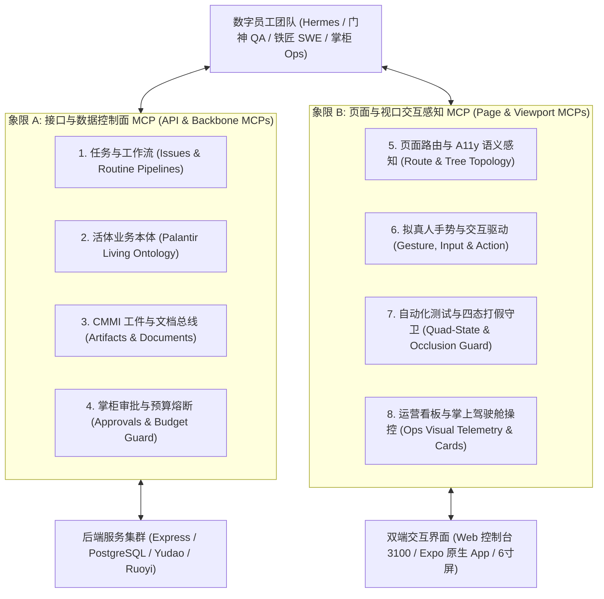

# 全工厂接口与页面全栈 MCP 完备清单与实施蓝图 (Full-Stack API & Page MCP Inventory)

> **核心公理**: Coolie 定位为全流程 AI 原生数字员工自主驱动的「端到端商业软件交付工厂」。  
> 过去的自动化测试与运营之所以能力孱弱，根本症结在于**将 MCP 矮化为单纯的后端 API 封装**，导致数字员工在面对真实的 Web 控制台与原生移动 App 界面时“看不见、摸不着、测不到、控不了”。  
> 本规范正式确立**「双模 MCP 矩阵 (Dual-Mode MCP Matrix)」**：将接口契约与页面视口并轨为同一等公民，使自动化测试具备真拟人走查与四态打假能力，使运营具备自然语言直通界面与掌上两字决策能力。

---

## 一、双模 MCP 矩阵架构拓扑 (Dual-Mode MCP Matrix Topology)



---

## 二、象限 A：接口与控制面 MCP 全景清单 (API & Control-Plane MCPs)

本象限保障底层数据的**真实性、合法性、不可篡改性与事务守恒**：

| 领域分类 | MCP 工具名称 | 核心参数与签名 | 核心职责与业务意图 | 调用方角色 |
| :--- | :--- | :--- | :--- | :--- |
| **1. 任务与工单** | `mcp_issue_list` | `{ companyId, projectId, status, priority, limit }` | 条件查询项目工单列表，支持状态、优先级与责任人过滤 | Hermes / SWE |
| | `mcp_issue_get` | `{ issueId }` | 获取单条工单详情、关联工作产品、审批单与因果血缘 | 全员 |
| | `mcp_issue_create` | `{ projectId, title, description, priority, assigneeId, goalId }` | 严格基于 EARS 规格立项并关联目标 Goal 物理节点 | Hermes / PM |
| | `mcp_issue_checkout_lock` | `{ issueId, agentId }` | **单一人原子独占签出锁**，防止多 Agent 冲突踩踏 | 领单 Agent |
| | `mcp_issue_release_lock` | `{ issueId, agentId }` | 释放单人独占签出锁，回退或交接工单 | 领单 Agent |
| | `mcp_issue_update_status`| `{ issueId, status, commitSha }` | 状态跃迁，完成时硬门禁校验有效 Commit SHA 与 0 dirty | 领单 Agent |
| | `mcp_issue_add_comment` | `{ issueId, body }` | 追加带有结构化证据的工单履约账本记录 | 全员 |
| **2. 活体业务本体**| `mcp_ontology_list_objects`| `{ domainId, objectType, filters }` | 遍历现实世界活体业务对象孪生实例 | FDA / DS |
| | `mcp_ontology_get_lineage`| `{ objectId }` | 追踪业务对象上下游全链路因果血缘 | FDA / DS |
| | `mcp_ontology_propose` | `{ domainId, changes, rationale }` | 将业务诉求转译为结构化 Proposal 卡片草案 | Hermes / DS |
| | `mcp_ontology_apply` | `{ proposalId, approvalId }` | 掌柜审批核准后，原子变更落盘物理库 | Hermes / SRE |
| **3. CMMI 工件总线**| `mcp_work_product_create`| `{ issueId, title, kind, resourceRef }` | 挂载工程真资产（代码 Commit、SOP、测试报告） | 交付 Agent |
| | `mcp_document_upsert` | `{ issueId, title, docType, content }` | 协同规格文档落盘（SRS / HLD / LLD / Test Report） | 交付 Agent |
| | `mcp_deliverable_register`| `{ issueId, packageHash, downloadUrl }` | 注册不可变投产发布制品与 SHA-256 指纹 | PRE-SRE |
| **4. 审批与预算** | `mcp_approval_create` | `{ companyId, type, payload, rationale }` | 发起高危写操作或预算调整审批请求 | 全员 |
| | `mcp_approval_decide` | `{ approvalId, decision: 'approve'\|'reject' }` | **掌柜掌上两字审批**，原子放行或驳回操作 | 掌柜 / CEO |
| | `mcp_budget_inspect` | `{ companyId, agentId }` | 实时查询公司与各数字员工 Token/费用消耗及燃烧率 | 财务 / CEO |
| | `mcp_killswitch_trigger` | `{ companyId, reason }` | 紧急硬熔断全局停工，秒级封锁所有写操作 | 掌柜 / SRE |

---

## 三、象限 B：页面与视口交互感知 MCP 全景清单 (Page & Viewport MCPs)

本象限彻底解决**自动化测试打假与运营掌上操控**的“失明与脱节”痛点：

### 1. 页面拓扑与上下文感知 (Page Topology & Context)
让 Agent 能够“看见”屏幕并理解当前界面状态与组件拓扑：

| MCP 工具名称 | 核心参数与签名 | 核心职责与业务意图 | 解决的核心痛点 |
| :--- | :--- | :--- | :--- |
| `mcp_page_list_registered_routes` | `{ platform: 'web'\|'mobile' }` | 扫描并列出前端所有已注册有效路由与层级调用栈 | 杜绝死屏、孤儿路由与废弃页面遗留 |
| `mcp_page_get_active_context` | `{ sessionId? }` | 获取当前前台显示的页面路由、Tab 索引、Modal 弹窗状态与参数 | 消除 Agent“不知当前身处何页”的盲操作 |
| `mcp_page_inspect_a11y_tree` | `{ selector?, maxDepth? }` | 提取当前视口结构化无障碍 A11y 树（Role, Name, Value, State） | 避开脆弱的 CSS 选择器，基于语义定位交互点 |
| `mcp_page_get_viewport_metrics` | `{ deviceType? }` | 获取当前屏幕物理分辨率、视口宽度 (320dp~390dp)、安全区内边距 | 为几何物理防遮挡与单手可达计算提供基准 |

### 2. UI 拟真人交互与操作 (Human-like Interaction)
让 Agent 能够“触碰”界面，像真实用户一样完成完整业务旅程：

| MCP 工具名称 | 核心参数与签名 | 核心职责与业务意图 | 解决的核心痛点 |
| :--- | :--- | :--- | :--- |
| `mcp_page_navigate` | `{ routeName, params?, mode: 'push'\|'replace' }` | 遵循 LIFO 严格调用栈导航，支持返回键回退审计 | 杜绝跨 Tab 乱跳与返回键跳出上下文 |
| `mcp_page_tap_component` | `{ target: { text?, id?, testId? }, timeoutMs? }` | 拟真轻触/点击目标组件，并检测触摸波纹与响应反馈 | 捕获假死按钮、空实现与无 feedback 死穴 |
| `mcp_page_type_input` | `{ target, text, clearFirst: true, delayMs? }` | 拟真人键盘输入文本，触发防抖逻辑与错误校验提示 | 验证表单实时校验、长度截断与特殊字符安全 |
| `mcp_page_swipe_scroll` | `{ direction: 'up'\|'down'\|'left'\|'right', distancePx? }` | 模拟手指平滑滑动，支持长列表上滑分页与下拉刷新 | 验证列表触底加载更多与轮播组件解锚 |
| `mcp_page_trigger_action_card` | `{ cardId, action: '同意'\|'驳回'\|'立项'\|'派单' }` | 定位页面上的因果提议卡片，执行两字操作决策 | 支撑掌柜与运营在页面上一跳两字闭环 |

### 3. 自动化测试与质量打假守卫 (QA Verification & Defense Guard)
**门神 (QA / DS) 核心武器库**，彻底根除“假 Mock、假绿灯”：

| MCP 工具名称 | 核心参数与签名 | 核心职责与业务意图 | 解决的核心痛点 |
| :--- | :--- | :--- | :--- |
| `mcp_qa_capture_quad_state` | `{ routeName, outputDir? }` | **一键捕获四大物理状态快照**（正常 Normal / 为空 Empty / 加载 Loading / 异常 Error） | 彻底消除“只测正常态、空白页白屏、报错红屏” |
| `mcp_qa_assert_geometry_occlusion` | `{ targetComponent, forbiddenRegions? }` | 计算目标组件外框与悬浮条、虚拟键盘、底栏手势条的几何相交 | **秒级发现 320dp 视口下的致命物理遮挡** |
| `mcp_qa_audit_two_letter_ui` | `{ scopeSelector? }` | 机检视口内所有 Button/Action 的文案长度是否严格 ≤ 2 个中文字 | 守卫极简两字 UI 规范，杜绝啰嗦文案撑爆 |
| `mcp_qa_detect_blank_or_freeze` | `{ timeoutMs: 3000 }` | 基于纯色像素分析与渲染管线心跳，探测页面白屏与渲染假死 | 拦截 SPA 路由加载崩塌与 Metro 热更白屏 |
| `mcp_qa_compare_visual_baseline` | `{ baselineImageUri, toleranceThreshold: 0.02 }` | 对标历史基线截图进行像素级比对，生成差异热力图 | 像素级防 UI 视觉退化与样式漂移 |

### 4. 运营看板与掌上驾驶舱操控 (Ops Visual Telemetry & Cockpit)
**掌柜与运营专用武器库**，实现“所思即所见、所见即所控”：

| MCP 工具名称 | 核心参数与签名 | 核心职责与业务意图 | 解决的核心痛点 |
| :--- | :--- | :--- | :--- |
| `mcp_ops_voice_intent_to_action` | `{ transcribedText, audioUri? }` | 将掌柜口语化语音转译为结构化页面提议卡片与操作指令 | 解决手机端移动办公打字繁琐，实现一句话派工 |
| `mcp_ops_highlight_viewport_element` | `{ selector, durationMs, bannerText? }` | 在前台页面动态绘制高亮轮廓与浮层标签，引导掌柜复核 | 复杂看板中瞬间聚焦异常指标或待审节点 |
| `mcp_ops_capture_chart_deliverable` | `{ chartId, caption }` | 高清截取数据看板中的图表组件，自动封装为汇报卡片 | 自动化生成运营晨报/周报，无需人工二次截屏 |
| `mcp_ops_trigger_daily_reconciliation` | `{ date, reconcileType: 'full'\|'delta' }` | 一键触发三方财务流水与业务订单对账，输出带 SHA-256 的平账报告 | 解决运营财务手工对账繁重与长款短款漏核 |

---

## 四、自动化测试使用页面 MCP 标准作战 SOP (QA Work Loop)

以门神 (QA / DS) 验收「工坊审批流」与「原生移动端 6 寸屏适配」为例：

```
[第 1 步: 发现与导航]
  mcp_page_navigate({ routeName: 'InboxScreen', params: { tab: 'approvals' } })
       │
[第 2 步: 视口与 A11y 嗅探]
  mcp_page_get_viewport_metrics({ deviceType: 'android-small-320dp' })
  mcp_page_inspect_a11y_tree() ➜ 确认存在待审卡片与「同意」「驳回」两字按钮
       │
[第 3 步: 几何防遮挡打假]
  mcp_qa_assert_geometry_occlusion({
    targetComponent: 'button-approve',
    forbiddenRegions: ['bottom-navigation-bar', 'system-gesture-inset']
  }) ➜ 确保不被底部 5 槽位底栏遮挡！
       │
[第 4 步: 两字 UI 与文案审计]
  mcp_qa_audit_two_letter_ui({ scopeSelector: '.card-actions' }) ➜ 违规超长文案直接红牌截断！
       │
[第 5 步: 拟真人走查与四态快照]
  mcp_qa_capture_quad_state({ routeName: 'InboxScreen' })
  mcp_page_tap_component({ target: { text: '同意' } })
       │
[第 6 步: 挂载工件与闭环]
  mcp_work_product_create({
    issueId: 'COOA-xxx',
    title: '审批流移动端真机四态走查与几何防遮挡验证快照',
    kind: 'evidence_snapshot',
    resourceRef: { path: 'evidence/inbox-approvals-quad.png' }
  })
```

---

## 五、运营使用 MCP 掌上驾驶舱标准作战 SOP (Ops Work Loop)

以掌柜在移动端处理交付大盘与财务对账为例：

```
[第 1 步: 语音/一句话意图输入]
  掌柜说: "看下九夏智居今天板材利用率，超过85%就通过G4门禁"
       │
[第 2 步: 意图转译与页面上下文对齐]
  mcp_ops_voice_intent_to_action({ transcribedText: "..." })
       │
[第 3 步: 定位页面并截取指标图表]
  mcp_page_navigate({ routeName: 'ProjectDetailScreen', params: { projectId: 'jiuxia' } })
  mcp_ops_capture_chart_deliverable({ chartId: 'sheet-utilization-chart' })
       │
[第 4 步: 结构化提议卡片弹出]
  界面就地浮层渲染:
  ┌───────────────────────────────────────────────────────────┐
  │ 📋 门禁裁决提议: 九夏智居板材利用率 88.4% (高于门槛 85%)     │
  │    [查看走查证据]                                          │
  │                 [ 同意 ]           [ 驳回 ]               │
  └───────────────────────────────────────────────────────────┘
       │
[第 5 步: 掌上一跳两字闭环]
  掌柜轻触 [ 同意 ] ➜ mcp_approval_decide 触发 ➜ 状态机原子跃迁为 G4_PASSED ➜ 履约账本落盘！
```

---

## 六、演进路线与实施里程碑 (Implementation Roadmap)

本规范正式挂载至控制面战略 Goal 树 **Phase 1: 固本强基** 之 **里程碑 1.5: 全端体验一致性与全栈 MCP 并轨**：

1. **Sprint 1 (当前交付)**：
   - 全盘规范与双模 MCP 清单确立；
   - 沉淀至 OpenWiki 与技能法典库；
   - 建立自动化测试与运营调用的标准协议契约。
2. **Sprint 2 (工程并轨)**：
   - 丰富 `packages/mcp-server`，接入 `agent-device` 与 `agent-browser` 协议桥；
   - 暴露 `mcp_page_*` 与 `mcp_qa_*` 工具端点，支持 JSON-RPC 2.0；
   - 移动端 Expo 注入 A11y 辅助测试反射钩子。
3. **Sprint 3 (运营直通)**：
   - 移动 App 语音转文字直通 `mcp_ops_voice_intent_to_action`；
   - 掌上两字审批浮层与 MCP 动词无缝闭环；
   - 达成 100% 全链路真机四态走查、0 伪造 Mock、0 几何遮挡。
