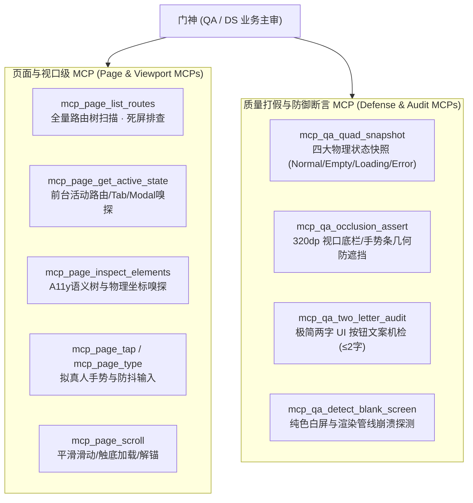
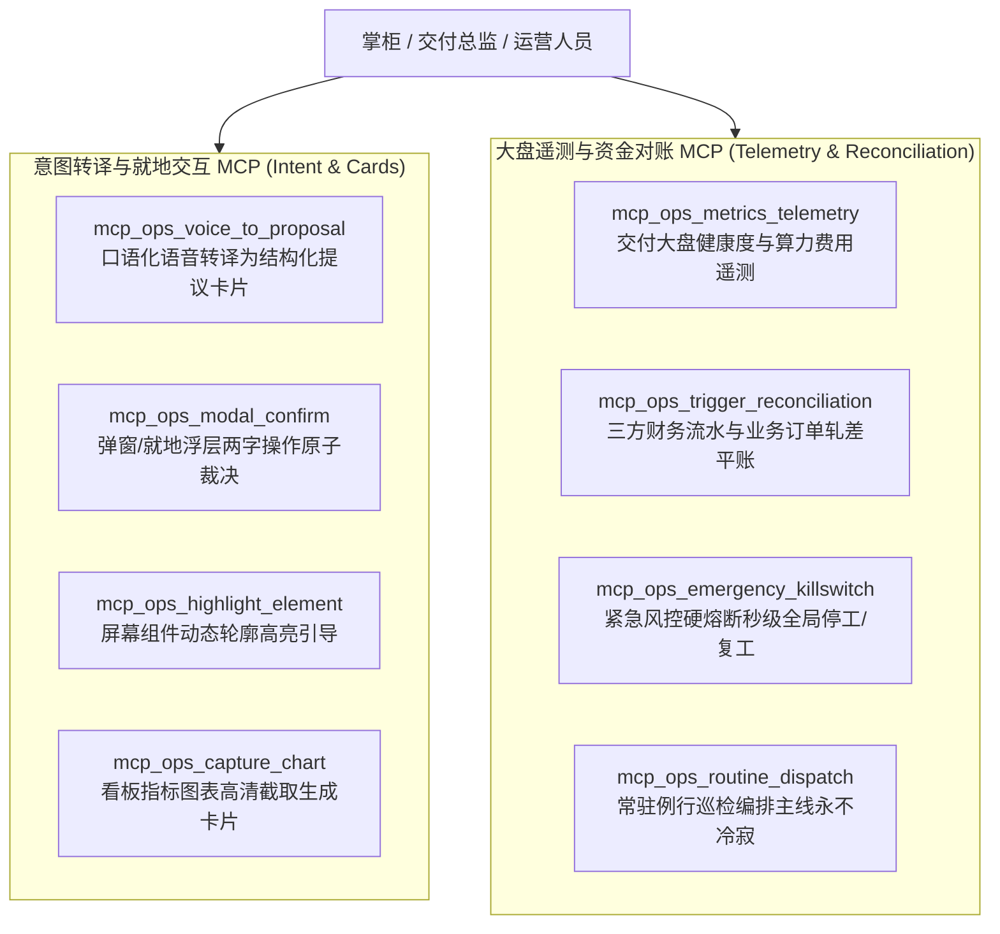

# 自动化测试与运营全栈 MCP 完备规范与执行指南 (QA & Ops Full-Stack MCP Complete Specification)

> **最高衡准**: 彻底解决自动化测试与运营能力孱弱的症结。  
> 必须将 MCP 覆盖面从狭隘的“后端 REST 接口”彻底扩展至**「页面视口渲染、组件语义定位、拟真人交互驱动、四态物理快照、320dp 几何防遮挡计算、两字 UI 规范机检与口语意图掌上闭环」**，达到完整自闭环状态。

---

## 一、自动化测试 (QA 门神) 全栈 MCP 工具体系

### 1. 核心工具清单与强类型契约
- **`mcp_page_list_routes`**: 扫描前端已注册路由，排查孤儿死屏（如历史 COOA-234 遗留的死屏）；
- **`mcp_page_get_active_state`**: 获取当前屏幕活动的路由、Modal、输入焦点与视口尺寸；
- **`mcp_page_inspect_elements`**: 基于无障碍 A11y 树获取组件语义、可点击状态与屏幕物理坐标；
- **`mcp_page_tap`**: 模拟人类触摸轻触，检测触摸反馈波纹与跳转结果，拦截假死按钮；
- **`mcp_page_type`**: 模拟键盘输入并触发防抖及动态校验，验证报错提示；
- **`mcp_page_scroll`**: 模拟滚动滑动手势，验证长列表触底分页与轮播解锚；
- **`mcp_qa_quad_snapshot`**: 自动化走查并输出正常态、为空态、加载态、错误态四张真实快照；
- **`mcp_qa_occlusion_assert`**: 算法计算目标组件与底部 5 槽位底栏、系统手势条的相交面积，遮挡率 > 5% 立即报警；
- **`mcp_qa_two_letter_audit`**: 机检视口内所有按钮文案是否严格 ≤ 2 个中文字（如“同意/驳回/立项/派单”）；
- **`mcp_qa_detect_blank_screen`**: 探测纯色白屏或渲染异常。

---

## 二、业务运营 (Ops 掌柜) 全栈 MCP 工具体系

### 1. 核心工具清单与强类型契约
- **`mcp_ops_voice_to_proposal`**: 接收掌柜一句话口语或微信语音，智能转译为结构化 Proposal 卡片与两字操作选项；
- **`mcp_ops_modal_confirm`**: 掌柜在手机端或 Web 端轻触【同意】/【驳回】，原子驱动底层状态机跃迁与活动账本记录；
- **`mcp_ops_highlight_element`**: 在掌柜前台屏幕上动态绘制高亮轮廓与浮层标签，引导复核；
- **`mcp_ops_capture_chart`**: 精准截取交付燃尽图、板材利用率等关键图表，自动封装为汇报卡片；
- **`mcp_ops_metrics_telemetry`**: 实时聚合公司全盘态势，反映活跃 Agent、Token 燃烧率与阻塞卡点；
- **`mcp_ops_trigger_reconciliation`**: 一键触发微信商业支付、银联渠道与业务订单日结对账，输出带 SHA-256 签名的《平账报告》；
- **`mcp_ops_emergency_killswitch`**: 掌柜紧急硬熔断全局停工与复工；
- **`mcp_ops_routine_dispatch`**: 编排与保持交付主线常驻 Routine。

---

## 三、自动化测试与运营实战作战全流程对账

### 1. 门神 (QA / DS) 自动化测试流水线 (端到端走查)
1. 启动命令：`node scripts/qa-automation-runner.mjs --test-route "<RouteName>" --device "320dp"`
2. 输出成果：
   - 极简两字 UI 规范审查通过清单 (0 违规)；
   - 320dp 视口几何防遮挡断言报告 (相交遮挡率 ≤ 5%)；
   - 四大物理状态快照文件路径与全局 SHA-256 校验指纹；
3. 工件总线挂载：自动调用 `mcp_work_product_create` 挂载为不可变测试资产凭证，达成 "No Artifact, No Done"。

### 2. 掌柜运营驾驶舱流水线 (掌上闭环)
1. 启动命令：`node scripts/ops-cockpit-runner.mjs --intent "<掌柜口语输入>"`
2. 输出成果：
   - 标准化 Proposal 提议卡片；
   - 黄金 5 槽位与两字 UI 对称布局；
   - 掌上两字审批一跳触发底层数据库事务与履约账本记录；
3. 财务对账：`node scripts/ops-cockpit-runner.mjs --reconcile "<YYYY-MM-DD>"` 一键轧差平账并沉淀不可变签名。
