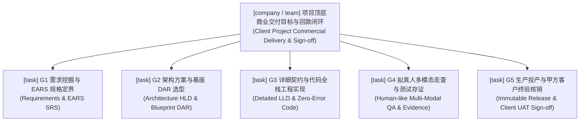

# CMMI G1~G5 商业交付 Goal 蓝图与立项模板树 (Commercial Delivery Goal Blueprint)

> **最高公理约束**: Coolie 定位为全流程 AI 原生数字员工自主驱动的「端到端商业软件交付工厂」。  
> 任何外部客户商业项目进厂立项，必须在控制面数据库 `goals` 物理表建立结构化 Goal 树。  
> 商业交付结项以甲方客户在真实生产环境中、依据《软件需求规格说明书 (SRS)》签署的《客户终验核销单 (UAT Acceptance Certificate)》为唯一法定闭环标准。

---

## 一、商业项目 Goal 树结构拓扑 (Tree Hierarchy)



---

## 二、标准 Goal 节点规范定义 (Goal Node Specifications)

### 1. 顶层商业愿景目标 (Root Commercial Goal)
- **Title**: `[项目名] 端到端商业交付、生产上线与甲方终验核销闭环 (Commercial Delivery & UAT Sign-off)`
- **Level**: `team` (或跨公司大项目采用 `company`)
- **Status**: `active`
- **Owner**: `Hermes (交付总监 / 架构中枢)`
- **Description**:  
  依据《商业交付主合同》与《软件需求规格说明书 (SRS)》，由工坊数字员工协同推进从 0 到 1 建设交付全生命周期工程资产，完成生产割接投产，并由甲方授权代表签署《客户终验核销单》，实现商业闭环与财务回款。
- **验收准则 (DoD)**:
  1. 甲方盖章/签字纸质或电子版《客户终验核销单》归档；
  2. 生产环境稳定运行超 72 小时无 P0/P1 缺陷；
  3. CMMI 01~09 全生命周期工程真资产归档无悬空。

---

### 2. G1: 需求挖掘与 EARS 规格门禁 (Gate 1: SRS & EARS Specification)
- **Title**: `[项目名][G1 需求门禁] 业务边界定界、EARS 严谨规格说明书与 RTM 追溯矩阵`
- **Level**: `task`
- **Status**: `planned` -> `active`
- **Owner**: `Hermes / 墨斗 (FDA 前线架构师)`
- **Description**:  
  对标 IEEE 29148 规范，消除客户口语化二义性，产出包含 Ubiquitous / State-driven / Event-driven / Optional / Unwanted-behavior 5 态语法的《软件需求规格说明书 (SRS)》，建立双向需求跟踪矩阵 (RTM)。
- **交付物要求 (Artifacts)**:
  - `docs/01_management/srs/SRS-[项目名].md`
  - 需求规格评审纪要与确认签字。

---

### 3. G2: 架构方案与基座 DAR 选型门禁 (Gate 2: HLD & Blueprint DAR)
- **Title**: `[项目名][G2 架构门禁] 开源基座选型 DAR 决策矩阵、概要设计 HLD 与租户物理隔离`
- **Level**: `task`
- **Status**: `planned`
- **Owner**: `墨斗 (FDA) / 铁匠 (Core SWE)`
- **Description**:  
  执行底座自动选型漏斗（`yudao-quad-terminal` vs `ruoyi-all-next`），完成 CMMI DAR 加权决策分析，产出概要设计说明书 (HLD)，锁定组织/租户数据物理隔离方案。
- **交付物要求 (Artifacts)**:
  - `docs/03_design/dar/DAR-[选型项].md`
  - `docs/03_design/hld/HLD-[项目名].md`
  - 数据库 ER 实体关系图与拓扑图。

---

### 4. G3: 详细契约与代码全栈工程实现门禁 (Gate 3: LLD & Contract Implementation)
- **Title**: `[项目名][G3 编码门禁] OpenAPI 接口契约 LLD、强类型 SDK 转译与 0 编译报错代码交付`
- **Level**: `task`
- **Status**: `planned`
- **Owner**: `铁匠 (Core SWE) / 墨斗 (FDSE)`
- **Description**:  
  编写详细设计说明书 (LLD)，生成前后端强类型 SDK 契约，完成全栈功能代码编写。严格落实 1 Task = 1 Commit，严禁 `git stash` 掩埋，强制 0 编译报错 (Zero Compile / Lint Error)。
- **交付物要求 (Artifacts)**:
  - `docs/03_design/lld/LLD-[模块名].md`
  - 源码仓库 Pull Request 或有效 Git Commit SHA；
  - 契约防漂移机检报告。

---

### 5. G4: 拟真人多模态走查与测试存证门禁 (Gate 4: Multi-Modal QA & Evidence)
- **Title**: `[项目名][G4 测试门禁] 变异测试打假、移动端 6 寸屏真机四态快照走查与测试总结报告`
- **Level**: `task`
- **Status**: `planned`
- **Owner**: `门神 (QA / DS 业务主审)`
- **Description**:  
  执行变异测试杀灭假 Mock，驱动 `agent-device` / `agent-browser` 拟真人执行关键业务旅程，捕获正常、为空、加载中、异常错误四态真实屏幕快照，审查 320dp 几何物理遮挡，出具《测试总结报告》。
- **交付物要求 (Artifacts)**:
  - `docs/04_test/TEST-REPORT-[项目名].md`
  - 真机四态快照存证图片 (`evidence/`)；
  - 变异测试杀伤率报告 (>80%)。

---

### 6. G5: 生产投产与甲方客户终验核销门禁 (Gate 5: Immutable Deployment & Client UAT Sign-off)
- **Title**: `[项目名][G5 终验门禁] 不可变制品割接、7 步生产投产、秒级回滚预案与甲方终验核销单签署`
- **Level**: `task`
- **Status**: `planned`
- **Owner**: `兜底渊 (PRE-SRE) / Hermes (掌柜代理)`
- **Description**:  
  验证环境版本指纹与不可变制品 Hash，执行无缓存灰度部署 SOP，制定秒级回滚预案；现场组织甲方主审官进行 UAT 验收，正式签署《客户终验核销单》，实现商业闭环。
- **交付物要求 (Artifacts)**:
  - `docs/05_release/SOP-DEPLOY-[项目名].md`
  - `docs/05_release/SOP-ROLLBACK-[项目名].md`
  - `docs-coolie/acceptance/UAT-[项目名]-sign-off.pdf`（或扫描图件）。

---

## 三、自动化立项初始化脚本挂载 (CLI / API One-Click Provisioning)

当收到新商业项目立项需求时，可直接通过 `scripts/seed-client-project-goals.mjs` 调用控制面原生 API 一键生成整颗 Goal 树，并与新项目的 WBS 任务树形成双向关联：

```bash
# 一键为新客户项目生成 G1~G5 活体 Goal 树
node scripts/seed-client-project-goals.mjs \
  --companyId "<companyId>" \
  --projectId "<projectId>" \
  --projectName "云南移动企微运营中台" \
  --clientName "中国移动云南分公司"
```

此规范确立商业交付客体与工坊本体并驾齐驱，实现“对内抗假死自愈，对外保真实终验”的双轨并进！
