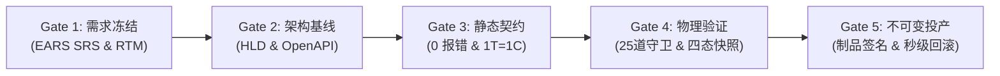

# Coolie 工坊平台综合研发管理计划与里程碑 (Project Master Plan)

> **文档代号**: COOA-PLAN-v2.0  
> **项目全称**: Coolie AI-Native Commercial Software Delivery Foundry  
> **基线版本**: v2.0.0 (生产与交付稳定版)  
> **制定日期**: 2026-10-17  
> **归属规范**: CMMI 01_management (PLAN / PP) / .agents/skills/cmmi-wbs-milestone  

---

## 1. 研发阶段里程碑与质量门禁主线 (WBS Milestones & Gate Keepers)

为彻底阻断“伪完工”与“带病投产”，Coolie 平台研发全生命周期遵循严格的 G1~G5 递进式门禁流水线：

| 门禁阶段 | 周期阶段 | 核心交付工程真资产 | 验收门禁条件 (Gate Criteria) | 主审与责任人 |
| :--- | :--- | :--- | :--- | :--- |
| **G1: 需求与立项** | Phase 01~02 | `project-charter.md` `software-requirements.md` `requirements-traceability-matrix.md` | • EARS 5态句式完备 • 双向需求追溯 RTM 建立 • 业务不变量清晰断言 | DS (@baixiaosheng) |
| **G2: 架构与契约** | Phase 03 | `architecture-hld.md` `adr/` `interface-contracts/openapi-spec.md` | • 4+1 架构分层视图冻结 • OpenAPI 3.1 强契约对齐 • DAR 选型加权打分落地 | FDA (@modou) |
| **G3: 编码与实现** | Phase 04 | Monorepo 源码仓库 `coding-standards.md` 原子 Git 提交 (1 Task = 1 Commit) | • `pnpm -r typecheck` 0 报错 • 严禁 `git stash` 掩埋代码 • 物理工作树 0 dirty 0 untracked | Core SWE (@tiejiang) |
| **G4: 验证与确认** | Phase 05~06 | `test-summary-report.md` `verification-matrix.md` 真机四态截屏快照 | • Pre-commit 25 道硬门禁 100% 全绿 • 活体本体 4 门禁反射一致 • 6 寸屏 0 遮挡 0 撑爆 | FDSE (@menshen) / QA |
| **G5: 割接与投产** | Phase 07~09 | `system-deployment-sop.md` `rollback-emergency-plan.md` `SLO-SLI-ERROR-BUDGET-MATRIX.md` | • 不可变制品 SHA-256 签名 • 7 处版本号源完全一致 • 15 分钟秒级回滚预案通过演练 | SRE (@sre) / 掌柜 |

---

## 2. 详细工作分解结构 (WBS Work Packages)

### 2.1 控制面中枢构建包 (WBS-100)
- **101**: 单人原子签出锁服务与心跳检测机制 (`server/src/services/heartbeat.ts`)
- **102**: 预算硬停止与自动暂停熔断器 (`finance-budget-guard`)
- **103**: 原生协同文档体系 (`documents` / `issue_documents`)
- **104**: 不可变工件总线与交付物注册 (`issue_work_products` / `register_deliverable`)

### 2.2 活体业务本体与全自动审计中枢 (WBS-200)
- **201**: 263 张物理表元模型映射与 Drizzle AST 反射对账
- **202**: 8 核心实体 (M1) 与 8 闭环动词 (M2) 因果状态机求值
- **203**: 5 大系统硬不变量守卫 (INV-1 ~ INV-5)
- **204**: 零人工介入机器审计脚本 (`scripts/harness-ontology-audit.mjs`) 与自愈引擎 (`--fix`)

### 2.3 极简交互与双端驾驶舱 (WBS-300)
- **301**: 移动端 6 寸屏 (320dp~430dp) 几何防撑爆与黄金 5 槽位底栏
- **302**: 全界面两字动词按钮收敛与就地防遮挡浮层
- **303**: 顶栏 🔔 消息与卡片式审批集成收件箱

### 2.4 CMMI 01~09 过程资产流水线 (WBS-400)
- **401**: CMMI 资产创建引擎与批量生成流水线 (`scripts/cmmi-asset-scaffold.cjs batch`)
- **402**: Harness 五位一体总调度器 (`scripts/harness.sh`)
- **403**: Pre-Commit 25 道物理安全门禁 (`scripts/pre-commit-check.mjs`)

---

## 3. 资源配置与进度跟踪准则 (Resource & Schedule Tracking)
1. **单写者与防踩踏纪律**：任何代码模块在同一时间仅允许单一智能体签出修改，杜绝并发冲突；
2. **小时级交付主线巡检 (Routine Keeper)**：后台常驻巡检任务扫描处于 `in_progress` 的工单，杜绝由于服务重启或会话中断导致项目冷寂停滞；
3. **经验沉淀与最小增量更新**：所有规程演进遵循加法原则，精准修改单一归宿，严禁全量推倒覆盖。
