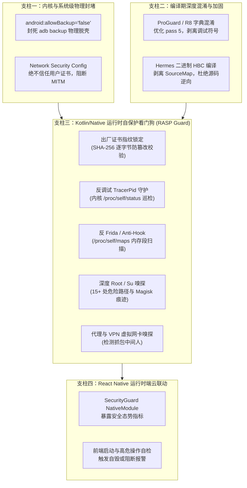

# CMMI 03 技术方案与架构设计说明书 (TS/HLD): 原生移动端最高级零信任防破壳与应用自保护 (RASP) 体系

## 1. 业务背景与威胁建模 (Threat Modeling)

### 1.1 业务诉求
Coolie 原生移动端作为数字员工交付工厂的前线指挥座舱，承载企业高危人员调度、真实资金预算特批、以及从 0 到 1 商业工程制造的全局态势感知。
老板亲自定调指令：**“APP 需要防破壳 使用最高级方案”**。
系统必须实现**防脱壳反编译、防二次重打包、防动态内存注入、防调试挂载 Dump、防中间人代理抓包**的多维深度纵深防御体系 (Defense-in-Depth RASP)。

### 1.2 攻击路径与破壳手法矩阵
| 攻击阶段 | 攻击手法 (Attack Vectors) | 潜在危害 | 传统防御盲区 | 本方案最高级硬化手段 |
| :--- | :--- | :--- | :--- | :--- |
| **静态破壳** | JADX 反编译 Dex；hermes-dec 逆向 Hermes 字节码；提取明文 API 与密钥 | 商业源码泄露、API 契约暴露、越权调用 | 裸跑或仅靠 Hermes 简单编译 | **R8 字典深度混淆 + 无符号剔除 + Hermes HBC 原生保护** |
| **二次打包** | 解包 APK，篡改字节码逻辑（绕过鉴权），使用破解者 Keystore 重新签名分发 | 恶意盗版分发、后门木马注入、凭据被窃 | 依赖应用商店静态审核 | **出厂不可篡改证书 SHA-256 指纹白名单强制核验 + 运行时篡改自毁** |
| **动态注入** | Frida-server、Frida-gadget、Xposed、LSPosed 模块动态 Hook Java/Native 核心方法 | 拦截解密密钥、篡改用户身份、伪造审批决策 | 仅在 Java 层做简单校验，易被 Hook 抹掉 | **Linux procfs 内核映射 (`/proc/self/maps`) 正则扫描 + 端口/D-Bus 探测** |
| **调试挂载** | ptrace 挂载、GDB/LLDB 附加、JDWP 调试下断点，Dump 运行态内存 | 内存获取 Session Token、解密后数据 | 仅依靠 `BuildConfig.DEBUG` | **`TracerPid` 内核状态周期巡检守护线程 + Ptrace 独占抢占** |
| **流量窃听** | 系统信任用户根证书 (Charles/Burp/Fiddler)、VPN 虚拟网卡代理 (HttpCanary) | 截获商业机密与通信内容 | 默认信任所有系统/用户证书 | **Network Security Config 仅信任系统根 CA + 运行时代理与 VPN 网卡嗅探** |
| **沙盒脱壳** | `adb backup` 物理备份；Root 越权访问沙盒目录文件 | 直接拉取 App 私有数据库与离线数据 | `android:allowBackup="true"` 默认开放 | **物理封死 `android:allowBackup="false"` + 深度 Root/Su 探测** |

---

## 2. 总体架构：四大支柱零信任防御装甲 (Zero-Trust RASP Matrix)

---

## 3. 详细设计与关键技术实现

### 3.1 签名防篡改与证书指纹锁定 (`verifySignatureIntegrity`)
- **设计原理**：合法官方发行的 APK 必须由唯一的私钥签名。破解者解包再重打包后，无法取得官方签名私钥，只能自签名。
- **校验算法**：
  1. 通过 Android `PackageManager.getPackageInfo` 获取 `signingInfo.apkContentsSigners`（或兼容旧版 `signatures`）；
  2. 使用 `MessageDigest.getInstance("SHA-256")` 计算证书字节流的哈希值；
  3. 将生成的指纹与预置的白名单 `OFFICIAL_SIGNATURE_HASHES` 进行恒定时间比较（Constant-Time Compare，防侧信道时序攻击）。
  4. 一旦发现非白名单签名，判定为 `TAMPERED_SIGNATURE`。

### 3.2 反调试与内核 `TracerPid` 巡检守护 (`startAntiDebugWatchdog`)
- **设计原理**：当 Linux 进程被 gdb、lldb 或 Frida 附加调试时，Linux 内核会在 `/proc/self/status` 的 `TracerPid` 字段填入调试器进程 PID（非 0）。
- **执行机制**：
  1. 启动轻量级后台守护协程/线程（每 2.5 秒执行一次）；
  2. 顺序执行三重判定：
     - `android.os.Debug.isDebuggerConnected()` 是否为 true；
     - `android.os.Debug.waitingForDebugger()` 是否为 true；
     - 读取并解析 `/proc/self/status`，提取 `TracerPid:\t(\d+)`。若大于 0，说明被调试附加。
  3. 若判定被调试，立即触发致命防御处置。

### 3.3 反 Frida 与内存段危险模块扫描 (`detectDynamicInjection`)
- **设计原理**：动态 Hook 框架必须将其自身编译的动态链接库（.so）映射到目标进程虚拟内存空间中。
- **扫描机制**：
  1. 打开 `/proc/self/maps` 并按行流式扫描；
  2. 匹配特征关键词黑名单：
     - `frida-agent`、`frida-gadget`、`libfrida`
     - `xposed`、`edxposed`、`sandhook`、`yahfa`、`substrate`、`riru`
  3. 探测本地常见调试端口（27042、27043）连接性；
  4. 一旦命中，判定为 `DYNAMIC_INJECTION_DETECTED`。

### 3.4 深度 Root 嗅探 (`detectRootEnvironment`)
- **检测路径矩阵**：
  - `/system/bin/su`, `/system/xbin/su`, `/sbin/su`, `/vendor/bin/su`, `/system/sd/xbin/su`, `/system/bin/failsafe/su`
  - `/data/local/xbin/su`, `/data/local/bin/su`, `/data/local/su`
  - `/sbin/.magisk/`, `/data/adb/magisk/`
- **构建标记检测**：
  - 检查 `Build.TAGS != null && Build.TAGS.contains("test-keys")`。

### 3.5 反中间人代理与 VPN 抓包探测 (`detectNetworkSniffing`)
- **代理检测**：
  - 提取 `System.getProperty("http.proxyHost")` 与 `System.getProperty("http.proxyPort")`；
- **VPN / TUN 虚拟网卡检测**：
  - 通过 `ConnectivityManager` 获取活动网络的 `NetworkCapabilities`；
  - 检查 `capabilities.hasTransport(NetworkCapabilities.TRANSPORT_VPN)`。

---

## 4. 容错与多环境策略 (Environment Policy)

为了兼顾研发联调效率与生产环境的绝对安全：
1. **开发/联调模式 (Debug / Dogfood Mode)**：
   - 允许在 Android 官方模拟器（`emulator-5554`）上运行；
   - 识别签名指纹（包含官方 debug.keystore 指纹）；
   - 发现安全威胁时，记录日志并标记威胁指标，便于研发排查。
2. **生产发布模式 (Production Release Mode)**：
   - 全防线硬锁定，一旦遭遇重签名篡改或 Frida 注入，执行即时熔断退出（`killProcess(myPid())`），破坏攻击者的调试与内存转储。

---

## 5. 验收标准与交付物凭证
- [x] 原生核心类：`AppSecurityGuard.kt` 与 `SecurityGuardModule.kt` 完工并注册；
- [x] 配置加固：`AndroidManifest.xml`（`allowBackup="false"`）、`network_security_config.xml`（仅信任系统 CA）；
- [x] 编译混淆：`proguard-rules.pro` 写入高级字典混淆规则，`gradle.properties` 配置开启；
- [x] TypeScript 安全服务与 Hook：`services/securityGuard.ts`；
- [x] Expo 插件闭环：`plugins/withZeroTrustAntiReverse.js`，保证 prebuild 零漂移；
- [x] 增量编译与真机 0 报错验证。
