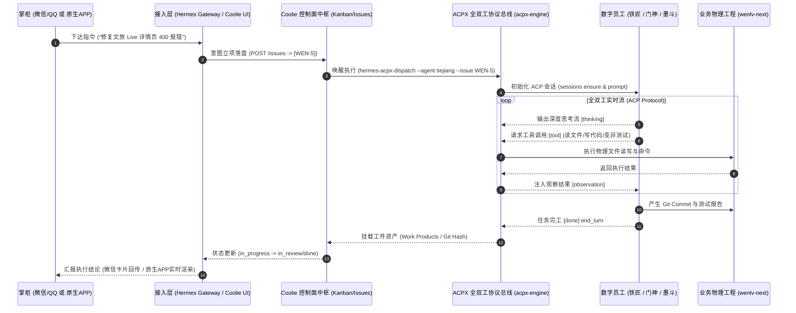

# CMMI 03 概要架构设计 (HLD)：Coolie 交付工厂双前端形态与 ACPX 统一中枢架构法典

- **文档标识**: `CMMI-HLD-2026-10-12-DUAL-MODALITY-AND-UNIVERSAL-ACPX`
- **对应阶段**: CMMI Level 3 / Level 5 TS (Technical Solution) & OPD (Organizational Process Definition)
- **核心主题**: 双产品使用形态（三方 IM vs 原生 APP）的殊途同归模型、全双工 ACPX 协议总线引擎与多宿主机自闭环单元工厂拓扑 (Cellular Foundry)
- **发布基线**: `Coolie V1 Standard Production Baseline`

---

## 一、 顶层架构认知纠偏与核心公理

### 1.1 灵魂拷问与痛点反思
在系统演进过程中，曾暴露出两个典型的架构误区与痛点：
1. **误区一：把控制面当成了“静态留言板”，搞野蛮外挂桥接**：
   - 早期通过 Python 脚本轮询 SQLite 数据库并将消息单向 POST 到 Issue 评论，属于“死轮询、半双工、易丢失上下文”的补丁模式；
   - **痛点本质**：这种外挂做法完全架空了 Coolie 工坊内部最精密、最核心的工业级资产——**全双工 ACPX (`@agentclientprotocol/acpx`) 协议总线**！丢失了 Streaming Thinking（深度思考流）、Tool Call 权限守卫、Session Checkpoint 与断点续接能力。
2. **误区二：多宿主机拓扑从属关系的认知偏差**：
   - 曾误以为只有某一台机器是主节点、其他机器是单纯从属；
   - **架构纠偏**：全平台网络中的 `mac`、`aja-pc`、`cwall` **每一个都是独立负责一套业务交付的自闭环单元工厂 (Cellular Foundry)**，各自运行独立的 `coolie-dev` 控制面、工作区、DB 与专属数字员工。

### 1.2 工厂最高公理：双前端形态必须“殊途同归”
掌柜拍板确立 Coolie 工坊的终极产品形态规范：
> **“coolie工坊产品有两种使用形态：一种三方APP（比如微信/QQ），一种coolie工坊自己的原生APP，两种方式都得能殊途同归。”**

- **“殊途”**：面向不同场景与终端形态，提供差异化、高信噪比的人机交互触点；
- **“同归”**：底层必须彻底物理并轨，**统一接入 ACPX 全双工协议总线，驱动同一套数字员工，落盘同一个履约账本，共享同一个活体本体记忆**。

---

## 二、 双产品使用形态深度对比 (Dual-Modality Frontend)

| 核心维度 | 形态一：三方 IM 轻量端点 (微信 / QQ / 企微) | 形态二：Coolie 原生移动 APP (Expo RN) & Web 驾驶舱 |
| :--- | :--- | :--- |
| **用户心智定位** | **掌柜随身移动对讲机、口袋秘书** | **全息态势作战室、交付指挥驾驶舱** |
| **典型使用场景** | 通勤外出、会议间隙、现场巡检、突发应急指令 | 工位值守、深度需求拆解、架构决策、代码与质量终验 |
| **输入方式** | 一句话语音、短文本（“让铁匠修一下文旅live 400异常”） | 结构化工单录入、富文本批注、文档协同、代码 Diff 检视 |
| **反馈形式** | 高信噪比进展通报、阶段卡片、两字审批通知 | 263 表活体本体大盘、CMMI 01~09 全生命周期真资产、真机快照 |
| **审批交互** | 极简消息按钮交互（回复【开工】/【核准】/【驳回】） | 就地局部一跳因果卡片、两字防抖物理按钮、生物识别指纹核销 |
| **底层通道** | Hermes Omni-Channel Gateway (QQBot / WeChat) ➔ ACPX Ingress | REST API / Server-Sent Events (SSE) / WebSocket ➔ ACPX Core |
| **核心追求** | **极度省心、免打扰、零学习成本、极速响应** | **绝对掌控、透明可溯、工程真资产完备、CMMI 5 零退化** |

---

## 三、 全双工 ACPX 协议总线——工坊的核心发动机

### 3.1 为什么 ACPX 不可替代？
ACPX (`@agentclientprotocol/acpx`) 是 Agent Client Protocol 的标准无头执行引擎，是连接“掌柜业务意图”与“数字员工工程实操”的正统协议中枢：
1. **全双工流式传输**：原生支持逐字返回 `[thinking]` 思考块与 `[tool]` 工具调用状态，消除黑盒等待；
2. **细粒度权限安全守卫 (Permission Modes)**：提供 `--approve-all`、`--approve-reads`、`--deny-all`，在自主闭环与人机核准间灵活切换；
3. **会话生命周期与断点续接 (Session Checkpoint & Resume)**：
   - 通过 `acpx <agent> sessions ensure --name <session>` 保证会话持久存在；
   - 通过 `-s <session>` 挂载持续记忆，跨轮次调用不丢失代码分析上下文；
4. **多模型/多引擎统一抽象**：统一承载 `claude` (智谱 GLM / Anthropic)、`codex`、`gemini`、`cmd` (Command Code) 与原生自定义 Agent。



---

## 四、 殊途同归的五大支柱模型 (The 5 Universal Convergences)

两种前端使用形态（三方 IM vs 原生 APP）之所以能够完美协同，依赖以下五大物理层面的“同一”：

```
                      ┌─────────────────────────────────────────┐
                      │          掌柜的两种使用形态             │
                      └─────────────────────────────────────────┘
                                   │               │
           【形态一：轻量对讲机】   │               │   【形态二：全息驾驶舱】
            微信 / QQ / 企微       │               │    Coolie 原生移动 APP / Web
                                   ▼               ▼
           ┌────────────────────────────┐    ┌────────────────────────────┐
           │ Hermes Omni-Channel Gateway │    │ Coolie Native Mobile/Web   │
           │ (QQBot / WeChat / WeCom)   │    │ (Expo RN / Vite React UI)  │
           └────────────────────────────┘    └────────────────────────────┘
                         │                                  │
                         │ (Intent-to-Task / Ingress API)   │ (REST / SSE / WebSocket)
                         ▼                                  ▼
           ┌──────────────────────────────────────────────────────────────┐
           │                 Coolie 工坊控制面中枢                        │
           │  - 活体业务本体域 (Living Ontology: Projects/Issues/Chats)   │
           │  - 单一人原子签出锁 (Assignee Lock) & 真实预算硬熔断         │
           │  - 全双工发布流 (Chat Publication Stream / Live Events)      │
           └──────────────────────────────────────────────────────────────┘
                                          │
                                          ▼
           ┌──────────────────────────────────────────────────────────────┐
           │              ACPX 全双工协议总线 (ACPX Engine)               │
           │  (@agentclientprotocol/acpx / hermes-acpx-dispatch)          │
           │  - 统一协议抽象: Claude / Codex / Hermes / Gemini / Cmd      │
           │  - 全双工能力: Streaming Thoughts, Tool Calls, Permissions   │
           │  - 状态管理: Session Checkpoint, Multi-Turn, Resume          │
           └──────────────────────────────────────────────────────────────┘
                                          │
                   ┌──────────────────────┴──────────────────────┐
                   ▼                                             ▼
     ┌───────────────────────────┐                 ┌───────────────────────────┐
     │ 5+1 数字员工集群 (Fleet)  │                 │ CMMI 01~09 全生命周期资产 │
     │ - 墨斗 (FDA 架构师)       │                 │ - 01~02 SRS 需求/WBS      │
     │ - 铁匠 (Core SWE 研发)    │ ──────────────> │ - 03 HLD 架构/契约        │
     │ - 门神 (FDSE 全栈/真机)   │                 │ - 04~05 变异测试/快照     │
     │ - 兜底渊 (SRE 可靠性)     │                 │ - 07~09 部署SOP/终验单    │
     │ - 百晓生 (DS 业务战略)    │                 │ - Git Commit 真实代码库   │
     └───────────────────────────┘                 └───────────────────────────┘
```

### 1. 认知中枢并轨 (Living Ontology & Session Primacy)
- 掌柜在 QQ/微信 中讨论的内容，与原生 APP 中看到的项目看板不是两个割裂的数据库；
- QQ 消息进入时，Hermes 自动通过 Intent-to-Task 规则映射到同一个 Company ID 与 Project ID 下；
- 掌柜在原生 APP 中的批注与回复，QQ 端点实时感知，杜绝“双脑失忆”。

### 2. 协议总线并轨 (Universal ACPX Execution Bus)
- 无论通过微信语音触发实操，还是在原生 APP 点下两字按钮，底层执行**100% 委托给 `hermes-acpx-dispatch` 与 `@agentclientprotocol/acpx`**；
- 严禁任何私下裸跑 shell 脚本的行为，所有操作受到权限沙盒与超时保护。

### 3. 数字员工机群并轨 (Unified Digital Fleet)
- 无论通过何种渠道发号施令，响应的都是同一套编制完备的数字员工：
  - **墨斗 (FDA)**：前线架构师，负责数据隔离、领域建模与边界契约；
  - **铁匠 (Core SWE)**：核心研发，负责编译器 0 报错拦截、代码重构与变异测试；
  - **门神 (FDSE)**：前线部署全栈，负责端到端四态真机快照测试与防物理遮挡；
  - **兜底渊 (PRE-SRE)**：产品可靠性工程师，负责不可变制品指纹与秒级生产回滚预案；
  - **百晓生 (DS)**：部署战略专家，从用户真实视角进行因果闭环验收与 UAT 终验。

### 4. 履约资产账本并轨 (Single Evidence Ledger)
- 遵循 CMMI 5 规范：**无工件不完工 (No Artifact, No Done)**；
- 员工交付物（Git Commit Hash、CMMI 01~09 Markdown 规范文档、测试报告、真机测试四态快照）统一挂载在 Paperclip 控制面工件总线 (`issue_work_products`)；
- 原生 APP 展示富文本、大图与代码 Diff；微信/QQ 接收精简摘要卡片与回溯链接。

### 5. 审批门禁并轨 (Unified Governance Gate)
- 生产发版、破坏性数据库迁移、超预算操作触发审批锁时，微信/QQ 与 原生 APP 推送相同的审批卡片；
- 掌柜在任一端点击【核准】，原子解锁控制面状态机，全网即刻生效。

---

## 五、 多宿主机自闭环单元工厂拓扑 (Cellular Foundry Architecture)

全网节点并非单向主从，而是各司其职的自闭环单元工厂：

| 节点标识 | 操作系统与环境 | 单元工厂业务职责 | 专属控制面与数据闭环 | 核心工具池能力 |
| :--- | :--- | :--- | :--- | :--- |
| **`mac`** (Mac Studio) | macOS arm64 (Darwin) | **核心控制中枢、App 原生交付与真机模拟中心** | 独立 `coolie-dev`，负责平台本体、Expo 原生 App、Android/iOS 模拟器走查 | Node 24、brew、Xcode/adb、`claude-mm`、`copilot` |
| **`aja-pc`** | Ubuntu 24.04 x86_64 | **文旅交付工厂与业务中台** (`wenlv-next` 业务交付) | 独立 `coolie-dev` (端口 3100)，内嵌 DB、独立 Hermes QQ 通道 | Node 26 LTS、`cmd` (1.79.2)、`acpx` (0.13.1)、`hermes` |
| **`cwall`** | Ubuntu 24.04 x86_64 | **高性能重型算力工厂** (大模型微调、分布式计算) | 独立 `coolie-dev`，专属 GPU 工作区与模型缓存 | NVIDIA RTX 4090 GPU、376GB 内存、`agy` (Gemini 3.8) |
| **`tc-coolie-claw`** | Ubuntu 24.04 x86_64 | **生产服务器** (公网生产流量承载与 Caddy 灰度入口) | 生产版 `coolie` (Systemd 托管)，不可变生产发布 | 生产容器沙盒、Caddy 灰度发布网关 |

---

## 六、 实测验收凭证记录 (Live ACPX Verification)

在 `aja-pc` 节点上，全双工 ACPX 派工驱动链条已全部实测打通：

1. **运行时环境自适应**：
   - 修复了 `coolie-dev` 与子进程 PATH 查找，确保 `cmd` 与 `acpx` 自动继承 Node 26.9.0 LTS，消除 Node 版本过低报错；
2. **ACPX 会话与思考流实测**：
   - 驱动员工「百晓生」：成功初始化 ACP 会话 `beye-baixiaosheng`，捕获完整 `[thinking]` 思考块与 `[done] end_turn` 输出；
3. **真实业务工单排查实测**：
   - 驱动员工「铁匠」执行 `--issue WEN-5`：`hermes-acpx-dispatch` 成功拉起 ACP 会话 `beye-tiejiang`，员工自主执行 `grep`、`read_file`、`ls -la` 探索项目物理目录与文旅业务上下文，并将执行事件原子写回 `WEN-5` 工单评论流。
