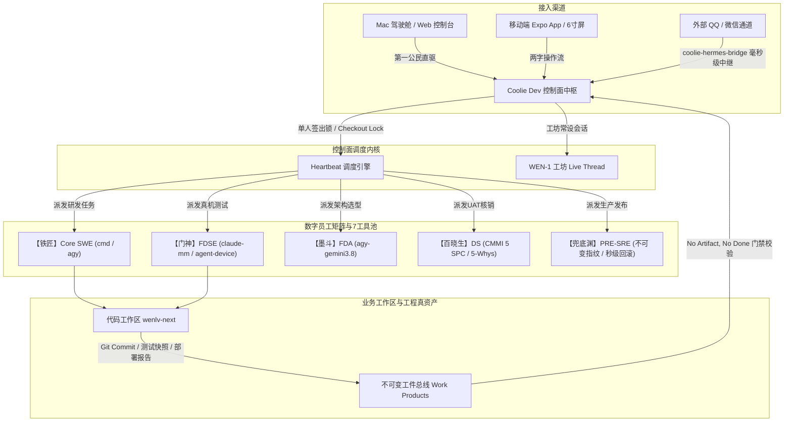

# CMMI 03 概要架构设计 (HLD)：Coolie 交付工厂产品标准化与全渠道双轨并轨体系

- **文档标识**: `CMMI-HLD-2026-10-12-PRODUCT-STANDARDIZATION-OMNI-CHANNEL`
- **对应阶段**: CMMI Level 3 / Level 5 TS (Technical Solution) & OPD (Organizational Process Definition)
- **核心主题**: 商业级端到端数字员工交付工厂标准产品形态、多宿主机拓扑角色与全渠道实时并轨架构
- **发布基线**: `Coolie V1 Standard Production Baseline`

---

## 一、 为什么必须标准化？历史痛点与反思

在前期多机混合环境（Mac Studio 前线驾驶舱、cwall 算力中心、aja-pc 文旅交付中台、tc-coolie-claw 生产服）的快速演进中，系统曾出现若干典型“非标准化”痛点：
1. **各跑各的（孤岛化）**：控制面 Server 跑在一边，Hermes Agent 网关跑在另一边，外部聊天通道（QQ/微信）的消息无法自动进入控制面，造成“聊了半天控制面空空如也”；
2. **门禁与实操指令冲突**：规则死板要求“两步确认建单”，导致掌柜在现场下达的高频实操排查指令（如“让 cmd 看看”、“让 agy 修”）被 Hermes 作为本地单机命令消化，脱离了控制面履约看板；
3. **补丁式运维**：出现问题临时写脚本、手动 scp，缺少统一标准构建打包包（Turnkey Bundle）与全维健康自检机制。

因此，必须站在**商业软件交付工厂最高生态位**，将 Coolie 提升为一个**开箱即用、工业化、自闭环的标准商业产品**。

---

## 二、 全网物理拓扑与节点标准化职责

全平台依托 Tailscale 网状拓扑与 SSH 互联，各物理节点定位严格标准化分工：

| 物理节点标识 | 操作系统与架构 | Tailscale IP | 核心职责与独占硬件能力 | 标准接入模式 |
| :--- | :--- | :--- | :--- | :--- |
| **`mac`** (Mac Studio) | macOS arm64 (Darwin) | `100.84.124.71` | **前线指挥驾驶舱**、Android/iOS 模拟器、移动端真机走查、Node 24、brew | **第一公民直连** (Web 控制台 / Expo 原生 App / 终端 agy/cmd) |
| **`aja-pc`** | Ubuntu 24.04 x86_64 | `100.101.22.109` | **文旅交付工厂与业务中台** (`wenlv-next` 业务交付与 Hermes 本地施工队) | **受管交付节点** (Coolie Dev 控制面 + Live Bridge + IM 网关) |
| **`cwall`** | Ubuntu 24.04 x86_64 | `100.118.232.61` | **高性能重型算力中心** (NVIDIA RTX 4090 GPU、376GB 内存、重型模型推理) | **计算节点** (GPU Worker / 容器集群) |
| **`tc-coolie-claw`**| Ubuntu 24.04 x86_64 | `62.234.59.180` | **生产服务器** (承载线上生产环境与公网 Caddy 灰度入口) | **生产发布节点** (Systemd 生产服务) |

> [!IMPORTANT]
> **Mac 宿主机绝非“同步任务模式”**！Mac 是掌柜的第一手指挥驾驶舱，通过 Web/App 界面直接发号施令；“同步任务模式 (Live Bridge)”专用于**外部移动 IM 远程渠道（QQ/微信）**的中继连接。

---

## 三、 Coolie Dev 中的“数字员工”三大标准使用范式

Coolie 控制面中的数字员工（铁匠、门神、墨斗、百晓生、兜底渊、Hermes）绝非仅用于展示的虚拟头像，而是具备**原子签出锁、真实工具池绑定、心跳调度与 CMMI 质量门禁**的完整执行实体：

### 1. 范式一：工单指派与自动履约模式 (Heartbeat Autonomous Delivery)
- **触发路径**：掌柜在看板将工单指派给对应员工，状态变更为 `in_progress`；
- **执行过程**：Heartbeat 调度器自动唤醒绑定的底层工具（如 `cmd` 或 `agy`），在业务工作区（`/home/beye/workspace/wenlv-next`）内读取工单需求，自主编码、重构、执行测试；
- **结项硬门禁**：员工调用系统 API 挂载 Git Commit Hash、四态真机测试快照与部署报告。后端强制核验：**无工件不完工 (No Artifact, No Done)**，自动闭环流转为 `done`。

### 2. 范式二：工坊对话直驱模式 (Workshop Concierge Mode)
- **触发路径**：掌柜在 Web 或手机 App 打开【工坊】（`WEN-1` 会话），直接打字或发送语音；
- **执行过程**：Hermes 掌柜接单并进行意图拆解，通过 Context Bus 实时分流给对应匠人（如让铁匠修代码、让门神走查），并在工坊中以就地浮层卡片流式返回执行阶段（STAGE 1~5）与排查结论；
- **掌柜决策**：掌柜就地点击【确认】或【批准】，工单与代码自动落盘。

### 3. 范式三：全渠道远程对讲机模式 (Remote Omni-Channel Bridge)
- **触发路径**：掌柜离线或在移动中，通过 QQ 群/私聊或企业微信发送语音/文字；
- **执行过程**：常驻守护进程 `coolie-hermes-bridge` 毫秒级轮询，把掌柜指令写入工坊；识别到实质性排查/开发需求时，**自动在看板立项建单**，并触发【范式一】或【范式二】的员工履约链条；
- **闭环反馈**：员工执行完成后的证据和工单链接秒级回推至 QQ/微信。

---

## 四、 标准化工程资产与运维命令

全套产品能力已彻底收拢并落盘至仓库与发行包规范中：

1. **同步桥接内核**：`scripts/coolie-hermes-bridge.py`（纯标准库自闭环，0 外部依赖）；
2. **历史追溯工具**：`scripts/sync-qq-history.py`；
3. **打包构建引擎**：`scripts/package-coolie-dev-bundle.mjs`，一键生成单一归档包 `coolie-dev-1.0.0-linux-x64.tar.gz`；
4. **服务管理与深度健康体检**：
   - `coolie-dev start`：原子拉起控制面 Server、Tailscale 跨端代理与 Hermes 实时同步桥接器；
   - `coolie-dev status`：查询各组件实时运行状态与 PID；
   - `coolie-dev health`：一键全息体检（Server、API、Tailscale、Hermes 状态库、Bridge 守护、7 工具池 CLI 就绪审计）；
   - `coolie-dev stop`：优雅停止所有组件。
