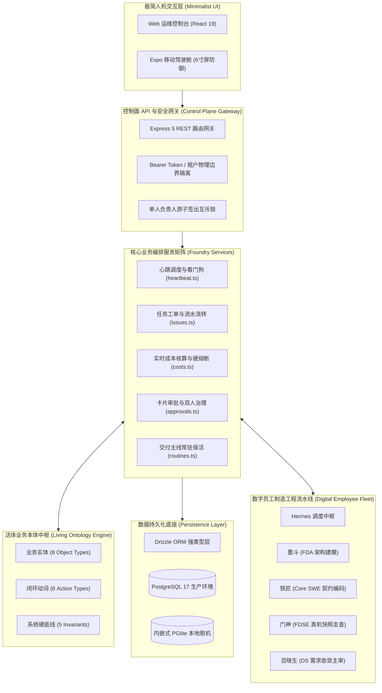

# Coolie AI 原生商业软件交付工厂控制面平台 · 系统总体架构概要设计说明书 (HLD)

> **文档代号**: COOLIE-FOUNDRY-HLD-2.0.0  
> **项目全称**: Coolie AI 原生商业软件交付工厂控制面平台 (端到端数字员工全自主软件制造与交付中枢)  
> **基线版本**: 2.0.0 (生产冻结稳定版)  
> **制定日期**: 2026-10-17  
> **归属规范**: CMMI 03_design (TS) / IEEE 1016-2009 / GB/T 8567-2006 (HLD) / .agents/skills/cmmi-tech-solution  

---

## 1. 系统定位与架构愿景 (System Overview & Architectural Vision)

Coolie AI 原生商业软件交付工厂控制面平台 定位为全流程由 AI 数字员工驱动的**「端到端商业软件交付工厂控制面平台 (Foundry Control Plane)」**。平台从软件交付公司的合伙人与总架构师顶层视角出发，解决传统商业交付中“需求漂移、代码腐化、人肉评审滞后、文档与代码两张皮”等顽疾。

系统严格贯彻三层物理生命周期隔离：
1. **第一层：工厂指挥决策中枢 (Console & Mobile Cockpit)**：专属于掌柜、交付总监与前线 FDE，提供全盘态势感知、一句话意图派单、两字审批卡片与移动端随身看盘；
2. **第二层：软件制造工程流水线 (Delivery Foundry Pipeline)**：专属于数字员工（Hermes/墨斗/铁匠/门神/百晓生），从 0 到 1 建造并交付真实工程资产（需求 SRS、架构 HLD、契约 LLD、源码 Repo、全栈测试集、割接 SOP）；
3. **第三层：业务落地运行系统 (Delivered Application)**：专属于客户生产环境（如云南移动企微中台、社区生活服务商用中台等），承载真实业务流水。

---

## 2. 总体 4+1 架构全景视图 (4+1 Architectural View Model)

### 2.1 逻辑视图 (Logical View)
- **极简人机交互层 (Minimalist UI)**：
  - Web 端：基于 React 19 + Vite 6 + Tailwind CSS 4 构建，支持大盘看板、工单管理与协同文档；
  - 移动端：基于 React Native + Expo SDK 52 构建（`clients/expo/`），严格执行 320dp 几何防撑爆、黄金 5 槽位绝对对称底栏、两字动词按钮与就地防遮挡浮层。
- **控制面编排服务层 (Control Plane Server)**：
  - 基于 Node.js 24 LTS + Express 5，以 Company 为边界实施行级租户隔离；
  - 核心服务包括心跳调度 (`heartbeat.ts`)、工单原子签出 (`issues.ts`)、实时费用统计与硬熔断 (`costs.ts`)、卡片式审批流 (`approvals.ts`)、交付主线巡检守护 (`routines.ts`)。
- **活体业务本体中枢 (Living Ontology Engine)**：
  - 独立根目录 `/ontology/`，基于 Palantir 活体本体理念构建，定义实体 (Object Types)、动词 (Action Types) 与系统不变量 (Invariants)，对 Drizzle 225 张物理表实施 100% 自动化双向反射审计。
- **数据持久化层 (Persistence Layer)**：
  - 基于 Drizzle ORM，自动适配双模运行：生产环境直连 PostgreSQL 17，本地脱机开发与单测直连内嵌 WebAssembly PGlite。

### 2.2 进程与线程视图 (Process & Concurrency View)
- 单人负责人原子锁（同一时刻唯一执行人持有 Issue 签出锁）；
- 交付主线巡检守护进程 (`scripts/coolie-dev-loop-supervisor.mjs`) 常驻运行，维护小时级生命周期；
- 移动端与 Web 端通过 WebSocket / Server-Sent Events 实现长任务心跳与非阻塞状态同步。

### 2.3 开发与工程视图 (Development & Monorepo View)
全栈仓库采用 PNPM Workspaces 单体多包工程架构：

| 子包标识 | 架构分层 | 核心职责与业务能力 | 技术选型与运行环境 | 源码物理路径 |
| :--- | :--- | :--- | :--- | :--- |
| **`server`** | 控制面服务层 | REST API 网关、单人原子签出、实时成本计算、审批引擎、心跳监控 | Node.js 24 + Express 5 | `server/` |
| **`ui`** | Web 驾驶舱层 | 交付总监大盘看板、工单协作、知识库文档、活体本体可视化图谱 | React 19 + Vite 6 + Tailwind CSS | `ui/` |
| **`clients/expo`** | 移动端驾驶舱 | 掌柜随身看板、一句话自然语言派单、卡片式审批决策、6寸屏物理防御 | React Native + Expo SDK 52 | `clients/expo/` |
| **`packages/db`** | 数据持久化层 | Drizzle ORM Schema、数据库迁移、PostgreSQL 17 / PGlite 双模驱动 | Drizzle ORM + PG / PGlite | `packages/db/` |
| **`packages/shared`** | 跨端契约共享 | 共享 TypeScript 类型定义、统一错误码、OpenAPI 契约、常量枚举 | TypeScript 5.8 | `packages/shared/` |
| **`packages/adapters`** | 智能体适配层 | Claude, Codex, Cursor 等 7 工具池智能体协议桥接与执行隔离 | TypeScript + Process Isolation | `packages/adapters/` |
| **`cli`** | 终端命令行工具 | `paperclipai` 官方发布 CLI 工具链与运维命令套件 | Node.js Executable | `cli/` |

### 2.4 物理部署视图 (Deployment & Topology View)
全平台数字员工体系运行于多机混合拓扑中，依托 Tailscale Mesh 网状网络与 SSH 互联互通：

| 节点标识 | 物理主机类型与架构 | 核心独占硬件与运行环境 | Tailscale 网状网络 IP | 承担职责与服务角色 |
| :--- | :--- | :--- | :--- | :--- |
| **`mac`** | Mac Studio (M-Series ARM64) | Android / iOS 原生模拟器, Xcode, Node 24 | `100.84.124.71` | 前线指挥驾驶舱、移动端截屏存证、本地沙箱验证 |
| **`cwall`** | Ubuntu 24.04 x86_64 | NVIDIA RTX 4090 GPU, 376GB 内存 | `100.118.232.61` | 高性能算力节点、重型模型推理与容器化构建集群 |
| **`aja-pc`** | Ubuntu 24.04 x86_64 | 专有交付测试环境 | `100.101.22.109` | 商业交付业务中台与预发布集成验证中心 |
| **`tc-coolie-claw`** | Ubuntu 24.04 x86_64 | 生产高可用 Linux 服务器 | `62.234.59.180` | 生产控制面服务、PostgreSQL 17 主库与 Caddy 网关 |

### 2.5 核心用例场景视图 (Use Case Scenario View)
掌柜自然语言一句话进厂 ➔ Hermes 解析转译排期 Issue ➔ 墨斗 FDA 架构建模 ➔ 铁匠 Core SWE 契约编码 ➔ 门神 FDSE 真机快照走查 ➔ 掌柜手机卡片两字【审批】➔ 自动割接上线。
