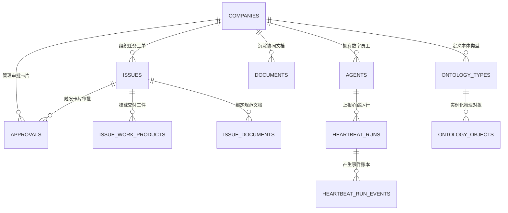

# Coolie 工坊平台控制面统一数据库与 ERD 设计说明书 (Drizzle ORM & PostgreSQL)

> **文档代号**: COOA-DB-ERD-v2.0  
> **系统代号**: `COOLIE-FOUNDRY-CORE` (Coolie AI-Native Foundry Control Plane)  
> **基线版本**: v2.0.0 (生产冻结稳定版)  
> **制定日期**: 2026-10-17  
> **归属规范**: CMMI 03_design (TS) / ISO/IEC 9075:2016 (SQL) / .agents/skills/cmmi-detailed-contracts  

---

## 1. 数据库选型与持久化架构设计 (Persistence Architecture)

Coolie 工坊控制面采用 **Drizzle ORM** 作为强类型数据映射底座，实现统一 Schema 跨双模持久化驱动：
1. **生产环境 (Production)**: 直连高可用 **PostgreSQL 17**，支撑高并发连接池与事务行级锁；
2. **本地研发与自动化单测 (Dev / Vitest)**: 自动降级至内嵌式 **WebAssembly PGlite**（`DATABASE_URL=""`），实现零外部 Docker/数据库依赖、毫秒级测试自闭环。

---

## 2. 核心领域实体关系全景图 (ERD - Entity Relationship Diagram)



---

## 3. 核心物理表结构规范 (Core Table DDL Schemas)

数据定义源码统一收拢于 [`packages/db/src/schema/`](file:///host-workspace/xaicd/coolie/packages/db/src/schema/)：

### 3.1 企业租户表 (`companies`)
```typescript
// packages/db/src/schema/companies.ts
export const companies = pgTable("companies", {
  id: uuid("id").primaryKey().defaultRandom(),
  name: varchar("name", { length: 255 }).notNull(),
  slug: varchar("slug", { length: 255 }).notNull().unique(),
  status: varchar("status", { length: 32 }).notNull().default("active"), // active | suspended | archived
  budgetLimit: integer("budget_limit").notNull().default(10000), // 分 (美分/分)
  budgetUsed: integer("budget_used").notNull().default(0),
  createdAt: timestamp("created_at").notNull().defaultNow(),
  updatedAt: timestamp("updated_at").notNull().defaultNow(),
});
```

### 3.2 任务工单与原子签出表 (`issues`)
```typescript
// packages/db/src/schema/issues.ts
export const issues = pgTable("issues", {
  id: uuid("id").primaryKey().defaultRandom(),
  companyId: uuid("company_id").notNull().references(() => companies.id),
  title: varchar("title", { length: 512 }).notNull(),
  description: text("description"),
  status: varchar("status", { length: 32 }).notNull().default("todo"), // todo | in_progress | blocked | done | cancelled
  priority: varchar("priority", { length: 32 }).notNull().default("medium"),
  assigneeId: uuid("assignee_id").references(() => agents.id),
  lockedBy: uuid("locked_by"), // 单人原子签出持有者
  lockedAt: timestamp("locked_at"),
  lockExpiresAt: timestamp("lock_expires_at"), // 租期心跳保护 (默认 900s)
  parentId: uuid("parent_id"), // WBS 树形任务父级
  createdAt: timestamp("created_at").notNull().defaultNow(),
  updatedAt: timestamp("updated_at").notNull().defaultNow(),
});
```

### 3.3 交付工件总线表 (`issue_work_products`)
```typescript
// packages/db/src/schema/issue_work_products.ts
export const issueWorkProducts = pgTable("issue_work_products", {
  id: uuid("id").primaryKey().defaultRandom(),
  issueId: uuid("issue_id").notNull().references(() => issues.id),
  title: varchar("title", { length: 255 }).notNull(),
  type: varchar("type", { length: 64 }).notNull(), // git_commit | document | snapshot | pull_request
  commitSha: varchar("commit_sha", { length: 64 }),
  resourceRef: jsonb("resource_ref").notNull(),
  createdAt: timestamp("created_at").notNull().defaultNow(),
});
```

### 3.4 活体本体映射表 (`ontology_objects`, `ontology_types`)
```typescript
// packages/db/src/schema/ontology_objects.ts
export const ontologyObjects = pgTable("ontology_objects", {
  id: uuid("id").primaryKey().defaultRandom(),
  typeId: uuid("type_id").notNull().references(() => ontologyTypes.id),
  companyId: uuid("company_id").notNull().references(() => companies.id),
  properties: jsonb("properties").notNull(),
  createdAt: timestamp("created_at").notNull().defaultNow(),
});
```

---

## 4. 数据库安全与数据完整性守卫 (Database Invariants)

1. **多租户数据严格隔离**: 263 张物理表凡涉及业务领域，必须显式外键关联 `company_id`，禁止跨企业全局裸查；
2. **单人签出锁原子性保证**: 工单签出执行 CAS 比较更新，杜绝两个智能体并发写同一任务；
3. **预算扣减事务守恒**: 费用流水与租户预算扣减必须在单一数据库事务内完成原子结算与硬停断言；
4. **本体模型自动化反射**: 本表结构与 `/ontology/` 元模型通过 `scripts/harness-ontology-audit.mjs` 实现 100% 自动对账机检。
