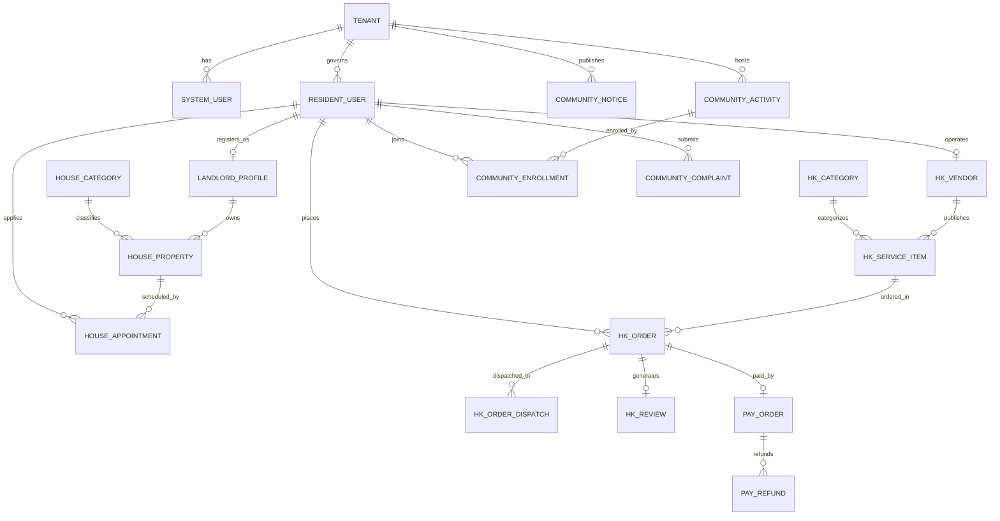

# 社区生活服务商用中台 · 数据库物理表与 ERD 设计说明书

> **系统代码**: CS-DB-001 · 版本: v1.0 (基线版)  
> **责任架构师**: 墨斗 (Inkstick · modou-fda · 前线架构师 FDA)  
> **归属门禁**: CMMI G2 架构与数据隔离门禁 (`gate_g2_arch`)  
> **底层数据库**: MySQL 8.0+ (InnoDB 引擎, `utf8mb4_unicode_ci` 字符集)  
> **核心表数量**: **29 张高内聚物理表** (覆盖 12 业务实体 + 标书 15 模块 + 5 模块底座)  

---

## 1. 总体设计规范与 8 大审计底座字段

为了保障数据的一致性、防篡改审计与全局多租户隔离，全盘 29 张表一律遵循统一的物理建模与索引规约：
1. **主键规约**：单表均以自增 `id BIGINT UNSIGNED NOT NULL AUTO_INCREMENT` 为物理主键；
2. **租户隔离规约**：每张表必须包含 `tenant_id BIGINT NOT NULL DEFAULT 0`，且建立 `idx_tenant_id` 或作为联合索引首列；
3. **8 大通用底座字段 (Base Entity Standard)**：
   ```sql
   `tenant_id`    BIGINT NOT NULL DEFAULT 0 COMMENT '租户编号',
   `creator`      VARCHAR(64) DEFAULT '' COMMENT '创建者用户名/ID',
   `create_time`  DATETIME NOT NULL DEFAULT CURRENT_TIMESTAMP COMMENT '创建时间',
   `updater`      VARCHAR(64) DEFAULT '' COMMENT '更新者用户名/ID',
   `update_time`  DATETIME NOT NULL DEFAULT CURRENT_TIMESTAMP ON UPDATE CURRENT_TIMESTAMP COMMENT '更新时间',
   `deleted`      BIT(1) NOT NULL DEFAULT b'0' COMMENT '是否删除: 0未删 1已删'
   ```
4. **敏感数据合规规约 (NFR-004)**：
   - 身份证号、手机号、银行卡号等 PII 敏感信息在物理表中以 `_enc` 后缀命名（如 `id_card_enc`、`phone_enc`），入库时由 MyBatis TypeHandler 自动触发国密 SM4-GCM 加密，严禁明文入库；
   - 列表及查询展示时必须严格脱敏（如 `138****1234`、`110101********1234`）。

---

## 2. 实体关系图 (Entity-Relationship Diagram)



---

## 3. 29 张物理表全景清单与分域表结构

### 3.1 平台管理后台与通用底座域 (7 张表)

| # | 物理表名 | 中文说明 | 对应业务实体 / 规范书模块 | 核心索引设计 |
|---|---|---|---|---|
| 01 | `system_users` | 后台管理账号表 | 模块 02 后台管理员管理 | `idx_tenant_username`, `idx_phone` |
| 02 | `system_roles` | 系统角色表 | 模块 01 角色与权限管理 | `idx_tenant_code` |
| 03 | `system_user_roles` | 用户角色关联表 | 模块 01 角色与权限管理 | `uk_user_role` |
| 04 | `system_permissions` | 菜单与按钮权限项表 | 模块 01 角色与权限管理 | `idx_parent_id`, `idx_permission` |
| 05 | `system_role_permissions` | 角色权限关联表 | 模块 01 角色与权限管理 | `uk_role_permission` |
| 06 | `system_configs` | 全局系统键值配置表 | 模块 04 系统配置管理 | `uk_tenant_config_key` |
| 07 | `system_audit_logs` | 操作审计与风控日志表 | 模块 04 系统配置与合规审计 | `idx_tenant_user_time`, `idx_create_time` |

#### 典型 DDL 样例：`system_users` (管理员管理表)
```sql
CREATE TABLE `system_users` (
  `id` BIGINT UNSIGNED NOT NULL AUTO_INCREMENT COMMENT '用户ID',
  `tenant_id` BIGINT NOT NULL DEFAULT 0 COMMENT '租户ID',
  `username` VARCHAR(30) NOT NULL COMMENT '登录账号',
  `password` VARCHAR(100) NOT NULL COMMENT 'BCrypt 密码哈希 (60位)',
  `nickname` VARCHAR(30) NOT NULL COMMENT '用户昵称',
  `dept_id` BIGINT DEFAULT NULL COMMENT '部门ID',
  `post_ids` VARCHAR(255) DEFAULT NULL COMMENT '岗位ID列表',
  `email` VARCHAR(50) DEFAULT '' COMMENT '用户邮箱',
  `phone_enc` VARCHAR(128) DEFAULT '' COMMENT '手机号 (SM4国密密文)',
  `status` TINYINT NOT NULL DEFAULT 0 COMMENT '状态: 0正常 1停用',
  `login_ip` VARCHAR(50) DEFAULT '' COMMENT '最后登录IP',
  `login_date` DATETIME DEFAULT NULL COMMENT '最后登录时间',
  `creator` VARCHAR(64) DEFAULT '' COMMENT '创建者',
  `create_time` DATETIME NOT NULL DEFAULT CURRENT_TIMESTAMP COMMENT '创建时间',
  `updater` VARCHAR(64) DEFAULT '' COMMENT '更新者',
  `update_time` DATETIME NOT NULL DEFAULT CURRENT_TIMESTAMP ON UPDATE CURRENT_TIMESTAMP,
  `deleted` BIT(1) NOT NULL DEFAULT b'0' COMMENT '逻辑删除',
  PRIMARY KEY (`id`),
  UNIQUE KEY `uk_tenant_username` (`tenant_id`, `username`, `deleted`),
  KEY `idx_dept_id` (`dept_id`)
) ENGINE=InnoDB DEFAULT CHARSET=utf8mb4 COMMENT='后台管理用户表';
```

---

### 3.2 前台会员与认证中心域 (3 张表)

| # | 物理表名 | 中文说明 | 对应业务实体 / 规范书模块 | 核心索引设计 |
|---|---|---|---|---|
| 08 | `member_users` | 前台居民用户表 | `OBJ-02 ResidentUser` / 模块 03 | `uk_tenant_phone`, `idx_create_time` |
| 09 | `member_user_bans` | 用户封禁记录与档案表 | 模块 03 封禁/解封档案 | `idx_tenant_user_id` |
| 10 | `member_auth_bindings` | 微信 OpenID/UnionID 授权绑定表 | 模块 15 前台用户中心 | `uk_open_id`, `idx_user_id` |

#### 典型 DDL 样例：`member_users` (居民用户表)
```sql
CREATE TABLE `member_users` (
  `id` BIGINT UNSIGNED NOT NULL AUTO_INCREMENT COMMENT '会员用户ID',
  `tenant_id` BIGINT NOT NULL DEFAULT 0 COMMENT '租户ID',
  `nickname` VARCHAR(30) NOT NULL DEFAULT '社区居民' COMMENT '昵称',
  `avatar` VARCHAR(512) DEFAULT '' COMMENT '头像URL',
  `phone_enc` VARCHAR(128) NOT NULL COMMENT '手机号(SM4国密加密)',
  `real_name` VARCHAR(30) DEFAULT '' COMMENT '真实姓名',
  `id_card_enc` VARCHAR(256) DEFAULT '' COMMENT '身份证号(SM4国密加密)',
  `is_real_name` TINYINT NOT NULL DEFAULT 0 COMMENT '是否实名认证: 0未认证 1已认证',
  `status` TINYINT NOT NULL DEFAULT 0 COMMENT '状态: 0正常 1已封禁',
  `creator` VARCHAR(64) DEFAULT '',
  `create_time` DATETIME NOT NULL DEFAULT CURRENT_TIMESTAMP,
  `updater` VARCHAR(64) DEFAULT '',
  `update_time` DATETIME NOT NULL DEFAULT CURRENT_TIMESTAMP ON UPDATE CURRENT_TIMESTAMP,
  `deleted` BIT(1) NOT NULL DEFAULT b'0',
  PRIMARY KEY (`id`),
  KEY `idx_tenant_phone` (`tenant_id`, `phone_enc`(32))
) ENGINE=InnoDB DEFAULT CHARSET=utf8mb4 COMMENT='前台居民用户档案表';
```

---

### 3.3 房源租赁微闭环主线 A (5 张表)

| # | 物理表名 | 中文说明 | 对应业务实体 / 规范书模块 | 核心索引设计 |
|---|---|---|---|---|
| 11 | `house_categories` | 房源分类表 (户型/租金区间/朝向) | `OBJ-04` / 模块 05 房源分类管理 | `idx_parent_sort` |
| 12 | `house_landlords` | 房东实名入驻与资质表 | `OBJ-03 LandlordProfile` / 模块 07 | `uk_tenant_user_id`, `idx_audit_status` |
| 13 | `house_landlord_audits` | 房东资质审核历史记录表 | 模块 07 房东资质审核 | `idx_landlord_id` |
| 14 | `house_properties` | 房源基础与租赁信息表 | `OBJ-04 HouseProperty` / 模块 06 | `idx_tenant_status`, `idx_category_price` |
| 15 | `house_appointments` | 线下看房预约工单表 | `OBJ-05 HouseAppointment` / 模块 06 | `idx_house_status`, `idx_consumer_time` |

#### 典型 DDL 样例：`house_properties` (房源信息表)
```sql
CREATE TABLE `house_properties` (
  `id` BIGINT UNSIGNED NOT NULL AUTO_INCREMENT COMMENT '房源ID',
  `tenant_id` BIGINT NOT NULL DEFAULT 0 COMMENT '租户ID',
  `landlord_id` BIGINT NOT NULL COMMENT '房东ID (house_landlords.id)',
  `category_id` BIGINT NOT NULL COMMENT '房源分类ID',
  `title` VARCHAR(120) NOT NULL COMMENT '房源标题',
  `rent_price` DECIMAL(10, 2) NOT NULL COMMENT '月租金 (元/月)',
  `deposit_type` TINYINT NOT NULL DEFAULT 1 COMMENT '押金方式: 1押一付一 2押一付三 3押二付一',
  `layout` VARCHAR(50) NOT NULL COMMENT '居室户型 (如 2室1厅1卫)',
  `area` DECIMAL(8, 2) NOT NULL COMMENT '建筑面积 (平方米)',
  `floor_info` VARCHAR(50) DEFAULT '' COMMENT '楼层信息',
  `address` VARCHAR(255) NOT NULL COMMENT '房源坐落详细地址',
  `photos_json` TEXT NOT NULL COMMENT '实拍图片列表 (JSON数组, 至少3张)',
  `status` TINYINT NOT NULL DEFAULT 0 COMMENT '状态: 0草稿 1待审核 2已上架 3已下架 4已出租',
  `audit_reason` VARCHAR(255) DEFAULT '' COMMENT '审核驳回原因',
  `view_count` INT NOT NULL DEFAULT 0 COMMENT '浏览量 (PV)',
  `favorite_count` INT NOT NULL DEFAULT 0 COMMENT '收藏量',
  `creator` VARCHAR(64) DEFAULT '',
  `create_time` DATETIME NOT NULL DEFAULT CURRENT_TIMESTAMP,
  `updater` VARCHAR(64) DEFAULT '',
  `update_time` DATETIME NOT NULL DEFAULT CURRENT_TIMESTAMP ON UPDATE CURRENT_TIMESTAMP,
  `deleted` BIT(1) NOT NULL DEFAULT b'0',
  PRIMARY KEY (`id`),
  KEY `idx_tenant_status` (`tenant_id`, `status`),
  KEY `idx_landlord_id` (`landlord_id`),
  KEY `idx_category_price` (`category_id`, `rent_price`)
) ENGINE=InnoDB DEFAULT CHARSET=utf8mb4 COMMENT='房源租赁资产信息表';
```

---

### 3.4 家政服务履约闭环主线 B (7 张表)

| # | 物理表名 | 中文说明 | 对应业务实体 / 规范书模块 | 核心索引设计 |
|---|---|---|---|---|
| 16 | `hk_vendors` | 家政服务商档案表 | `OBJ-06 HousekeepingVendor` / 模块 09 | `idx_tenant_status`, `idx_score` |
| 17 | `hk_vendor_audits` | 服务商入驻资质审核表 | 模块 09 服务商入驻审核 | `idx_vendor_id` |
| 18 | `hk_categories` | 家政服务类目分类表 | 模块 10 家政服务分类 | `idx_parent_id` |
| 19 | `hk_service_items` | 家政服务单项配置表 | `OBJ-07 ServiceItem` / 模块 10 | `idx_vendor_status`, `idx_category_id` |
| 20 | `hk_orders` | 家政履约服务订单主表 | `OBJ-08 ServiceOrder` / 模块 11 | `uk_order_no`, `idx_consumer_status`, `idx_vendor_status` |
| 21 | `hk_order_dispatches` | 技工派工与上门签到记录表 | 模块 11 履约签到签退跟踪 | `idx_order_id`, `idx_worker_id` |
| 22 | `hk_reviews` | 家政服务履约评价表 | `OBJ-09 ServiceReview` / 模块 12 | `idx_order_id`, `idx_vendor_star` |

#### 典型 DDL 样例：`hk_orders` (家政服务订单主表)
```sql
CREATE TABLE `hk_orders` (
  `id` BIGINT UNSIGNED NOT NULL AUTO_INCREMENT COMMENT '订单主键ID',
  `tenant_id` BIGINT NOT NULL DEFAULT 0 COMMENT '租户ID',
  `order_no` VARCHAR(64) NOT NULL COMMENT '全局唯一业务订单号 (年月日时分秒+自增序列)',
  `consumer_id` BIGINT NOT NULL COMMENT '下单居民ID (member_users.id)',
  `vendor_id` BIGINT NOT NULL COMMENT '承接服务商ID (hk_vendors.id)',
  `item_id` BIGINT NOT NULL COMMENT '服务项目ID (hk_service_items.id)',
  `item_title` VARCHAR(120) NOT NULL COMMENT '快照: 服务项目名称',
  `unit_price` DECIMAL(10, 2) NOT NULL COMMENT '快照: 单价',
  `quantity` INT NOT NULL DEFAULT 1 COMMENT '服务购买数量/工时',
  `pay_price` DECIMAL(10, 2) NOT NULL COMMENT '实际支付金额 (元)',
  `appoint_time` DATETIME NOT NULL COMMENT '预约上门服务时段',
  `service_address` VARCHAR(255) NOT NULL COMMENT '上门详细地址',
  `contact_name` VARCHAR(30) NOT NULL COMMENT '联系人姓名',
  `contact_phone_enc` VARCHAR(128) NOT NULL COMMENT '联系人电话(密文)',
  `status` TINYINT NOT NULL DEFAULT 0 COMMENT '状态: 0待支付 1待派工 2已派工 3服务中 4已完成 5退款中 6已退款 7已关闭',
  `worker_name` VARCHAR(30) DEFAULT '' COMMENT '履约技工姓名',
  `worker_phone_enc` VARCHAR(128) DEFAULT '' COMMENT '履约技工电话(密文)',
  `refund_status` TINYINT NOT NULL DEFAULT 0 COMMENT '退款状态: 0无 1申请中 2已退款 3已驳回',
  `refund_amount` DECIMAL(10, 2) NOT NULL DEFAULT 0.00 COMMENT '已退款金额',
  `creator` VARCHAR(64) DEFAULT '',
  `create_time` DATETIME NOT NULL DEFAULT CURRENT_TIMESTAMP,
  `updater` VARCHAR(64) DEFAULT '',
  `update_time` DATETIME NOT NULL DEFAULT CURRENT_TIMESTAMP ON UPDATE CURRENT_TIMESTAMP,
  `deleted` BIT(1) NOT NULL DEFAULT b'0',
  PRIMARY KEY (`id`),
  UNIQUE KEY `uk_order_no` (`order_no`),
  KEY `idx_tenant_consumer` (`tenant_id`, `consumer_id`, `status`),
  KEY `idx_tenant_vendor` (`tenant_id`, `vendor_id`, `status`),
  KEY `idx_create_time` (`create_time`)
) ENGINE=InnoDB DEFAULT CHARSET=utf8mb4 COMMENT='家政履约订单主表';
```

---

### 3.5 社区互动与诉求工单主线 C (4 张表)

| # | 物理表名 | 中文说明 | 对应业务实体 / 规范书模块 | 核心索引设计 |
|---|---|---|---|---|
| 23 | `community_notices` | 社区图文公告通知表 | `OBJ-10 CommunityNotice` / 模块 13 | `idx_tenant_status_top`, `idx_expire_time` |
| 24 | `community_activities` | 居委会社区活动表 | `OBJ-11 CommunityActivity` / 模块 14 | `idx_tenant_status`, `idx_start_time` |
| 25 | `community_enrollments` | 活动报名与核销流水表 | 模块 14 活动名额与核销 | `uk_activity_consumer`, `idx_verify_code` |
| 26 | `community_complaints` | 居民诉求与投诉工单表 | `OBJ-12 ComplaintTicket` / 模块 14 | `idx_tenant_status`, `idx_consumer_id` |

#### 典型 DDL 样例：`community_activities` (社区活动与超卖防范表)
```sql
CREATE TABLE `community_activities` (
  `id` BIGINT UNSIGNED NOT NULL AUTO_INCREMENT COMMENT '活动ID',
  `tenant_id` BIGINT NOT NULL DEFAULT 0 COMMENT '租户ID',
  `title` VARCHAR(120) NOT NULL COMMENT '活动主题',
  `cover_url` VARCHAR(512) DEFAULT '' COMMENT '封面图片URL',
  `max_capacity` INT NOT NULL DEFAULT 0 COMMENT '名额上限 (0为不限)',
  `enrolled_count` INT NOT NULL DEFAULT 0 COMMENT '已成功报名人数',
  `start_time` DATETIME NOT NULL COMMENT '活动开始时间',
  `end_time` DATETIME NOT NULL COMMENT '活动结束时间',
  `enroll_deadline` DATETIME NOT NULL COMMENT '报名截止时间',
  `location` VARCHAR(255) NOT NULL COMMENT '活动举办地点',
  `status` TINYINT NOT NULL DEFAULT 0 COMMENT '状态: 0草稿 1报名中 2进行中 3已结束 4已取消',
  `creator` VARCHAR(64) DEFAULT '',
  `create_time` DATETIME NOT NULL DEFAULT CURRENT_TIMESTAMP,
  `updater` VARCHAR(64) DEFAULT '',
  `update_time` DATETIME NOT NULL DEFAULT CURRENT_TIMESTAMP ON UPDATE CURRENT_TIMESTAMP,
  `deleted` BIT(1) NOT NULL DEFAULT b'0',
  PRIMARY KEY (`id`),
  KEY `idx_tenant_status` (`tenant_id`, `status`),
  KEY `idx_start_time` (`start_time`)
) ENGINE=InnoDB DEFAULT CHARSET=utf8mb4 COMMENT='社区活动信息表';
```

---

### 3.6 支付结算与资金对账域 (3 张表)

| # | 物理表名 | 中文说明 | 对应业务实体 / 规范书模块 | 核心索引设计 |
|---|---|---|---|---|
| 27 | `pay_orders` | 微信支付交易流水主表 | 模块 11 支付网关记录 | `uk_pay_order_no`, `idx_biz_order_no` |
| 28 | `pay_refunds` | 微信退款流水明细表 | 模块 11 原路退款记录 | `uk_refund_no`, `idx_pay_order_id` |
| 29 | `pay_reconciliations` | 日终财务对账汇总单表 | 模块 11 账实平账审计 | `uk_tenant_recon_date` |

#### 典型 DDL 样例：`pay_reconciliations` (财务日终平账表)
```sql
CREATE TABLE `pay_reconciliations` (
  `id` BIGINT UNSIGNED NOT NULL AUTO_INCREMENT COMMENT '对账单ID',
  `tenant_id` BIGINT NOT NULL DEFAULT 0 COMMENT '租户ID',
  `recon_date` DATE NOT NULL COMMENT '对账归属日期 (YYYY-MM-DD)',
  `total_order_count` INT NOT NULL DEFAULT 0 COMMENT '当日交易订单总笔数',
  `total_pay_amount` DECIMAL(12, 2) NOT NULL DEFAULT 0.00 COMMENT '当日支付总金额',
  `total_refund_count` INT NOT NULL DEFAULT 0 COMMENT '当日退款总笔数',
  `total_refund_amount` DECIMAL(12, 2) NOT NULL DEFAULT 0.00 COMMENT '当日退款总金额',
  `vendor_settle_amount` DECIMAL(12, 2) NOT NULL DEFAULT 0.00 COMMENT '服务商结算出金总额',
  `platform_fee_amount` DECIMAL(12, 2) NOT NULL DEFAULT 0.00 COMMENT '平台佣金收益总额',
  `diff_count` INT NOT NULL DEFAULT 0 COMMENT '异常不平账笔数 (0为平账)',
  `status` TINYINT NOT NULL DEFAULT 0 COMMENT '状态: 0平账 1存在差异已告警 2人工已调账',
  `creator` VARCHAR(64) DEFAULT '',
  `create_time` DATETIME NOT NULL DEFAULT CURRENT_TIMESTAMP,
  `updater` VARCHAR(64) DEFAULT '',
  `update_time` DATETIME NOT NULL DEFAULT CURRENT_TIMESTAMP ON UPDATE CURRENT_TIMESTAMP,
  `deleted` BIT(1) NOT NULL DEFAULT b'0',
  PRIMARY KEY (`id`),
  UNIQUE KEY `uk_tenant_recon_date` (`tenant_id`, `recon_date`)
) ENGINE=InnoDB DEFAULT CHARSET=utf8mb4 COMMENT='日终财务平账汇总台账';
```

---

## 4. 数据库性能与安全加固基线 (NFR Verification)

1. **复合索引优化**：高频查询一律禁止全表扫描，以 `tenant_id` 为前导列建立复合索引；
2. **连接池与超时规约**：采用 Druid 1.2+ 高性能连接池，配置 `maxActive=50`，`minIdle=10`，`queryTimeout=3000ms`；
3. **备份策略 (NFR-010)**：生产环境开启 Binlog ROW 模式，保留 30 天，每日凌晨 03:00 执行冷备份并异地备份到 MinIO。
