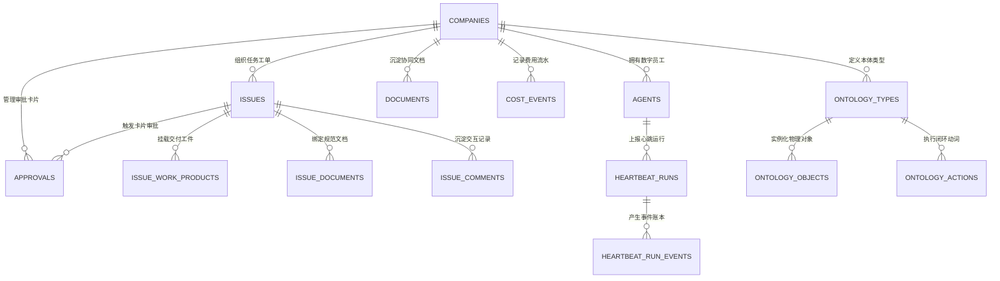

# Coolie AI 原生商业软件交付工厂控制面平台 · 控制面统一数据库与 ERD 设计说明书 (Drizzle ORM & PostgreSQL)

> **文档代号**: COOLIE-FOUNDRY-DB-ERD-2.0.0  
> **系统代号**: `COOLIE-FOUNDRY-CORE` (Coolie AI 原生商业软件交付工厂控制面平台)  
> **基线版本**: 2.0.0 (生产冻结稳定版)  
> **制定日期**: 2026-10-17  
> **归属规范**: CMMI 03_design (TS) / ISO/IEC 9075:2016 (SQL) / .agents/skills/cmmi-detailed-contracts  

---

## 1. 数据库选型与持久化架构设计 (Persistence Architecture)

Coolie AI 原生商业软件交付工厂控制面平台采用 **Drizzle ORM** 作为强类型数据映射底座，实现统一 Schema 跨双模持久化驱动：
1. **生产环境 (Production)**: 直连高可用 **PostgreSQL 17**，支撑高并发连接池与事务行级锁；
2. **本地研发与自动化单测 (Dev / Vitest)**: 自动降级至内嵌式 **WebAssembly PGlite**（`DATABASE_URL=""`），实现零外部 Docker/数据库依赖、毫秒级测试自闭环。

---

## 2. 核心领域实体关系全景图 (ERD - Entity Relationship Diagram)



---

## 3. 全盘物理表结构索引台账 (Physical Database Tables Catalog)

经代码内省扫描，全盘共计 **225** 张物理数据表，统一收拢于 [`packages/db/src/schema/`](file:///host-workspace/xaicd/coolie/packages/db/src/schema/)：

| 序号 | 物理数据表名 | 所属业务域 | Schema 源码文件 | 主键定义 | 字段数 | 8 大审计底座达标 |
| :---: | :--- | :--- | :--- | :--- | :---: | :---: |
| 1 | `account` | 通用基础域 | `packages/db/src/schema/auth.ts` | `id` | 14 | ⚪ 部分达标 |
| 2 | `activity_log` | 通用基础域 | `packages/db/src/schema/activity_log.ts` | `id` | 12 | ⚪ 部分达标 |
| 3 | `adapter_auth_sessions` | 组织与安全域 | `packages/db/src/schema/adapter_auth_sessions.ts` | `id` | 20 | ✅ 100% 达标 |
| 4 | `agent_api_keys` | 智能体与心跳域 | `packages/db/src/schema/agent_api_keys.ts` | `id` | 10 | ⚪ 部分达标 |
| 5 | `agent_config_revisions` | 智能体与心跳域 | `packages/db/src/schema/agent_config_revisions.ts` | `id` | 11 | ⚪ 部分达标 |
| 6 | `agent_memberships` | 组织与安全域 | `packages/db/src/schema/agent_memberships.ts` | `id` | 8 | ✅ 100% 达标 |
| 7 | `agent_runtime_state` | 智能体与心跳域 | `packages/db/src/schema/agent_runtime_state.ts` | `agent_id` | 14 | ✅ 100% 达标 |
| 8 | `agent_session_goal_actions` | 智能体与心跳域 | `packages/db/src/schema/agent_task_sessions.ts` | `id` | 13 | ✅ 100% 达标 |
| 9 | `agent_task_sessions` | 智能体与心跳域 | `packages/db/src/schema/agent_task_sessions.ts` | `id` | 19 | ✅ 100% 达标 |
| 10 | `agent_wakeup_requests` | 智能体与心跳域 | `packages/db/src/schema/agent_wakeup_requests.ts` | `id` | 19 | ✅ 100% 达标 |
| 11 | `agents` | 智能体与心跳域 | `packages/db/src/schema/agents.ts` | `id` | 29 | ✅ 100% 达标 |
| 12 | `ai_connection_defaults` | 通用基础域 | `packages/db/src/schema/ai_connection_defaults.ts` | `id` | 7 | ⚪ 部分达标 |
| 13 | `ai_provider_defaults` | 通用基础域 | `packages/db/src/schema/ai_provider_defaults.ts` | `id` | 6 | ⚪ 部分达标 |
| 14 | `announcement_dismissals` | 通用基础域 | `packages/db/src/schema/announcement_dismissals.ts` | `id` | 3 | ⚪ 部分达标 |
| 15 | `announcement_publications` | 通用基础域 | `packages/db/src/schema/announcement_dismissals.ts` | `announcement_id` | 1 | ⚪ 部分达标 |
| 16 | `approval_comments` | 任务工单与工件域 | `packages/db/src/schema/approval_comments.ts` | `id` | 8 | ✅ 100% 达标 |
| 17 | `approvals` | 审批与治理域 | `packages/db/src/schema/approvals.ts` | `id` | 12 | ✅ 100% 达标 |
| 18 | `assets` | 通用基础域 | `packages/db/src/schema/assets.ts` | `id` | 12 | ✅ 100% 达标 |
| 19 | `audit_log` | 通用基础域 | `packages/db/src/schema/audit_log.ts` | `id` | 10 | ⚪ 部分达标 |
| 20 | `board_api_keys` | 通用基础域 | `packages/db/src/schema/board_api_keys.ts` | `id` | 8 | ⚪ 部分达标 |
| 21 | `board_conversations` | 通用基础域 | `packages/db/src/schema/board_conversations.ts` | `id` | 3 | ⚪ 部分达标 |
| 22 | `budget_incidents` | 实时成本与预算域 | `packages/db/src/schema/budget_incidents.ts` | `id` | 17 | ✅ 100% 达标 |
| 23 | `budget_policies` | 实时成本与预算域 | `packages/db/src/schema/budget_policies.ts` | `id` | 15 | ✅ 100% 达标 |
| 24 | `built_in_managed_resources` | 通用基础域 | `packages/db/src/schema/built_in_managed_resources.ts` | `id` | 11 | ✅ 100% 达标 |
| 25 | `case_attachments` | 任务工单与工件域 | `packages/db/src/schema/cases.ts` | `id` | 6 | ✅ 100% 达标 |
| 26 | `case_documents` | 协同文档与知识域 | `packages/db/src/schema/cases.ts` | `id` | 7 | ✅ 100% 达标 |
| 27 | `case_events` | 通用基础域 | `packages/db/src/schema/cases.ts` | `id` | 11 | ✅ 100% 达标 |
| 28 | `case_issue_links` | 任务工单与工件域 | `packages/db/src/schema/cases.ts` | `id` | 8 | ✅ 100% 达标 |
| 29 | `case_labels` | 任务工单与工件域 | `packages/db/src/schema/cases.ts` | `id` | 6 | ✅ 100% 达标 |
| 30 | `cases` | 通用基础域 | `packages/db/src/schema/cases.ts` | `id` | 17 | ✅ 100% 达标 |
| 31 | `chat_actions` | 通用基础域 | `packages/db/src/schema/chat_channels.ts` | `id` | 4 | ⚪ 部分达标 |
| 32 | `chat_agent_routes` | 智能体与心跳域 | `packages/db/src/schema/chat_channels.ts` | `id` | 10 | ✅ 100% 达标 |
| 33 | `chat_conversations` | 通用基础域 | `packages/db/src/schema/chat_channels.ts` | `id` | 4 | ⚪ 部分达标 |
| 34 | `chat_deliveries` | 通用基础域 | `packages/db/src/schema/chat_channels.ts` | `id` | 4 | ⚪ 部分达标 |
| 35 | `chat_discord_command_owners` | 通用基础域 | `packages/db/src/schema/chat_discord_command_owners.ts` | `application_id` | 5 | ⚪ 部分达标 |
| 36 | `chat_endpoint_leases` | 通用基础域 | `packages/db/src/schema/chat_channels.ts` | `id` | 8 | ✅ 100% 达标 |
| 37 | `chat_endpoint_resources` | 通用基础域 | `packages/db/src/schema/chat_channels.ts` | `id` | 14 | ✅ 100% 达标 |
| 38 | `chat_endpoints` | 通用基础域 | `packages/db/src/schema/chat_channels.ts` | `id` | 23 | ⚪ 部分达标 |
| 39 | `chat_external_principals` | 通用基础域 | `packages/db/src/schema/chat_channels.ts` | `id` | 13 | ✅ 100% 达标 |
| 40 | `chat_github_configurations` | 通用基础域 | `packages/db/src/schema/chat_github.ts` | `endpoint_id` | 7 | ✅ 100% 达标 |
| 41 | `chat_github_registrations` | 通用基础域 | `packages/db/src/schema/chat_github.ts` | `id` | 10 | ⚪ 部分达标 |
| 42 | `chat_github_reviews` | 通用基础域 | `packages/db/src/schema/chat_github.ts` | `id` | 5 | ⚪ 部分达标 |
| 43 | `chat_identity_links` | 通用基础域 | `packages/db/src/schema/chat_channels.ts` | `id` | 12 | ✅ 100% 达标 |
| 44 | `chat_message_links` | 通用基础域 | `packages/db/src/schema/chat_channels.ts` | `id` | 5 | ⚪ 部分达标 |
| 45 | `chat_publications` | 通用基础域 | `packages/db/src/schema/chat_channels.ts` | `id` | 6 | ⚪ 部分达标 |
| 46 | `chat_sdk_state` | 通用基础域 | `packages/db/src/schema/chat_channels.ts` | `id` | 9 | ✅ 100% 达标 |
| 47 | `chat_teams_file_transfers` | 通用基础域 | `packages/db/src/schema/chat_teams_file_transfers.ts` | `id` | 37 | ✅ 100% 达标 |
| 48 | `cli_auth_challenges` | 组织与安全域 | `packages/db/src/schema/cli_auth_challenges.ts` | `id` | 15 | ⚪ 部分达标 |
| 49 | `companies` | 通用基础域 | `packages/db/src/schema/companies.ts` | `id` | 22 | ⚪ 部分达标 |
| 50 | `company_logos` | 组织与安全域 | `packages/db/src/schema/company_logos.ts` | `id` | 5 | ✅ 100% 达标 |
| 51 | `company_memberships` | 组织与安全域 | `packages/db/src/schema/company_memberships.ts` | `id` | 8 | ✅ 100% 达标 |
| 52 | `company_onboarding_seeds` | 组织与安全域 | `packages/db/src/schema/company_onboarding_seeds.ts` | `id` | 14 | ✅ 100% 达标 |
| 53 | `company_secret_bindings` | 组织与安全域 | `packages/db/src/schema/company_secret_bindings.ts` | `id` | 13 | ✅ 100% 达标 |
| 54 | `company_secret_proposals` | 组织与安全域 | `packages/db/src/schema/company_secret_proposals.ts` | `id` | 33 | ✅ 100% 达标 |
| 55 | `company_secret_provider_configs` | 组织与安全域 | `packages/db/src/schema/company_secret_provider_configs.ts` | `id` | 16 | ✅ 100% 达标 |
| 56 | `company_secret_versions` | 组织与安全域 | `packages/db/src/schema/company_secret_versions.ts` | `id` | 13 | ⚪ 部分达标 |
| 57 | `company_secrets` | 组织与安全域 | `packages/db/src/schema/company_secrets.ts` | `id` | 22 | ✅ 100% 达标 |
| 58 | `company_skill_comments` | 组织与安全域 | `packages/db/src/schema/company_skills.ts` | `id` | 10 | ✅ 100% 达标 |
| 59 | `company_skill_policies` | 组织与安全域 | `packages/db/src/schema/company_skill_policies.ts` | `company_id` | 7 | ✅ 100% 达标 |
| 60 | `company_skill_stars` | 组织与安全域 | `packages/db/src/schema/company_skills.ts` | `id` | 6 | ⚪ 部分达标 |
| 61 | `company_skill_test_inputs` | 组织与安全域 | `packages/db/src/schema/company_skills.ts` | `id` | 9 | ✅ 100% 达标 |
| 62 | `company_skill_test_run_templates` | 组织与安全域 | `packages/db/src/schema/company_skills.ts` | `id` | 12 | ✅ 100% 达标 |
| 63 | `company_skill_test_runs` | 组织与安全域 | `packages/db/src/schema/company_skills.ts` | `id` | 24 | ✅ 100% 达标 |
| 64 | `company_skill_versions` | 组织与安全域 | `packages/db/src/schema/company_skills.ts` | `id` | 12 | ⚪ 部分达标 |
| 65 | `company_skills` | 组织与安全域 | `packages/db/src/schema/company_skills.ts` | `id` | 31 | ✅ 100% 达标 |
| 66 | `company_transfer_runs` | 组织与安全域 | `packages/db/src/schema/company_transfer_runs.ts` | `id` | 17 | ✅ 100% 达标 |
| 67 | `company_user_sidebar_preferences` | 组织与安全域 | `packages/db/src/schema/company_user_sidebar_preferences.ts` | `id` | 6 | ✅ 100% 达标 |
| 68 | `completion_contracts` | 通用基础域 | `packages/db/src/schema/completion_contracts.ts` | `id` | 15 | ⚪ 部分达标 |
| 69 | `connection_event_deliveries` | 通用基础域 | `packages/db/src/schema/connection_event_deliveries.ts` | `id` | 16 | ✅ 100% 达标 |
| 70 | `connection_grant_delegations` | 通用基础域 | `packages/db/src/schema/tool_access.ts` | `id` | 6 | ⚪ 部分达标 |
| 71 | `connection_grant_members` | 通用基础域 | `packages/db/src/schema/tool_access.ts` | `id` | 6 | ⚪ 部分达标 |
| 72 | `connection_grants` | 通用基础域 | `packages/db/src/schema/tool_access.ts` | `id` | 19 | ✅ 100% 达标 |
| 73 | `connection_intent_deliveries` | 通用基础域 | `packages/db/src/schema/connection_intent_deliveries.ts` | `interaction_id` | 5 | ⚪ 部分达标 |
| 74 | `connection_token_issuances` | 组织与安全域 | `packages/db/src/schema/tool_access.ts` | `id` | 19 | ⚪ 部分达标 |
| 75 | `cost_events` | 实时成本与预算域 | `packages/db/src/schema/cost_events.ts` | `id` | 19 | ⚪ 部分达标 |
| 76 | `decision_archive_notification_outbox` | 审批与治理域 | `packages/db/src/schema/decision_queues.ts` | `id` | 13 | ✅ 100% 达标 |
| 77 | `decision_bundles` | 审批与治理域 | `packages/db/src/schema/decisions.ts` | `id` | 8 | ⚪ 部分达标 |
| 78 | `decision_effect_executions` | 审批与治理域 | `packages/db/src/schema/decisions.ts` | `id` | 10 | ⚪ 部分达标 |
| 79 | `decision_queue_items` | 审批与治理域 | `packages/db/src/schema/decision_queues.ts` | `id` | 12 | ⚪ 部分达标 |
| 80 | `decision_queues` | 审批与治理域 | `packages/db/src/schema/decision_queues.ts` | `id` | 15 | ✅ 100% 达标 |
| 81 | `decision_retention` | 审批与治理域 | `packages/db/src/schema/decision_queues.ts` | `id` | 16 | ✅ 100% 达标 |
| 82 | `decision_target_issues` | 任务工单与工件域 | `packages/db/src/schema/decisions.ts` | `id` | 3 | ⚪ 部分达标 |
| 83 | `decision_training_examples` | 审批与治理域 | `packages/db/src/schema/decision_training_examples.ts` | `id` | 14 | ✅ 100% 达标 |
| 84 | `decision_triage` | 审批与治理域 | `packages/db/src/schema/decision_queues.ts` | `id` | 16 | ✅ 100% 达标 |
| 85 | `decision_triage_events` | 审批与治理域 | `packages/db/src/schema/decision_queues.ts` | `id` | 14 | ⚪ 部分达标 |
| 86 | `decisions` | 审批与治理域 | `packages/db/src/schema/decisions.ts` | `id` | 25 | ✅ 100% 达标 |
| 87 | `defect_kb` | 通用基础域 | `packages/db/src/schema/defect_kb.ts` | `id` | 11 | ✅ 100% 达标 |
| 88 | `document_annotation_anchor_snapshots` | 协同文档与知识域 | `packages/db/src/schema/document_annotation_anchor_snapshots.ts` | `id` | 14 | ⚪ 部分达标 |
| 89 | `document_annotation_comments` | 任务工单与工件域 | `packages/db/src/schema/document_annotation_comments.ts` | `id` | 16 | ✅ 100% 达标 |
| 90 | `document_annotation_threads` | 协同文档与知识域 | `packages/db/src/schema/document_annotation_threads.ts` | `id` | 29 | ✅ 100% 达标 |
| 91 | `document_memberships` | 组织与安全域 | `packages/db/src/schema/document_memberships.ts` | `id` | 7 | ✅ 100% 达标 |
| 92 | `document_revisions` | 协同文档与知识域 | `packages/db/src/schema/document_revisions.ts` | `id` | 12 | ⚪ 部分达标 |
| 93 | `documents` | 协同文档与知识域 | `packages/db/src/schema/documents.ts` | `id` | 17 | ✅ 100% 达标 |
| 94 | `email_endpoints` | 通用基础域 | `packages/db/src/schema/email.ts` | `endpoint_id` | 8 | ⚪ 部分达标 |
| 95 | `email_messages` | 通用基础域 | `packages/db/src/schema/email.ts` | `id` | 12 | ⚪ 部分达标 |
| 96 | `email_sends` | 通用基础域 | `packages/db/src/schema/email.ts` | `publication_id` | 8 | ⚪ 部分达标 |
| 97 | `entity_relations` | 通用基础域 | `packages/db/src/schema/entity_relations.ts` | `id` | 12 | ⚪ 部分达标 |
| 98 | `environment_custom_image_setup_sessions` | 通用基础域 | `packages/db/src/schema/environment_custom_image_setup_sessions.ts` | `id` | 19 | ⚪ 部分达标 |
| 99 | `environment_custom_image_templates` | 通用基础域 | `packages/db/src/schema/environment_custom_image_templates.ts` | `id` | 16 | ⚪ 部分达标 |
| 100 | `environment_leases` | 通用基础域 | `packages/db/src/schema/environment_leases.ts` | `id` | 19 | ✅ 100% 达标 |
| 101 | `environments` | 通用基础域 | `packages/db/src/schema/environments.ts` | `id` | 10 | ⚪ 部分达标 |
| 102 | `execution_workspace_runtime_leases` | 智能体与心跳域 | `packages/db/src/schema/execution_workspace_runtime_leases.ts` | `id` | 14 | ✅ 100% 达标 |
| 103 | `execution_workspaces` | 通用基础域 | `packages/db/src/schema/execution_workspaces.ts` | `id` | 24 | ✅ 100% 达标 |
| 104 | `external_object_mentions` | 通用基础域 | `packages/db/src/schema/external_object_mentions.ts` | `id` | 19 | ✅ 100% 达标 |
| 105 | `external_objects` | 通用基础域 | `packages/db/src/schema/external_objects.ts` | `id` | 31 | ✅ 100% 达标 |
| 106 | `feedback_exports` | 通用基础域 | `packages/db/src/schema/feedback_exports.ts` | `id` | 26 | ✅ 100% 达标 |
| 107 | `feedback_votes` | 通用基础域 | `packages/db/src/schema/feedback_votes.ts` | `id` | 14 | ✅ 100% 达标 |
| 108 | `finance_events` | 实时成本与预算域 | `packages/db/src/schema/finance_events.ts` | `id` | 27 | ⚪ 部分达标 |
| 109 | `folders` | 协同文档与知识域 | `packages/db/src/schema/folders.ts` | `id` | 11 | ✅ 100% 达标 |
| 110 | `git_credentials` | 通用基础域 | `packages/db/src/schema/git_credentials.ts` | `id` | 7 | ⚪ 部分达标 |
| 111 | `goals` | 通用基础域 | `packages/db/src/schema/goals.ts` | `id` | 10 | ✅ 100% 达标 |
| 112 | `heartbeat_run_events` | 智能体与心跳域 | `packages/db/src/schema/heartbeat_run_events.ts` | `id` | 17 | ⚪ 部分达标 |
| 113 | `heartbeat_run_watchdog_decisions` | 智能体与心跳域 | `packages/db/src/schema/heartbeat_run_watchdog_decisions.ts` | `id` | 11 | ⚪ 部分达标 |
| 114 | `heartbeat_runs` | 智能体与心跳域 | `packages/db/src/schema/heartbeat_runs.ts` | `id` | 55 | ⚪ 部分达标 |
| 115 | `inbox_dismissals` | 通用基础域 | `packages/db/src/schema/inbox_dismissals.ts` | `id` | 9 | ✅ 100% 达标 |
| 116 | `instance_settings` | 通用基础域 | `packages/db/src/schema/instance_settings.ts` | `id` | 7 | ⚪ 部分达标 |
| 117 | `instance_user_roles` | 通用基础域 | `packages/db/src/schema/instance_user_roles.ts` | `id` | 5 | ⚪ 部分达标 |
| 118 | `invites` | 通用基础域 | `packages/db/src/schema/invites.ts` | `id` | 12 | ✅ 100% 达标 |
| 119 | `issue_approvals` | 任务工单与工件域 | `packages/db/src/schema/issue_approvals.ts` | `id` | 6 | ⚪ 部分达标 |
| 120 | `issue_attachments` | 任务工单与工件域 | `packages/db/src/schema/issue_attachments.ts` | `id` | 6 | ⚪ 部分达标 |
| 121 | `issue_comments` | 任务工单与工件域 | `packages/db/src/schema/issue_comments.ts` | `id` | 24 | ✅ 100% 达标 |
| 122 | `issue_create_idempotency_keys` | 任务工单与工件域 | `packages/db/src/schema/issue_create_idempotency_keys.ts` | `id` | 5 | ⚪ 部分达标 |
| 123 | `issue_documents` | 任务工单与工件域 | `packages/db/src/schema/issue_documents.ts` | `id` | 7 | ✅ 100% 达标 |
| 124 | `issue_execution_decisions` | 任务工单与工件域 | `packages/db/src/schema/issue_execution_decisions.ts` | `id` | 12 | ✅ 100% 达标 |
| 125 | `issue_inbox_archives` | 任务工单与工件域 | `packages/db/src/schema/issue_inbox_archives.ts` | `id` | 10 | ✅ 100% 达标 |
| 126 | `issue_labels` | 任务工单与工件域 | `packages/db/src/schema/issue_labels.ts` | `id` | 4 | ⚪ 部分达标 |
| 127 | `issue_plan_decompositions` | 任务工单与工件域 | `packages/db/src/schema/issue_plan_decompositions.ts` | `id` | 16 | ✅ 100% 达标 |
| 128 | `issue_question_response_deliveries` | 任务工单与工件域 | `packages/db/src/schema/issue_question_response_deliveries.ts` | `id` | 18 | ✅ 100% 达标 |
| 129 | `issue_read_states` | 任务工单与工件域 | `packages/db/src/schema/issue_read_states.ts` | `id` | 7 | ✅ 100% 达标 |
| 130 | `issue_recovery_actions` | 任务工单与工件域 | `packages/db/src/schema/issue_recovery_actions.ts` | `id` | 26 | ✅ 100% 达标 |
| 131 | `issue_reference_mentions` | 任务工单与工件域 | `packages/db/src/schema/issue_reference_mentions.ts` | `id` | 10 | ✅ 100% 达标 |
| 132 | `issue_relations` | 任务工单与工件域 | `packages/db/src/schema/issue_relations.ts` | `id` | 9 | ✅ 100% 达标 |
| 133 | `issue_thread_interactions` | 任务工单与工件域 | `packages/db/src/schema/issue_thread_interactions.ts` | `id` | 29 | ✅ 100% 达标 |
| 134 | `issue_tree_hold_members` | 任务工单与工件域 | `packages/db/src/schema/issue_tree_hold_members.ts` | `id` | 16 | ⚪ 部分达标 |
| 135 | `issue_tree_holds` | 任务工单与工件域 | `packages/db/src/schema/issue_tree_holds.ts` | `id` | 20 | ✅ 100% 达标 |
| 136 | `issue_watchdogs` | 任务工单与工件域 | `packages/db/src/schema/issue_watchdogs.ts` | `id` | 22 | ✅ 100% 达标 |
| 137 | `issue_work_products` | 任务工单与工件域 | `packages/db/src/schema/issue_work_products.ts` | `id` | 26 | ✅ 100% 达标 |
| 138 | `issues` | 任务工单与工件域 | `packages/db/src/schema/issues.ts` | `id` | 68 | ✅ 100% 达标 |
| 139 | `join_requests` | 通用基础域 | `packages/db/src/schema/join_requests.ts` | `id` | 22 | ✅ 100% 达标 |
| 140 | `labels` | 任务工单与工件域 | `packages/db/src/schema/labels.ts` | `id` | 6 | ✅ 100% 达标 |
| 141 | `managed_agent_profiles` | 智能体与心跳域 | `packages/db/src/schema/managed_agent_profiles.ts` | `id` | 19 | ✅ 100% 达标 |
| 142 | `native_run_finalizations` | 通用基础域 | `packages/db/src/schema/native_run_finalizations.ts` | `run_id` | 10 | ⚪ 部分达标 |
| 143 | `native_run_results` | 通用基础域 | `packages/db/src/schema/native_run_results.ts` | `id` | 14 | ⚪ 部分达标 |
| 144 | `ontology_branches` | 活体本体域 | `packages/db/src/schema/ontology_branches.ts` | `id` | 9 | ⚪ 部分达标 |
| 145 | `ontology_functions` | 活体本体域 | `packages/db/src/schema/ontology_functions.ts` | `id` | 8 | ⚪ 部分达标 |
| 146 | `ontology_links` | 活体本体域 | `packages/db/src/schema/ontology_links.ts` | `id` | 7 | ⚪ 部分达标 |
| 147 | `ontology_objects` | 活体本体域 | `packages/db/src/schema/ontology_objects.ts` | `id` | 8 | ✅ 100% 达标 |
| 148 | `ontology_properties` | 活体本体域 | `packages/db/src/schema/ontology_properties.ts` | `id` | 6 | ⚪ 部分达标 |
| 149 | `ontology_types` | 活体本体域 | `packages/db/src/schema/ontology_types.ts` | `id` | 8 | ⚪ 部分达标 |
| 150 | `pipeline_automation_executions` | 常驻保活与流水线域 | `packages/db/src/schema/pipeline_cases.ts` | `id` | 13 | ✅ 100% 达标 |
| 151 | `pipeline_case_blockers` | 常驻保活与流水线域 | `packages/db/src/schema/pipeline_cases.ts` | `id` | 6 | ✅ 100% 达标 |
| 152 | `pipeline_case_documents` | 协同文档与知识域 | `packages/db/src/schema/pipeline_cases.ts` | `id` | 7 | ✅ 100% 达标 |
| 153 | `pipeline_case_events` | 常驻保活与流水线域 | `packages/db/src/schema/pipeline_case_events.ts` | `id` | 13 | ✅ 100% 达标 |
| 154 | `pipeline_case_issue_links` | 任务工单与工件域 | `packages/db/src/schema/pipeline_cases.ts` | `id` | 12 | ✅ 100% 达标 |
| 155 | `pipeline_cases` | 常驻保活与流水线域 | `packages/db/src/schema/pipeline_cases.ts` | `id` | 33 | ✅ 100% 达标 |
| 156 | `pipeline_documents` | 协同文档与知识域 | `packages/db/src/schema/pipeline_cases.ts` | `id` | 7 | ✅ 100% 达标 |
| 157 | `pipeline_stages` | 常驻保活与流水线域 | `packages/db/src/schema/pipelines.ts` | `id` | 9 | ⚪ 部分达标 |
| 158 | `pipeline_transitions` | 常驻保活与流水线域 | `packages/db/src/schema/pipelines.ts` | `id` | 7 | ⚪ 部分达标 |
| 159 | `pipelines` | 常驻保活与流水线域 | `packages/db/src/schema/pipelines.ts` | `id` | 12 | ✅ 100% 达标 |
| 160 | `plugin_company_settings` | 组织与安全域 | `packages/db/src/schema/plugin_company_settings.ts` | `id` | 8 | ✅ 100% 达标 |
| 161 | `plugin_config` | 插件与扩展域 | `packages/db/src/schema/plugin_config.ts` | `id` | 7 | ✅ 100% 达标 |
| 162 | `plugin_database_namespaces` | 插件与扩展域 | `packages/db/src/schema/plugin_database.ts` | `id` | 8 | ⚪ 部分达标 |
| 163 | `plugin_entities` | 插件与扩展域 | `packages/db/src/schema/plugin_entities.ts` | `id` | 12 | ✅ 100% 达标 |
| 164 | `plugin_job_runs` | 插件与扩展域 | `packages/db/src/schema/plugin_jobs.ts` | `id` | 12 | ⚪ 部分达标 |
| 165 | `plugin_jobs` | 插件与扩展域 | `packages/db/src/schema/plugin_jobs.ts` | `id` | 9 | ⚪ 部分达标 |
| 166 | `plugin_logs` | 插件与扩展域 | `packages/db/src/schema/plugin_logs.ts` | `id` | 7 | ⚪ 部分达标 |
| 167 | `plugin_managed_resources` | 插件与扩展域 | `packages/db/src/schema/plugin_managed_resources.ts` | `id` | 10 | ✅ 100% 达标 |
| 168 | `plugin_migrations` | 插件与扩展域 | `packages/db/src/schema/plugin_database.ts` | `id` | 11 | ⚪ 部分达标 |
| 169 | `plugin_state` | 插件与扩展域 | `packages/db/src/schema/plugin_state.ts` | `id` | 8 | ⚪ 部分达标 |
| 170 | `plugin_webhook_deliveries` | 插件与扩展域 | `packages/db/src/schema/plugin_webhooks.ts` | `id` | 13 | ⚪ 部分达标 |
| 171 | `plugins` | 插件与扩展域 | `packages/db/src/schema/plugins.ts` | `id` | 13 | ⚪ 部分达标 |
| 172 | `principal_permission_grants` | 通用基础域 | `packages/db/src/schema/principal_permission_grants.ts` | `id` | 9 | ✅ 100% 达标 |
| 173 | `project_goals` | 通用基础域 | `packages/db/src/schema/project_goals.ts` | `id` | 5 | ✅ 100% 达标 |
| 174 | `project_memberships` | 组织与安全域 | `packages/db/src/schema/project_memberships.ts` | `id` | 8 | ✅ 100% 达标 |
| 175 | `project_workspaces` | 通用基础域 | `packages/db/src/schema/project_workspaces.ts` | `id` | 19 | ✅ 100% 达标 |
| 176 | `projects` | 通用基础域 | `packages/db/src/schema/projects.ts` | `id` | 18 | ✅ 100% 达标 |
| 177 | `provider_trace_records` | 通用基础域 | `packages/db/src/schema/provider_trace_records.ts` | `id` | 15 | ✅ 100% 达标 |
| 178 | `remote_agent_profiles` | 智能体与心跳域 | `packages/db/src/schema/remote_agent_profiles.ts` | `id` | 13 | ✅ 100% 达标 |
| 179 | `routine_documents` | 协同文档与知识域 | `packages/db/src/schema/routine_documents.ts` | `id` | 7 | ✅ 100% 达标 |
| 180 | `routine_revisions` | 协同文档与知识域 | `packages/db/src/schema/routines.ts` | `id` | 14 | ⚪ 部分达标 |
| 181 | `routine_runs` | 常驻保活与流水线域 | `packages/db/src/schema/routines.ts` | `id` | 18 | ✅ 100% 达标 |
| 182 | `routine_triggers` | 常驻保活与流水线域 | `packages/db/src/schema/routines.ts` | `id` | 25 | ✅ 100% 达标 |
| 183 | `routine_webhook_test_receipts` | 常驻保活与流水线域 | `packages/db/src/schema/routines.ts` | `id` | 5 | ⚪ 部分达标 |
| 184 | `routines` | 常驻保活与流水线域 | `packages/db/src/schema/routines.ts` | `id` | 30 | ✅ 100% 达标 |
| 185 | `run_identity_contexts` | 通用基础域 | `packages/db/src/schema/run_identity_contexts.ts` | `id` | 13 | ⚪ 部分达标 |
| 186 | `secret_access_events` | 组织与安全域 | `packages/db/src/schema/secret_access_events.ts` | `id` | 22 | ⚪ 部分达标 |
| 187 | `session` | 通用基础域 | `packages/db/src/schema/auth.ts` | `id` | 8 | ⚪ 部分达标 |
| 188 | `smoke_run_steps` | 通用基础域 | `packages/db/src/schema/smoke_lab.ts` | `id` | 11 | ✅ 100% 达标 |
| 189 | `smoke_runs` | 通用基础域 | `packages/db/src/schema/smoke_lab.ts` | `id` | 9 | ✅ 100% 达标 |
| 190 | `status_card_updates` | 通用基础域 | `packages/db/src/schema/status_cards.ts` | `id` | 17 | ⚪ 部分达标 |
| 191 | `status_cards` | 通用基础域 | `packages/db/src/schema/status_cards.ts` | `id` | 32 | ✅ 100% 达标 |
| 192 | `status_decision_effects` | 审批与治理域 | `packages/db/src/schema/status_decision_effects.ts` | `id` | 17 | ✅ 100% 达标 |
| 193 | `status_decisions` | 审批与治理域 | `packages/db/src/schema/status_decisions.ts` | `id` | 16 | ⚪ 部分达标 |
| 194 | `summary_slots` | 通用基础域 | `packages/db/src/schema/summary_slots.ts` | `id` | 11 | ⚪ 部分达标 |
| 195 | `tool_access_audit_events` | 通用基础域 | `packages/db/src/schema/tool_access.ts` | `id` | 16 | ⚪ 部分达标 |
| 196 | `tool_action_deliveries` | 通用基础域 | `packages/db/src/schema/tool_action_deliveries.ts` | `id` | 6 | ⚪ 部分达标 |
| 197 | `tool_action_requests` | 通用基础域 | `packages/db/src/schema/tool_access.ts` | `id` | 22 | ✅ 100% 达标 |
| 198 | `tool_applications` | 通用基础域 | `packages/db/src/schema/tool_access.ts` | `id` | 14 | ✅ 100% 达标 |
| 199 | `tool_call_events` | 通用基础域 | `packages/db/src/schema/tool_access.ts` | `id` | 43 | ⚪ 部分达标 |
| 200 | `tool_catalog_entries` | 通用基础域 | `packages/db/src/schema/tool_access.ts` | `id` | 29 | ✅ 100% 达标 |
| 201 | `tool_connection_installs` | 通用基础域 | `packages/db/src/schema/tool_access.ts` | `id` | 8 | ⚪ 部分达标 |
| 202 | `tool_connections` | 通用基础域 | `packages/db/src/schema/tool_access.ts` | `id` | 29 | ✅ 100% 达标 |
| 203 | `tool_gateway_rate_limit_counters` | 通用基础域 | `packages/db/src/schema/tool_access.ts` | `id` | 10 | ✅ 100% 达标 |
| 204 | `tool_gateway_sessions` | 通用基础域 | `packages/db/src/schema/tool_access.ts` | `id` | 20 | ✅ 100% 达标 |
| 205 | `tool_invocations` | 通用基础域 | `packages/db/src/schema/tool_access.ts` | `id` | 46 | ✅ 100% 达标 |
| 206 | `tool_mcp_gateway_tokens` | 组织与安全域 | `packages/db/src/schema/tool_access.ts` | `id` | 22 | ✅ 100% 达标 |
| 207 | `tool_mcp_gateways` | 通用基础域 | `packages/db/src/schema/tool_access.ts` | `id` | 17 | ⚪ 部分达标 |
| 208 | `tool_oauth_states` | 组织与安全域 | `packages/db/src/schema/tool_access.ts` | `state` | 15 | ⚪ 部分达标 |
| 209 | `tool_policies` | 通用基础域 | `packages/db/src/schema/tool_access.ts` | `id` | 14 | ✅ 100% 达标 |
| 210 | `tool_profile_bindings` | 通用基础域 | `packages/db/src/schema/tool_access.ts` | `id` | 11 | ✅ 100% 达标 |
| 211 | `tool_profile_entries` | 通用基础域 | `packages/db/src/schema/tool_access.ts` | `id` | 13 | ✅ 100% 达标 |
| 212 | `tool_profiles` | 通用基础域 | `packages/db/src/schema/tool_access.ts` | `id` | 11 | ✅ 100% 达标 |
| 213 | `tool_rate_limit_counters` | 通用基础域 | `packages/db/src/schema/tool_access.ts` | `id` | 13 | ✅ 100% 达标 |
| 214 | `tool_runtime_metric_counters` | 智能体与心跳域 | `packages/db/src/schema/tool_access.ts` | `id` | 7 | ✅ 100% 达标 |
| 215 | `tool_runtime_slots` | 智能体与心跳域 | `packages/db/src/schema/tool_access.ts` | `id` | 32 | ✅ 100% 达标 |
| 216 | `tool_stdio_command_templates` | 通用基础域 | `packages/db/src/schema/tool_access.ts` | `id` | 15 | ✅ 100% 达标 |
| 217 | `user` | 通用基础域 | `packages/db/src/schema/auth.ts` | `id` | 7 | ⚪ 部分达标 |
| 218 | `user_inbox_agent_policies` | 智能体与心跳域 | `packages/db/src/schema/user_inbox_agent_policies.ts` | `id` | 7 | ✅ 100% 达标 |
| 219 | `user_secret_declarations` | 组织与安全域 | `packages/db/src/schema/user_secret_declarations.ts` | `id` | 13 | ✅ 100% 达标 |
| 220 | `user_secret_definitions` | 组织与安全域 | `packages/db/src/schema/user_secret_definitions.ts` | `id` | 18 | ✅ 100% 达标 |
| 221 | `user_sidebar_preferences` | 通用基础域 | `packages/db/src/schema/user_sidebar_preferences.ts` | `id` | 5 | ⚪ 部分达标 |
| 222 | `verification` | 通用基础域 | `packages/db/src/schema/auth.ts` | `id` | 6 | ⚪ 部分达标 |
| 223 | `work_assessments` | 通用基础域 | `packages/db/src/schema/work_assessments.ts` | `id` | 19 | ⚪ 部分达标 |
| 224 | `workspace_operations` | 通用基础域 | `packages/db/src/schema/workspace_operations.ts` | `id` | 3 | ⚪ 部分达标 |
| 225 | `workspace_runtime_services` | 智能体与心跳域 | `packages/db/src/schema/workspace_runtime_services.ts` | `id` | 30 | ✅ 100% 达标 |

---

## 4. 核心物理表 DDL 源码范例 (Core Table DDL Schemas)

```typescript
// packages/db/src/schema/issues.ts (核心任务工单表)
export const issues = pgTable("issues", {
  id: uuid("id").primaryKey().defaultRandom(),
  companyId: uuid("company_id").notNull().references(() => companies.id),
  title: text("title").notNull(),
  description: text("description"),
  status: text("status").notNull().default("backlog"), // backlog | todo | in_progress | in_review | done | cancelled
  statusVersion: bigint("status_version", { mode: "number" }).notNull().default(0),
  priority: text("priority").notNull().default("medium"),
  assigneeAgentId: uuid("assignee_agent_id").references(() => agents.id),
  executionRunId: uuid("execution_run_id").references(() => heartbeatRuns.id),
  executionLockedAt: timestamp("execution_locked_at", { withTimezone: true }),
  createdAt: timestamp("created_at", { withTimezone: true }).notNull().defaultNow(),
  updatedAt: timestamp("updated_at", { withTimezone: true }).notNull().defaultNow(),
});

// packages/db/src/schema/agents.ts (数字员工花名册表)
export const agents = pgTable("agents", {
  id: uuid("id").primaryKey().defaultRandom(),
  companyId: uuid("company_id").notNull().references(() => companies.id),
  name: varchar("name", { length: 128 }).notNull(),
  role: varchar("role", { length: 64 }).notNull(),
  status: varchar("status", { length: 32 }).notNull().default("idle"), // idle | running | paused | terminated
  budgetLimitMonthly: integer("budget_limit_monthly").notNull().default(10000),
  budgetSpentMonthly: integer("budget_spent_monthly").notNull().default(0),
  createdAt: timestamp("created_at", { withTimezone: true }).notNull().defaultNow(),
  updatedAt: timestamp("updated_at", { withTimezone: true }).notNull().defaultNow(),
});
```

---

## 5. 8 大核心审计底座字段标准 (8 Audit Base Columns)

根据 CMMI 03_design (TS) 规范，所有持久化业务表严格遵循 8 大审计底座字段，确保组织隔离与因果追溯：

| 字段名称 | 物理字段类型 | 约束条件 | 核心语义与 CMMI 守卫目的 |
| :--- | :--- | :--- | :--- |
| `id` | `uuid` / `varchar(64)` | PRIMARY KEY | 全局唯一高熵主键，防枚举碰撞 |
| `company_id` | `uuid` | NOT NULL, INDEX | 企业多租户物理隔离基石，行级拦截越权 |
| `created_at` | `timestamp with time zone` | NOT NULL, DEFAULT NOW() | 记录资产创建物理时标，不可篡改审计证据 |
| `updated_at` | `timestamp with time zone` | NOT NULL, DEFAULT NOW() | 记录资产末次变更时标，防并发脏写 |
| `created_by` | `varchar(128)` / `uuid` | NULLABLE | 记录发起操作的操作者（用户或数字员工） |
| `updated_by` | `varchar(128)` / `uuid` | NULLABLE | 记录末次修改的操作者，精确追溯操作责任人 |
| `deleted_at` | `timestamp with time zone` | NULLABLE | 软删除标记，保护商业历史流水可追溯 |
| `version` | `bigint` / `integer` | NOT NULL, DEFAULT 0 | 乐观锁并发版本号，杜绝并发覆盖丢失 |
