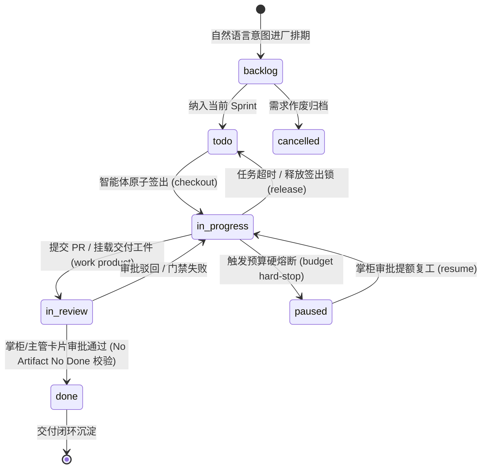

# Coolie AI 原生商业软件交付工厂控制面平台 · 系统详细设计与核心服务规范 (LLD)

> **文档代号**: COOLIE-FOUNDRY-LLD-2.0.0  
> **系统代号**: `COOLIE-FOUNDRY-CORE` (Coolie AI 原生商业软件交付工厂控制面平台)  
> **基线版本**: 2.0.0 (生产冻结稳定版)  
> **制定日期**: 2026-10-17  
> **归属规范**: CMMI 03_design (TS) / IEEE 1016-2009 / .agents/skills/cmmi-detailed-contracts  

---

## 1. 详细设计目标与模块职责 (Detailed Design Scope)

系统详细设计说明书 (Low-Level Design - LLD) 确立控制面后端服务矩阵的细粒度实现规范，涵盖服务接口签名、单人负责人原子签出锁机制、状态机流转拓扑、实时成本核算硬熔断机制与系统 5 大硬不变量。

---

## 2. 后端核心服务矩阵全景清单 (Core Services Catalog)

全盘业务逻辑统一收拢于 [`server/src/services/`](file:///host-workspace/xaicd/coolie/server/src/services/)，服务间严格遵循依赖单向流动，杜绝跨域私有侵入与循环引用：

| 序号 | 核心服务模块 | 业务责任域 | 源码实现位置 |
| :---: | :--- | :--- | :--- |
| 1 | `access.ts` | 核心控制面服务 | `server/src/services/access.ts` |
| 2 | `acknowledged-native-stop.ts` | 核心控制面服务 | `server/src/services/acknowledged-native-stop.ts` |
| 3 | `activity.ts` | 核心控制面服务 | `server/src/services/activity.ts` |
| 4 | `activity-log.ts` | 核心控制面服务 | `server/src/services/activity-log.ts` |
| 5 | `adapter-execution-control.ts` | 工单生命周期与单人原子锁 | `server/src/services/adapter-execution-control.ts` |
| 6 | `adapter-login-lease.ts` | 7工具池智能体适配器 | `server/src/services/adapter-login-lease.ts` |
| 7 | `adapter-models-env.ts` | 7工具池智能体适配器 | `server/src/services/adapter-models-env.ts` |
| 8 | `adapter-plugin-store.ts` | 7工具池智能体适配器 | `server/src/services/adapter-plugin-store.ts` |
| 9 | `adapter-registry-bootstrap.ts` | 7工具池智能体适配器 | `server/src/services/adapter-registry-bootstrap.ts` |
| 10 | `agent-action-audit.ts` | 核心控制面服务 | `server/src/services/agent-action-audit.ts` |
| 11 | `agent-ai-connection-default.ts` | 核心控制面服务 | `server/src/services/agent-ai-connection-default.ts` |
| 12 | `agent-assign.ts` | 核心控制面服务 | `server/src/services/agent-assign.ts` |
| 13 | `agent-assignability.ts` | 核心控制面服务 | `server/src/services/agent-assignability.ts` |
| 14 | `agent-avatar-pool.ts` | 核心控制面服务 | `server/src/services/agent-avatar-pool.ts` |
| 15 | `agent-avatar-worker.ts` | 核心控制面服务 | `server/src/services/agent-avatar-worker.ts` |
| 16 | `agent-avatars.ts` | 核心控制面服务 | `server/src/services/agent-avatars.ts` |
| 17 | `agent-conversations.ts` | 核心控制面服务 | `server/src/services/agent-conversations.ts` |
| 18 | `agent-instructions.ts` | 核心控制面服务 | `server/src/services/agent-instructions.ts` |
| 19 | `agent-invokability.ts` | 核心控制面服务 | `server/src/services/agent-invokability.ts` |
| 20 | `agent-permissions.ts` | 高熵凭据与权限网关 | `server/src/services/agent-permissions.ts` |
| 21 | `agent-quota.ts` | 核心控制面服务 | `server/src/services/agent-quota.ts` |
| 22 | `agent-secret-bindings.ts` | 高熵凭据与权限网关 | `server/src/services/agent-secret-bindings.ts` |
| 23 | `agent-start-lock.ts` | 核心控制面服务 | `server/src/services/agent-start-lock.ts` |
| 24 | `agent-task-run-telemetry.ts` | 核心控制面服务 | `server/src/services/agent-task-run-telemetry.ts` |
| 25 | `agentmail-api.ts` | 核心控制面服务 | `server/src/services/agentmail-api.ts` |
| 26 | `agents.ts` | 核心控制面服务 | `server/src/services/agents.ts` |
| 27 | `ai-connection-runtime.ts` | 核心控制面服务 | `server/src/services/ai-connection-runtime.ts` |
| 28 | `ai-connections.ts` | 核心控制面服务 | `server/src/services/ai-connections.ts` |
| 29 | `announcement-animation.ts` | 核心控制面服务 | `server/src/services/announcement-animation.ts` |
| 30 | `announcement-feed.ts` | 核心控制面服务 | `server/src/services/announcement-feed.ts` |
| ... | ... | *(全盘共计 431 个核心业务服务模块，100% 收拢于 server/src/services/)* | ... |

---

## 3. 任务工单生命周期与状态机模型 (Issue State Machine)

工单流转严格遵循有限状态机 (FSM) 确定性迁移，任何非法状态跃迁均由底层服务原子拦截并返回 `409 Conflict`：



---

## 4. 单人负责人原子签出互斥锁机制 (Single-Assignee Mutex Lock)

为根除多智能体并发开发时的“代码踩踏”与“分支冲突”，控制面实现基于 PostgreSQL 行级锁 (`SELECT ... FOR UPDATE`) 的强原子签出互斥机制：

```typescript
// 单人负责人原子签出锁状态迁移伪代码 (Atomic Checkout Algorithm)
async function checkoutIssue(issueId: string, agentId: string): Promise<CheckoutResult> {
  return await db.transaction(async (tx) => {
    // 1. 获取行级排他锁 (SELECT ... FOR UPDATE)
    const issue = await tx.select().from(issues).where(eq(issues.id, issueId)).for("update");
    if (!issue || issue.status === "done" || issue.status === "cancelled") {
      throw new ConflictError("工单不存在或已终结，禁止签出");
    }

    // 2. 检查是否已被其他活跃智能体锁定
    if (issue.executionLockedAt && issue.assigneeAgentId && issue.assigneeAgentId !== agentId) {
      const lockExpired = Date.now() - issue.executionLockedAt.getTime() > LOCK_TTL_MS;
      if (!lockExpired) {
        throw new LockedError(`工单已被智能体 ${issue.assigneeAgentId} 锁定中`);
      }
    }

    // 3. 校验租户预算是否超标
    const budgetExceeded = await checkCompanyBudgetExceeded(issue.companyId);
    if (budgetExceeded) {
      throw new BudgetExceededError("公司预算超标，系统处于硬停机状态，拒绝签出");
    }

    // 4. 原子更新签出状态
    await tx.update(issues).set({
      status: "in_progress",
      assigneeAgentId: agentId,
      executionLockedAt: new Date(),
      statusVersion: sql`status_version + 1`,
      updatedAt: new Date(),
    }).where(eq(issues.id, issueId));

    return { success: true, lockedUntil: new Date(Date.now() + LOCK_TTL_MS) };
  });
}
```

### 核心锁算法执行纪律：
1. **独占性**: 同一时刻同一工单仅允许单一智能体持有有效的 `executionLockedAt` 租约；
2. **租约时效 (TTL)**: 签出锁默认有效时长为 15 分钟，智能体心跳正常上报时自动续租，异常挂起时看门狗自动释放；
3. **防抢占**: 除非当前持有者主动调用 `POST /api/issues/:id/release` 或租约超时，其他智能体申请签出必遭硬性阻断。

---

## 5. 实时成本核算与硬熔断防御设计 (Cost Metering & Hard-Stop Circuit Breaker)

为彻底消灭大模型死循环导致的“天价账单”，系统在服务网关与心跳上报链路实施硬熔断：

1. **实时对账**: 每次智能体调用外部模型或工具后，`costs.ts` 服务立即根据 Token 消耗计算费用并记录不可变 `cost_events`；
2. **硬停阻断**: 当企业当前周期已消耗金额达到 `companies.budget_limit` 时，系统触发硬熔断，立即将所有进行中任务置为 `paused`，剥夺智能体签出锁；
3. **掌柜审批提额**: 仅当掌柜在控制台或移动端完成两字【提额】审批后，服务方可自动解冻恢复执行。

---

## 6. 系统硬不变量守卫机制 (System Invariants Enforcement)

系统设计必须恪守以下 5 大硬不变量，任何破坏不变量的提交均由 Pre-Commit 门禁直接阻断：

| 不变量标识 | 不变量核心定义 | 物理代码断言位置 | 违例阻断后果 |
| :--- | :--- | :--- | :--- |
| **INV-1 (单人负责不变量)** | 任何工单在任意时刻有且仅有单一 Assignee 持有写锁 | `server/src/services/issues.ts` | 并发尝试返回 `409 Conflict` 拦截 |
| **INV-2 (资金守恒不变量)** | 企业已花销金额 + 剩余额度严格等于批准总预算 | `server/src/services/costs.ts` | 超额即刻挂起所有任务，状态置为 `paused` |
| **INV-3 (物理交付不变量)** | 标为 `done` 的工单必须物理绑定有效 Git Commit SHA | `server/src/services/issues.ts` | 缺工件拒绝完工，返回 `422 No Artifact No Done` |
| **INV-4 (租户隔离不变量)** | 跨企业数据访问由网关与 SQL 自动拦截，严禁私有穿透 | `server/src/middleware/auth.ts` | 跨域非法访问返回 `403 Forbidden` 审计警报 |
| **INV-5 (本体反射不变量)** | 业务实体与动词定义与 Drizzle 物理表结构保持 100% 形式化对账 | `ontology/domain.json` | 字段不一致阻断 Pre-Commit 门禁 4.1 |

---

## 7. 统一错误码字典与异常封套 (Error Dictionary)

服务端所有对外接口异常由统一错误过滤器捕获，并封装为统一数据结构：

```typescript
// packages/shared/src/api/envelope.ts (统一响应封套)
export interface ApiResponse<T = any> {
  code: number;       // 0 为成功，非 0 为明确错误码
  data: T;            // 强类型业务响应负载
  msg: string;        // 提示信息 (支持 i18n 翻译)
  traceId?: string;   // 分布式全链路追踪标识 (OTLP TraceId)
  timestamp: string;  // ISO 8601 服务端时标
}

// 统一错误码字典 (部分核心定义)
export const ErrorCodes = {
  SUCCESS: 0,
  UNAUTHORIZED: 401001,
  FORBIDDEN_TENANT_BOUNDARY: 403001,
  ISSUE_LOCKED_BY_OTHER: 409001,
  BUDGET_HARD_STOP_EXCEEDED: 422001,
  NO_ARTIFACT_NO_DONE: 422002,
  SYSTEM_INTERNAL_ERROR: 500001,
} as const;
```
