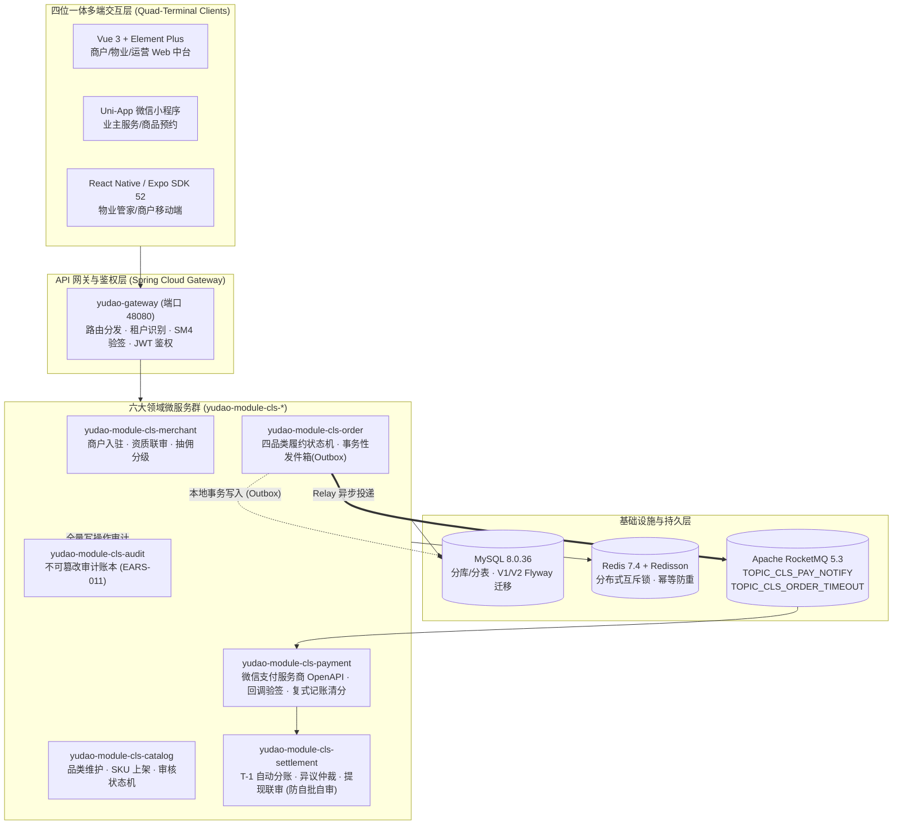
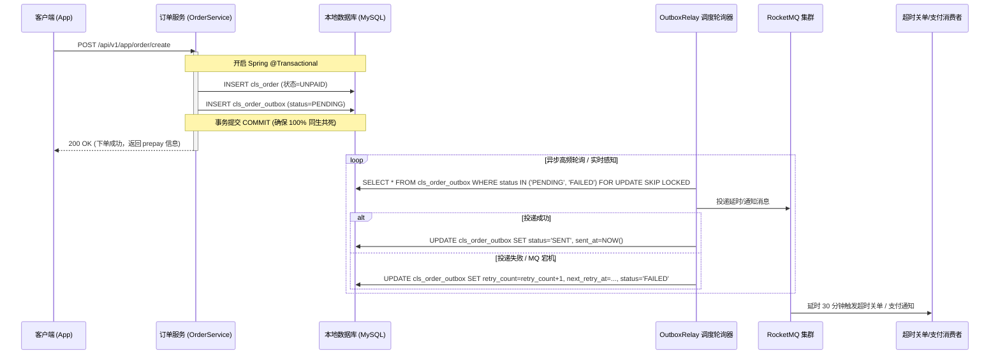

# RFC-CLS-003 · 社区生活服务商用中台微服务物理拆分接入 yudao-quad-terminal 基座与事务发件箱设计方案

> **状态**: 提议已批准 / 实施就绪 (PROPOSED & APPROVED)  
> **归属工单**: [COOA-275] [G2·架构] 墨斗 · yudao-quad-terminal 集成架构 RFC 与 6 领域微服务拆分契约方案  
> **父工单**: [COOA-262] 生产化续: cls-core-services 微服务物理拆分接入 yudao-quad-terminal 基座 + 事件发件箱解耦  
> **负责人**: 墨斗 (Inkstick / modou-fda) · 前线架构师 (FDA)  
> **评审人**: Hermes (PM / 交付总监) · 铁匠 (Core-SWE) · 门神 (FDSE)  
> **日期**: 2026-10-16  

---

## 1. 架构演进背景与动因

社区生活服务中台已在 COOA-93/COOA-255/COOA-256 中完成从「模块化单体 + H2 演示态」到「MySQL 8 + Redis + RocketMQ + SM4 + 真实支付 OpenAPI」的生产级运行时落地。系统在真机真栈（48082 端口 + MySQL/Redis/RocketMQ）实测达成资金严格守恒、防自批自审与 AST 租户行级隔离。

然而，按照《CMMI 5 软件工程资产化》与平台开源基座选型法典（`yudao-quad-terminal` 作为 Java 17 + Spring Boot 3 + Spring Cloud Alibaba / 多端闭环标准基座），系统面临两项结构性演进诉求：
1. **六大业务领域微服务物理拆分**：将现有单工程拆解为商户 (Merchant)、商品/目录 (Catalog)、订单 (Order)、支付清分 (Payment)、结算中心 (Settlement) 与审计溯源 (Audit) 六个高内聚、低耦合微服务，接入 `yudao-quad-terminal` 的微服务基础设施；
2. **事件投递解耦与高韧性容灾 (Transactional Outbox)**：当前 `OrderService.create` 在同步向 RocketMQ 投递超时关单事件时采用 fail-fast。若 MQ Broker 遭遇瞬时网络抖动或正在重启，将直接导致用户下单失败。必须引入**事务性发件箱 (Transactional Outbox) 模式**，保证「本地业务落库与发件箱存盘」在同一数据库本地事务内原子提交，由独立 Relay 异步轮询/推送，即使 MQ 彻底宕机也不阻断前端正常下单。

---

## 2. 总体架构拓扑图



---

## 3. 六大微服务模块物理拆分规范

各领域严格遵循 `yudao` 推荐的 `api` 与 `server` 双模块隔离范式：

| 微服务模块 | API 模块 (`-api`) | Server 模块 (`-server` 或独立部署) | 核心职责 | 依赖契约 |
| :--- | :--- | :--- | :--- | :--- |
| **`merchant`** | `yudao-module-cls-merchant-api` | `yudao-module-cls-merchant-biz` | 商户资质、入驻审核、佣金比例、商户账户基本信息 | 被 `catalog`、`order`、`settlement` 依赖 |
| **`catalog`** | `yudao-module-cls-catalog-api` | `yudao-module-cls-catalog-biz` | 服务类目、商品信息、SKU 价格、上架联审 | 被 `order` 依赖校验价格与库存 |
| **`order`** | `yudao-module-cls-order-api` | `yudao-module-cls-order-biz` | 订单生命周期、履约核销、超时关单、**Outbox 发件箱** | 依赖 `merchant-api`、`catalog-api` |
| **`payment`** | `yudao-module-cls-payment-api` | `yudao-module-cls-payment-biz` | 微信支付服务商统一下单、异步验签、复式记账分账计算、退款准备金台账 | 依赖 `order-api`，被 `settlement` 依赖 |
| **`settlement`** | `yudao-module-cls-settlement-api` | `yudao-module-cls-settlement-biz` | 结算单生成、商户打款、提现发起与防自批自审联审 | 依赖 `payment-api`、`merchant-api` |
| **`audit`** | `yudao-module-cls-audit-api` | `yudao-module-cls-audit-biz` | 业务操作不可篡改审计流水 | 纯消费型底座，各服务通过消息/RPC 异步记录 |

---

## 4. 事务性发件箱 (Transactional Outbox) 详细设计

### 4.1 问题与解耦架构
在原有代码中：
```java
// 原 OrderService.java 缺陷代码
orderRepository.save(order);
// 若此时 RocketMQ 网络闪断，直接抛出异常导致整个下单事务回滚！
domainEventPublisher.publishOrderTimeout(order.getId(), 30);
```
**改进设计**：采用本地事务发件箱模式。


### 4.2 库表设计 (`cls_order_outbox`)
```sql
CREATE TABLE IF NOT EXISTS `cls_order_outbox` (
    `id` BIGINT NOT NULL AUTO_INCREMENT COMMENT '发件箱自增主键',
    `tenant_id` BIGINT NOT NULL DEFAULT 1 COMMENT '租户编号',
    `order_id` BIGINT NOT NULL COMMENT '关联合同/订单号',
    `topic` VARCHAR(64) NOT NULL COMMENT '目标 RocketMQ Topic',
    `tag` VARCHAR(32) NOT NULL DEFAULT '*' COMMENT '消息 Tag',
    `event_type` VARCHAR(64) NOT NULL COMMENT '事件类型: ORDER_TIMEOUT / PAY_NOTIFY',
    `payload` TEXT NOT NULL COMMENT '消息 JSON 体',
    `delay_level` INT NOT NULL DEFAULT 0 COMMENT '延时级别 (RocketMQ delayLevel)',
    `status` VARCHAR(20) NOT NULL DEFAULT 'PENDING' COMMENT '状态: PENDING / SENT / FAILED / DEAD',
    `retry_count` INT NOT NULL DEFAULT 0 COMMENT '已重试次数',
    `max_retries` INT NOT NULL DEFAULT 5 COMMENT '最大允许重试次数',
    `next_retry_at` DATETIME NOT NULL DEFAULT CURRENT_TIMESTAMP COMMENT '下次重试时间',
    `last_error` VARCHAR(512) DEFAULT NULL COMMENT '最后一次失败原因',
    `created_at` DATETIME NOT NULL DEFAULT CURRENT_TIMESTAMP COMMENT '创建时间',
    `sent_at` DATETIME DEFAULT NULL COMMENT '成功投递时间',
    PRIMARY KEY (`id`),
    INDEX `idx_tenant_status_retry` (`tenant_id`, `status`, `next_retry_at`),
    INDEX `idx_order_id` (`order_id`)
) ENGINE=InnoDB DEFAULT CHARSET=utf8mb4 COMMENT='社区生活服务·订单事务发件箱';
```

### 4.3 容灾与指数退避重试规则
- **重试间隔**：采用指数退避：`next_retry = now + min(300, 5 * 2^retry_count)` 秒；
- **死信保护 (Dead-Letter)**：当 `retry_count >= 5` 时，状态自动置为 `DEAD` 并触发钉钉/企业微信告警，由人工或运维脚本兜底处理，绝不无休止占用线程；
- **幂等消费保证**：消息体必须携带唯一的 `outbox_id` 与 `order_id`，消费者端使用 Redis `SETNX` 建立 24 小时幂等窗口。

---

## 5. 跨域治理与核心不变量继承 (Non-Negotiable Invariants)

1. **租户隔离零改动复用**：
   - 继承 `common/tenant/ClsTenantLineHandler`，基于 MyBatis-Plus / JSqlParser AST 进行 SQL 语法树自动注入 `tenant_id = ?` 谓词；
   - 维持 Fail-Closed 策略：当上下文缺失 `TenantContext` 时直接拒绝访问，绝不裸奔查询全库。
2. **防自批自审隔离 (Anti-Self-Approval)**：
   - 资质审核（商户、商品）与提现审批必须满足 `reviewer_id != applicant_id`，违反直接抛出 `FORBIDDEN` 业务错误。
3. **资金守恒四方平衡公式**：
   - 任何涉及资金清分的场景，严格断言：
     $$\text{实收金额} \equiv \text{商户待结} + \text{平台抽佣} + \text{物业分成} + \text{退款准备金 (0.5\%)}$$
   - 偏差为 0，若出现哪怕 1 分钱不平衡，事务强制回滚。

---

## 6. 实施路线与交接清单

- **阶段一 (即刻施工 · COOA-276)**：
  - 铁匠实现 `cls_order_outbox` 实体、Flyway 迁移脚本与 `OutboxRelay` 调度器；
  - 改造 `OrderService.create`，将 MQ 强依赖解耦为本地事务落库 + Outbox 补发；
  - 编写包含 RocketMQ 假死、网络抖动、重试上限等 ≥6 项单元测试。
- **阶段二 (微服务工程落地 · COOA-277)**：
  - 按照 Maven Monorepo 标准，在 `yudao-quad-terminal` 建立 6 大领域包骨架；
  - 完成 API/DTO 与业务代码物理隔离。
- **阶段三 (线上真实联调 · COOA-278)**：
  - 待掌柜提供真实微信服务商商户号凭据后，解阻真实 0.01 元交易实测。
