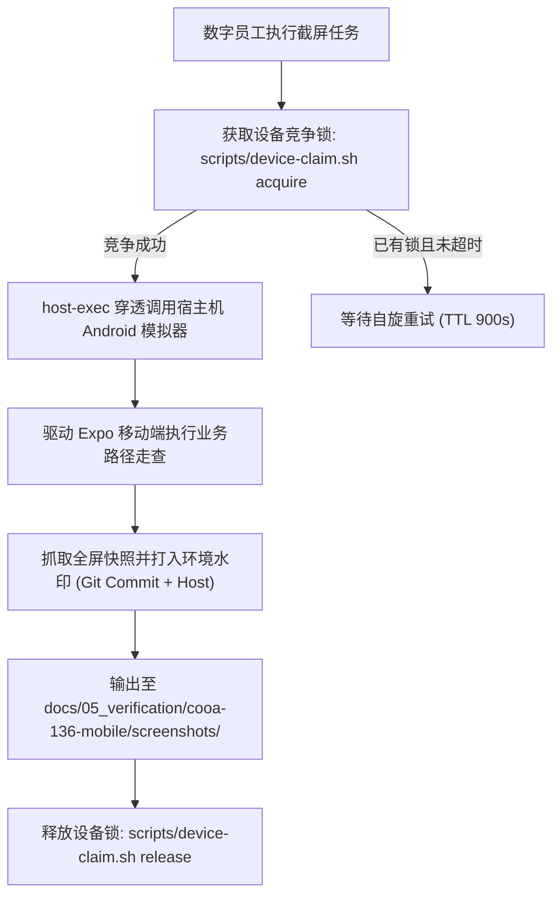

# Coolie 工坊移动端真机自动化截屏流水线规范 (Playwright + device-claim)

> **文档代号**: COOA-SCREEN-v2.0  
> **基线版本**: v2.0.0 (生产准入版)  
> **制定日期**: 2026-10-17  
> **归属规范**: CMMI 03_design (TS) / .agents/skills/agent-device-browser-automation  

---

## 1. 自动化真机快照流水线目标 (Objectives)

在端到端交付场景中，必须确保证据绝对真实可信：
1. **彻底杀灭假 Mock 与纯前端画板**：截图必须来自真实运行在 Pixel 7 Android 模拟器中的 Expo 原生应用；
2. **多智能体并发设备锁保护**：通过 `scripts/device-claim.sh` 实现串行设备锁竞争，避免两个数字员工同时操作同一台模拟器造成截屏混乱；
3. **极简 6 寸屏几何防御走查**：强制在 320dp~430dp 视口下走查无横向滚动条、核心两字按钮不折行、底栏黄金 5 槽位不被模态框遮挡；
4. **端到端四态全覆盖**：覆盖正常态 (Normal)、加载态 (Loading)、空数据态 (Empty)、异常错误态 (Error)。

---

## 2. 流水线执行与串行锁拓扑架构 (Execution Topology)

---

## 3. 门禁断言与不可变存证规则

1. **Gate 24 真机设备锁守卫**: 提交前必须通过 `node --test scripts/__tests__/device-claim.test.mjs`，确保单并发、超时回收与幂等释放测试全部全绿；
2. **快照归档与物理追溯**: 所有真机截图必须物理纳管于 Git 仓库，并在 UAT 终验单中作为不可变机器凭据挂载。
