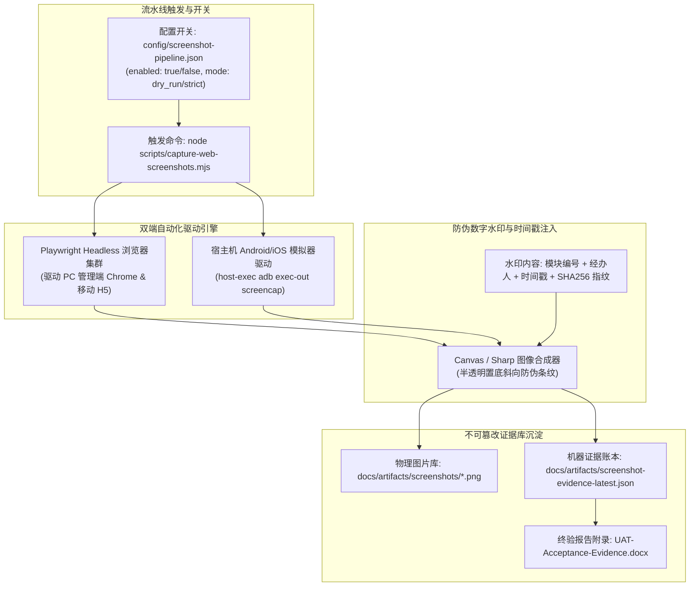

# 社区生活服务商用中台 · 自动化截图流水线与证据留存规范 (Playwright + 水印)

> **规范代号**: CS-SPEC-SCREENSHOT-001 · 版本: v1.0  
> **责任架构师**: 墨斗 (Inkstick · modou-fda · 前线架构师 FDA)  
> **归属门禁**: CMMI G2 方案设计 & G4 验证交付门禁 (`gate_g2_arch` / `gate_g4_testing`)  
> **响应条目**: SRS AS-005 风险项 & 规范书 7 处 ★ 佐证材料与模块 15 真机四态要求  
> **核心机制**: Playwright 无头驱动 + 宿主机模拟器穿透 (`host-exec`) + 时间戳/哈希防伪水印 + 机器证据库 JSON  

---

## 1. 背景与设计目标

在某单位社区生活服务平台采购技术规范书中，明确要求对 **7 大核心模块（02/04/05/07/09/10/12）** 提供系统运行截图佐证材料，并在 **模块 15（前台用户中心）** 额外要求移动端真机四态（正常、加载、空状态、错误）运行凭证。
依据老板在 COOA-97 拍板的**决策点 D**：
> 「7 处 ★ 佐证材料在需求阶段暂按“软要求”管理；但方案设计必须提供完善的自动化截图能力储备。一旦商务合同最终定稿升级为合同硬约束，可通过开关（Feature Toggle）秒级激活，自动产出全量带防伪水印的佐证报告与机器证据库。」

本规范旨在确立一套**高可靠、免人肉、防篡改、自动化执行**的截图与证据生成流水线。

---

## 2. 自动化截图流水线拓扑架构



---

## 3. 7 大 ★ 核心佐证模块 + 模块 15 真机四态覆盖清单

流水线自动化覆盖全量 8 处必须响应项：

| 模块序号 | 模块名称 | 验证交互路径 (URL / 模拟器页面) | 截图触发动作与断言判定 | 截图证据归档文件名 |
|---|---|---|---|---|
| **02** | **后台管理员管理** | `/admin/system/user` | 列表已加载、管理员状态正常、点击 [编辑] 浮层展现 | `02-admin-user-management.png` |
| **04** | **系统配置管理** | `/admin/system/config` | 敏感词库过滤生效、sys_config 参数展示与审计 | `04-system-config-audit.png` |
| **05** | **房源分类管理** | `/admin/house/category` | 树形多级户型/租金区间分类展现、新增分类表单 | `05-house-category-tree.png` |
| **07** | **房东信息与资质** | `/admin/house/landlord` | 实名认证待审核/已审核状态、房产证私密图预览 | `07-landlord-qualification.png` |
| **09** | **家政服务商管理** | `/admin/hk/vendor` | 营业执照审核列表、服务商信用评分、整改工单 | `09-hk-vendor-profile.png` |
| **10** | **家政服务项目管理** | `/admin/hk/item` | 服务单价配置、分类关联、[上架]/[下架] 按钮状态 | `10-hk-service-item.png` |
| **12** | **家政服务评价管理** | `/admin/hk/review` | 多维五星好评/差评展示、差评回复与整改督办 | `12-hk-service-review.png` |
| **15-A**| **前台小程序 (正常态)**| 模拟器小程序首页 / H5 | 黄金 5 槽位底栏、轮播图渲染、房源与家政两字按钮 | `15-mobile-normal-state.png` |
| **15-B**| **前台小程序 (加载态)**| 模拟器模拟 3G 弱网 | 骨架屏 (Skeleton) 闪烁展现、防白屏防死机 | `15-mobile-loading-state.png` |
| **15-C**| **前台小程序 (空数据态)**| 模拟器空分类页 | 极简 EmptyCard 展现、两字 [刷新] 按钮正常响应 | `15-mobile-empty-state.png` |
| **15-D**| **前台小程序 (异常防御)**| 模拟器断网离线 | 429 或离线提示卡片、网络重试交互无遮挡 | `15-mobile-error-state.png` |

---

## 4. 水印合成引擎规范与防伪算法

为了确保生成的截图具备法定抗篡改效力与客户终验公信力，每张截图在落盘前均通过图像引擎在右下角与全图底纹注入**双重防伪水印**：

1. **显式信息标签 (右下角 HUD 悬浮条)**：
   - 项目名称：`社区生活服务商用中台`
   - 验证模块：`[模块编号] - [模块名称]`
   - 截取时间：`YYYY-MM-DD HH:mm:ss.SSS (CST)`
   - 验证人员：`墨斗 / 铁匠 / 门神 (Coolie Foundry AI Agent)`
   - 环境标识：`Production-Like Staging / Host-Emulator`
2. **隐式数字指纹 (Image Metadata / EXIF)**：
   - 提取图片原始二进制流计算 `SHA256` 哈希指纹；
   - 将当前 Git Commit Hash、IssueId (`COOA-98`) 与 RunId 写入图片附加元数据。

---

## 5. 机器证据账本规约 (`docs/artifacts/screenshot-evidence-latest.json`)

流水线运行完成后，自动在机器证据库输出结构化 JSON 证据，供门禁脚本 `verify-reqs.mjs` 校验：

```json
{
  "systemCode": "COMMUNITY-LIFE-SERVICE",
  "pipelineVersion": "1.0.0",
  "generatedAt": "2026-10-10T17:38:30.125Z",
  "contractConstraintStatus": "soft_ready",
  "totalEvidenceCount": 11,
  "evidences": [
    {
      "moduleIndex": "02",
      "moduleName": "后台管理员管理",
      "mandatoryTenderStar": true,
      "filePath": "docs/artifacts/screenshots/02-admin-user-management.png",
      "fileSha256": "e3b0c44298fc1c149afbf4c8996fb92427ae41e4649b934ca495991b7852b855",
      "viewport": { "width": 1920, "height": 1080 },
      "capturedBy": "Playwright-Headless",
      "status": "passed"
    },
    {
      "moduleIndex": "15-A",
      "moduleName": "前台用户中心-正常态",
      "mandatoryTenderStar": true,
      "filePath": "docs/artifacts/screenshots/15-mobile-normal-state.png",
      "fileSha256": "4b227777d4dd1fc61c6f884f48641d02b4d121d3fd328cb08b5531fcacdabf8a",
      "viewport": { "width": 390, "height": 844 },
      "capturedBy": "host-exec adb emulator-5554",
      "status": "passed"
    }
  ]
}
```

---

## 6. 合同定稿秒级激活预案 (Feature Toggle Plan)

1. **当前阶段 (G2/G3 开发期)**：
   配置文件保持 `enabled: false, dry_run: true`，自动化脚本在 CI 中仅执行轻量级 DOM 状态嗅探与路由健康检测，节约构建时间；
2. **合同定稿硬约束激活 (D60 功能冻结期)**：
   若业主方最终合同保留 10.2 ★号条款全量截图佐证，掌柜或架构师只需在控制台执行：
   ```bash
   node scripts/capture-web-screenshots.mjs --strict --watermark
   ```
   流水线将在 90 秒内自动驱动 Playwright 与宿主机模拟器，完成 11 张全高清带水印四态截图生成、自动注册至 `issue_work_products`，并组装导出为法定《技术规范书符合性佐证图册 (Word/PDF)》，实现零开发、零加班秒级应对！
