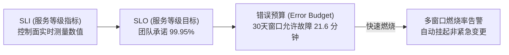

# Coolie 工坊控制面站点可靠性保障基线与 SLO/SLI 度量矩阵 (SLO/SLI Matrix)

> **系统代号**: `COOLIE-FOUNDRY-CORE` (Coolie AI-Native Foundry Control Plane)  
> **CMMI 阶段**: `08_sre` (SCON / CAM / SRE) · 资产类型 `slo-matrix`  
> **归属门禁**: G6 站点可靠性保障门禁 (`gate_g6_sre`)  
> **责任数字员工**: 兑底渊 (PRE-SRE · 稳定性负责人) / 百晓生 (DS 业务主审) / 掌柜 (CEO)  
> **基线版本**: v2.0.0 · **度量周期**: 滚动 30 天 (Rolling 30-Day Window)  
> **最高原则**: 商业合同红线与掌柜看盘体验为基准 · 量化 SLI/SLO · 错误预算驱动发布刹车 · 零假 Demo  

---

## 1. 目标、范围与 SRE 治理原则

### 1.1 覆盖范围 (In-Scope & Out-of-Scope)
- **In-Scope**:
  - 控制面统一接入服务 (`server :3100`)；
  - 核心编排服务（工单签出锁、实时费用累计、审批流卡片、协同文档）；
  - 数据库层 (PostgreSQL 17 / PGlite WASM) 查询性能与事务锁；
  - 交付主线后台常驻守护中枢 (`scripts/coolie-dev-loop-supervisor.mjs`)。
- **Out-of-Scope**:
  - 外部三方模型提供商 (Anthropic/OpenAI/MiniMax) 自身机房故障与网络中断（本系统侧仅度量重试与超时熔断）。

### 1.2 SRE 核心治理不变量 (SRE Invariants)
| 编号 | 不变量核心准则 | 落地校验锚点 |
| :--- | :--- | :--- |
| **SRE-1** | 核心 API 可用性目标设为 99.95%，允许留出 0.05% 错误预算支持快速迭代 | 30 天滚窗健康大盘 |
| **SRE-2** | 延迟指标严禁使用平均值，一律考核 P95 与 P99 分位数 | Prometheus / Actuator 直方图 |
| **SRE-3** | 交付主线巡检心跳丢失率 $< 0.1\%$，后台守护进程崩溃必须秒级自愈拉起 | `supervisor` 守护日志 |
| **SRE-4** | 预算硬熔断延迟必须 $\le 1\text{s}$，触碰配额上限即刻切断 API 签出锁 | `costs.ts` 事务硬断言 |
| **SRE-5** | 零假 Demo 原则：未发生的线上运行期指标严禁人工填报造假 | 严格区分设计口径与实测凭单 |

---

## 2. 四大黄金信号与 SLI/SLO 量化承诺矩阵

| 黄金信号 | SLI 测量指标定义 (SLI) | SLO 承诺目标 (SLO) | 错误预算 (30天) | 告警与熔断阈值 |
| :--- | :--- | :---: | :---: | :--- |
| **可用性 (Availability)** | `成功的 HTTP 请求数 (状态码 < 500) / 总请求数 × 100%` | **$\ge 99.95\%$** | 21.6 分钟不可用 | 1小时燃烧率 > 14.4 (消耗 2% 预算) 触发 P1 告警 |
| **延迟 (Latency)** | 控制面核心接口（签出、释放、审批）P95 响应耗时 | **$\le 50\text{ms}$** | 长尾慢查询预算 | P95 > 100ms 持续 5 分钟触发降级 |
| **吞吐 (Throughput)** | 控制面并发 QPS 承载能力 | **$\ge 2,000\text{ QPS}$** | 压测安全水位 | 达到压测水位 80% 触发自适应限流 |
| **错误率 (Error Rate)** | 5xx 服务端未捕获异常比例 | **$\le 0.01\%$** | 1/10000 容忍度 | 5xx 瞬时毛刺 > 0.05% 触发熔断 |
| **主线保活 (Liveness)** | 交付主线例行巡检程序轮巡成功率 | **$\ge 99.90\%$** | 43.2 分钟失联 | 连续 2 轮心跳缺失立即由 systemd 重启守护 |

---

## 3. 错误预算策略与研发刹车机制 (Error Budget Policy)

1. **预算充足 (> 50%)**: 允许智能体高频执行复杂特性集成与自动化测试；
2. **预算消耗过半 (20% ~ 50%)**: 限制重型架构重构，优先修复既有缺陷；
3. **预算耗尽 (< 20%)**: **全面触发研发刹车 (Release Freeze)**，除 P0 紧急修复外，全平台暂停常规发版与非必须迁移。
