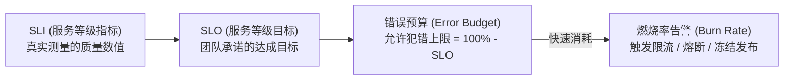
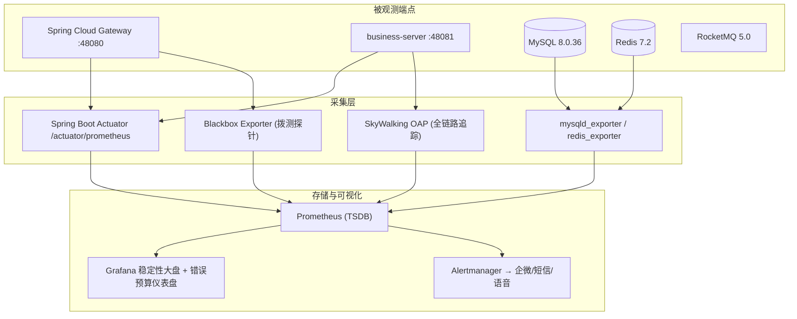

# 社区生活服务商用中台 · 站点可靠性保障基线与 SLO/SLI 度量矩阵 (SLO/SLI Matrix)

> **系统代码**: `COMMUNITY-LIFE-SERVICE`（社区生活服务商用中台 · Community Life Service Commercial Hub）
> **CMMI 阶段**: `08_sre`（SCON / CAM / SRE）· 资产类型 `slo-matrix`
> **归属门禁**: G6 站点可靠性保障门禁 (`gate_g6_sre`)
> **责任数字员工**: 兑底渊（PRE-SRE · 稳定性负责人）；金标验收：门神（FDSE）；业务主审：百晓生（DS）
> **驱动 Skills**: `sre-slo-manager` · `pre-sre`
> **上游契约**: `docs/03_design/architecture-design-hld.md` · `docs/07_release/system-deployment-sop.md` · `docs/07_release/rollback-emergency-plan.md`
> **下游契约**: `docs/08_sre/05_disaster_recovery/DISASTER-RECOVERY-PLAN.md` · `docs/09_operations/tenant-governance.md`
> **基线日期**: 2026-10-11 · **服务等级目标周期**: 滚动 30 天 (Rolling 30-Day Window)
> **最高原则**: 系统可用性以商业合同红线与终端用户体验为法定基准 · 量化 SLI/SLO · 错误预算驱动发布刹车 · No Artifact, No Done

---

## 一、 目标、范围与 SRE 治理不变量

### 1.1 目标
以用户真实体验为核心，为本中台定义可测量、可告警、可熔断的**服务等级指标 (SLI)** 与**服务等级目标 (SLO)**，并通过**错误预算燃烧率 (Error Budget Burn Rate)** 建立稳定性与研发迭代速度的量化平衡契约。

### 1.2 覆盖范围与边界
- **In-Scope**：统一接入网关 (`gateway :48080`)、核心聚合服务 (`business-server :48081`)、8 大领域模块的对外 HTTP/RPC 能力、支付回调链路、数据库/缓存/消息中间件的可用性与延迟；
- **Out-of-Scope**：第三方支付渠道 (微信支付) 自身的可用性（仅度量本系统侧的下单与回调成功率，渠道方 SLA 由渠道 SLA 兜底），甲方内网专线质量。

### 1.3 SRE 治理不变量 (SRE Invariants)
| 编号 | 不变量 | 落地校验锚点 |
|---|---|---|
| **SRE-1** | 可用性不盲目追 100%：错误预算必须留白用于合理创新与快速演进 | 30 天滚窗预算仪表盘 |
| **SRE-2** | 延迟指标一律采用分位数 (P95/P99)，严禁以平均值掩盖长尾 | 网关/Actuator 延迟直方图 |
| **SRE-3** | 告警一律基于多窗口多燃烧率，严禁瞬时单点误报风暴 | 告警规则库（见 §4） |
| **SRE-4** | 资金守恒为 0 容忍红线，任何轧差差异即触发熔断与人工介入 | 日终平账断言（见 `docs/09_operations`） |
| **SRE-5** | 熔断先于雪崩：任一下游依赖异常必须自动降级/短路 | 网关 Sentinel 熔断规则 |
| **SRE-6** | 未发生的生产测量值不预填，防止虚假达标 (Zero Fake Demo) | 本表 §3 采集点为"设计口径"而非"实测值" |

---

## 二、 四大黄金信号与 SLI 定义口径 (Golden Signals)

- **可用性 (Availability)**：`SLI_avail = 成功的 HTTP 请求数 (状态码 < 500) / 总有效请求数 × 100%`
- **延迟 (Latency)**：采用 `P95 / P99` 分位数口径，`SLI_latency = 响应时间 ≤ 阈值的请求数 / 总有效请求数 × 100%`
- **吞吐量 (Throughput)**：满足延迟 SLO 前提下承载的 QPS/RPS（容量护栏见 §7）
- **饱和度 (Saturation)**：网关连接数水位、DB 连接池占用率、Redis 内存使用率、RocketMQ 消费堆积

---

## 三、 核心业务 SLI / SLO 目标矩阵

> **口径声明 (Zero Fake Demo)**：本表为**监控基线设计**，定义 SLI 的测量口径、SLO 承诺目标与采集落点；生产上线后由 Prometheus/Grafana 实时填充真实数值，未经采集不预填任何达标数据。

| 业务域与主链路 | 服务等级指标 (SLI 定义) | 服务等级目标 (SLO) | 30 天错误预算 | 测量采集点 |
| :--- | :--- | :--- | :--- | :--- |
| **全站综合可用性** | 成功请求数(非 5xx) / 总请求数 | **≥ 99.95%** | 21.6 分钟不可用/月 | 网关 `gateway:48080` 访问日志 + Prometheus |
| **房源检索与浏览** | HTTP 200 且耗时 ≤ 300ms / 房源查询总数 | **≥ 99.90%** | 43.2 分钟不可用/月 | `house` 模块 Actuator + ES 检索延迟 |
| **家政订单履约链** | 订单创建成功且支付回调成功 / 提单总数 | **≥ 99.99%** | 4.32 分钟不可用/月 | `housekeeping` 订单状态机 + `pay` 回调 |
| **三端端到端延迟** | P95 核心接口 ≤ 200ms · P99 ≤ 800ms | **≥ 99.50%** | — | APM (Prometheus + SkyWalking 链路) |
| **社区活动并发扣减** | 名额扣减成功且无超卖 / 报名请求数 | **≥ 99.90%** | 43.2 分钟不可用/月 | `community` 活动服务 + Redis 原子计数 |
| **数据落盘一致性** | 账务资金流水双写轧差差异率 | **0.00% (绝对守恒)** | 0 容忍 | 日终平账脚本 `audit-reconcile.sql` |

---

## 四、 错误预算多窗口燃烧率告警模型 (Multi-Window Burn-Rate Alerts)

依据 Google SRE 最佳实践，告警采用**多时间窗口双重确认**机制，兼顾爆发型故障与慢性侵蚀故障，消灭告警风暴与疲劳：

| 严重级别 | 燃烧率 (Burn Rate) | 对应消耗 | 判定窗口 (短/长) | 响应时效 (MTTR) | 响应机制与触达渠道 |
| :--- | :--- | :--- | :--- | :--- | :--- |
| **P0 紧急灾难** | **14.4x** | 1 小时消耗 2% | 2 分钟 / 1 小时 | **≤ 5 分钟** | 语音外呼 + 企微群高亮 + 网关自动降级 |
| **P1 严重异常** | **6.0x** | 6 小时消耗 5% | 15 分钟 / 6 小时 | **≤ 15 分钟** | 企微群 @ 全员 + 短信告警 |
| **P2 关注预警** | **2.0x** | 24 小时消耗 10% | 1 小时 / 24 小时 | **≤ 2 小时** | 内部工单通知 + 邮件摘要 |
| **P3 隐患漂移** | **1.0x** | 3 天消耗 10% | 6 小时 / 3 天 | **≤ 24 小时** | 每日 SRE 晨会大盘自动通报 |

> 短窗口用于"确认中"、长窗口用于"触发告警"，两者同时命中方升级响应，避免瞬时跳刺误报。

---

## 五、 错误预算冻结与发布刹车机制 (Budget Freeze Policy)

> [!IMPORTANT]
> **错误预算熔断红线**（30 天滚动窗口消耗比例）：
> - 消耗达 **50%**：冻结非核心特性发布，进入发布加强复核态；
> - 消耗达 **80%**：全面冻结特性发版，仅允许 P0 缺陷修复与稳定性加固补丁上线；
> - 消耗达 **100% (耗尽)**：强制熔断停工，所有研发力量转入稳定性攻坚与 SRE 事故复盘。

冻结动作由发布门禁与 `docs/07_release/release-verification-checklist.md` 联动执行：预算未回补前，任何新特性发版走查项一律置 ⛔，严禁放行。

---

## 六、 观测采集拓扑与指标落点 (Observability Topology)

- **指标端**：所有业务模块暴露 `/actuator/prometheus`；中间件经 exporter 上报；
- **拨测端**：Blackbox 探针从公网与内网双视角拨测 `/api/health`；
- **链路端**：SkyWalking 采集跨模块 Feign/RocketMQ 调用耗时，定位延迟瓶颈；
- **告警端**：Alertmanager 按 §4 规则分级路由至企微群 / 短信 / 语音外呼。

---

## 七、 容量与压测护栏 (Capacity Guardrails)

| 护栏 | 目标值 | 校验方式 |
| :--- | :--- | :--- |
| 单机独立进程吞吐量 | **≥ 5,000 RPS** | 本地独立进程压测（隔离干净进程，严禁 Dev Mode 低性能态） |
| 核心写接口 P95 延迟 | **≤ 50ms** | 压测报告 + Actuator 直方图 |
| 核心读接口 P99 延迟 | **≤ 200ms** | 压测报告 + SkyWalking |
| HTTP 失败率 | **严格 0%** | 压测断言退出码 |
| 网关连接数水位 | **< 30%** | 网关实时指标 |
| Redis 内存使用率 | **< 50%** | redis_exporter |

---

## 八、 G6 门禁准入与结项检查清单 (`gate_g6_sre`)

- [ ] §3 SLO/SLI 目标矩阵已按业务域逐项定义（可用性 ≥ 99.95%、支付链路 ≥ 99.99%）；
- [ ] §4 告警采用多窗口多燃烧率（P0~P3），无瞬时单点误报规则；
- [ ] §5 错误预算冻结与发布刹车机制与 G5 走查清单联动；
- [ ] §7 容量护栏满足单机 ≥5,000 RPS、P95 ≤ 50ms、失败率 0%；
- [ ] `docs/08_sre/05_disaster_recovery/DISASTER-RECOVERY-PLAN.md` 容灾预案就绪且演练计划明确；
- [ ] 未发生的生产事故与渗透结果严格 `.gitkeep` 留空（`02_postmortem/`、`security-reports/`）；
- [ ] `node scripts/check-sre-baseline.mjs` 退出码为 0；
- [ ] 本资产作为物理 Work Product 挂载至工单（`metadata.resourceRef.kind = "workspace_file"`）。

---

## 九、 权威标准参考

- Google SRE 稳定性工程框架（SLI/SLO、Error Budget、Multi-Burn-Rate Alerts）；
- CMMI V2.0 连续服务与可用性管理 (SCON) / 因果分析与解决 (CAM)；
- 技能规范：`.agents/skills/sre-slo-manager/SKILL.md`、`.agents/skills/pre-sre/SKILL.md`。
