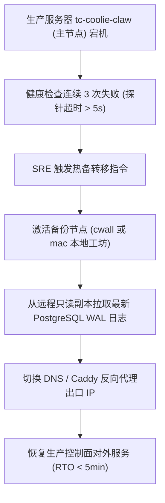

# Coolie 工坊平台控制面高可用容灾与灾难恢复预案 (Disaster Recovery Plan)

> **文档代号**: COOA-SRE-DR-v2.0  
> **系统代号**: `COOLIE-FOUNDRY-CORE` (Coolie AI-Native Foundry Control Plane)  
> **CMMI 阶段**: `08_sre` (SCON / CAM / SRE) · 资产类型 `dr-plan`  
> **归属门禁**: G6 站点可靠性保障门禁 (`gate_g6_sre`)  
> **责任数字员工**: 兑底渊 (PRE-SRE · 稳定性负责人) / 掌柜 (CEO)  
> **基线版本**: v2.0.0 (生产准入版)  
> **制定日期**: 2026-10-17  

---

## 1. 容灾目标与核心 SLA 指标 (RTO / RPO)

为保障商业交付项目进度不中断、智能体履约账本不丢失，本预案设定极其严苛的容灾红线：
- **恢复时间目标 (RTO - Recovery Time Objective)**: **$\le 5$ 分钟**（生产主机故障时，备用节点控制面全面接管服务耗时）；
- **恢复点目标 (RPO - Recovery Point Objective)**: **$\le 1$ 分钟**（最大允许丢失的数据时间跨度）；
- **零单点故障 (Zero SPoF)**: Tailscale Mesh 网络中任何单一宿主机（`mac` / `cwall` / `tc-coolie-claw` / `aja-pc`）离线，全网协同与代码资产不丢失。

---

## 2. 多主机容灾拓扑与切换 SOP (Failover SOP)



### 2.1 主机宕机接管步骤
1. **确认故障态**:
   ```bash
   ssh -o ConnectTimeout=5 ubuntu@62.234.59.180 'systemctl is-active coolie' || echo "主节点确认失联"
   ```
2. **激活备份控制面服务**:
   在 `cwall` 或 `mac` 节点执行一键拉起脚本：
   ```bash
   node scripts/coolie-dev-loop-supervisor.mjs --failover-master
   ```
3. **域名/隧道秒级切换**:
   更新 Tailscale Funnel 或反向代理上游指向备用节点 IP。

---

## 3. 数据资产备份与混沌演练计划 (Chaos Engineering)

1. **增量 WAL 与定时快照**:
   - 生产数据库每小时执行增量快照，物理备份异地同步至 S3 兼容对象存储；
2. **季度混沌容灾演练**:
   - 模拟单机断电（kill 生产进程）、网络高延迟（注入 500ms 丢包）、磁盘打满等故障场景，验证系统自愈与秒级回退能力。
