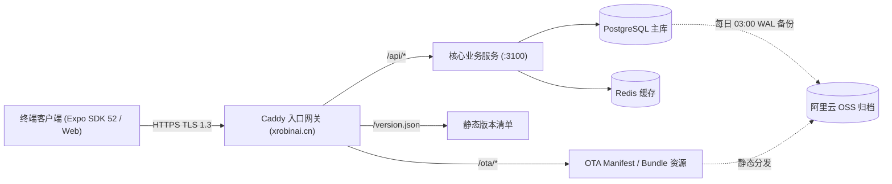
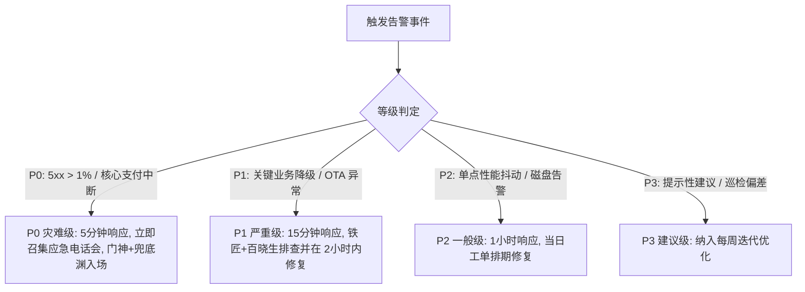

# 社区生活服务商用中台 · v1.0 商业运营与运维手册 (Operations Runbook)

> **系统代码**: `COMMUNITY-LIFE-SERVICE`（社区生活服务商用中台）  
> **CMMI 阶段**: `09_operations`（OPER）· 资产类型 `runbook`  
> **归属门禁**: G5 生产投产与持续运营合规 (`gate_g5_operations`)  
> **责任数字员工**: 百晓生（DS · 业务主审）· 铁匠贰号（Core SWE 副）· 兜底渊（PRE-SRE）  
> **服务工单**: [COOA-271](/COOA/issues/COOA-271) `[G7·运营] 运营手册 + App OTA 协议 + expo-updates 集成 (强更/热更)`  
> **上游依据**: `docs/09_operations/ota-version-protocol.md` · `docs-coolie/plans/2026-10-16-cooa-95-canary-rollout-plan.md`  
> **合规基线**: 严格遵循公理一「交付工厂生态位」、公理三「活体本体并轨」、公理四「No Artifact, No Done」

---

## 一、 系统架构与运营大盘全景

### 1.1 系统运行拓扑
社区生活服务商用中台采用全链路高可用微服务与自适应移动端架构：
- **生产控制面与宿主**: `tc-coolie-claw` (Ubuntu 24.04, 公网 IP `62.234.59.180`)
- **对外主入口与网关**: `https://xrobinai.cn` (Caddy 反向代理 + 自动 Let's Encrypt TLS 1.3)
- **核心业务服务端点**:
  - API 健康拨测: `https://xrobinai.cn/api/health`
  - 核心服务集群: `http://127.0.0.1:3100` (Node.js / Express 核心业务与控制面服务)
- **App 更新与分发基础设施**:
  - 版本元数据清单: `https://xrobinai.cn/version.json`
  - 增量热更清单通道: `https://xrobinai.cn/ota/manifest`
  - 静态包体与资源桶: 阿里云 OSS 异地高可用存储桶



---

## 二、 App 版本管理与 OTA 运营操作规程 (强更/热更)

### 2.1 升级仲裁与用户体验分流契约
依据 `docs/09_operations/ota-version-protocol.md` 协议，客户端启动及切前台时触发仲裁，划分为三大模式：

| 呈现模式 (`presentation`) | 触发条件 | 界面交互与表现 | 运维适用场景 |
| :--- | :--- | :--- | :--- |
| **`gate` (强更门禁)** | `minSupportedVersionCode > 本机 versionCode` 或 `mandatory=true` | 全屏压暗遮罩 (`zIndex: 200`)，不可关闭、不可穿透，仅保留一个两字按钮【升级】 | 底层原生断代、数据库破坏性变更、核心安全漏洞修复 |
| **`banner` (可选升级)** | `versionCode < 远端 versionCode` 且 `force=false` | 顶部浮动提示，可点击【升级】或关闭稍后提醒，不阻断业务操作 | 日常特性迭代、非破坏性新功能上线 |
| **`none` (静默热更)** | 本地与远端原生对齐，增量 JS Bundle 可由 `expo-updates` 接管 | 前台零打扰，后台静默下载，下一次 Cold Start 自动平滑生效 | 纯前端逻辑修补、文案错字订正、微小样式调整 |

### 2.2 纯 JS 增量热更发布 SOP
1. **生成并校验生产 Bundle**:
   ```bash
   cd clients/expo
   pnpm run bundle
   ```
2. **发布至指定 OTA 渠道**:
   ```bash
   pnpm run ota:publish -- --channel production
   ```
3. **验证 Manifest 响应**:
   ```bash
   curl -s -H "expo-channel-name: production" https://xrobinai.cn/ota/manifest | jq .
   ```
   - 必须确认返回 JSON 中包含合法的 `launchAsset.hash` 与 `runtimeVersion`。

### 2.3 原生整包发布与强制升级拦截 SOP
当引入新原生模块、修改 `android/` 原生配置或重大断代变更时：
1. **统一 4 处版本号一致性**:
   - `clients/expo/app.json` (`expo.version` 与 `expo.android.versionCode`)
   - `clients/expo/package.json` (`version`)
   - `clients/expo/android/app/build.gradle` (`defaultConfig.versionCode`)
   - 根目录 `version.json`
   - 运行校验: `bash scripts/VERSION-CONSISTENCY-CHECK.sh`
2. **构建与签名原生 APK**:
   ```bash
   bash scripts/release-app.sh
   ```
3. **上传 APK 至 OSS 并更新 `version.json`**:
   - 上传产物至 `https://xrobinai.cn/app/coolie-v1.0.0.apk`
   - 更新根目录及现网 `version.json`：
     ```json
     {
       "version": "1.0.0",
       "versionCode": 100,
       "minSupportedVersionCode": 100,
       "downloadUrl": "https://xrobinai.cn/app/coolie-v1.0.0.apk",
       "releaseNotes": "1.0.0 正式版：全新架构上线，必须升级后使用。",
       "mandatory": true
     }
     ```
   - **生效判定**: 低于 `versionCode=100` 的存量客户端再次启动时将直接弹出不可关闭的【升级】门禁。

### 2.4 OTA 异常回滚与应急降级预案
- **OTA 故障快速回退**: 若最新热更引起白屏，立即在发布工具执行撤回或将渠道回退至上一个已知稳定 bundle ID。
- **降级为整包提醒**: 若远端 bundle 异常且无法回滚，将 `version.json` 中 `minSupportedVersionCode` 提升至当前原生版本，引导用户下载修复包。

---

## 三、 日常监控巡检与告警处置

### 3.1 核心健康与 SLO 指标
运营团队实施日间 4 次巡检与 24 小时自动化告警监测：

| 监测对象 | 检查频次 | 判定标准 (SLO) | 检查命令 / 端点 |
| :--- | :--- | :--- | :--- |
| **API 服务可用性** | 实时 (10s) | HTTP 200, 延迟 < 200ms | `curl -sI https://xrobinai.cn/api/health` |
| **HTTP 5xx 错误率** | 实时 (1m) | 5xx 占比 < 0.1% | Prometheus 规则 `sla-burn-rate.rules.yml` |
| **支付交易成功率** | 实时 (5m) | 交易成功率 ≥ 99.5% | 业务日志与 Prometheus 业务信号规则 |
| **数据库 WAL 归档** | 每日 03:00 | 增量与快照成功推送 OSS | `/var/log/coolie/backup.log` |
| **磁盘空间占用** | 每日巡检 | 根分区与数据分区 < 80% | `df -h / /var/lib/docker` |

### 3.2 告警响应等级与升级树



---

## 四、 数据库备份、灾备演练与高可用恢复

### 4.1 自动备份机制
- **备份时机**: 每日凌晨 03:00 CST 自动触发。
- **备份脚本**: `scripts/backup/postgres-wal-to-oss.sh`
- **生命周期**: 本地保留 7 日快照，OSS 归档保留 90 日，并开启版本控制与异地跨区域容灾复制。

### 4.2 容灾恢复演练 (RPO / RTO 契约)
- **RPO (最大数据丢失量)**: ≤ 5 分钟 (依赖 PostgreSQL WAL 实时流式归档)
- **RTO (系统最大恢复时间)**: ≤ 30 分钟 (基于不可变 Docker 镜像快速拉起 + 基础数据快照挂载)
- **恢复实操指令**:
  1. 停止异常写入容器: `docker compose stop server`
  2. 获取最新有效 OSS 快照: `ossutil cp oss://coolie-backup/db/latest.dump /tmp/db.dump`
  3. 执行冷备数据恢复: `pg_restore -c -d coolie /tmp/db.dump`
  4. 重启业务服务并执行健康检查: `docker compose start server && curl https://xrobinai.cn/api/health`

---

## 五、 多租户运营与商用客户灰度准入规程

### 5.1 灰度发布三阶节拍表
依据 `docs-coolie/plans/2026-10-16-cooa-95-canary-rollout-plan.md`，全网发布按科学梯度推进：

1. **第 1 阶段 (T+0 ~ T+24h) · 1% 白名单灰度**:
   - 目标对象: 云南移动企微核心运维 (≤5人)、九夏智居物业示范组 (≤3户)、平台自营环境。
   - 准出标准: 首日 0 笔 P0/P1 故障，SLA 监控 5xx < 0.5%，支付对账 100% 轧差平衡。
2. **第 2 阶段 (T+24h ~ T+72h) · 10% 扩大灰度**:
   - 目标对象: 示范园区全量租户与管理团队。
   - 准出标准: 客户签署《阶段试运行回执单》(回执 ≥ 5/5)，OTA 热更 0 失败报告。
3. **第 3 阶段 (T+72h+) · 100% 全量推开**:
   - 目标对象: 全渠道外部商业客户。
   - 准出标准: 系统进入平稳运营态，售后运维移交至常态化响应流。

### 5.2 售后支持与响应通道双轨机制
- **第一轨：Paperclip 原生工单通道 (主要)**:
  - 承载缺陷申报、功能改进建议、需求变更 (RFC)；
  - 承诺 SLA: 1 小时内初审排期，24 小时内闭环或给出里程碑计划；由 Hermes (PM) 自动转化分派数字员工。
- **第二轨：企业微信/微信应急直连专群 (应急)**:
  - 成员构成: 甲方项目负责人、客户总监、掌柜 (Robin)、门神 (FDSE)；
  - 承诺 SLA: 5 分钟内即时响应，专门用于处理发布期与运行期的突发紧急阻断事件。

---

## 六、 责任矩阵与应急联络名单

| 角色职责 | 数字员工 / 物理责任人 | 职责边界 | 应急联系方式 |
| :--- | :--- | :--- | :--- |
| **掌柜 / CEO** | Hermes / Robin | 全局商业决策、重大变更审批、灰度阶段签发 | 决策大盘 / 企业微信 |
| **业务方案主审 (DS)** | 百晓生 | 业务规则审查、运营手册维护、终验核销闭环 | 工单 / 控制面心跳 |
| **核心平台研发 (SWE)** | 铁匠 / 铁匠贰号 | 接口契约、热更逻辑、底层代码缺陷修复 | Git 仓库 / PR Review |
| **可靠性架构 (SRE)** | 兜底渊 | 生产服务部署、Prometheus 面板、OSS 备份与灾备演练 | 监控告警 / 生产终端 |
| **前线部署全栈 (FDSE)**| 门神 | 真机走查、客户现场支持、UI 遮挡与防抖测试 | 模拟器走查 / 微信直连 |

---

*文档版本: v1.0.0 · 编制日期: 2026-10-16 · 社区生活服务商用中台运营委员会*
